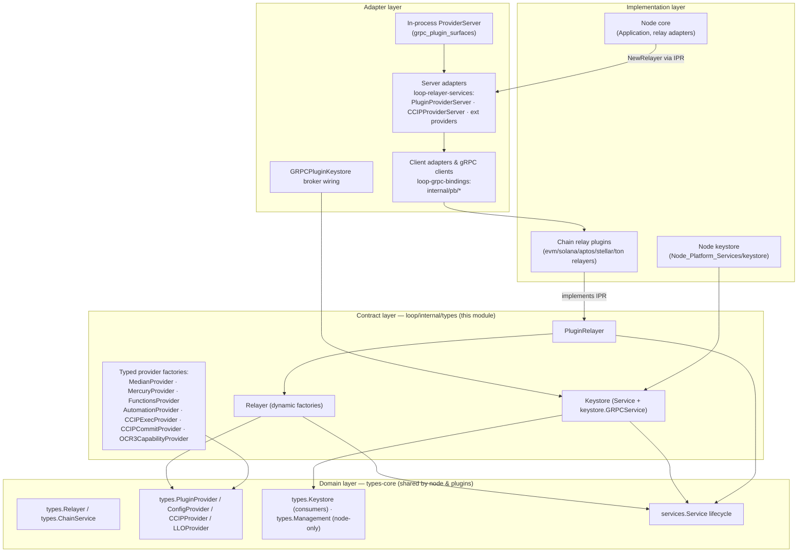
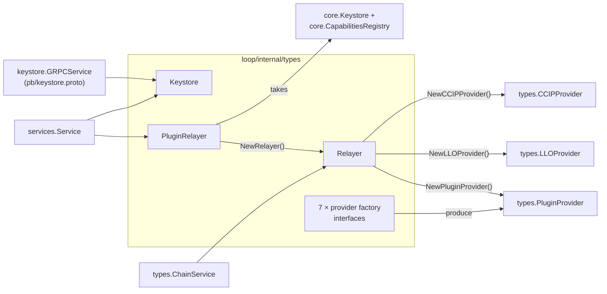
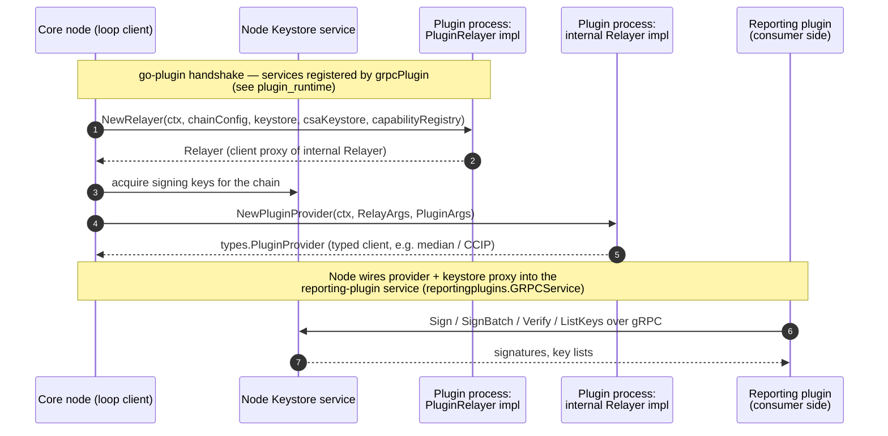

# loop-plugin-core: Interfaces (`loop-plugin-core_interfaces`)

> **Module path:** `chainlink-common/pkg/loop/internal/types` (file: `types.go`)
> **Parent:** [loop-plugin-core](../loop-plugin-core.md) · **Grandparent:** [Plugin Process Framework (Loop)](../Plugin_Process_Framework_(Loop).md)

## 1. Introduction

The **Loop** framework runs Chainlink *plugins* (chain relayers, reporting plugins, capabilities) in separate OS processes, communicating over gRPC via `hashicorp/go-plugin`. To do that safely, both sides of the process boundary need a shared vocabulary of **interface contracts** that are stable across the wire.

This module defines those contracts for the *core* plugin surfaces. It sits between two layers:

- **Upstream:** the domain interfaces of [types-core](../../Shared_Foundation_Libraries___Domain_Types/types-core.md) (`types.Relayer`, `types.PluginProvider`, `types.Keystore`, `services.Service`, `core.Keystore`, `core.CapabilitiesRegistry`, …), which both the node and plugins link against directly.
- **Downstream:** the generated protobuf/gRPC bindings ([loop-grpc-bindings](../loop-grpc-bindings.md)) and the client/server adapter implementations that satisfy these interfaces over gRPC ([loop-relayer-services](../loop-relayer-services.md), [gRPC plugin surfaces](grpc_plugin_surfaces.md)).

In short: **`loop/internal/types` is the "abstract contract layer" of loop-plugin-core.** Everything concrete — gRPC clients, gRPC servers, in-process fakes — is written against these interfaces, which keeps the wire protocol, the domain types, and the plugin implementations decoupled.

---

## 2. Component catalogue

The module is a single file, `chainlink-common/pkg/loop/internal/types/types.go`, containing pure interface declarations (no state, no logic):

| Interface | Role | Domain counterpart |
|---|---|---|
| `PluginRelayer` | Root factory implemented by every chain-relay plugin; creates the per-chain `Relayer` | — (loop-specific) |
| `Relayer` | Chain-scoped service surface with **dynamic** provider factories | `types.Relayer` / `types.ChainService` |
| `MedianProvider` | Factory for Mercury/OCR2 *median* providers | `types.MedianProvider` |
| `MercuryProvider` | Factory for Mercury feed providers | `types.MercuryProvider` |
| `FunctionsProvider` | Factory for Chainlink Functions providers | `types.FunctionsProvider` |
| `AutomationProvider` | Factory for Automation (upkeep) providers | `types.AutomationProvider` |
| `CCIPExecProvider` | Factory for CCIP execution providers | `types.CCIPExecProvider` |
| `CCIPCommitProvider` | Factory for CCIP commit providers | `types.CCIPCommitProvider` |
| `OCR3CapabilityProvider` | Factory for OCR3 capability providers | `types.OCR3CapabilityProvider` |
| `Keystore` | Transport-level keystore surface exposed to plugins | `types.Keystore` (consumers) + `types.Management` (node-only) |

### 2.1 `PluginRelayer`

```go
type PluginRelayer interface {
    services.Service
    NewRelayer(ctx context.Context, config string,
        keystore, csaKeystore core.Keystore,
        capabilityRegistry core.CapabilitiesRegistry) (Relayer, error)
}
```

- This is the **entry point of every relayer plugin**. A chain relay (e.g. `evm-relayer`, `solana-relayer`) ships a binary whose top-level service implements `PluginRelayer`; the node calls `NewRelayer` once per chain configuration.
- Arguments passed *from the node into the plugin*:
  - `config` — chain-specific configuration blob (JSON/TOML string).
  - `core.Keystore` (twice: the general keystore and the CSA keystore) and `core.CapabilitiesRegistry` — **node-side capability objects handed to the plugin as gRPC proxies**, so the plugin can sign data and discover capabilities without ever holding secrets in its own process.
- Because it embeds `services.Service`, the plugin's lifecycle (start/close/health) is managed uniformly by the node's service supervisor (see [types-core → Service](../../Shared_Foundation_Libraries___Domain_Types/types-core.md)).

### 2.2 `Relayer`

```go
// Relayer is like types.Relayer, but with a dynamic NewPluginProvider method.
type Relayer interface {
    types.ChainService

    EVM() (types.EVMService, error)
    TON() (types.TONService, error)
    Solana() (types.SolanaService, error)
    Aptos() (types.AptosService, error)
    Stellar() (types.StellarService, error)
    NewContractWriter(ctx, contractWriterConfig []byte) (types.ContractWriter, error)
    NewContractReader(ctx, contractReaderConfig []byte) (types.ContractReader, error)
    NewConfigProvider(ctx, types.RelayArgs) (types.ConfigProvider, error)
    NewPluginProvider(ctx, types.RelayArgs, types.PluginArgs) (types.PluginProvider, error)
    NewLLOProvider(ctx, types.RelayArgs, types.PluginArgs) (types.LLOProvider, error)
    NewCCIPProvider(ctx, types.CCIPProviderArgs) (types.CCIPProvider, error)
}
```

The doc-comment is the design intent: unlike the domain `types.Relayer` — which enumerates one constructor per product (`NewMedianProvider`, `NewMercuryProvider`, `NewFunctionsProvider`, `NewAutomationProvider`, `NewCCIPCommitProvider`, `NewCCIPExecProvider`, `NewOCR3CapabilityProvider`, …) — the loop-internal `Relayer` collapses all of those into **three dynamic factories**:

| Internal factory | Replaces (domain constructors) |
|---|---|
| `NewPluginProvider` | `NewMedianProvider`, `NewMercuryProvider`, `NewFunctionsProvider`, `NewAutomationProvider`, and future OCR2-style products |
| `NewLLOProvider` | Low-Latency Oracle provider construction |
| `NewCCIPProvider` | `NewCCIPCommitProvider` + `NewCCIPExecProvider` (via `types.CCIPProviderArgs`) |

**Why:** it means a new product provider can be added to the ecosystem **without widening the gRPC wire contract** — the `NewPluginProvider` RPC returns an opaque `types.PluginProvider` whose concrete flavour is negotiated by the adapter layer, while the typed factory interfaces below (§2.3) let Go code keep working with strongly-typed providers on either side of the wire.

Chain surface: `EVM()`, `TON()`, `Solana()`, `Aptos()`, `Stellar()` return chain-family service proxies. A relayer binary returns `ErrUnsupportedChain`-style errors for families it does not implement (e.g. the EVM relayer supports only `EVM()`). Reader/writer factories take implementation-defined `[]byte` configs — for EVM these are the `ContractReaderConfig`/`ContractWriterConfig` schemas documented in [types-chains](../../Shared_Foundation_Libraries___Domain_Types/types-chains.md).

### 2.3 Product provider factory interfaces

Each is a single-method interface mirroring the corresponding domain constructor:

```go
type MedianProvider interface {
    NewMedianProvider(context.Context, types.RelayArgs, types.PluginArgs) (types.MedianProvider, error)
}
// ...same shape for MercuryProvider, FunctionsProvider, AutomationProvider,
//    CCIPExecProvider (NewExecutionProvider), CCIPCommitProvider (NewCommitProvider),
//    OCR3CapabilityProvider (NewOCR3CapabilityProvider)
```

These interfaces are **not called by plugins directly**. They are the typing seams used by the adapter layer:

- **Server side (node / plugin-provided):** adapters such as `PluginProviderServer` (OCR2 median) and `CCIPProviderServer` in [loop-relayer-services](../loop-relayer-services.md) implement one or more of these factories and forward calls into the plugin's real provider implementations.
- **Client side (node → plugin proxies):** the generated gRPC clients in [loop-grpc-bindings](../loop-grpc-bindings.md) are wrapped so they satisfy the same factory interfaces, handing back domain-typed providers (`types.MedianProvider`, `types.CCIPExecProvider`, …) that transparently marshal over gRPC.
- **In-process mode:** `ProviderServer` (see [gRPC plugin surfaces](loop-plugin-core_grpc_plugin_surfaces.md)) lets the same adapters run without a socket for tests and embedded deployments.

### 2.4 `Keystore`

```go
// This interface contains all the keystore GRPC functionality. keystore.Keystore is
// meant to be exposed to consumers and the keystore.Management interface is exposed
// only to the core node.
type Keystore interface {
    services.Service
    keystore.GRPCService   // loop-internal keystore gRPC service (internal/pb/keystore.proto)
}
```

This is the **transport surface of the node keystore as seen by plugin processes**:

- The *consumer-facing* domain surface is `types.Keystore` — `Sign`, `SignBatch`, `Verify`, `VerifyBatch`, `ListKeys`, `RunUDF` (see [types-core](../../Shared_Foundation_Libraries___Domain_Types/types-core.md)).
- The *administrative* domain surface is `types.Management` — `ImportKey`/`ExportKey`/`CreateKey`/`DeleteKey`, tag and policy management — **which is never exposed across the plugin boundary**. Only the core node holds a `Management` implementation (see [Keystore platform service](../../Node_Platform_Services/keystore.md)).
- On the wire, `keystore.GRPCService` is backed by the protobuf service in `chainlink-common/pkg/loop/internal/pb/keystore.proto`. The hashicorp go-plugin broker wiring that hands this proxy into plugin processes is `GRPCPluginKeystore`, documented in [gRPC plugin surfaces](loop-plugin-core_grpc_plugin_surfaces.md).

---

## 3. Architecture

### 3.1 Layering



Key relationships:

- `PluginRelayer` → `Relayer`: one relayer plugin binary bootstraps many per-chain `Relayer` instances (one per chain `config`).
- `Relayer` → provider factories: a single `NewPluginProvider` RPC yields a provider that the adapter layer slices into typed views via `MedianProvider`/`CCIPExecProvider`/etc.
- `Keystore` is the **only** secret path: plugins call `Sign`/`Verify` through the proxy; keys never leave the node process.

### 3.2 Interface graph



---

## 4. Runtime flow

### 4.1 Plugin bootstrap and provider acquisition



Narrative:

1. **Handshake.** The node spawns the plugin binary; `grpcPlugin` (go-plugin) negotiates the gRPC connection and the set of brokered services — including `PluginRelayer` and the keystore service (see [Plugin runtime](loop-plugin-core_plugin_runtime.md)).
2. **Relayer construction.** `NewRelayer` passes chain config plus **node-capability proxies** (`core.Keystore`, CSA keystore, `core.CapabilitiesRegistry`). From here on, the plugin holds proxies, not implementations — every call round-trips to the node.
3. **Provider acquisition.** When a job starts (OCR2 median, CCIP commit/exec, Automation, …), the node's relay adapter (e.g. EVM `RelayAdapter`, see [node_application_relay](../../Node_Application_Core___Interfaces/node_application/node_application_relay.md)) calls `NewPluginProvider`/`NewCCIPProvider` with `RelayArgs` (chain-scoped) and `PluginArgs` (job-scoped). The adapter layer in [loop-relayer-services](../loop-relayer-services.md) returns a domain-typed provider whose methods marshal to the plugin process.
4. **Plugin-side consumption.** The reporting plugin running *in the same plugin process* receives the provider/keystore handles through its gRPC service surface ([gRPC plugin surfaces](loop-plugin-core_grpc_plugin_surfaces.md)) and signs reports via the `Keystore` proxy. The CCIP-specific provider stack this feeds is described in [CCIP](../../CCIP_Cross-Chain_Protocol/ccip.md).

### 4.2 Direction of dependencies

| Call direction | Examples | Mechanism |
|---|---|---|
| **Node → plugin** | `PluginRelayer.NewRelayer`, `Relayer.NewPluginProvider`, `NewContractReader/Writer`, `EVM()/Solana()/...` | Standard gRPC calls to services implemented by the plugin |
| **Plugin → node** | `Keystore.Sign/Verify`, capability registry lookups | Services **brokered** by go-plugin (e.g. `GRPCPluginKeystore`): the node hosts the server, the plugin gets the client |
| **Bypass (in-process)** | tests, embedded nodes | `ProviderServer` adapters registered instead of socket-backed ones |

---

## 5. Dependencies

### Upstream (this module imports)

| Package | Used for |
|---|---|
| `chainlink-common/pkg/types` | `ChainService`, `RelayArgs`, `PluginArgs`, `CCIPProviderArgs`, and all `*Provider` domain types |
| `chainlink-common/pkg/types/core` | `core.Keystore`, `core.CapabilitiesRegistry` (arguments of `NewRelayer`) |
| `chainlink-common/pkg/services` | `services.Service` lifecycle embedding |
| `chainlink-common/pkg/loop/internal/keystore` | `keystore.GRPCService` — the wire contract backing `Keystore` (proto: `internal/pb/keystore.proto`) |

### Downstream (who consumes these contracts)

| Consumer | Relationship |
|---|---|
| [Plugin runtime](loop-plugin-core_plugin_runtime.md) | `grpcPlugin` registers `PluginRelayer` and keystore services during the go-plugin handshake; `Plugin` tracks registered services |
| [gRPC plugin surfaces](loop-plugin-core_grpc_plugin_surfaces.md) | `GRPCPluginKeystore` (keystore broker), reporting-plugin `GRPCService`s, in-process `ProviderServer` |
| [loop-grpc-bindings](../loop-grpc-bindings.md) | Generated `internal/pb/*` services implementing/transporting these contracts (`UnsafeRelayerServer`, `UnsafeKeystoreServer`, `UnsafeReportingPluginFactoryServer`, …) |
| [loop-relayer-services](../loop-relayer-services.md) | Server/client adapters (`PluginProviderServer`, `CCIPProviderServer`, chain relayer-set servers) that satisfy the typed factory interfaces |
| Chain relays (`core/services/relay/*`, e.g. the EVM `RelayAdapter` in [node_application_relay](../../Node_Application_Core___Interfaces/node_application/node_application_relay.md)) | Implement `PluginRelayer`-shaped plugin binaries and consume `types.Relayer` on the node side |

---

## 6. Security boundary

- **Secrets stay in the node.** The plugin receives the `Keystore` transport interface only. `types.Management` (key import/export/create/delete, tags, policies) has **no** representation in this module and is never brokered into a plugin process; it exists only inside the node (see [Keystore platform service](../../Node_Platform_Services/keystore.md)).
- **Least-privilege capability injection.** `NewRelayer` receives exactly two keystores (general + CSA) and a read-oriented `core.CapabilitiesRegistry` — the plugin cannot enumerate or mutate anything else on the node.
- **Opaque configs.** `NewContractReader`/`NewContractWriter` accept `[]byte` configs whose schema is implementation-defined; validation therefore belongs to the consuming relay/chain layer, not to the wire contract.

---

## 7. Extension guide

**Adding a new chain family** (e.g. a new `FooService`):
1. Add the domain service type in `chainlink-common/pkg/types` ([types-core](../../Shared_Foundation_Libraries___Domain_Types/types-core.md)) and, if needed, chain RPC types ([types-chains](../../Shared_Foundation_Libraries___Domain_Types/types-chains.md)).
2. Add `Foo() (types.FooService, error)` to the internal `Relayer` **and** the domain `types.Relayer`.
3. Add the protobuf service + generated bindings ([loop-grpc-bindings](../loop-grpc-bindings.md)) and a relayer-set server/client ([loop-relayer-services](../loop-relayer-services.md)).

**Adding a new product provider** (e.g. a new OCR-style product):
1. Prefer the dynamic path: implement it behind `NewPluginProvider` and add a typed factory interface here only if Go-side code needs a distinct seam.
2. Implement the server adapter (e.g. alongside `PluginProviderServer`) and register it in the provider server construction; generate pb bindings under `internal/pb/`.
3. Wire node-side acquisition through the domain `types.Relayer` constructor so the node's relay adapters can request it.

---

## 8. Build & generation context

- All of this code lives in the **`chainlink-common` Go module** (`github.com/smartcontractkit/chainlink-common`, see `chainlink-common/go.mod`), which depends on `github.com/hashicorp/go-plugin` for the multiprocess transport — the reason these contracts must remain plain Go interfaces independent of any socket handling.
- The gRPC bindings backing `Keystore` (and every other loop surface) are generated from `.proto` files. Regeneration flows through the `chainlink-common` Makefile: `make generate` → `install-protoc` + `cre-protoc` (the custom `protoc-gen-cre` plugin built from `pkg/capabilities/v2/protoc`) → `go generate ./...` (see `chainlink-common/Makefile`).
- The interface in `internal/types` is intentionally dependency-light: it compiles against domain types and one internal keystore service, which is what lets node and plugin binaries — potentially built at different times — agree on a stable contract.

---

## 9. Related documentation

- [loop-plugin-core](../loop-plugin-core.md) — overview of the core loop plugin package
- [Plugin runtime](loop-plugin-core_plugin_runtime.md) — `Plugin`, `grpcPlugin`, go-plugin lifecycle and service registration
- [gRPC plugin surfaces](loop-plugin-core_grpc_plugin_surfaces.md) — `GRPCPluginKeystore`, reporting-plugin gRPC services, in-process `ProviderServer`
- [loopinstall](loop-plugin-core_loopinstall.md) — plugin binary installation models (`PluginConfig`, `ModDownloadResult`)
- [Query primitives](loop-plugin-core_query_primitives.md) — chain-agnostic query expression types used by contract readers
- [loop-grpc-bindings](../loop-grpc-bindings.md) — generated protobuf/gRPC layer
- [loop-relayer-services](../loop-relayer-services.md) — relayer/provider server & client adapters
- [types-core](../../Shared_Foundation_Libraries___Domain_Types/types-core.md) — domain interfaces these contracts mirror
- [Keystore](../../Node_Platform_Services/keystore.md) — node-side keystore implementation (the `Management` holder)
- [Node Application → Relay](../../Node_Application_Core___Interfaces/node_application/node_application_relay.md) — how the core node consumes loop relayers (`RelayAdapter`)
- [CCIP](../../CCIP_Cross-Chain_Protocol/ccip.md) — the largest consumer of the CCIP provider factories defined here
