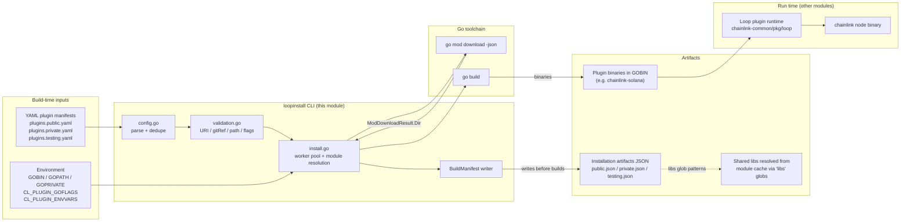
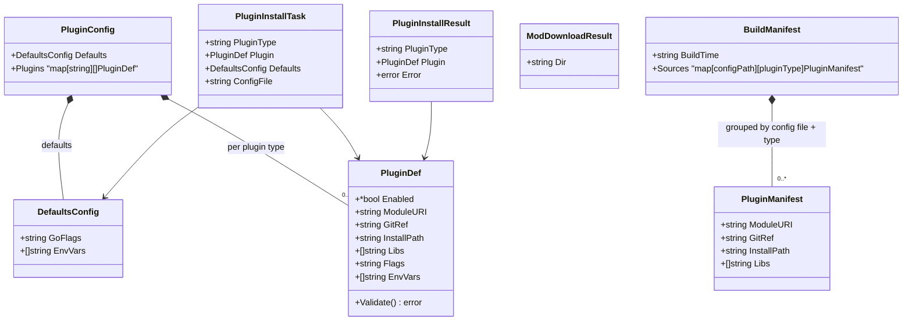
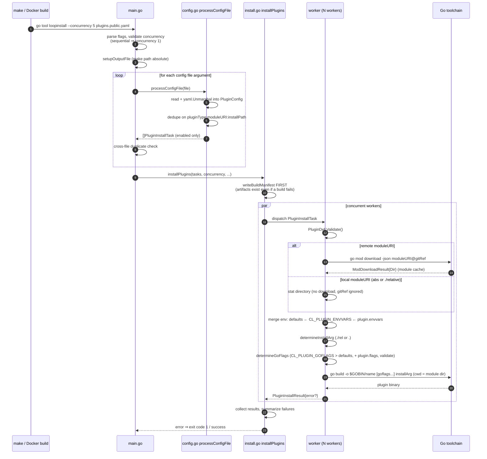
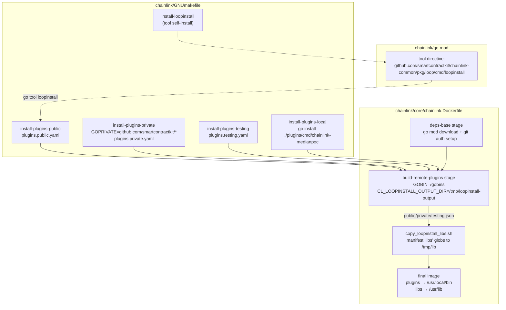

# loopinstall — LOOP Plugin Installer (`chainlink-common/pkg/loop/cmd/loopinstall`)

`loopinstall` is a standalone Go CLI tool that **builds and installs Chainlink LOOP plugin binaries ("LOOPP" binaries) from declarative YAML manifests**. It is the *build-time* counterpart of the Loop plugin process framework: the [Loop runtime](loop-plugin-core_plugin_runtime.md) loads and hosts plugin binaries as separate gRPC processes at node startup, while `loopinstall` is what fetches, compiles, and places those binaries on disk (and what records *what* was built, so shared libraries can be packaged with them).

- **Source root:** `chainlink-common/pkg/loop/cmd/loopinstall/`
- **Package type:** `main` (self-contained CLI; depends only on the Go toolchain, `gopkg.in/yaml.v3`, and `github.com/mattn/go-shellwords`)
- **Parent module:** [loop-plugin-core](../loop-plugin-core.md) — see also [gRPC plugin surfaces](loop-plugin-core_grpc_plugin_surfaces.md) and [interfaces](loop-plugin-core_interfaces.md)
- **Top-level area:** [Plugin Process Framework (Loop)](../Plugin_Process_Framework_(Loop).md)

---

## 1. Purpose and scope

### 1.1 Why a separate installer?

The Loop framework deliberately splits plugin code out of the `chainlink` node binary: each relayer/reporting plugin (median, solana, cosmos, CCIP tooling, …) ships as its own executable that the node launches and drives over gRPC (hashicorp `go-plugin`). Building these binaries *inside* the node repository would couple the node release cycle to every plugin's dependency tree. `loopinstall` breaks that coupling:

1. **Decoupled versioning** — each plugin pins its own `moduleURI` + `gitRef`, so a node image can mix plugin versions independently of the node version.
2. **Cacheable Docker builds** — because plugin manifests are plain YAML, the Docker build can compile *all remote plugins in a dedicated stage* that only invalidates when manifests or `go.mod`/`go.sum` change (source-only PRs skip the ~160s remote-plugin build — see `chainlink/core/chainlink.Dockerfile`, stage `build-remote-plugins`).
3. **Reproducible packaging metadata** — the tool emits a JSON *build manifest* that a later build step consumes to copy plugin-required shared libraries (e.g. CosmWasm `libwasmvm*.so`) into the final image.

### 1.2 What it does / does not do

| Does | Does not |
|---|---|
| Parse one or more YAML plugin manifests | Start or supervise plugins at runtime (see [plugin runtime](loop-plugin-core_plugin_runtime.md)) |
| Resolve remote modules via `go mod download -json` | Sign, key, or configure plugins |
| Resolve local modules (`/abs/path` or `./relative`) without network access | Publish artifacts to a registry (output is `GOBIN`) |
| Compile each plugin with `go build` into `$GOBIN` | Run inside the node process |
| Write a JSON build manifest (`--output-installation-artifacts`) | |
| Validate inputs and Go flags against command injection | |

---

## 2. Position in the system



The produced binaries are loaded by the [Loop plugin runtime](loop-plugin-core_plugin_runtime.md); the contract of what the node expects from those binaries is defined by the [core interfaces](loop-plugin-core_interfaces.md) and materialized over the wire by the [gRPC plugin surfaces](loop-plugin-core_grpc_plugin_surfaces.md).

---

## 3. Module layout

| File | Responsibility |
|---|---|
| `main.go` | CLI entrypoint: flag parsing, cross-file duplicate detection, help text |
| `config.go` | YAML manifest parsing (`processConfigFile`), per-file dedupe, `enabled` filtering |
| `install.go` | Module resolution (local/remote), flag & env composition, worker pool, `go build` invocation, manifest writing |
| `validation.go` | `PluginDef.Validate()` and `validateGoFlags` (command-injection guard) |
| `models.go` | All data structures (config, tasks, results, manifests) |
| `plugins.example.yaml` | Documented example manifest (feeds / cosmos / starknet) |
| `testdata/plugins.test.yaml` | Fixtures for tests |
| `main_test.go`, `install_test.go` | Unit tests; `install.go` exposes the `execCommand` variable as a seam for mocking `exec.Cmd` |

Core components of this module:

- [`chainlink-common/pkg/loop/cmd/loopinstall/models.go::PluginConfig`](https://github.com/smartcontractkit/chainlink-common/blob/main/pkg/loop/cmd/loopinstall/models.go) — root of the YAML schema
- [`chainlink-common/pkg/loop/cmd/loopinstall/models.go::ModDownloadResult`](https://github.com/smartcontractkit/chainlink-common/blob/main/pkg/loop/cmd/loopinstall/models.go) — parser for `go mod download -json` output

---

## 4. Data model

### 4.1 Configuration schema (YAML → structs)

```yaml
defaults:                # DefaultsConfig
  goflags: "-ldflags='-s'"
  envvars: []

plugins:                 # map[pluginType][]PluginDef
  cosmos:
    - moduleURI: "github.com/smartcontractkit/chainlink-cosmos"
      gitRef: "f740e9ae54e79762991bdaf8ad6b50363261c056"
      installPath: "./pkg/cosmos/cmd/chainlink-cosmos"
      libs:
        - "/go/pkg/mod/github.com/!cosm!wasm/wasmvm@v*/internal/api/libwasmvm.*.so"
      # enabled: false   # optional; omitted = enabled (pointer semantics)
```



Key semantics:

| Field / type | Semantics |
|---|---|
| `PluginDef.Enabled` | `*bool` pointer — **omitted ⇒ enabled**; `enabled: false` removes the plugin from the task list (`isPluginEnabled` in `config.go`) |
| `PluginDef.ModuleURI` | Remote Go module path (`github.com/org/repo[/submodule]`) **or** a local path (absolute, or `./relative`) |
| `PluginDef.GitRef` | Tag, branch or commit hash appended as `moduleURI@gitRef` for remote downloads; ignored (logged) for local modules |
| `PluginDef.InstallPath` | Package to build, relative to the module root (`./cmd/foo`); legacy absolute form `github.com/org/repo/cmd/foo` is normalized by `determineInstallArg` |
| `PluginDef.Libs` | Glob patterns for shared libraries inside the module cache; **not used by the build itself** — recorded in the build manifest and consumed later by `plugins/scripts/copy_loopinstall_libs.sh` during Docker builds |
| `PluginDef.Flags` / `EnvVars` | Per-plugin overrides appended on top of `defaults` |
| `ModDownloadResult` | Mirrors the `Dir` field of `go mod download -json` — the module cache directory used as the build working directory |
| `BuildManifest` | `{buildTime (RFC3339 UTC), sources: {abs-config-path: {pluginType: PluginManifest}}}` |

---

## 5. CLI interface

```
loopinstall [options] <plugin-config-file> [<plugin-config-file>...]
```

| Flag | Shorthand | Default | Effect |
|---|---|---|---|
| `--help` | `-h` | off | Print help |
| `--verbose` | `-v` | off | Per-plugin, per-worker logging |
| `--concurrency` | `-c` | `5` | Worker-pool size (must be ≥ 1) |
| `--sequential` | `-s` | off | Forces concurrency to 1 |
| `--output-installation-artifacts` | `-o` | *(unset)* | Absolute path for the JSON build manifest; nothing is written if omitted |

| Environment variable | Effect |
|---|---|
| `CL_PLUGIN_GOFLAGS` | **Replaces** `defaults.goflags` (per-plugin `flags` are still appended) |
| `CL_PLUGIN_ENVVARS` | Space-separated `KEY=VALUE` list merged over `defaults.envvars` (replace-or-append) |
| `GOPRIVATE` | Forwarded to `go mod download` and `go build` (private module access) |
| `GOBIN`, `GOPATH` | Output directory resolution: `$GOBIN` → `$GOPATH/bin` → `$HOME/go/bin` |

**Duplicate detection:** the identity key is `pluginType:moduleURI:installPath`. Duplicates *within* one file fail in `processConfigFile`; duplicates *across* the multiple config files passed on the command line fail in `main.go` with the two offending file names.

---

## 6. Installation pipeline



### 6.1 Stage details

**Config processing (`config.go`)**
- `processConfigFile` reads the file and unmarshals it into `PluginConfig` (`gopkg.in/yaml.v3`).
- Iterates `config.Plugins` (map of plugin type → list of `PluginDef`), skipping disabled entries, and attaches `config.Defaults` plus the originating `configFile` to each `PluginInstallTask`.
- `pluginKey` (`pluginType:moduleURI:installPath`) enforces uniqueness within the file.

**Module resolution (`install.go`)**
- Local (`filepath.IsAbs(uri)` or `./`-prefixed): `determineModuleDirectoryLocal` resolves and stats the directory — no network, no download; `gitRef` is ignored with a log message.
- Remote: `determineModuleDirectoryRemote` runs `go mod download -json <moduleURI>[@gitRef]`, optionally overriding `GOPRIVATE` in the child environment, parses stdout into `ModDownloadResult`, and rejects an empty `Dir`.

**Build composition (`install.go`)**
- `determineInstallArg` normalizes `installPath` to a package path relative to the module root (`.` or `./sub/pkg`), handling the legacy absolute `github.com/org/repo/cmd/x` form.
- Binary name = base of the install arg; for `.` it falls back to the base of `moduleURI` (or local directory name).
- Output path = `<GOBIN | $GOPATH/bin | $HOME/go/bin>/<binaryName>`.
- `determineGoFlags` precedence: `CL_PLUGIN_GOFLAGS` (replaces config defaults) → `defaults.GoFlags`; per-plugin `flags` are then **appended**; the combined string is shell-word-parsed (`go-shellwords`) and passed through `validateGoFlags`.
- The child `go build` inherits the full current environment, then `GOPRIVATE` (if set) and the merged plugin env vars are overlaid via `mergeOrReplaceEnvVars` (existing `KEY=` entries are replaced, new ones appended).

**Manifest (`writeBuildManifest`)**
- Written **before** builds start (so artifacts exist even if a later build fails).
- Groups `PluginManifest` entries by absolute config-file path and plugin type; records `ModuleURI`, `GitRef`, `InstallPath`, and `Libs` (only when non-empty).
- Directory created `0755`; file written `0600`; `buildTime` is RFC3339 UTC.

**Concurrency (`installPlugins`)**
- Buffered task and result channels; `concurrency` workers drain tasks; results are keyed with `pluginKey` and any error triggers a summary and a non-zero exit.

### 6.2 Validation and security (`validation.go`)

| Check | Rule |
|---|---|
| `validateModuleURI` | `^[\w./-]+(/[\w./-]+)*$` — Go module path shape |
| `validateGitRef` | `^[\w./-]+$` — safe git ref characters only |
| `validateInstallPath` | `^[.\w/-]+(/[\w./-]+)*$` — Go import path shape |
| `validateGoFlags` | Blacklist of injection vectors: `;`, `&&`, `||`, backtick, `$`, `|`, `<`, `>`, `#`, `//`, plus destructive command words (`shutdown`, `reboot`, `rm -`, `format`, `mkfs`, `dd`) |

`validateGoFlags` is the last line of defense before `go build` receives user-controlled flag text; flags are additionally parsed with `go-shellwords` so quoting is honored rather than interpolated by a shell.

---

## 7. Build, CI and Docker integration

The tool is wired into the node's build via three mechanisms (details on build targets: [chainlink build and tooling](../../Build,_CI___Release_Infrastructure/chainlink_build_and_tooling.md)):

1. **Go tool directive** — `chainlink/go.mod` declares
   `tool github.com/smartcontractkit/chainlink-common/pkg/loop/cmd/loopinstall`, enabling `go tool loopinstall` from the node module without a separate install step.
2. **Make targets** — `chainlink/GNUmakefile`:
   - `install-loopinstall` — `go install …cmd/loopinstall` (standalone install of the tool itself);
   - `install-plugins-public` — `go tool loopinstall --concurrency 5 ./plugins/plugins.public.yaml`, optionally with `--output-installation-artifacts $(CL_LOOPINSTALL_OUTPUT_DIR)/public.json`;
   - `install-plugins-private` — same for `plugins.private.yaml` with `GOPRIVATE=github.com/smartcontractkit/*` (requires GitHub auth);
   - `install-plugins-testing` — `plugins.testing.yaml`;
   - `install-plugins-local` — plain `go install ./plugins/cmd/chainlink-medianpoc` (kept outside `loopinstall` because it builds from the node source tree);
   - `install-plugins` — local + public.
3. **Docker multi-stage build** — `chainlink/core/chainlink.Dockerfile`:
   - Stage `build-remote-plugins` branches from `deps-base` (only `go.mod`/`go.sum` + manifest YAMLs needed) so source-only changes never invalidate the plugin layer;
   - It runs the make targets with `GOBIN=/gobins` and `CL_LOOPINSTALL_OUTPUT_DIR=/tmp/loopinstall-output`, passing `GIT_AUTH_TOKEN` as a build secret for private repos;
   - `plugins/scripts/copy_loopinstall_libs.sh` then reads the generated `public.json` / `private.json` / `testing.json` manifests and copies each plugin's `libs` glob matches into `/tmp/lib`;
   - The final image copies plugin binaries to `/usr/local/bin/` and the libs to `/usr/lib/`; the node selects plugin executables via env vars such as `CL_MEDIAN_CMD`, `CL_EVM_CMD`, `CL_SOLANA_CMD`.



> The repo also carries a `plugout` helper tool that manipulates the same `plugins/` manifests for module hygience — see [plugout](../../Build,_CI___Release_Infrastructure/plugout.md).

### Private repository access

For `plugins.private.yaml` style builds: authenticate git for Go module fetches (e.g. `gh auth setup-git`, or a CI HTTPS-token rewrite), and export `GOPRIVATE` with glob patterns (`github.com/myorg/*`) so the module proxy is bypassed. Inside Docker the equivalent is the `GIT_AUTH_TOKEN` secret plus the `GOPRIVATE=github.com/smartcontractkit/*` injected by the make targets. The module [README](https://github.com/smartcontractkit/chainlink-common/blob/main/pkg/loop/cmd/loopinstall/README.md) documents the developer workflow.

---

## 8. Extending the framework

To ship a new remote LOOP plugin:

1. Publish the plugin's Go module with a `main` package (it must expose the Loop gRPC contract — see [gRPC plugin surfaces](loop-plugin-core_grpc_plugin_surfaces.md) and [core interfaces](loop-plugin-core_interfaces.md)).
2. Append a `PluginDef` to the appropriate `plugins/*.yaml` manifest under a plugin-type key, pinning `gitRef` and setting `installPath`; add `libs` globs only if the plugin needs shared libraries at runtime.
3. No Makefile/Dockerfile changes are required — `install-plugins-public/private/testing` picks up new manifest entries automatically, and the manifest-driven `copy_loopinstall_libs.sh` handles new libs.

To iterate locally, point `moduleURI` at a local checkout (`./path` or an absolute path); loopinstall will build in place and ignore `gitRef`.

---

## 9. Related documentation

| Area | Page |
|---|---|
| Parent framework overview | [Plugin Process Framework (Loop)](../Plugin_Process_Framework_(Loop).md) |
| loop-plugin-core module map | [loop-plugin-core](../loop-plugin-core.md) |
| Runtime process hosting (`Plugin`, `grpcPlugin`) | [plugin runtime](loop-plugin-core_plugin_runtime.md) |
| Client/server gRPC surfaces | [gRPC plugin surfaces](loop-plugin-core_grpc_plugin_surfaces.md) |
| Node-side interfaces consumed by plugins | [interfaces](loop-plugin-core_interfaces.md) |
| Build targets and tooling | [chainlink build and tooling](../../Build,_CI___Release_Infrastructure/chainlink_build_and_tooling.md) |
| Plugin manifest maintenance tooling | [plugout](../../Build,_CI___Release_Infrastructure/plugout.md) |
