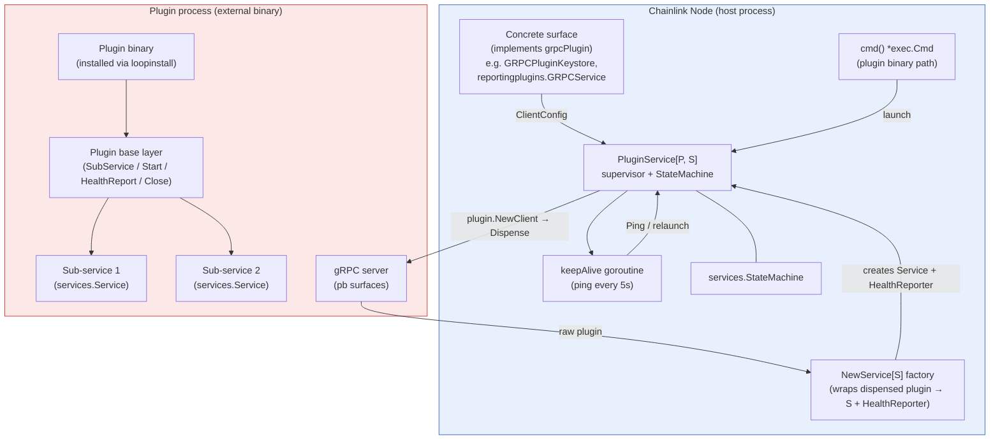
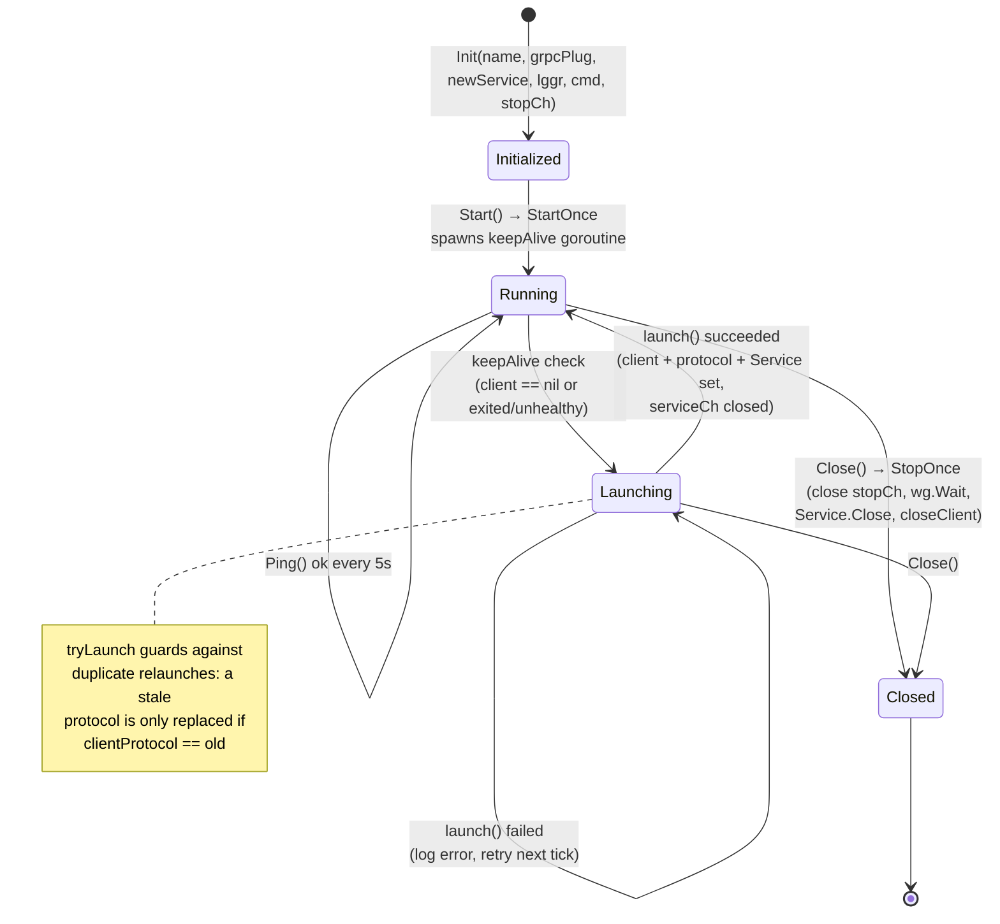
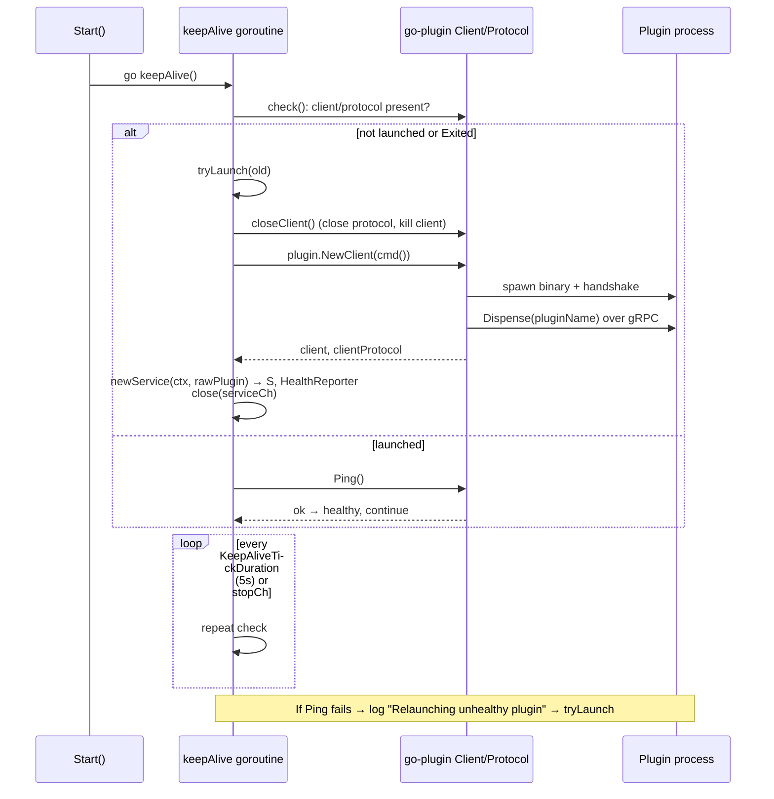

# Plugin Runtime (`loop-plugin-core_plugin_runtime`)

## 1. Overview

The **plugin runtime** module provides the execution machinery that lets the Chainlink node ("the host") run oracle **plugins** — such as relayers, median/OCR reporting plugins, and keystores — as **separate OS processes**, and gives those plugin binaries a **base layer for managing their own internal services**.

It consists of two complementary halves of the same runtime contract:

| Component | Location | Side | Responsibility |
|---|---|---|---|
| `grpcPlugin` / `PluginService[P, S]` | `chainlink-common/pkg/loop/internal/goplugin/plugin_service.go` | **Host** | Launches, supervises, and re-launches an external plugin process over gRPC (HashiCorp go-plugin). |
| `Plugin` | `chainlink-common/pkg/loop/plugin.go` | **Plugin** | A base layer that plugin implementations embed to register, start, and health-report their sub-services. |

Both halves are built on the shared lifecycle contracts from the [services](../../Shared_Foundation_Libraries___Domain_Types/services.md) foundation library (`services.Service`, `services.StateMachine`, `services.HealthReporter`, `services.StopChan`, `services.MultiStart`, `services.MultiCloser`), so a plugin's health and lifecycle are observable through the same interfaces used by every other node service.

## 2. Position in the System

This module is a child of [loop-plugin-core](../loop-plugin-core.md), the core of the [Plugin Process Framework (Loop)](../Plugin_Process_Framework_(Loop).md). Its relationship with sibling modules:

- **[gRPC plugin surfaces](loop-plugin-core_grpc_plugin_surfaces.md)** — the concrete `grpcPlugin` implementations (e.g. `GRPCPluginKeystore`, `reportingplugins.GRPCService`) that `PluginService` launches and supervises.
- **[Interfaces](loop-plugin-core_interfaces.md)** — the domain contracts (`types.Keystore`, `types.Relayer`, …) that are serialized across the process boundary managed here.
- **[loopinstall](loop-plugin-core_loopinstall.md)** — the installer that produces the plugin binaries this runtime executes (see `PluginConfig`/`PluginDef` manifests such as `plugins/plugins.public.yaml`).
- **[loop-grpc-bindings](../loop-grpc-bindings.md)** — the generated protobuf/gRPC service definitions that flow over the connections established by this runtime.
- **[loop-relayer-services](../loop-relayer-services.md)** — the server/client implementations (`PluginProviderServer`, `PluginProviderClient`, relayer sets) that consume `grpcPlugin.GRPCClientConn` connections.

Downstream consumers include the node application's relay layer ([node_application_relay](../../Node_Application_Core___Interfaces/node_application/node_application_relay.md)) and the shared domain types ([types-core](../../Shared_Foundation_Libraries___Domain_Types/types-core.md)).

## 3. Core Components

### 3.1 `grpcPlugin` and `PluginService[P, S]` (host side)

```go
type grpcPlugin interface {
    plugin.Plugin
    plugin.GRPCPlugin
    ClientConfig() *plugin.ClientConfig
}
```

`grpcPlugin` extends HashiCorp's go-plugin interfaces with a `ClientConfig()` accessor. Every concrete plugin surface (keystore, median, OCR3 reporting, CCIP, etc.) implements this interface; its `ClientConfig` tells the host how to spawn the plugin binary.

`PluginService[P grpcPlugin, S services.Service]` is a generic **supervisor service** that:

1. **Launches the plugin process** via go-plugin (`plugin.NewClient` → `ClientProtocol` → `Dispense(pluginName)`), using a caller-supplied `cmd func() *exec.Cmd` to resolve the executable.
2. **Defers service construction** — the dispensed raw plugin is transformed into a typed service `S` (and a root-level `HealthReporter`) by the injected `NewService[S]` factory. A `serviceCh` channel is closed once the service exists, allowing `Ready`/`HealthReport`/`Wait` to block until availability.
3. **Keeps the plugin alive** — a background `keepAlive` goroutine pings the client protocol every `KeepAliveTickDuration` (5s); on failure or process exit it closes the stale client and re-launches, replacing `s.client`/`s.clientProtocol` only if no other routine already did (guarded by the `tryLaunch` compare-and-swap).
4. **Exposes a standard service lifecycle** — `Start` (via `StartOnce`), `Close` (via `StopOnce`, joining service close and client teardown while ignoring benign `context.Canceled`/gRPC `codes.Canceled` errors), `Ready`, `Name`, `HealthReport`, `Wait`, and `WaitCtx`.
5. **Supports testing without races** — `XXXTestHook` returns a `TestPluginService` channel supporting `Kill` and `Reset` of the underlying client from tests.

The embedded `services.StateMachine` enforces correct start/stop state transitions.

### 3.2 `Plugin` (plugin side)

```go
type Plugin struct {
    Logger logger.Logger
    mu     sync.RWMutex
    ss     []services.Service
}
```

`Plugin` is the base layer that plugin binaries embed (it is designed for implementing `PluginRelayer` and `PluginMedian`-style servers). It:

- **Registers sub-services** through `SubService(s services.Service)`.
- **Starts them in order** with `services.MultiStart` (rolling back already-started services on failure).
- **Aggregates health** in `HealthReport()`, seeding the map with its own name and merging every sub-service's report via `services.CopyHealth`.
- **Closes in reverse** with `services.MultiCloser`.

It intentionally has a trivial `Ready()` (always nil) — readiness is delegated to the registered sub-services.

## 4. Architecture



## 5. Lifecycle and State

`PluginService` implements the full `services.Service` contract. The diagram below shows the state transitions and the interaction between `Start`, the keep-alive loop, deferred construction, and `Close`.



Key invariants:

- **Availability signaling**: `serviceCh` is closed exactly once, after the first successful `newService` construction. `Ready` returns `ErrPluginUnavailable` until then; `Wait`/`WaitCtx` block on it.
- **Graceful degradation of health**: `HealthReport` waits (up to 5s) for deferred construction and sub-service readiness, then merges the plugin's own `Healthy()` status with the root `HealthReporter`'s report.
- **Cancellation tolerance**: teardown joins errors but filters `context.Canceled` and gRPC `codes.Canceled`, which are expected during shutdown.

## 6. Keep-Alive / Self-Healing Flow



## 7. Component Interaction: Plugin Base and Sub-Services

On the plugin side, `Plugin` composes arbitrary sub-services into one lifecycle unit, which is what a plugin's gRPC service implementation (see [gRPC plugin surfaces](loop-plugin-core_grpc_plugin_surfaces.md)) typically embeds:

```mermaid
flowchart LR
    IMPL["Concrete plugin impl<br/>(e.g. PluginRelayer server)"] -->|embeds| P["Plugin"]
    P -->|SubService| A["Relayer service"]
    P -->|SubService| B["ContractReader/Writer services"]
    P -->|SubService| C["Telemetry / ErrorLog service"]
    P -->|Start: MultiStart| A & B & C
    P -->|Close: MultiCloser| A & B & C
    P -->|HealthReport: CopyHealth| A & B & C
    HOST["PluginService (host)"] -.->|lifecycle + health via gRPC<br/>(loop-grpc-bindings)| P

    style P fill:#e6f4ea,stroke:#338a3e
```

This two-sided design means the node's own service tree ([services](../../Shared_Foundation_Libraries___Domain_Types/services.md)) can treat a remote plugin exactly like any in-process service: start it, wait for readiness, poll its health report, and shut it down — while crashes inside the plugin process are healed by the keep-alive supervisor rather than taking down the node.

## 8. Build, Packaging, and Installation Context

The runtime executes binaries that are built and installed by the repository's tooling (see [chainlink_build_and_tooling](../../Build,_CI___Release_Infrastructure/chainlink_build_and_tooling.md)):

- `chainlink/GNUmakefile` defines `install-loopinstall` (installs the [loopinstall](loop-plugin-core_loopinstall.md) tool) and `install-plugins-public` / `install-plugins-private` / `install-plugins-testing` targets that run `go tool loopinstall` against `plugins/plugins.{public,private,testing}.yaml` manifests (modeled by `PluginConfig`).
- `CL_LOOPINSTALL_OUTPUT_DIR` optionally captures per-class installation artifacts (`public.json`, `private.json`, `testing.json`), which record which plugin binaries are available to be launched by `PluginService.cmd()`.
- Docker image builds (`make docker`, `make docker-ccip`) propagate `CL_INSTALL_PRIVATE_PLUGINS` / `CL_INSTALL_TESTING_PLUGINS` (requiring `GITHUB_TOKEN` for private modules), so container images bundle the plugin binaries the runtime will supervise.

## 9. Testing Support

- `XXXTestHook()` returns a `TestPluginService` channel that must be called once before `Start`. It supports:
  - `Kill()` — closes the client and protocol (the keep-alive loop will relaunch it), simulating a plugin crash.
  - `Reset()` — kills **and** clears `client`/`clientProtocol`, forcing a fresh launch.
- `Wait`/`WaitCtx` let tests block deterministically until the deferred service is constructed or the stop signal fires.

## 10. Related Documentation

- Parent: [loop-plugin-core](../loop-plugin-core.md)
- Siblings: [gRPC plugin surfaces](loop-plugin-core_grpc_plugin_surfaces.md) · [Interfaces](loop-plugin-core_interfaces.md) · [loopinstall](loop-plugin-core_loopinstall.md) · [Query primitives](loop-plugin-core_query_primitives.md)
- Framework: [loop-grpc-bindings](../loop-grpc-bindings.md) · [loop-relayer-services](../loop-relayer-services.md)
- Foundation contracts: [services](../../Shared_Foundation_Libraries___Domain_Types/services.md) · [types-core](../../Shared_Foundation_Libraries___Domain_Types/types-core.md)
