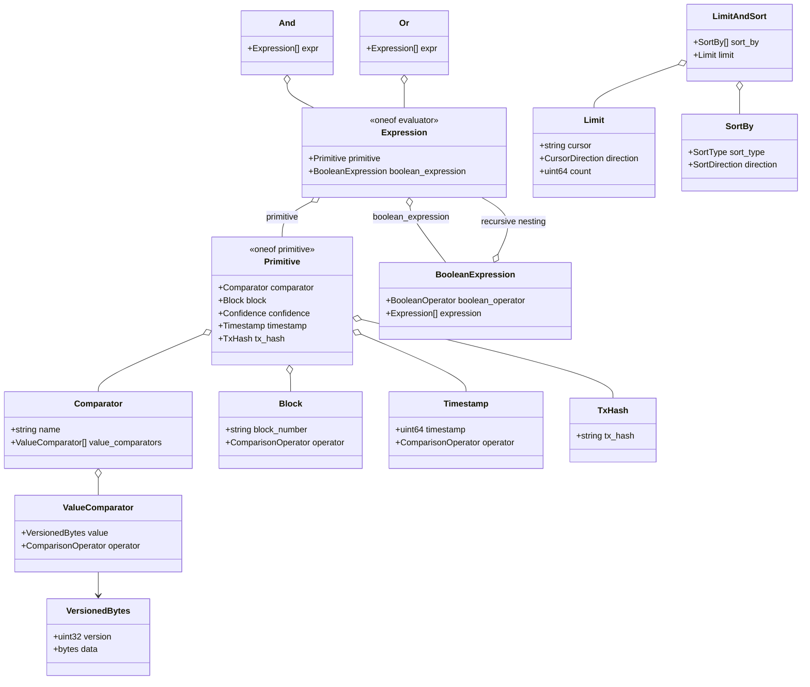
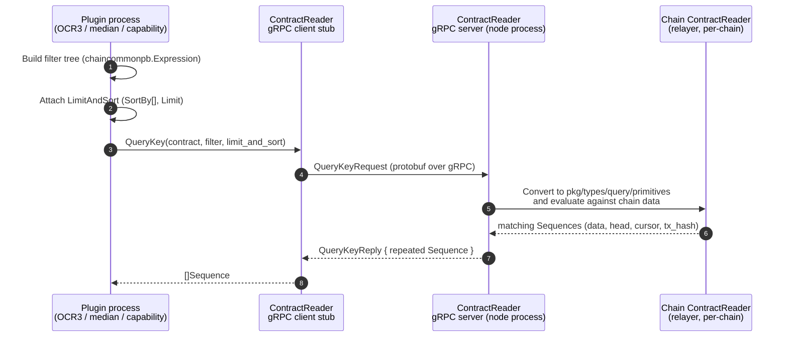
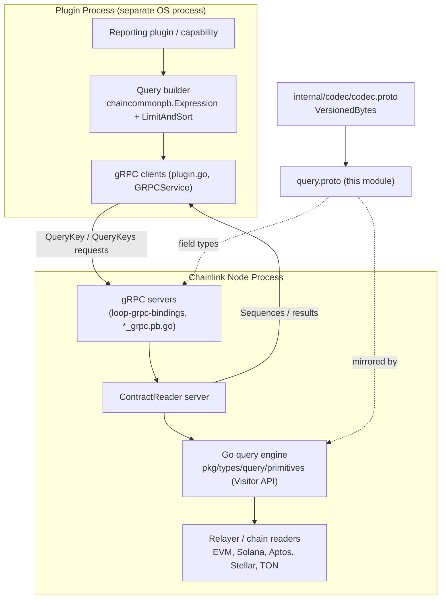
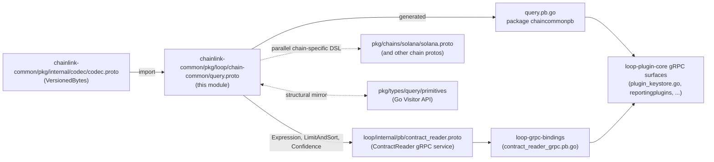

# loop-plugin-core / Query Primitives (`chain-common/query`)

## 1. Introduction

The `loop-plugin-core_query_primitives` module defines the **chain-agnostic query DSL** used to filter, sort, and paginate blockchain data across the Loop plugin process boundary. It consists of exactly two artifacts:

| File | Role |
|---|---|
| `chainlink-common/pkg/loop/chain-common/query.proto` | The single source of truth: a pure protobuf **data contract** (no services). |
| `chainlink-common/pkg/loop/chain-common/query.pb.go` | Generated Go bindings (package `chaincommonpb`). Header: *"Code generated by protoc-gen-go. DO NOT EDIT."* (protoc-gen-go v1.36.12, protoc v5.29.3). |

The DSL models a lightweight, ORM-like filter language built from **fundamental blockchain primitives** (block number, block confidence, timestamp, transaction hash, and named field comparators) combined into arbitrarily nested boolean expression trees, plus reusable **sorting and cursor-based pagination** criteria.

It has **no RPC surface of its own** (`NumServices: 0` in the generated descriptor). Instead, its messages are embedded as field types by other Loop protos — most prominently the `ContractReader` service (see [loop-grpc-bindings](../loop-grpc-bindings.md)) — so that every plugin ↔ node query exchange speaks one shared vocabulary regardless of chain family.

> **Module position:** This is a leaf module of [loop-plugin-core](../loop-plugin-core.md), which is itself part of the [Plugin Process Framework (Loop)](../../Plugin_Process_Framework_(Loop).md).

---

## 2. Design Goals

1. **Chain agnosticism** — filters are expressed in terms of universal blockchain concepts (`Block`, `Timestamp`, `TxHash`, `Confidence`), not chain-specific types. Block numbers and tx hashes are `string`-typed to accommodate differing per-chain representations (EVM hex quantities, Solana slots, etc.).
2. **Versioned payloads** — comparator values use `codec.VersionedBytes {version, data}` (from `chainlink-common/pkg/internal/codec/codec.proto`) so the binary encoding of compared values can evolve independently of the query wire format.
3. **Composability** — `Expression` is a recursive `oneof` (primitive *or* nested boolean expression), enabling arbitrarily deep filter trees while remaining a flat, serializable protobuf message.
4. **Round-trippability with idiomatic Go** — every proto construct has a counterpart in `chainlink-common/pkg/types/query/primitives` (a Go-native Visitor-pattern API, documented in [types-core](../../Shared_Foundation_Libraries___Domain_Types/types-core.md)). The proto types are the wire form; the Go types are the in-process form.

---

## 3. Data Model

### 3.1 Type Hierarchy



### 3.2 Filter Constructs

**`Expression`** — the top-level filter unit. Exactly one of:
- `primitive` → a leaf condition (see `Primitive`), or
- `boolean_expression` → an interior node combining child `Expression`s.

**`Primitive`** — one leaf of filter logic, exactly one of:

| Variant | Message | Semantics |
|---|---|---|
| `comparator` | `Comparator` | Compares a **named field** (e.g. a log field, event key, or contract-read key) against one or more values. `ValueComparator` pairs a `codec.VersionedBytes` value with a `ComparisonOperator`; multiple `value_comparators` under one `Comparator` express a disjunction over values. |
| `block` | `Block` | Block-number window condition (`block_number` + operator). |
| `confidence` | `Confidence` enum | Required confirmation level of the data. |
| `timestamp` | `Timestamp` | Unix-timestamp condition (uint64 + operator). |
| `tx_hash` | `TxHash` | Restrict results to a single transaction hash. |

**`BooleanExpression`** — `BooleanOperator` (`AND` / `OR`) applied to a list of child `Expression`s. Because children are themselves `Expression`s, arbitrary trees like `(A AND (B OR C))` are expressible. The flat `And` and `Or` messages in the proto are convenience combinators over the same child-list shape; `BooleanExpression` is the canonical nesting mechanism used by the generated oneof.

### 3.3 Enums

| Enum | Values |
|---|---|
| `ComparisonOperator` | `Eq`, `Neq`, `Gt`, `Lt`, `Gte`, `Lte` |
| `BooleanOperator` | `AND`, `OR` |
| `Confidence` | `Unconfirmed` (0), `Finalized` (1), `Safe` (2) |
| `CursorDirection` | `Preceding`, `Following` |
| `SortDirection` | `Asc`, `Desc` |
| `SortType` | `SortTimestamp`, `SortBlock`, `SortSequence` |

### 3.4 Sorting & Pagination Constructs

- **`SortBy`** — one sorting criterion: `SortType` ∈ {timestamp, block, sequence} × `SortDirection`. A query may supply multiple criteria (multi-key sort).
- **`Limit`** — result-count cap (`count`) with **optional cursor-based pagination**. `cursor` and `direction` are proto3 `optional` fields, so the generated Go struct holds pointers (`*string`, `*CursorDirection`) and accessors (`GetCursor()`, `GetDirection()`) fall back to zero values (`""`, `Preceding`) when unset. Absent cursor ⇒ "start of the result stream"; `Preceding`/`Following` pages backward/forward from the cursor.
- **`LimitAndSort`** — the composite request-scoped envelope: `repeated SortBy` + `Limit`. This is what consumer protos embed (e.g. `contract_reader.proto` → `QueryKeyRequest.limit_and_sort`, `QueryKeysRequest.limit_and_sort`).

---

## 4. Generated Oneof Wrappers (`query.pb.go`)

The two components `Expression_Primitive` and `Expression_BooleanExpression` are the **generated oneof wrapper structs** for `Expression.evaluator`. They exist so Go code can pattern-match the oneof safely:

```go
type isExpression_Evaluator interface{ isExpression_Evaluator() }

type Expression_Primitive struct {
    Primitive *Primitive `protobuf:"bytes,1,opt,name=primitive,proto3,oneof"`
}

type Expression_BooleanExpression struct {
    BooleanExpression *BooleanExpression `protobuf:"bytes,2,opt,name=boolean_expression,json=booleanExpression,proto3,oneof"`
}
```

- Both wrappers implement the unexported marker interface `isExpression_Evaluator`; the `Expression.Evaluator` field holds exactly one of them.
- Typed accessors `Expression.GetPrimitive()` and `Expression.GetBooleanExpression()` perform a checked type assertion on `Evaluator` and return `nil` when the other variant is set.
- Both wrapper types are registered in `OneofWrappers` for message type 0, which is what protobuf reflection/protojson use to map wire data ↔ wrapper structs.
- The identical mechanism is generated for `Primitive` (wrappers `Primitive_Comparator`, `Primitive_Block`, `Primitive_Confidence`, `Primitive_Timestamp`, `Primitive_TxHash`).

**Practical guidance:** when traversing a filter tree in Go, switch on the wrapper type rather than calling accessors repeatedly — this mirrors the Visitor pattern of the in-process API (§6).

---

## 5. Where the DSL Is Consumed

The primary consumer inside Loop is the **`ContractReader` gRPC service** (`chainlink-common/pkg/loop/internal/pb/contract_reader.proto`, part of [loop-grpc-bindings](../loop-grpc-bindings.md)):

```protobuf
// excerpt — contract_reader.proto
service ContractReader {
  rpc QueryKey(QueryKeyRequest) returns (QueryKeyReply) {}
  rpc QueryKeys(QueryKeysRequest) returns (QueryKeysReply) {}
  ...
}

message QueryKeyFilter {
  string key = 1;
  // Expressions are lightweight orm like DSL defined for filtering over
  // common blockchain primitives.
  repeated loop.chain.common.Expression expression = 2;
}

message QueryKeyRequest {
  BoundContract contract = 1;
  QueryKeyFilter filter = 2;
  loop.chain.common.LimitAndSort limit_and_sort = 3;
  bool as_value_type = 4;
}
```

The same `Expression`/`Primitive` vocabulary is also re-declared in chain-specific protos — e.g. `chainlink-common/pkg/chains/solana/solana.proto` carries parallel `Expression_BooleanExpression` / `Expression_Primitive` types for Solana-native querying. The `chain-common` definitions in this module are the shared, chain-neutral core of that pattern.

### 5.1 Query Lifecycle Across the Process Boundary



The DSL is only moved across the boundary — evaluation always happens in the node process against the chain-specific reader implementation (see [loop-relayer-services](../loop-relayer-services.md) for the relayer/provider plumbing and [loop-plugin-core_plugin_runtime](loop-plugin-core_plugin_runtime.md) for how the plugin process itself is launched).

### 5.2 Architectural Context



---

## 6. Relationship to the Go-Side Primitives API

The protobuf messages are the **wire form**; the node-side engine works with the Go-native types in `chainlink-common/pkg/types/query/primitives` (documented in [types-core](../../Shared_Foundation_Libraries___Domain_Types/types-core.md)). The mapping is structural:

| Proto (wire, `chaincommonpb`) | Go (in-process, `pkg/types/query/primitives`) | Notes |
|---|---|---|
| `Primitive` (oneof) | `Primitive` interface + `Visitor` interface | Go side uses the **Visitor pattern**: `Visitor` has one method per variant (`Comparator`, `Block`, `Confidence`, `Timestamp`, `TxHash`); each Go primitive implements `Accept(visitor)`. |
| `Comparator{Name, ValueComparators}` | `Comparator{Name string, ValueComparators []ValueComparator}` | Direct field correspondence. |
| `Block{block_number, operator}` | `Block{Block string, Operator ComparisonOperator}` | Field renamed `Block` on the Go side. |
| `Timestamp{timestamp, operator}` | `Timestamp{Timestamp uint64, Operator ComparisonOperator}` | |
| `TxHash{tx_hash}` | `TxHash{TxHash string}` | |
| `Expression` (oneof) | Composed via Go structs / visitor traversal | The oneof wrappers (`Expression_Primitive`, `Expression_BooleanExpression`) play the role the visitor plays in-process. |

Crossing the boundary therefore requires an adapter layer that converts `chaincommonpb` messages ↔ Go primitives (typically driven by the oneof wrappers on the encode side and the `Visitor` on the decode side). Keeping the two schemas field-identical is a maintenance invariant: **a change to `query.proto` must be reflected in `pkg/types/query/primitives` and vice versa.**

---

## 7. Dependency Graph



Key dependency notes:

- **Upstream:** the only import is `internal/codec/codec.proto` (the `VersionedBytes` message used by `ValueComparator.value`). The import path `"internal/codec/codec.proto"` implies a protoc include root at `chainlink-common/pkg/`.
- **Downstream:** consumer protos (`contract_reader.proto`, chain protos) and, transitively, every gRPC surface listed in [loop-plugin-core_grpc_plugin_surfaces](loop-plugin-core_grpc_plugin_surfaces.md) and the interface contracts in [loop-plugin-core_interfaces](loop-plugin-core_interfaces.md).

---

## 8. Worked Example

A plugin that wants "all `Transfer` events for a key, finalized, from block 100 onward, newest first, at most 50 per page, following a cursor":

```go
import chaincommonpb "github.com/smartcontractkit/chainlink-common/pkg/loop/chain-common"

filter := []*chaincommonpb.Expression{
    {Evaluator: &chaincommonpb.Expression_Primitive{
        Primitive: &chaincommonpb.Primitive{
            Primitive: &chaincommonpb.Primitive_Confidence{
                Confidence: chaincommonpb.Confidence_Finalized,
            },
        },
    }},
    {Evaluator: &chaincommonpb.Expression_Primitive{
        Primitive: &chaincommonpb.Primitive{
            Primitive: &chaincommonpb.Primitive_Block{
                Block: &chaincommonpb.Block{
                    BlockNumber: "100",
                    Operator:    chaincommonpb.ComparisonOperator_Gte,
                },
            },
        },
    }},
    {Evaluator: &chaincommonpb.Expression_BooleanExpression{ // (field = X OR field = Y)
        BooleanExpression: &chaincommonpb.BooleanExpression{
            BooleanOperator: chaincommonpb.BooleanOperator_OR,
            Expression: []*chaincommonpb.Expression{
                {Evaluator: &chaincommonpb.Expression_Primitive{Primitive: &chaincommonpb.Primitive{
                    Primitive: &chaincommonpb.Primitive_Comparator{Comparator: &chaincommonpb.Comparator{
                        Name:             "from",
                        ValueComparators: []*chaincommonpb.ValueComparator{{Value: addrX, Operator: chaincommonpb.ComparisonOperator_Eq}},
                    }},
                }}}},
                {Evaluator: &chaincommonpb.Expression_Primitive{Primitive: &chaincommonpb.Primitive{
                    Primitive: &chaincommonpb.Primitive_Comparator{Comparator: &chaincommonpb.Comparator{
                        Name:             "from",
                        ValueComparators: []*chaincommonpb.ValueComparator{{Value: addrY, Operator: chaincommonpb.ComparisonOperator_Eq}},
                    }},
                }}}},
            },
        },
    }},
}

limitAndSort := &chaincommonpb.LimitAndSort{
    SortBy: []*chaincommonpb.SortBy{{
        SortType:  chaincommonpb.SortType_SortBlock,
        Direction: chaincommonpb.SortDirection_Desc,
    }},
    Limit: &chaincommonpb.Limit{
        Cursor:    &cursor,                                        // nil ⇒ start of stream
        Direction: &following,                                    // CursorDirection_Following
        Count:     50,
    },
}
```

This tree is sent inside a `QueryKeyRequest` / `QueryKeysRequest` (see §5) and evaluated by the node-side reader.

---

## 9. Maintenance & Code Generation

`query.pb.go` must never be edited by hand. To regenerate after changing `query.proto`:

1. Install the pinned toolchain — `make install-protoc` in `chainlink-common/` installs `protoc` (version from `.tool-versions`), `protoc-gen-go` (version resolved from `go.mod`), and `protoc-gen-go-grpc` (see `chainlink-common/Makefile`, target `install-protoc`).
2. Run `make generate` (same Makefile), which drives the workspace-wide `go generate` pipeline (target `generate`); the `cre-protoc` target builds the repo-specific `protoc-gen-cre` plugin used by other protos in the workspace.

Consistency checklist for any schema change:

- [ ] `query.proto` updated (source of truth).
- [ ] `query.pb.go` regenerated (§9).
- [ ] Mirror types in `chainlink-common/pkg/types/query/primitives` reviewed (§6 invariant).
- [ ] Downstream consumers (`contract_reader.proto`, chain protos, relayer implementations) still compile and round-trip; see [loop-grpc-bindings](../loop-grpc-bindings.md) and [loop-relayer-services](../loop-relayer-services.md).

**Compatibility rules when evolving the schema:**

- Never renumber existing oneof variant tags or enum values (`proto3` wire compatibility).
- New `Primitive` variants / `SortType`s / `ComparisonOperator`s are **additive**; older nodes may not understand them — treat unknown oneof variants as unsupported filters rather than errors where evaluation can safely degrade.
- Prefer evolving the `version` field of `codec.VersionedBytes` over changing the meaning of `ValueComparator.value`.

---

## 10. Summary

| Aspect | Value |
|---|---|
| Module | `loop-plugin-core_query_primitives` |
| Files | `chainlink-common/pkg/loop/chain-common/query.proto`, `query.pb.go` |
| Go package | `chaincommonpb` |
| Nature | Pure protobuf data contract (no services) — a chain-agnostic filter/sort/paginate DSL |
| Depends on | `internal/codec/codec.proto` (`VersionedBytes`) |
| Consumed by | `contract_reader.proto` (ContractReader `QueryKey`/`QueryKeys`), chain-specific protos (e.g. `solana.proto`), Loop gRPC surfaces |
| In-process mirror | `chainlink-common/pkg/types/query/primitives` (Visitor-pattern API) |

## Related Documentation

- [Plugin Process Framework (Loop)](../../Plugin_Process_Framework_(Loop).md) — overall framework
- [loop-plugin-core](../loop-plugin-core.md) — parent module (plugin bootstrap, runtime, install)
- [loop-plugin-core_grpc_plugin_surfaces](loop-plugin-core_grpc_plugin_surfaces.md) — gRPC service surfaces that carry these types
- [loop-plugin-core_interfaces](loop-plugin-core_interfaces.md) — core Loop interfaces (`Keystore`, `Relayer`)
- [loop-plugin-core_plugin_runtime](loop-plugin-core_plugin_runtime.md) — plugin process lifecycle
- [loop-grpc-bindings](../loop-grpc-bindings.md) — generated gRPC bindings, including `ContractReader`
- [loop-relayer-services](../loop-relayer-services.md) — relayer/plugin-provider servers that evaluate queries
- [types-core](../../Shared_Foundation_Libraries___Domain_Types/types-core.md) — Go-side domain types, including the query primitives mirror
