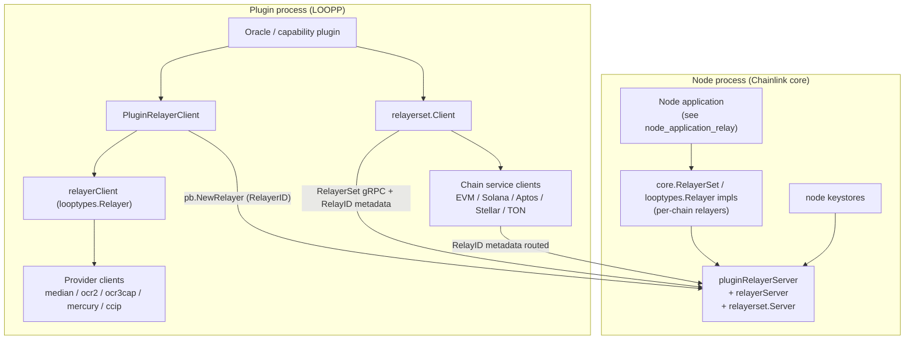
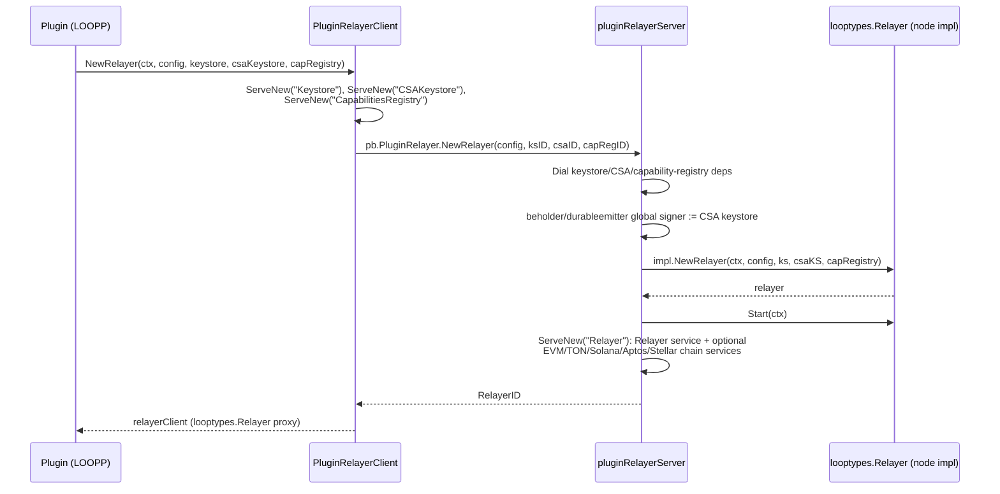
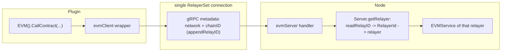

# Loop Relayer Services

> Part of the [Plugin Process Framework (Loop)](Plugin_Process_Framework_(Loop).md)

## 1. Purpose and Scope

`loop-relayer-services` (source root: `chainlink-common/pkg/loop/internal/relayer*`) implements the **relayer-facing services of the LOOPP plugin process framework**. In the Loop architecture, the Chainlink node and its plugins (reporting plugins, capabilities, CCIP/OCR/Median oracle plugins) run in **separate OS processes** connected by gRPC (hashicorp go-plugin). This module supplies the client/server adapter pairs that cross that boundary for everything "relayer"-shaped:

1. **Relayer bootstrapping** — `PluginRelayer` client/server: a plugin asks the node to instantiate a chain relayer on its behalf; the node hands the plugin relayer reverse connections to the plugin's **Keystores** (EVM + CSA) and **CapabilitiesRegistry**.
2. **Relayer lifecycle & provider factories** — `Relayer` client/server: head/chain-status queries, native `Transact`/`Replay`, and factories for `ContractReader`, `ContractWriter`, `ConfigProvider`, `PluginProvider`, and `CCIPProvider` instances, each served on its own managed gRPC connection.
3. **Typed plugin providers** — gRPC adapters for each product provider flavor: generic OCR2 `PluginProvider`, `MedianProvider`, `OCR3CapabilityProvider`, `MercuryProvider`, and CCIP commit/execution providers, including the libocr `ContractTransmitter`.
4. **RelayerSet multiplexing** — a single gRPC endpoint that fronts a map of relayers (one per `RelayID` = network + chain ID) and routes per-family chain RPCs (EVM, Solana, Aptos, Stellar, TON) by carrying the `RelayID` in gRPC context metadata.

The generated protobuf/gRPC bindings this module depends on are documented in [loop-grpc-bindings](loop-grpc-bindings.md); the plugin bootstrap mechanics (`goplugin`, brokers, `ServiceClient`/`ServiceServer`) in [loop-plugin-core](loop-plugin-core.md).

## 2. Position in the Loop Framework

Dependencies at a glance:

| Dependency | Provided by | Used for |
|---|---|---|
| `internal/pb/*` gRPC bindings | [loop-grpc-bindings](loop-grpc-bindings.md) | generated `Relayer`, `PluginRelayer`, provider, and chain service services |
| `goplugin` (ServiceClient, PluginClient, BrokerExt, ServeNew) | [loop-plugin-core](loop-plugin-core.md) | plugin process lifecycle, sub-connection brokering, resource cleanup |
| `types.*` domain interfaces (Relayer, PluginProvider, MedianProvider, CCIPProvider, chain services) | [types-core](../Shared_Foundation_Libraries___Domain_Types/types-core.md), [types-chains](../Shared_Foundation_Libraries___Domain_Types/types-chains.md) | the contract implemented locally and exposed remotely |
| `chainlink-common/pkg/chains/*` protos | [chain-grpc-protos](../Shared_Foundation_Libraries___Domain_Types/chain-grpc-protos.md) | per-family wire messages (EVM, Solana, Aptos, Stellar, TON) |
| `libocr` OCR2/OCR3 types | OCR stack ([ocr](../Oracle_Engines___Data_Pipelines/ocr.md)) | report codecs, transmitters digested over gRPC |

Consumers of this module: the oracle plugins of [Oracle Engines & Data Pipelines](../Oracle_Engines___Data_Pipelines/ocr.md) (median/OCR2/OCR3 providers), [CCIP Cross-Chain Protocol](../CCIP_Cross-Chain_Protocol/ccip.md) (CCIP provider + codecs), and the [Workflow & Capability Runtime](../Workflow___Capability_Runtime_(CRE_Engine)/core_capabilities_runtime.md) (capabilities registry plumbing). The node side wires real relayer implementations from the [Node Application Core](../Node_Application_Core___Interfaces/node_application.md) (`node_application_relay`) into these servers.

## 3. Architecture Overview

### 3.1 Component map

| Package | Key types | Role |
|---|---|---|
| `internal/relayer` | `PluginRelayerClient`, `pluginRelayerServer`, `relayerClient`, `relayerServer`, `WrapProviderClientConnection` | PluginRelayer/Relayer client-server pairs; provider factory dispatch; relayer bootstrap |
| `internal/relayer/pluginprovider/ocr2` | `PluginProviderClient`, `PluginProviderServer`, `ConfigProviderClient`, `contractTransmitterClient/Server` | Base OCR2 plugin-provider surface incl. libocr `ContractTransmitter` over gRPC |
| `internal/relayer/pluginprovider/ext/median` | `ProviderClient`, `ProviderServer` | `types.MedianProvider` (report codec, median contract, onchain config codec) |
| `internal/relayer/pluginprovider/ext/ocr3capability` | `ProviderClient`, `ProviderServer` | `types.OCR3CapabilityProvider` (OCR2 base + OCR3 transmitter) |
| `internal/relayer/pluginprovider/ext/ccipocr3` | `CCIPProviderClient`, `CCIPProviderServer` | `types.CCIPProvider` (chain accessor, OCR3 transmitter, CCIP OCR3 codec bundle) |
| `internal/relayer/pluginprovider/contractreader` | `interfaceTesterBase` (test) | shared ContractReader interface-conformance test harness |
| `internal/relayerset` | `Server`, `Client`, `readRelayID`/`appendRelayID`, `evmServer`, `solServer`, `aptosServer`, `tonServer`, `stellarServer` (+clients) | multi-relayer multiplexer with per-family chain service adapters |

### 3.2 Relayer bootstrap flow

Every gRPC sub-service in Loop is created lazily via `ServeNew`, which allocates a brokered sub-connection and registers handlers; resources are tracked for deterministic teardown.

Notes from the code:

- The **CSA keystore doubles as the auth signer**: `beholder.GetClient().SetSigner(...)` and `durableemitter.SetGlobalSigner(...)` are invoked server-side, so telemetry and durable queues emit signed messages.
- When serving the relayer, the server type-switches the implementation (`types.EVMService`, `types.TONService`, `types.SolanaService`, `types.AptosService`, `types.StellarService`) and registers the matching chain gRPC service, so unsupported families simply are not registered.
- Failures during dependency dialing or relayer start trigger `CloseAll` of already-created resources — the `net.Resource`/`net.Resources` bookkeeping from [loop-plugin-core](loop-plugin-core.md).

### 3.3 Provider creation and dispatch

`relayerServer.NewPluginProvider` and `relayerClient.WrapProviderClientConnection` implement a mirrored `switch` over `RelayArgs.ProviderType`, so each provider flavor has a server-side registration and a client-side reconstruction:

| ProviderType | Server-side registration | Client-side adapter |
|---|---|---|
| `Median` | `newMedianProvider` → `median.RegisterProviderServices` | `median.NewProviderClient` (+ `RmUnimplemented` probing) |
| `GenericPlugin` | `newPluginProvider` → `ocr2.RegisterPluginProviderServices` | `ocr2.NewPluginProviderClient` |
| `OCR3Capability` | `newOCR3CapabilityProvider` → `ocr3capability.RegisterProviderServices` | `ocr3capability.NewProviderClient` |
| `Mercury` | `newMercuryProvider` → OCR2 base + mercury services | `mercury.NewProviderClient` |
| `CCIPCommit` / `CCIPExecution` | `newCommitProvider`/`newExecProvider` → OCR2 base + ccip services | `ccip.NewCommitProviderClient`/`ccip.NewExecProviderClient` (⚠ known gap: BCF-3061) |
| `LLO` | — (client returns `errors.ErrUnsupported`) | — |

Capability checking is explicit: e.g. `newMedianProvider` type-asserts the node relayer to `looptypes.MedianProvider` and answers `codes.Unimplemented` if it is not. Every created provider is `Start`-ed on the server, registered via `ServeNew` (own sub-connection), and closed through the resource tracker.

`NewCCIPProvider` is richer: the plugin may serve an `ExtraDataCodecBundle` back to the relayer, and the `CCIPProviderClient.GetSyncRequests()` map is replayed server-side via `ChainAccessor().Sync(...)` to persist already-synced contract addresses across restarts. Details: [Plugin Providers](loop-relayer-services/loop-relayer-services_plugin_providers.md).

### 3.4 RelayerSet routing

A `core.RelayerSet` (see [types-core](../Shared_Foundation_Libraries___Domain_Types/types-core.md): `Get(ctx, RelayID)` / `List(...)`) is exposed as **one** gRPC service. Instead of per-relayer connections, chain RPCs are multiplexed by metadata:

- `appendRelayID` (client side) injects `network`/`chain` context values into every request; `readRelayID` (server side) decodes them, and `Server.getRelayer` resolves the matching `looptypes.Relayer` and returns its family service (e.g. `relayer.EVM()`).
- The `Server` struct owns one sub-server per family plus a contract-reader server; `RegisterRelayerSetServerWithDependants` wires them all. The `Client` mirrors this with per-family generated clients wrapped by the relay-ID attachers (`evmClient`, `solClient`, `aptosClient`, `stellarClient`, `tonClient`).
- Each family handler converts proto ⇄ Go types and enforces family-specific validation (e.g. Aptos 32-byte address length, TON filter registration, EVM uint8 signer bounds).

Full routing and per-family method coverage: [Relayer Set](loop-relayer-services/loop-relayer-services_relayerset.md).

## 4. Sub-modules

Detailed documentation is split by package boundary; each page lives in the `loop-relayer-services/` folder next to this file:

1. **[Relayer Orchestration](loop-relayer-services/loop-relayer-services_relayer.md)** (`loop-relayer-services/loop-relayer-services_relayer.md`) — `internal/relayer/relayer.go`: `PluginRelayerClient`/`pluginRelayerServer` bootstrap, `relayerClient`/`relayerServer`, provider-factory dispatch (`WrapProviderClientConnection`), CCIP provider wiring, standalone registration helpers.
2. **[Plugin Providers](loop-relayer-services/loop-relayer-services_plugin_providers.md)** (`loop-relayer-services/loop-relayer-services_plugin_providers.md`) — `internal/relayer/pluginprovider/...`: OCR2 base provider & libocr contract transmitter over gRPC; Median, OCR3-capability and CCIP-OCR3 ext providers; ContractReader interface test harness.
3. **[Relayer Set](loop-relayer-services/loop-relayer-services_relayerset.md)** (`loop-relayer-services/loop-relayer-services_relayerset.md`) — `internal/relayerset/...`: server/client multiplexer, RelayID metadata routing, and EVM/Solana/Aptos/Stellar/TON service adapters plus the gRPC round-trip conformance tests.

Each sub-module page links back to this overview and to the sibling [loop-plugin-core](loop-plugin-core.md) and [loop-grpc-bindings](loop-grpc-bindings.md) pages for the underlying plugin runtime and generated wire protocol.

## 5. Testing Strategy

- **In-process gRPC round-trips**: `relayerset_test.go` uses `plugin.TestPluginGRPCConn` to run a real client/server pair against mock relayers (`mocks.NewRelayer`, `mocks2.*Service`), exercising serialization, RelayID routing, and lifecycle (`Start/Close/Ready/HealthReport`) for every family — including edge cases like zero-address EOA forwarder lookups and `LiveUntilLedgerSeq` in Stellar ledger entries.
- **Interface conformance harness**: `pluginprovider/contractreader/helper_test.go` provides `interfaceTesterBase`, type providers keyed by read-name suffixes, and generated query-filter cases (comparators, confidence levels, boolean nesting) reused by per-chain ContractReader interface tests (companion to the interface tests in [types-core](../Shared_Foundation_Libraries___Domain_Types/types-core.md)).
- **Backwards-compat probing**: `median.ProviderClient.RmUnimplemented` calls `GetLatestValue`/`Decode` once and nils the readers when the remote returns `codes.Unimplemented`, letting old plugins interoperate with new relayers.

## 6. Related Modules

- [loop-plugin-core](loop-plugin-core.md) — plugin bootstrap, goplugin services, in-process provider server used for embedded relayers.
- [loop-grpc-bindings](loop-grpc-bindings.md) — the generated `pb`/`chains` services registered and wrapped throughout this module.
- [types-core](../Shared_Foundation_Libraries___Domain_Types/types-core.md) — `Relayer`, `RelayerSet`, `RelayArgs`/`PluginArgs`, provider interfaces, keystores.
- [types-chains](../Shared_Foundation_Libraries___Domain_Types/types-chains.md) — Go types for each chain family's service methods.
- [CCIP Cross-Chain Protocol](../CCIP_Cross-Chain_Protocol/ccip.md) — the CCIP OCR3 plugin that consumes `CCIPProvider`.
- [Node Application Core & Interfaces](../Node_Application_Core___Interfaces/node_application.md) — where node-side relayer implementations are created and started.
