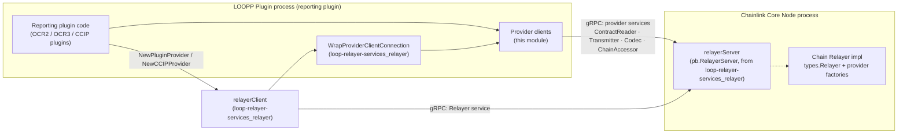
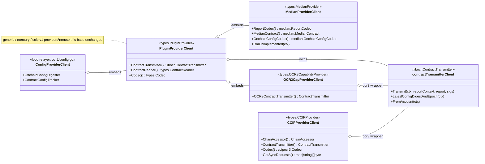
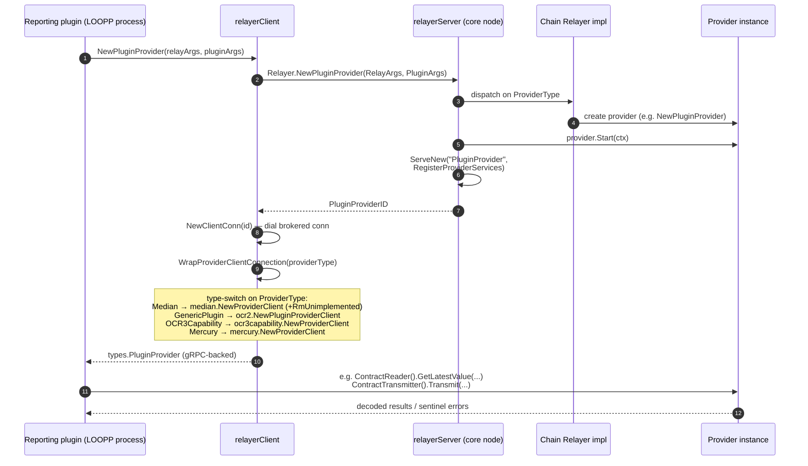
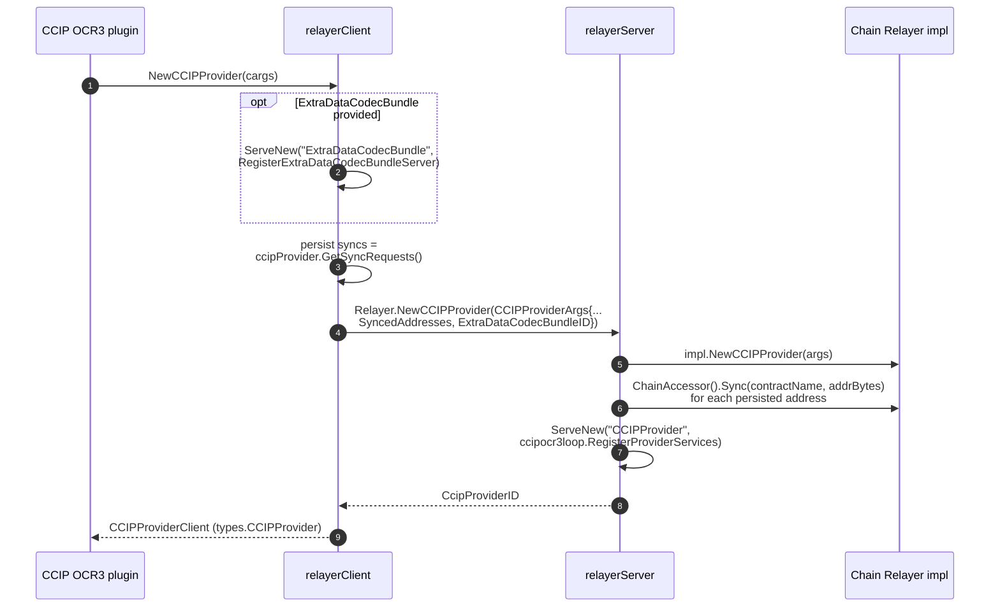
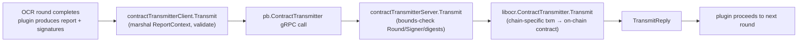
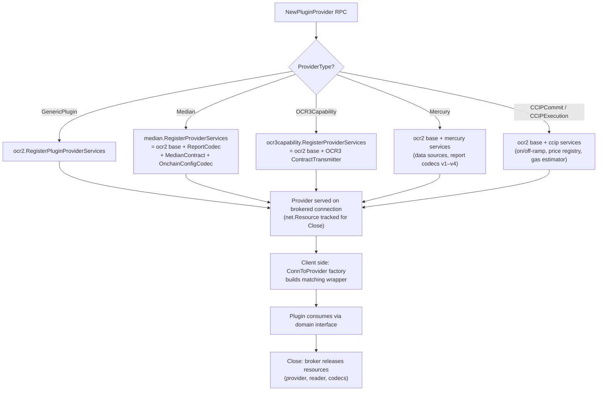
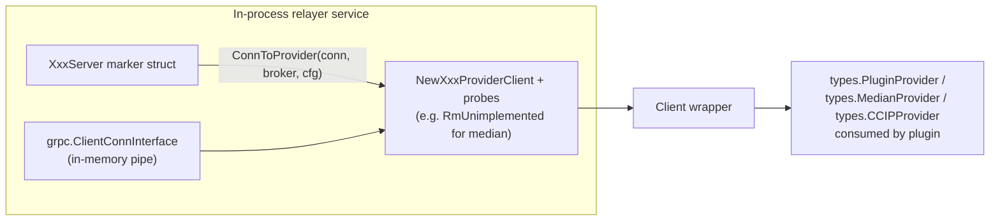

# Loop Relayer Services — Plugin Providers

> **Module path:** `chainlink-common/pkg/loop/internal/relayer/pluginprovider/...`
> **Parent module:** [Loop Relayer Services](../loop-relayer-services.md) · **Grandparent:** [Plugin Process Framework (Loop)](../../Plugin_Process_Framework_(Loop).md)

## 1. Introduction

The **plugin providers** module is the adaptation layer that exposes *chain-specific relayer capabilities* to reporting plugins running in separate processes. In the LOOP ("loop-plugin") framework, a reporting plugin is executed in its own OS process (a LOOPP), while the chain connectivity, keystore, and contract bindings live inside the Chainlink core node (or an in-process relayer). Plugins never touch these resources directly — they consume them as gRPC services.

This module supplies, for each product supported by the node:

- **Client wrappers** (`PluginProviderClient`, `ProviderClient`, `CCIPProviderClient`, …) that implement the domain interfaces from [`chainlink-common/pkg/types`](../../Shared_Foundation_Libraries___Domain_Types/types-core.md) — e.g. `types.PluginProvider`, `types.MedianProvider`, `types.OCR3CapabilityProvider`, `types.CCIPProvider` — by delegating every method call over gRPC.
- **Server adapters** (`contractTransmitterServer`, `reportCodecServer`, `medianContractServer`, …) that wrap a concrete relayer implementation and serve it on a brokered gRPC connection.
- **Registration entry points** (`RegisterProviderServices`) that compose the correct set of gRPC services for a given provider type.
- **Interface conformance test fixtures** (`interfaceTesterBase`) shared by all chain families (EVM, Solana, Aptos, Stellar, TON) to prove that error semantics and query behavior survive the process boundary.

The wire protocol itself (`.proto` definitions and generated gRPC stubs) is owned by the sibling module [Loop gRPC Bindings](../loop-grpc-bindings.md); this module only consumes those stubs. The generic plugin bootstrap/runtime is owned by [Loop Plugin Core](../loop-plugin-core.md).

### Why this module exists

Crossing a process boundary means every value must be serialized and every capability must be reachable via RPC. Naively, plugin authors would have to implement gRPC clients for OCR2/OCR3/CCIP types themselves. This module makes the process boundary *invisible*: a plugin receives an ordinary Go interface (`types.PluginProvider` and friends) whose methods happen to travel over gRPC. The [`ext/` README](https://github.com/smartcontractkit/chainlink-common/blob/main/pkg/loop/internal/relayer/pluginprovider/ext/README.md) states the intent directly:

> *"The subpackages herein contain the gRPC wrappers for custom `Providers`. Custom Providers are interfaces that abstract chain-specific operations. They are defined in `chainlink-common/pkg/types`, with the pattern `provider_xxx.go`."*

---

## 2. Architecture

### 2.1 Position in the system

```
Reporting Plugin process (LOOPP)                Chainlink Core Node process
┌────────────────────────────────┐              ┌─────────────────────────────────────────┐
│  OCR3/OCR2 reporting plugin    │              │  Chain-specific Relayer implementation  │
│        │                       │              │  (EVM / Solana / Aptos / Stellar / TON) │
│        ▼                       │              │        ▲                                │
│  relayerClient (loop-relayer)  │              │  relayerServer (loop-relayer)           │
│        │ WrapProviderClient…   │              │        │ newXxxProvider + Register…     │
│        ▼                       │              │        ▼                                │
│  ┌──────────────────────────┐  │    gRPC      │  ┌───────────────────────────────────┐  │
│  │ THIS MODULE              │◄─┼──────────────┼─►│ THIS MODULE                       │  │
│  │ provider clients         │  │  (brokered)  │  │ provider servers / registrators   │  │
│  └──────────────────────────┘  │              │  └───────────────────────────────────┘  │
└────────────────────────────────┘              └─────────────────────────────────────────┘
```

The [Loop Relayer](loop-relayer-services_relayer.md) module orchestrates provider creation and connection brokering; this module contains the per-provider-type adapters it dispatches to.



### 2.2 Client adapter composition hierarchy

The client wrappers are deliberately built by **composition over an inheritance-like chain**: the base OCR2 provider is extended by each product family.



Key structural facts:

| Provider type | Client wrapper | Extends | Extra capabilities served |
|---|---|---|---|
| `GenericPlugin` | `ocr2.PluginProviderClient` | `ConfigProviderClient` | ContractTransmitter, ContractReader, Codec |
| `Median` | `median.ProviderClient` | `ocr2.PluginProviderClient` | + ReportCodec, MedianContract, OnchainConfigCodec |
| `OCR3Capability` | `ocr3capability.ProviderClient` | `ocr2.PluginProviderClient` | + OCR3 generic `ContractTransmitter[[]byte]` |
| `Mercury` | `mercury.ProviderClient` | `ocr2.PluginProviderClient` | + report codecs v1–v4, data sources |
| `CCIPCommit` / `CCIPExecution` | `ccip.ProviderClient` (v1) | — | on/off-ramp readers, gas price estimators, price registries |
| `CCIPProvider` (OCR3) | `ccipocr3.CCIPProviderClient` | `goplugin.ServiceClient` | ChainAccessor, OCR3 transmitter, full codec bundle |

---

## 3. Component Reference

### 3.1 `ocr2/plugin_provider.go` — base OCR2 plugin provider

The foundational adapter for every OCR2-style provider.

- **`PluginProviderClient`** — implements `types.PluginProvider` (i.e. `ConfigProvider` + `ContractTransmitter()` + `ContractReader()` + `Codec()`), and `goplugin.GRPCClientConn` (inherited from `ConfigProviderClient` so nested clients can create further brokered sub-connections).
  - `NewPluginProviderClient(b *net.BrokerExt, cc net.ClientConnInterface)` wires together:
    - an embedded `ConfigProviderClient` (serving `libocr.OffchainConfigDigester` and `libocr.ContractConfigTracker` over RPC — see the relayer module),
    - a `contractTransmitterClient` backed by `pb.ContractTransmitterClient`,
    - a `contractreader.Client` (types.ContractReader) and `contractreader.NewCodecClient` (types.Codec).
- **`PluginProviderServer`** — despite the name, this is an **empty marker struct whose `ConnToProvider` method is a factory** that builds a client wrapper from a gRPC connection:

  ```go
  func (p PluginProviderServer) ConnToProvider(conn grpc.ClientConnInterface,
      broker net.Broker, brokerCfg net.BrokerConfig) types.PluginProvider
  ```

  This pattern supports *in-process relayers* (e.g. the embedded Mercury relayer service), which satisfy the same `ProviderServer` interface contract (`Start`, `Close`, `GetConn` — see [Loop Plugin Core](../loop-plugin-core.md)) but construct clients over an in-memory connection instead of a socket. **Naming convention across the module:** exported `XxxServer` structs are *factories*; the actual gRPC service adapters are the unexported `xxxServer` structs registered by `RegisterXxxServices`.

### 3.2 `ocr2/contract_transmitter.go` — OCR2 report transmission

Implements `libocr.ContractTransmitter` across the boundary in both directions:

- **`contractTransmitterClient`** (client side):
  - `Transmit` — marshals `ReportContext` (32-byte `ConfigDigest`, `Epoch`, `Round`), the report, and `AttributedOnchainSignature`s into `pb.TransmitRequest`.
  - `LatestConfigDigestAndEpoch` — validates the reply digest is exactly 32 bytes (`pb.ErrConfigDigestLen`).
  - `FromAccount` — returns the chain account string for the transmitting oracle.
- **`contractTransmitterServer`** (server side, `pb.ContractTransmitterServer`) — mirrors the client with strict bounds checking before invoking the real implementation: digest/extra-hash lengths must be 32, and `Round`/`Signer` must fit in `uint8` (`pb.ErrUint8Bounds`).

This strict validation is deliberate: libocr types use fixed-size arrays and `uint8` oracle IDs, and deserialization must never silently truncate.

### 3.3 `ext/median/median.go` — Median (data feeds) provider

`ProviderClient` composes the OCR2 base plus three median-specific surfaces:

- `reportCodecClient` ↔ `pb.ReportCodecServer` — `BuildReport`, `MedianFromReport`, `MaxReportLength` over `median.ParsedAttributedObservation` (values, JuelsPerFeeCoin, gas price subunits, observer ID).
- `medianContractClient` ↔ `pb.MedianContractServer` — `LatestTransmissionDetails`, `LatestRoundRequested` (with `time.Duration` lookback marshalled as int64 nanoseconds; timestamps via `timestamppb`).
- `onchainConfigCodecClient` ↔ `pb.OnchainConfigCodecServer` — `Encode`/`Decode` of min/max bounds.

Notable behaviors:

- **`RmUnimplemented(ctx)`** — backward compatibility probe. The client calls `ContractReader.GetLatestValue` and `Codec.Decode` with dummy arguments; if gRPC replies with `codes.Unimplemented`, the corresponding field is set to `nil`. This lets newer plugins interoperate with older relayers that predate the reader/codec surfaces. It is invoked automatically by `ProviderServer.ConnToProvider` and by `WrapProviderClientConnection` when the provider type is `Median`.
- **`RegisterProviderServices(s *grpc.Server, provider types.MedianProvider)`** — registers the OCR2 base services *plus* the three median servers. Registration composition is how the module expresses "provider = base + extensions".

### 3.4 `ext/ocr3capability/capability.go` — OCR3 capability provider

The thinnest extension: `ProviderClient` embeds the OCR2 base and adds an `ocr3types.ContractTransmitter[[]byte]` (the generic OCR3 transmitter, reused by CCIP OCR3). `RegisterProviderServices` composes `ocr2.RegisterPluginProviderServices` + `ocr3pb.RegisterContractTransmitterServer`. Implements `types.OCR3CapabilityProvider`.

### 3.5 `ext/ccipocr3/ccip_provider.go` — CCIP OCR3 provider

Unlike the median/ocr3 wrappers, `CCIPProviderClient` does **not** embed the OCR2 base; it embeds `goplugin.ServiceClient` and assembles the CCIP-specific surface:

- **`ChainAccessorClient`** — contract-address resolution with `Sync` support; `GetSyncRequests()` is exposed on the client and returns `map[string][]byte` (converted from `ccipocr3.UnknownEncodedAddress`) so resolved addresses can be persisted and re-seeded after plugin restarts.
- **Contract transmitter** — reuses the OCR3 transmitter from 3.4.
- **Codec bundle** — six gRPC-backed components returned as a struct literal of `ccipocr3.Codec`: `ChainSpecificAddressCodec`, `CommitPluginCodec`, `ExecutePluginCodec`, `TokenDataEncoder`, `SourceChainExtraDataCodec`, `MessageHasher`.

`RegisterProviderServices` registers all of these plus the base `Service` (liveness) — see the CCIP sequence below for how the [CCIP domain types](../../CCIP_Cross-Chain_Protocol/types-ccip.md) flow across it.

### 3.6 `contractreader/helper_test.go` — interface conformance harness

`interfaceTesterBase` is the shared fixture embedded by every chain family's contract-reader test suite (in-process *and* over-loop variants):

- `GetAccountBytes` / `GetAccountString` / `Name()` — stable identity constants for both transport variants.
- `fakeTypeProvider` / `testProtoConversionTypeProvider` — implement `types.ContractTypeProvider`, mapping read names to Go types (structs, slices, `[2]T` arrays, comparator-augmented types, event payloads) so CBOR/proto conversion can be exercised end-to-end.
- `generateQueryFilterTestCases` — enumerates the wire-supported expression grammar: `TxHash`, `Block(n, op)`, `Timestamp(n, op)`, `Comparator` (int/string value comparators), `Confidence` (Finalized/Unconfirmed/Safe), and nested `And`/`Or` boolean expressions — matching the primitives defined in [Loop Plugin Core → Query primitives](../loop-plugin-core/loop-plugin-core_query_primitives.md).
- `errorTypes` — the sentinel errors (`ErrInvalidEncoding`, `ErrInvalidType`, `ErrFieldNotFound`, `ErrSliceWrongLen`, `ErrNotASlice`, `ErrNotFound`) that **must survive the gRPC boundary with identity preserved**; suites assert these come back unchanged from remote calls, which is the contract that lets plugin code branch on `errors.Is`.

---

## 4. Data Flow

### 4.1 Provider establishment (generic plugin / median / OCR3 / mercury)



### 4.2 CCIP OCR3 provider establishment (with codec bundle & sync replay)



### 4.3 Report transmission path (runtime steady state)



---

## 5. Process Flows

### 5.1 Server-side registration dispatch

`relayerServer.NewPluginProvider` (in [Loop Relayer](loop-relayer-services_relayer.md)) switches on `RelayArgs.ProviderType` and fails with `Unimplemented` if the relayer implementation does not support the requested family. The registration composition per type is the module's contract surface:



### 5.2 In-process factory pattern

Embedded relayers (e.g. the in-process Mercury relayer) satisfy `ProviderServer` as defined in [Loop Plugin Core](../loop-plugin-core.md) — `Start(ctx)`, `Close()`, `GetConn() (grpc.ClientConnInterface, error)` — and use the empty marker structs' `ConnToProvider` to reuse the exact same client code over an in-memory connection:



---

## 6. Relationships to Other Modules

| Related module | Relationship |
|---|---|
| [Loop Relayer Services](../loop-relayer-services.md) | Parent module; owns lifecycle and connection brokering around these adapters. |
| [Loop Relayer](loop-relayer-services_relayer.md) | Calls `RegisterProviderServices` (server side) and `WrapProviderClientConnection` → `NewXxxProviderClient` (client side); passes `net.BrokerExt` and typed args. |
| [Loop Relayer Set](loop-relayer-services_relayerset.md) | Per-chain servers (evm, solana, aptos, stellar, ton) that host these providers for multi-chain relayer sets (`types.RelayerSet` from [types-core](../../Shared_Foundation_Libraries___Domain_Types/types-core.md)). |
| [Loop gRPC Bindings](../loop-grpc-bindings.md) | Owns the protobuf schema and generated stubs consumed here: [`relayer-oracle`](../loop-grpc-bindings/loop-grpc-bindings_relayer-oracle.md), [`ocr-reporting`](../loop-grpc-bindings/loop-grpc-bindings_ocr-reporting.md), [`ccip`](../loop-grpc-bindings/loop-grpc-bindings_ccip.md). |
| [Loop Plugin Core](../loop-plugin-core.md) | `goplugin.ServiceClient/ServiceServer`, `GRPCClientConn`, and the `ProviderServer` contract (`Start`/`Close`/`GetConn`) used for in-process factories; query primitives tested by `interfaceTesterBase`. |
| [Shared Foundation — types-core](../../Shared_Foundation_Libraries___Domain_Types/types-core.md) | Source of truth for the domain interfaces implemented here (`PluginProvider`, `MedianProvider`, `OCR3CapabilityProvider`, `CCIPProvider`, `Relayer`, `RelayerSet`). |
| [Shared Foundation — types-chains](../../Shared_Foundation_Libraries___Domain_Types/types-chains.md) | Chain-family service types surfaced through the relayer set. |
| [CCIP types](../../CCIP_Cross-Chain_Protocol/types-ccip.md) | `ccipocr3` plugin types (ChainAccessor, codecs, MessageHasher) marshalled by the CCIP provider adapter. |
| [Node Application — Relay](../../Node_Application_Core___Interfaces/node_application/node_application_relay.md) | The core node's `RelayAdapter` is a concrete `types.Relayer` whose provider factories are ultimately exposed through this module. |

---

## 7. Build & Packaging Context

- The module lives in the Go module `github.com/smartcontractkit/chainlink-common` (`chainlink-common/go.mod`), which pulls the LOOP runtime dependencies: `github.com/hashicorp/go-plugin` (LOOPP process supervision), `google.golang.org/grpc`, and `github.com/smartcontractkit/libocr` (the OCR2/OCR3 types wrapped here).
- Because reporting plugins are separate binaries, the chainlink build produces them via the `install-plugins`, `install-plugins-public`, and `install-plugins-private` targets in `chainlink/GNUmakefile`; everything those plugin binaries can do against the chain is mediated by this module's adapters over the brokered connections established by [Loop Relayer](loop-relayer-services_relayer.md).

---

## 8. Extension Notes for Maintainers

1. **Adding a new provider type** (`provider_xxx.go` in `pkg/types`):
   - Create `ext/<name>/` with a `ProviderClient` (embed `ocr2.PluginProviderClient` or `goplugin.ServiceClient`), an exported marker `ProviderServer` with `ConnToProvider`, and a `RegisterProviderServices` composition.
   - Wire both sides of the type-switch: client `WrapProviderClientConnection` and server `relayerServer.NewPluginProvider` in [Loop Relayer](loop-relayer-services_relayer.md).
   - Add the corresponding service registration to [Loop gRPC Bindings](../loop-grpc-bindings.md).
2. **Never weaken wire-bound validation.** The 32-byte digest and `uint8` Round/Signer checks in the transmitter adapters mirror libocr's invariants; a silent truncation here would produce on-chain corruption rather than an error.
3. **Preserve sentinel error identity** (see `errorTypes` in the test harness) when adding new client methods — plugins rely on `errors.Is` against `types.Err*`.
4. **Keep `RmUnimplemented`-style probes** for any surface added to an existing provider, so plugins built against newer `chainlink-common` versions degrade gracefully against older relayers.
5. **Reuse rather than fork**: OCR3's transmitter is shared by both `ocr3capability` and `ccipocr3`; prefer embedding the OCR2 base over re-implementing ConfigProvider plumbing.