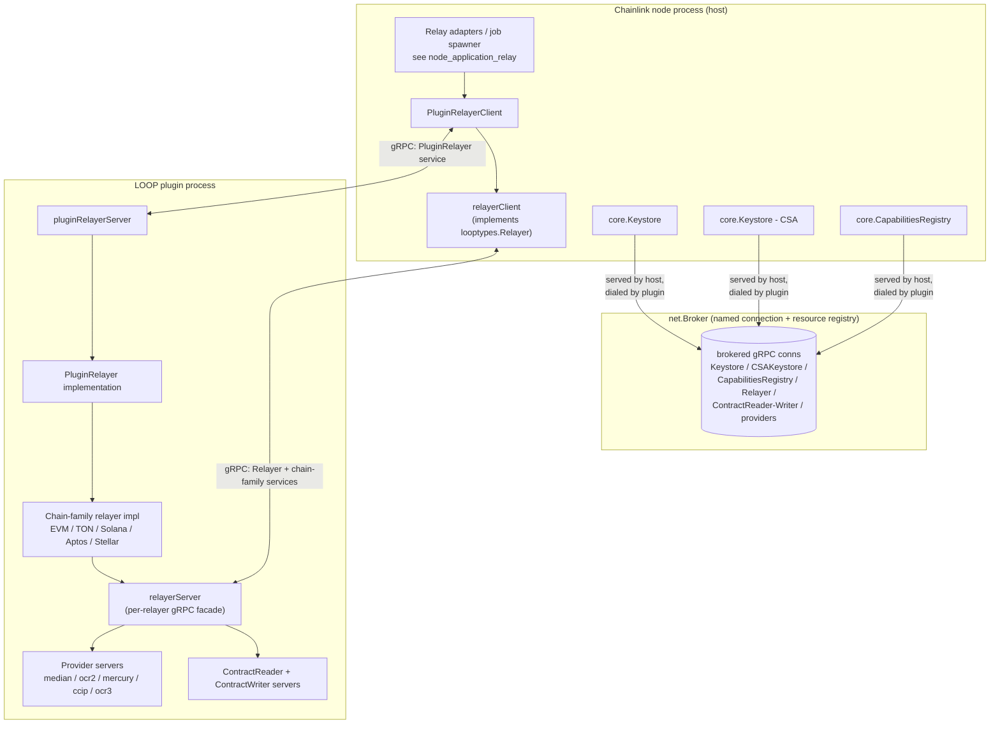
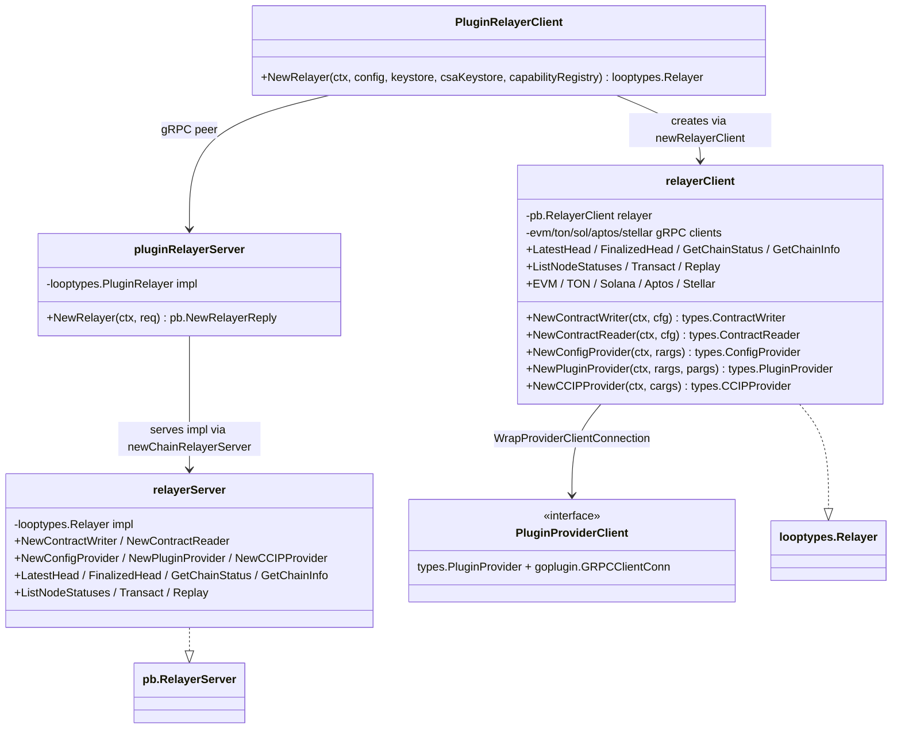
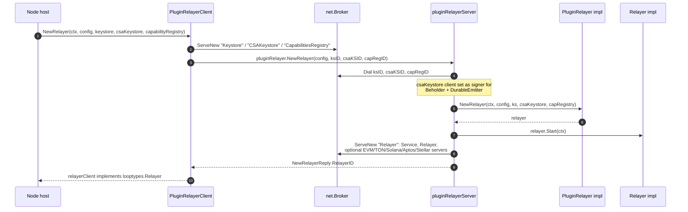
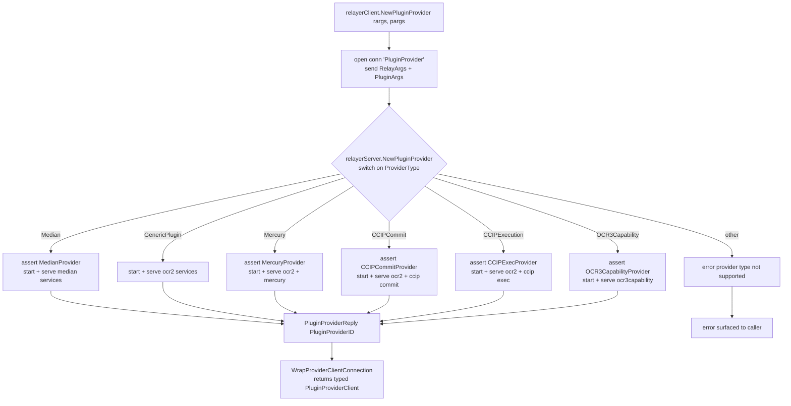

# Loop Relayer Services — Relayer

**Source:** `chainlink-common/pkg/loop/internal/relayer/relayer.go`

This module implements the relayer boundary of the LOOP (Library Of Offchain Plugins) framework: it is the bidirectional gRPC bridge that lets a Chainlink node drive a `Relayer` running inside a plugin process, and lets any chain-specific relayer implementation expose itself to the node (or to a reporting plugin) over gRPC. It is one of the three sub-services of [loop-relayer-services](../loop-relayer-services.md), alongside the [plugin providers](loop-relayer-services_plugin_providers.md) and the [relayer set](loop-relayer-services_relayerset.md).

For the overall plugin process lifecycle (how a LOOPP binary is launched, handshaken and brokered), see [loop-plugin-core](../loop-plugin-core.md). For the raw protobuf/gRPC surface that this module both implements and consumes, see [loop-grpc-bindings](../loop-grpc-bindings.md).

---

## 1. Purpose and responsibilities

The module contains exactly two symmetric halves, in one file (`relayer.go`):

| Side | Component | Role |
|---|---|---|
| Host (node) | `PluginRelayerClient`, `relayerClient` | Creates remote relayers over gRPC and adapts the `pb.RelayerClient` wire API back into the Go `looptypes.Relayer` interface consumed by the node. |
| Plugin (LOOPP) | `pluginRelayerServer`, `relayerServer` | Accepts relayer creation requests, drives a `looptypes.PluginRelayer` implementation, and re-exposes the resulting relayer (plus its chain-family services and providers) over gRPC. |

Concretely, the module is responsible for:

- **Relayer instantiation** — the `NewRelayer` handshake, including serving the host-owned dependencies (keystore, CSA keystore, capabilities registry) *in reverse* so the plugin process can dial back into them.
- **Chain service exposure** — registering per-chain-family gRPC servers (EVM, TON, Solana, Aptos, Stellar) on the relayer connection when the implementation advertises the corresponding optional interface.
- **Provider factories** — routing `NewConfigProvider` / `NewPluginProvider` / `NewCCIPProvider` calls by `ProviderType` to the correct provider server/client pair (median, generic OCR2, OCR3 capability, Mercury, CCIP commit/execute).
- **Contract IO** — creating `ContractReader` and `ContractWriter` sub-services on demand, each on its own brokered connection.
- **Cross-process infrastructure wiring** — injecting the CSA keystore as the signing mechanism for Beholder telemetry and the durable emitter inside the plugin process.
- **Simple chain queries** — heads, chain status/info, node statuses, native `Transact`, and log `Replay`.

---

## 2. Architecture

Key structural points:

- **Reverse dependency serving.** The *host* is the gRPC server for `Keystore`, `CSAKeystore` and `CapabilitiesRegistry`: `PluginRelayerClient.NewRelayer` serves these on the outbound "Relayer" connection setup and passes their broker IDs to the plugin. The `pluginRelayerServer` dials them back. This keeps secrets and capability data inside the node process while the relayer runs unprivileged.
- **Per-relayer connections.** Every relayer instance gets its own brokered connection ("Relayer"). The server registers, on that one connection: the generic `Service` server (start/close), the `Relayer` server, and — via type assertions on the implementation — whichever chain-family servers it supports.
- **Everything is a resource.** Connections, keystores, providers, readers/writers are `net.Resource`s tracked by `net.BrokerExt`; both sides release them deterministically (`deps.Add` on the client, `CloseAll` on partial-failure paths on the server).
- **Provider sub-connections.** Providers, contract readers and writers are themselves served on child connections created with `NewClientConn`, so their lifetime is scoped to the relayer that produced them.

The Go interfaces being adapted are defined in the shared types modules — see [types-core](../../Shared_Foundation_Libraries___Domain_Types/types-core.md) for `types.Relayer` / `looptypes.Relayer` semantics and [types-chains](../../Shared_Foundation_Libraries___Domain_Types/types-chains.md) for the chain-family service types.

### Component relationship (class view)

---

## 3. Core components

### 3.1 `PluginRelayerClient` — host-side entry point

`PluginRelayerClient` embeds `goplugin.PluginClient` and `goplugin.ServiceClient` and satisfies `looptypes.PluginRelayer`. It is constructed with `NewPluginRelayerClient(net.BrokerConfig)` (the logger is namespaced to `PluginRelayerClient`).

`NewRelayer(ctx, config, keystore, csaKeystore, capabilityRegistry)` performs the full bootstrap:

1. Opens a named client connection `"Relayer"` whose setup callback:
   - serves `Keystore` (`pb.RegisterKeystoreServer` around `ks.NewServer(keystore)`),
   - serves `CSAKeystore` (same wrapper around `csaKeystore`),
   - serves `CapabilitiesRegistry` (`capability.RegisterCapabilitiesRegistryServer`),
   - then issues `pluginRelayer.NewRelayer(ctx, &pb.NewRelayerRequest{Config, KeystoreID, KeystoreCSAID, CapabilityRegistryID})`.
2. Wraps the resulting connection ID in a `relayerClient`.

Any failure while serving the reverse dependencies aborts the setup and the broker tears the connection down.

### 3.2 `pluginRelayerServer` — plugin-side entry point

Registered via `RegisterPluginRelayerServer(server, broker, brokerCfg, impl)`, which installs both the generic `ServiceServer` (lifecycle) and the `PluginRelayerServer` around the process's `looptypes.PluginRelayer` implementation.

Its `NewRelayer` handler:

1. Dials the three reverse services (`Keystore`, `CSAKeystore`, `CapabilityRegistry`), closing already-acquired resources (`p.CloseAll(...)`) if any dial fails.
2. Wraps the CSA keystore client and installs it as the **auth header signer for Beholder** (`beholder.GetClient().SetSigner`) and as the **global signer for the durable emitter** (`durableemitter.SetGlobalSigner`) — telemetry emitted from the plugin is therefore signed with the node's CSA key.
3. Calls `impl.NewRelayer(ctx, config, ksClient, csaKeystore, capRegistry)` and then `r.Start(ctx)`.
4. Serves the new relayer on a dedicated connection (`ServeNew("Relayer", ...)`), registering:
   - the `Service` server (so the host can start/stop it),
   - the `relayerServer` facade (`newChainRelayerServer`),
   - chain-family servers **if and only if** the implementation implements the optional interfaces: `types.EVMService`, `types.TONService`, `types.SolanaService`, `types.AptosService`, `types.StellarService`.
5. Returns `NewRelayerReply{RelayerID}` for the client to dial.

### 3.3 `relayerClient` — wire-to-Go adapter (host side)

`relayerClient` implements `looptypes.Relayer` for a remote relayer. It holds one gRPC client per chain family (populated lazily by the accessors `EVM()`, `TON()`, `Solana()`, `Aptos()`, `Stellar()`, each returning a typed wrapper over the corresponding `pb` client) and forwards all `ChainService` calls with explicit pb ↔ Go conversions:

- `ExternalJobID` is transported as raw UUID bytes and re-hydrated with `uuid.FromBytes` server-side.
- `Replay` args travel as `structpb.Struct`; `Transact` amounts as a pb `BigInt` with a `balanceCheck` flag.
- Heads, chain status/info and paginated node statuses are plain request/response RPCs.

Factory methods open their own child connections:

- `NewContractWriter` → connection `"ContractWriter"` → `contractwriter.NewClient`.
- `NewContractReader` → connection `"ContractReader"` → `contractreader.NewClient` (pairs a `ServiceClient` with the `pb.ContractReaderClient`).
- `NewConfigProvider` → connection `"ConfigProvider"` → `ocr2.NewConfigProviderClient`.
- `NewPluginProvider` → connection `"PluginProvider"` → dispatch through `WrapProviderClientConnection` (below).
- `NewCCIPProvider` → connection `"CCIPProvider"`; optionally serves the caller's `ExtraDataCodecBundle` in reverse so the remote provider can decode chain-specific extra data, and replays persisted sync requests (`GetSyncRequests`) as `ChainAccessor().Sync` calls after the provider initializes, so address syncing survives restarts.
- `NewLLOProvider` is explicitly unsupported (`errors.ErrUnsupported`).

### 3.4 `relayerServer` — Go-to-wire adapter (plugin side)

`relayerServer` implements `pb.RelayerServer` over the local `looptypes.Relayer`. Besides the query passthroughs, it hosts the provider factories. Every factory follows the same template:

1. Assert the implementation supports the product-specific optional interface (e.g. `looptypes.MedianProvider`), otherwise return `codes.Unimplemented`.
2. Create the provider, then `Start(ctx)` it.
3. `ServeNew` a child connection that registers the provider's gRPC services, tracked as a `net.Resource` so the provider is closed with the connection.

### 3.5 `PluginProviderClient` and provider-type dispatch

`PluginProviderClient` is the interface returned to callers: `types.PluginProvider` combined with `goplugin.GRPCClientConn` (so callers can keep using the brokered connection, e.g. for typed product providers — see [plugin providers](loop-relayer-services_plugin_providers.md)).

`WrapProviderClientConnection` selects the adapter from `rargs.ProviderType`:

| `ProviderType` | Client adapter returned | Server-side assertion (`relayerServer`) | gRPC services registered on the provider connection |
|---|---|---|---|
| `types.Median` | `median.NewProviderClient` + `RmUnimplemented(ctx)` | `looptypes.MedianProvider` | `median.RegisterProviderServices` |
| `types.GenericPlugin` | `ocr2.NewPluginProviderClient` | (core `NewPluginProvider`) | `ocr2.RegisterPluginProviderServices` |
| `types.OCR3Capability` | `ocr3capability.NewProviderClient` | `looptypes.OCR3CapabilityProvider` | `ocr3capability.RegisterProviderServices` |
| `types.Mercury` | `mercury.NewProviderClient` | `looptypes.MercuryProvider` | `ocr2.RegisterPluginProviderServices` + `mercury.RegisterProviderServices` |
| `types.CCIPExecution` | `ccip.NewExecProviderClient` | `looptypes.CCIPExecProvider` | `ocr2.RegisterPluginProviderServices` + `ccip.RegisterExecutionProviderServices` |
| `types.CCIPCommit` | `ccip.NewCommitProviderClient` | `looptypes.CCIPCommitProvider` | `ocr2.RegisterPluginProviderServices` + `ccip.RegisterCommitProviderServices` |

Anything else yields `provider type not supported`. Note the two CCIP cases currently return `errors.New("need to fix BCF-3061")` **in addition to** the client — a deliberate, documented transitional state (see §7).

### 3.6 Standalone registration helpers

`RegisterStandAloneMedianProvider`, `RegisterStandAlonePluginProvider` and `RegisterStandAloneOCR3CapabilityProvider` register just the provider services onto an arbitrary `grpc.Server`. They are explicitly documented as a workaround to exercise the Node API on EVM **until the EVM relayer is "loopified"** — i.e. until the EVM relayer runs as a full LOOP plugin. See also [node_application_relay](../../Node_Application_Core___Interfaces/node_application/node_application_relay.md) for how the node's relay layer selects looped vs. in-process relayers.

---

## 4. Process flows

### 4.1 Relayer bootstrap (full handshake)

Failure handling is symmetric: on the host, a failed `ServeNew` aborts the `NewClientConn` setup; on the plugin, any failed dial or `NewRelayer`/`Start` error closes all previously acquired resources before returning.

### 4.2 Plugin provider creation

For CCIP, the richer `NewCCIPProvider` path additionally: serves the caller-supplied `ExtraDataCodecBundle` as a reverse service, re-synchronizes persisted `SyncedAddresses` through `provider.ChainAccessor().Sync`, and registers `ccipocr3loop` provider services (the CCIPOCR3 provider types are documented in [types-ccip](../../CCIP_Cross-Chain_Protocol/types-ccip.md)).

### 4.3 Contract reader/writer creation

`NewContractReader` / `NewContractWriter` are one-round-trip: the client opens a child conn whose setup RPC (`pb.NewContractReaderRequest` / `pb.NewContractWriterRequest`) triggers the server to create, `Start`, and serve the reader/writer, then the client wraps the conn in `contractreader` / `contractwriter` clients. Lifecycle is fully owned by the relayer's broker connection.

---

## 5. Resource and lifecycle conventions

- **Named connections.** Every logical sub-service ("Relayer", "Keystore", "ContractReader", "PluginProvider", …) is a named, brokered connection. This makes gRPC logs and broker state auditable per sub-service.
- **Deterministic cleanup.** Client setup callbacks accumulate `net.Resources` and return them with the connection; server handlers call `CloseAll` on every failure path after a resource has been acquired. Providers/readers/writers are registered as resources so they close with their connection.
- **Start-before-serve.** Every remotely created object (relayer, provider, reader, writer) is `Start`ed before its service is registered — a remote peer will never see a service that isn't running.
- **Capability negotiation by type assertion.** Chain-family services and product-specific providers are only registered when the implementation implements the corresponding optional interface, and clients handle the absence gracefully (`NewLLOProvider` → `ErrUnsupported`, provider-type default → error).

---

## 6. Relationship to the rest of the system

- **[Plugin_Process_Framework_(Loop)](../../Plugin_Process_Framework_(Loop).md)** — parent framework: process isolation of oracle plugins via hashicorp/go-plugin and gRPC. This module is the relayer boundary of that framework.
- **[loop-relayer-services](../loop-relayer-services.md)** — parent page; situates the relayer module next to [plugin providers](loop-relayer-services_plugin_providers.md) (the `pluginprovider` package this module delegates to) and [relayer set](loop-relayer-services_relayerset.md) (multi-chain relayer servers, e.g. `evmServer`, that a relayer implementation may expose via the chain-family hooks this module registers).
- **[loop-plugin-core](../loop-plugin-core.md)** — provides `goplugin.PluginClient`/`ServiceClient` and the `net.Broker`/`BrokerExt` primitives used everywhere here.
- **[loop-grpc-bindings](../loop-grpc-bindings.md)** — the generated `pb` surfaces (`relayer_grpc.pb.go`, `keystore_grpc.pb.go`, contract reader/writer, chain-family protos) that both adapters in this module target.
- **[types-core](../../Shared_Foundation_Libraries___Domain_Types/types-core.md)** — the canonical `Relayer`, `PluginProvider`, `RelayArgs`/`PluginArgs` and chain-service interfaces.
- **[types-chains](../../Shared_Foundation_Libraries___Domain_Types/types-chains.md)** / **[chain-grpc-protos](../../Shared_Foundation_Libraries___Domain_Types/chain-grpc-protos.md)** — the EVM/Solana/Aptos/Stellar/TON service types and their protobuf bindings.
- **[Node_Application_Core___Interfaces](../../Node_Application_Core___Interfaces.md)** — the node's relay adapters (e.g. `RelayAdapter`) are the primary consumers of relayers produced through this module.

---

## 7. Known limitations and in-progress work

1. **BCF-3061 (CCIP providers).** `WrapProviderClientConnection` returns the CCIP commit/execute provider clients *and* a `need to fix BCF-3061` error. The inline TODO describes the open design question: for the embedded (in-process) relayer, the broker must be shared between the relayer client (in the reporting-plugin loop) and the provider so that resource passing works; until resolved, callers must treat the error accordingly.
2. **LLO providers.** `NewLLOProvider` always fails with `errors.ErrUnsupported`.
3. **EVM loopification.** The three `RegisterStandAlone*` helpers exist only to test the Node API on EVM until the EVM relayer is loopified; they are expected to disappear once that migration completes.
4. **Provider-type dispatch is string-keyed.** New provider kinds require coordinated changes in `types` (provider type constant), `WrapProviderClientConnection` (client), and `relayerServer.NewPluginProvider` (server).

---

## 8. Build and packaging context

All code in this module lives in the Go module `github.com/smartcontractkit/chainlink-common` (`chainlink-common/go.mod`), which is the shared foundation library imported by the node (`chainlink/go.mod`), the capabilities workspace, and the deployment tooling. The LOOP runtime depends on `github.com/hashicorp/go-plugin` (the process plugin framework underneath `goplugin`) and `google.golang.org/grpc` — changes to this module therefore affect every product that instantiates looped relayers (OCR2/median, OCR3 capabilities, Mercury, CCIP), and must remain wire-compatible with the generated bindings documented in [loop-grpc-bindings](../loop-grpc-bindings.md).
