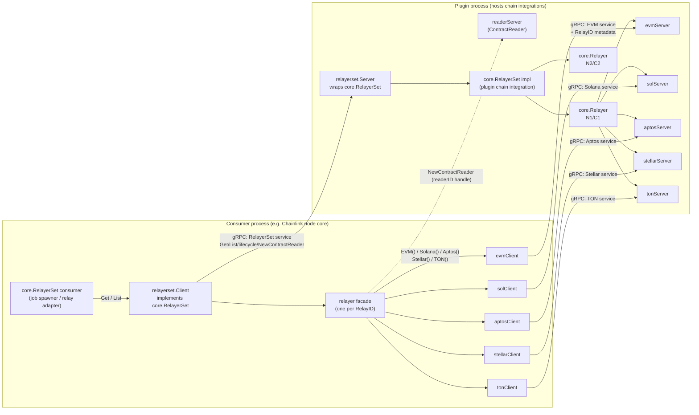
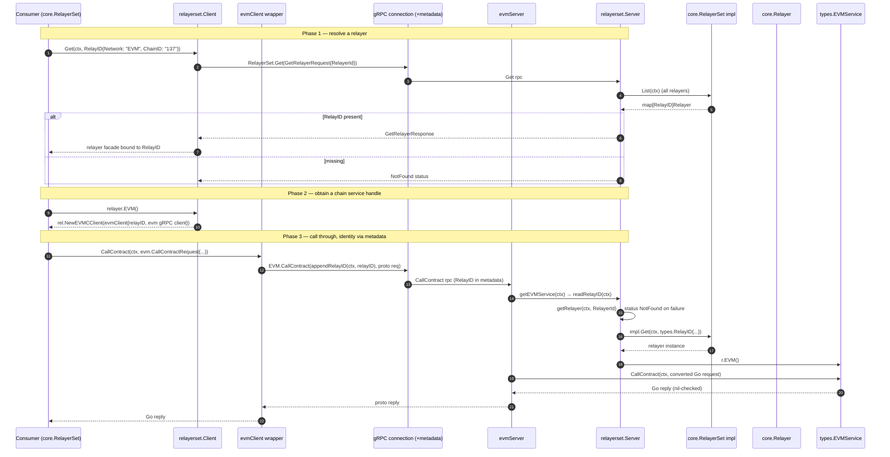
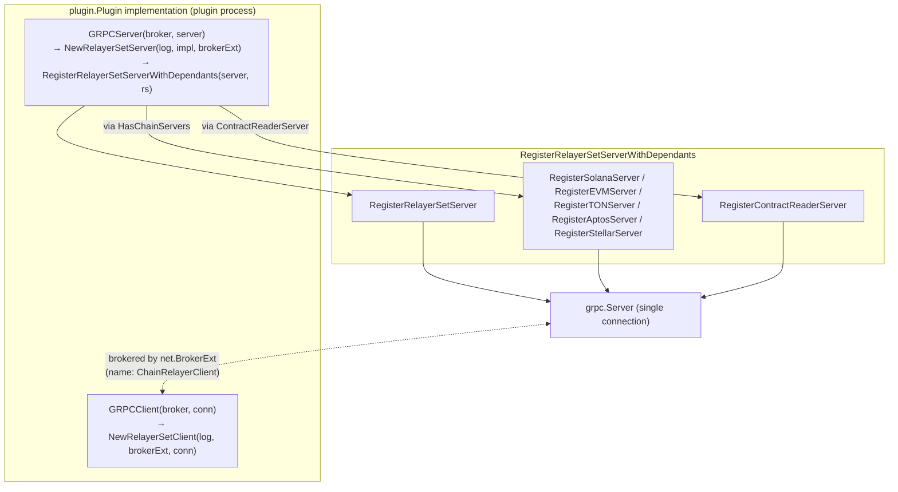
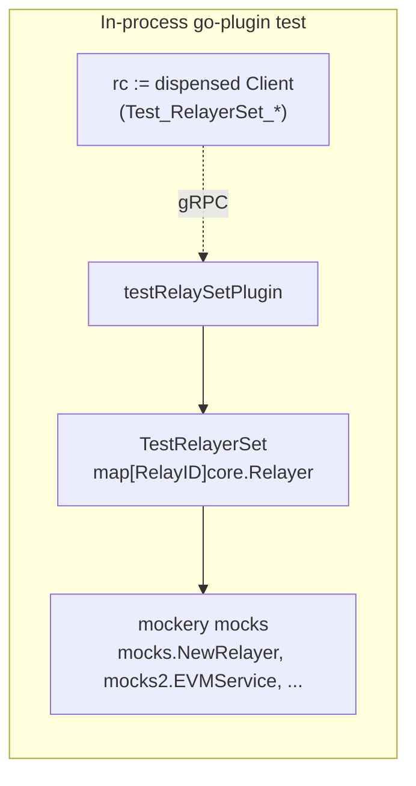

# loop-relayer-services / relayerset — Multi-Relayer gRPC Dispatch

## 1. Introduction

`chainlink-common/pkg/loop/internal/relayerset` is the sub-package of the [Loop plugin framework](../loop-relayer-services.md) that transports the **`core.RelayerSet`** interface across the process boundary between a Chainlink node core and a chain plugin process.

A *relayer set* is a collection of relayers keyed by **`types.RelayID{Network, ChainID}`** ([types-core](../../Shared_Foundation_Libraries___Domain_Types/types-core.md)). It exists so that a **single plugin process can serve many chains and networks over one gRPC connection**: instead of exposing `Get`, `List`, transaction submission, log tracking, etc. separately per chain, the relayer set multiplexes requests for any number of relayers and routes each request to the relayer identified by the `RelayID` carried in the request's gRPC context metadata.

This page documents:

- the two dispatchers — `Server` (plugin side, wraps a concrete `core.RelayerSet`) and `Client` (consumer side, implements `core.RelayerSet` over gRPC),
- the per-chain client/server adapter pairs for **EVM, Solana, Aptos, Stellar and TON**,
- the RelayID metadata routing mechanism that makes the multiplexing work,
- how the gRPC surface is registered and how it is tested.

For the surrounding framework see the [loop-relayer-services overview](../loop-relayer-services.md); for single-relayer plugin-provider bridging see [loop-relayer-services_relayer](loop-relayer-services_relayer.md) and [loop-relayer-services_plugin_providers](loop-relayer-services_plugin_providers.md).

---

## 2. Module at a Glance

| Aspect | Detail |
|---|---|
| Package | `github.com/smartcontractkit/chainlink-common/pkg/loop/internal/relayerset` (module `chainlink-common`, see `chainlink-common/go.mod`) |
| Core abstraction | `core.RelayerSet` (`Get`, `List`) and `core.Relayer` from `chainlink-common/pkg/types/core` |
| Transport | gRPC over a [hashicorp/go-plugin](https://github.com/hashicorp/go-plugin) connection, brokered by `loop/internal/net.BrokerExt` |
| Generated bindings | `pkg/loop/internal/pb/relayerset` (RelayerSet service) and per-chain bindings under `pkg/chains/{evm,solana,aptos,stellar,ton}` (see [chain-grpc-protos](../../Shared_Foundation_Libraries___Domain_Types/chain-grpc-protos.md)) |
| Identity | `types.RelayID{Network string, ChainID string}` ⇄ proto `relayerset.RelayerId{Network, ChainId}` |
| Chain coverage | EVM, Solana, Aptos, Stellar, TON (`types.EVMService`, `SolanaService`, `AptosService`, `StellarService`, `TONService`) |

### Who runs which side

- **`Server`** runs in the process that *owns* the concrete `core.RelayerSet` implementation (the actual chain integrations). In the canonical chain-relayer-plugin setup this is the plugin process: the plugin's `plugin.Plugin` implementation calls `NewRelayerSetServer(log, impl, brokerExt)` in its `GRPCServer` hook.
- **`Client`** runs in the consuming process (typically the Chainlink node core). `NewRelayerSetClient` is called from the plugin's `GRPCClient` hook; the broker name is explicitly `"ChainRelayerClient"`. The dispensed `*Client` satisfies `core.RelayerSet`, so node-side code (e.g. the relay adapters in [node_application_relay](../../Node_Application_Core___Interfaces/node_application/node_application_relay.md)) consumes plugin-hosted relayers exactly as if they were in-process.

The pairing is symmetric and verified end-to-end by the package's own tests (see [§9](#9-testing)).

---

## 3. Architecture



Key structural points:

1. **One connection, many services.** `RegisterRelayerSetServerWithDependants` registers the `RelayerSet` service *and* all chain services (EVM, Solana, Aptos, Stellar, TON, ContractReader) on the same `grpc.Server`. The relayer set is therefore a *bundle*: chain RPCs are not nested inside the RelayerSet service but are sibling services multiplexed on one connection.
2. **Identity travels in metadata, not in messages.** Every chain RPC's protobuf payload is identical whether it targets chain A or chain B; the target relayer is disambiguated by gRPC context metadata (see [§5](#5-the-relayid-routing-mechanism)).
3. **Facades keep per-relayer state on the consumer side.** `Client.Get` does not return a long-lived remote object; it verifies the relayer exists and returns a local `relayer` struct that remembers its `RelayID` and proxies every call.

---

## 4. Component Reference

| File | Component | Role |
|---|---|---|
| `server.go` | `Server`, `NewRelayerSetServer`, `Server.getRelayer` | Plugin-side dispatcher; wraps `core.RelayerSet`, hosts the chain servers and the contract-reader registry, maps `RelayerId → core.Relayer` |
| `client.go` | `Client`, `NewRelayerSetClient`, `Client.Get/List`, `Client.EVM/Solana/Aptos/Stellar/TON/NewContractReader` | Consumer-side `core.RelayerSet`; builds metadata-injecting chain clients and relayer facades |
| `relayer.go` | `relayer`, `newRelayer` | Per-RelayID facade: proxies lifecycle RPCs (`StartRelayer`, `CloseRelayer`, …), `NewPluginProvider` (brokered sub-connection) and `NewContractReader` |
| `evm.go` | `evmClient`, `evmServer` | EVM service adapters (24 RPCs) |
| `solana.go` | `solClient`, `solServer` | Solana service adapters |
| `aptos.go` | `aptosClient`, `aptosServer` | Aptos service adapters |
| `stellar.go` | `stellarClient`, `stellarServer` | Stellar service adapters |
| `ton.go` | `tonClient`, `tonServer` | TON service adapters |
| `relayerset_test.go` | `TestTON`, `TestRelayerSet`, `testRelaySetPlugin`, per-chain `Test_RelayerSet_*Service` | Round-trip tests over a real in-process gRPC connection |
| `pb/relayerset/helper.go` | `RegisterRelayerSetServerWithDependants`, `HasChainServers` | Registration of the RelayerSet service together with all dependent chain/reader servers |

Generated proto layer (regenerate with `make generate` in `chainlink-common/Makefile`, which wires `install-protoc`, `protoc-gen-go` and `protoc-gen-go-grpc`): `pkg/loop/internal/pb/relayerset/*.pb.go` plus the per-chain bindings generated from `pkg/chains/{evm/evm.proto, solana/solana.proto, aptos/aptos.proto, stellar/stellar.proto, ton/ton.proto}` (documented in [chain-grpc-protos](../../Shared_Foundation_Libraries___Domain_Types/chain-grpc-protos.md)).

---

## 5. The RelayID Routing Mechanism

The central trick of this package: **the RelayID is attached to the gRPC context metadata by the client-side wrapper and extracted by the server-side dispatcher.** This is why a single shared gRPC connection can serve arbitrarily many relayers without any per-relayer channels.



Implementation details:

- **Client side** — every `*Client` adapter (`evmClient`, `solClient`, `aptosClient`, `stellarClient`, `tonClient`) holds a `relayID types.RelayID` and a raw generated pb client; each of its methods is a one-liner that re-issues the underlying call with `appendRelayID(ctx, relayID)`. The adapters satisfy the generated client interfaces (e.g. `var _ evmpb.EVMClient = (*evmClient)(nil)`), so they drop in transparently.
- **Server side** — each `*Server` adapter exposes a private accessor on the shared `Server` (e.g. `getEVMService`, `getSolService`, `getAptosService`, `getStellarService`, `getTONService`). All five follow the identical three-step pattern:
  1. `readRelayID(ctx)` — extract the RelayID from incoming metadata;
  2. build a `relayerset.RelayerId{Network, ChainId}` and call `s.getRelayer(ctx, &idT)`, which delegates to `impl.Get` and translates failure into gRPC `codes.NotFound`;
  3. call the corresponding chain accessor on the relayer (`r.EVM()`, `r.Solana()`, `r.Aptos()`, `r.Stellar()`, `r.TON()`).
- **Error mapping.** Dispatch failures become gRPC status errors (`codes.NotFound` for unknown relayers, `codes.Internal` for list/lifecycle failures); some adapters additionally wrap domain errors with `net.WrapRPCErr` (Solana, Stellar) so that error details survive the hop.

---

## 6. gRPC Surface

### 6.1 `RelayerSet` service

Implemented by `Server` (via the generated `RelayerSetServer` interface) and consumed by `Client`:

| RPC | Purpose | Consumer entry point |
|---|---|---|
| `Get(GetRelayerRequest) → GetRelayerResponse` | Membership check for one RelayID | `Client.Get` → returns a `relayer` facade |
| `List(ListAllRelayersRequest) → ListAllRelayersResponse` | List relayers (all, or the requested subset) | `Client.List` → map of facades |
| `NewPluginProvider / NewContractReader / NewContractWriter` | Create per-relayer sub-resources | `relayer.NewPluginProvider`, `relayer.NewContractReader`, `relayer.NewContractWriter` |
| `StartRelayer / CloseRelayer / RelayerReady / RelayerHealthReport / RelayerName` | `services.Service` lifecycle, proxied per relayer | `relayer.Start/Close/Ready/HealthReport/Name` |
| `RelayerLatestHead / RelayerFinalizedHead / RelayerGetChainInfo` | Head and chain-info reads | `relayer.LatestHead/FinalizedHead/GetChainInfo` |
| `ContractReaderStart / ContractReaderClose` | Lifecycle of reader instances created via `NewContractReader` | reader handle methods |

Notes on semantics worth knowing when operating or extending the service:

- `Server.Get` checks membership by calling `impl.List(ctx)` (all relayers) rather than `impl.Get`, so unknown relayers surface as `codes.NotFound`.
- `Server.NewContractReader` instantiates the relayer's `types.ContractReader`, assigns it a **UUID `ContractReaderId`**, wraps it in a `contractreader.NewServer`, and records the pair (`readerAndServer{reader, server}`) in a mutex-protected `readers` map on `Server`. The client keeps the matching ID and returns a `contractreader.NewClient(...)` handle, so all subsequent reader calls are routed by ID.
- `Server.NewPluginProvider` creates a plugin provider for the given RelayID and registers its gRPC server resources under the `"PluginProviderServers"` resource group; `Server.Close` closes them all (see [§8](#8-lifecycle--resource-management)).

### 6.2 Chain services

Each chain is a **separate gRPC service** registered alongside `RelayerSet` (see [§7](#7-registration--plugin-integration)). This is what allows the `RelayerSetServer` implementation to double as a `HasChainServers` provider.

### 6.3 Registration helper

`RegisterRelayerSetServerWithDependants(s grpc.ServiceRegistrar, srv RelayerSetServer)`:

```go
RegisterRelayerSetServer(s, srv)                       // RelayerSet service
if contractReader, ok := srv.(pb.ContractReaderServer) // reader, when embedded
if h, ok := srv.(HasChainServers) {                    // chain services, when provided
    Solana, EVM, TON, Aptos, Stellar, ContractReader   // registered on the same server
}
```

`HasChainServers` is the optional capability interface a server implements to advertise its chain servers (`SolanaServer()`, `EVMServer()`, `TONServer()`, `AptosServer()`, `StellarServer()`, `ContractReaderServer()`).

---

## 7. Registration / Plugin Integration



The broker extension (`net.BrokerExt`) stored on both `Server` and `Client` is the same Loop broker used by the rest of the framework (see [loop-plugin-core](../loop-plugin-core.md)). It is what enables **reverse/brokered sub-connections**: `relayer.NewPluginProvider` opens a named `"PluginProvider"` client connection via `Client.NewClientConn("PluginProvider", factory)`, where the factory calls back into `RelayerSet.NewPluginProvider` to obtain a provider ID; the connection is then wrapped per provider type by `rel.WrapProviderClientConnection` (details in [loop-relayer-services_relayer](loop-relayer-services_relayer.md) and [loop-relayer-services_plugin_providers](loop-relayer-services_plugin_providers.md)).

---

## 8. Lifecycle & Resource Management

- **Construction.** `NewRelayerSetServer(log, underlying, broker)` builds the `Server`, wires the five chain servers plus the contract-reader server as children pointing back at the `Server` (`parent *Server`), and returns a `net.Resource{Name: "PluginProviderServers", Closer: server}` so the enclosing plugin can tear the bundle down.
- **`Server.Close()`** iterates `serverResources` (the plugin-provider servers created at runtime) and closes each; the reader registry (`readers` map, guarded by `readersMux`) backs the reader instances created via `NewContractReader`.
- **Per-relayer lifecycle** is fully proxied: `relayer.Start(ctx)` → `RelayerSet.StartRelayer(RelayerId)` → `Server.StartRelayer` → `getRelayer(...).Start(ctx)`. The same pattern applies to `Close`, `Ready`, `HealthReport`, `Name`, `LatestHead`, `FinalizedHead` and `GetChainInfo`, so the consumer sees ordinary `services.Service` semantics for each relayer even though the implementation lives in another process.

---

## 9. Chain Service Catalogue

All five chains follow the same adapter pattern; the table lists the operations exposed per chain (Go-side entry points on `types.*Service`, mirrored 1:1 by the generated pb services).

| Chain | Reads / chain state | Transactions | Logs & filters | Other |
|---|---|---|---|---|
| **EVM** | `CallContract`, `FilterLogs`, `BalanceAt`, `HeaderByNumber`, `GetTransactionByHash`, `GetTransactionReceipt`, `EstimateGas`, `GetLatestLPBlock` | `SubmitTransaction`, `GetTransactionStatus`, `GetTransactionFee`, `CalculateTransactionFee`, `GetForwarderForEOA` | `QueryTrackedLogs`, `RegisterLogTracking`, `UnregisterLogTracking`, `GetFiltersNames` *(deprecated, PLEX-1465)* | `LPSkipToBlock` |
| **Solana** | `GetBalance`, `GetAccountInfoWithOpts`, `GetMultipleAccountsWithOpts`, `GetBlock`, `GetSlotHeight`, `GetTransaction`, `GetSignatureStatuses`, `GetLatestLPBlock` | `SubmitTransaction`, `SimulateTX`, `GetFeeForMessage` | `QueryTrackedLogs`, `RegisterLogTracking`, `UnregisterLogTracking`, `GetFiltersNames` | — |
| **Aptos** | `LedgerVersion`, `AccountAPTBalance`, `View`, `TransactionByHash`, `AccountTransactions` | `SubmitTransaction` | — | — |
| **Stellar** | `GetLedgerEntries`, `GetLatestLedger`, `GetLedgers`, `GetTransaction`, `GetEvents`, `GetSigningAccount` | `SubmitTransaction`, `SimulateTransaction` | — | — |
| **TON** | `GetMasterchainInfo`, `GetBlockData`, `GetAccountBalance`, `GetTxStatus`, `GetTxExecutionFees` | `SendTx` | `HasFilter`, `RegisterFilter`, `UnregisterFilter` | — |

Convention highlights visible in the adapters:

- **Conversion boundary.** Handlers convert proto ⇄ Go types using the chain pb packages' `Convert*` helpers (e.g. `evmpb.ConvertCallMsgFromProto`, `evmpb.ConvertLogsToProto`, `solpb.ConvertSubmitTransactionRequestFromProto`, `aptospb.ConvertViewReplyToProto`, `tonpb.NewBlock`) and big-int helpers (`valuespb.NewBigIntFromInt`, `valuespb.NewIntFromBigInt`).
- **Nil-reply guards.** The EVM server rejects successful-but-empty replies (`errors.New("reply is nil")`) rather than propagating a nil pointer across the wire.
- **Input validation.** Aptos validates 32-byte account addresses; Solana rejects a missing log-tracking filter; confidence levels are decoded through `chaincommonpb.ConfidenceFromProto` (EVM read paths).
- **Deprecated surface.** `GetFiltersNames` on EVM is retained only for backwards compatibility (tracked as `PLEX-1465`).

---

## 10. Testing

`relayerset_test.go` exercises the **entire round trip over a real gRPC connection** using `plugin.TestPluginGRPCConn` (hashicorp go-plugin):



- `testRelaySetPlugin.GRPCServer` installs `NewRelayerSetServer` + `RegisterRelayerSetServerWithDependants` on the test gRPC server; `GRPCClient` dispenses `NewRelayerSetClient` — exactly the production wiring.
- `TestRelayerSet` implements `core.RelayerSet` over `mocks.NewRelayer` instances, so assertions are made against the *implementation-side* mocks while the *consumer side* calls the public Go interfaces.
- Suites: `Test_RelayerSet` (facade lifecycle, `HealthReport`, `GetChainInfo`, `Name`), `Test_RelayerSet_ContractReader` (including `QueryKeys` streaming iterators and reader-close error propagation), and one suite per chain — `Test_RelayerSet_EVMService` (17 cases incl. zero-address tolerance, forwarder lookups, fee calculation), `_SolanaService` (13 cases incl. `SimulateTX` and multi-account reads), `_AptosService` (9 cases incl. view calls with and without ledger version), `_TONService` (9 cases; backed by the `TestTON` double) and `_StellarService` (7 cases incl. event pagination and signing-account lookup).
- `generateFixtureQuery` builds deeply nested `query.Expression` trees (AND/OR over tx-hash, block, timestamp, chain-specific primitives and confidence levels) to stress the query-expression codecs shared with the [contract reader](../loop-grpc-bindings.md) bindings.

---

## 11. Extension Notes

**Adding support for a new chain** in the relayer set requires touching each layer consistently:

1. Define/extend the chain pb service under `chainlink-common/pkg/chains/<chain>/` and regenerate (`make generate` in `chainlink-common/Makefile`).
2. Add the chain service to `types` (e.g. `types.FooService`) and to the `core.Relayer` interface in [types-core](../../Shared_Foundation_Libraries___Domain_Types/types-core.md).
3. Create `foo.go` in this package with a `fooClient` (metadata-injecting wrapper) and `fooServer` (parent-dispatched adapter with a `getFooService(ctx)` accessor on `Server`).
4. Register the new server in `NewRelayerSetServer`, expose it through `HasChainServers`, and register it in `RegisterRelayerSetServerWithDependants`.
5. Extend `relayer.go`/`client.go` with the accessor and mirror the tests.

---

## 12. Related Documentation

- [loop-relayer-services](../loop-relayer-services.md) — parent module: relayer-level services in the Loop framework.
- [loop-relayer-services_relayer](loop-relayer-services_relayer.md) — the single-relayer / `PluginProviderClient` layer consumed through this module's facades.
- [loop-relayer-services_plugin_providers](loop-relayer-services_plugin_providers.md) — the OCR2/median/OCR3-capability/CCIP provider servers reachable via the brokered `"PluginProvider"` connections.
- [Plugin_Process_Framework_(Loop)](../../Plugin_Process_Framework_(Loop).md) — the Loop framework root: plugin lifecycle, go-plugin bootstrap, broker.
- [loop-plugin-core](../loop-plugin-core.md) — `plugin.Plugin` surfaces, `ServiceClient`, keystore and in-process provider servers.
- [loop-grpc-bindings](../loop-grpc-bindings.md) — generated pb layer for all Loop services, including contract reader/writer and the RelayerSet service.
- [types-core](../../Shared_Foundation_Libraries___Domain_Types/types-core.md) — `RelayerSet`, `Relayer`, `RelayArgs`/`PluginArgs` and the chain `*Service` interfaces.
- [chain-grpc-protos](../../Shared_Foundation_Libraries___Domain_Types/chain-grpc-protos.md) — the per-chain proto schemas (`evm.proto`, `solana.proto`, `aptos.proto`, `stellar.proto`, `ton.proto`) whose generated bindings this module adapts.
- [node_application_relay](../../Node_Application_Core___Interfaces/node_application/node_application_relay.md) — node-side relay adapters (`RelayAdapter`) that consume relayer/relayer-set clients.
