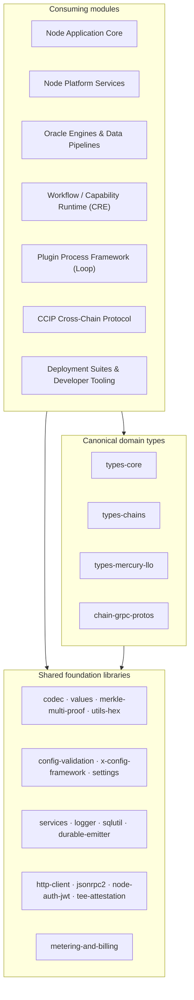
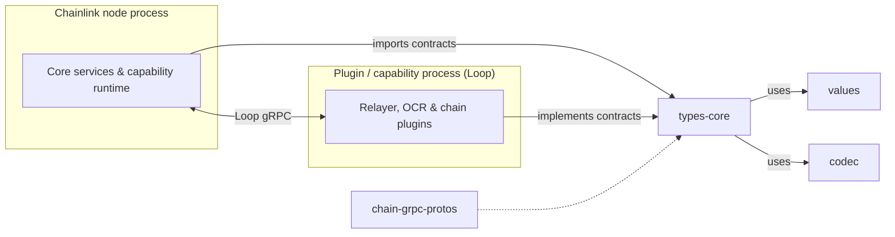

# Shared Foundation Libraries & Domain Types (`chainlink-common`)

## Purpose

`Shared_Foundation_Libraries___Domain_Types` is the **foundation layer of the Chainlink monorepo**, rooted at the `chainlink-common` Go module. It contains no product logic of its own; instead it provides:

- **Canonical domain types and contracts** — the shared interfaces (`Relayer`, providers, keystore, plugin services, chain contracts) and per-network type packages that the node core, oracle engines, CRE runtime, CCIP and Loop plugins all code against.
- **Cross-process contracts** — generated per-chain gRPC protobufs and a shared value/codec model so that the node process and out-of-process plugins (via the Loop framework) can interoperate safely.
- **Reusable infrastructure libraries** — logging, service lifecycle, config validation, HTTP/RPC clients, SQL utilities, durable event emission, metering/billing, node auth, TEE attestation and general utilities.

Because every higher-level module (Node Application Core, Platform Services, Oracle Engines, CRE, CCIP, deployment suites and tooling) depends on these contracts rather than on each other, `chainlink-common` acts as the **dependency-inversion hub** that keeps module boundaries clean and prevents circular dependencies.

## Architecture

### Layered view

Higher-level modules consume both the canonical domain types and the shared libraries; the domain types themselves are built on top of the foundation libraries (values, codec, services, logger, …).

### Contract flow across process boundaries

The domain types are deliberately defined once in `chainlink-common` so that the node **imports** the contracts while Loop plugins **implement** them, communicating over gRPC using the generated protobuf bindings and the shared value/codec model.

## Core Components

| Component | Path | Summary | Documentation |
|---|---|---|---|
| **types-core** | `chainlink-common/pkg/types` | Canonical interfaces for the node's extensibility surface: Relayer/RelayerSet, chain/config providers, plugin services, chain contracts, keystore and automation types. | [types-core](<Shared_Foundation_Libraries___Domain_Types/types-core.md>) |
| **types-chains** | `chainlink-common/pkg/types/chains` | Chain-scoped type packages extending the core contracts per network (EVM, Aptos, Solana, Stellar/TON, Sui). | [types-chains](<Shared_Foundation_Libraries___Domain_Types/types-chains.md>) |
| **types-mercury-llo** | `chainlink-common/pkg/types/mercury` | Types for Mercury data feeds and LLO, including report codecs. | [types-mercury-llo](<Shared_Foundation_Libraries___Domain_Types/types-mercury-llo.md>) |
| **chain-grpc-protos** | `chainlink-common/pkg/chains` | Generated per-chain gRPC/proto definitions used to reach remote chain runtimes over Loop. | [chain-grpc-protos](<Shared_Foundation_Libraries___Domain_Types/chain-grpc-protos.md>) |
| **codec** | `chainlink-common/pkg/codec` | Pluggable encode/decode pipeline with modifiers and a gRPC codec service for serializing payloads against chain encodings. | [codec](<Shared_Foundation_Libraries___Domain_Types/codec.md>) |
| **values** | `chainlink-common/pkg/values` | Language-agnostic value model (maps, lists, primitives) with protobuf serialization shared between node and plugins. | [values](<Shared_Foundation_Libraries___Domain_Types/values.md>) |
| **merkle-multi-proof** | `chainlink-common/pkg/merklemulti` | Merkle tree implementation supporting multi-proof verification. | [merkle-multi-proof](<Shared_Foundation_Libraries___Domain_Types/merkle-multi-proof.md>) |
| **config-validation** | `chainlink-common/pkg/config` | Shared configuration primitives, validation helpers and config documentation generation (`configdoc`). | [config-validation](<Shared_Foundation_Libraries___Domain_Types/config-validation.md>) |
| **x-config-framework** | `chainlink-common/x/config` | Experimental config framework: comment parsing, markup rendering and CLI binding for config types. | [x-config-framework](<Shared_Foundation_Libraries___Domain_Types/x-config-framework.md>) |
| **http-client** | `chainlink-common/pkg/http` | Shared HTTP client abstractions: request construction and transport configuration. | [http-client](<Shared_Foundation_Libraries___Domain_Types/http-client.md>) |
| **jsonrpc2** | `chainlink-common/pkg/jsonrpc2` | JSON-RPC 2.0 client/server implementation. | [jsonrpc2](<Shared_Foundation_Libraries___Domain_Types/jsonrpc2.md>) |
| **logger** | `chainlink-common/pkg/logger` | Structured logging for all services, with an OpenTelemetry bridge (`otelzap`). | [logger](<Shared_Foundation_Libraries___Domain_Types/logger.md>) |
| **settings** | `chainlink-common/pkg/settings` | Hierarchical settings framework with schemas, CRE settings schema and limit definitions. | [settings](<Shared_Foundation_Libraries___Domain_Types/settings.md>) |
| **sqlutil** | `chainlink-common/pkg/sqlutil` | Database helpers: query/transaction wrappers, naming and locking utilities on top of the node's PostgreSQL layer. | [sqlutil](<Shared_Foundation_Libraries___Domain_Types/sqlutil.md>) |
| **services** | `chainlink-common/pkg/services` | Service lifecycle contract (Start/Close/HealthReport) plus resolver and test helpers used across the node. | [services](<Shared_Foundation_Libraries___Domain_Types/services.md>) |
| **durable-emitter** | `chainlink-common/pkg/durableemitter` | Durable event emission with event-store contracts and a PostgreSQL event store implementation. | [durable-emitter](<Shared_Foundation_Libraries___Domain_Types/durable-emitter.md>) |
| **metering-and-billing** | `chainlink-common/pkg/metering` | Resource metering, the metering report schema and the billing client. | [metering-and-billing](<Shared_Foundation_Libraries___Domain_Types/metering-and-billing.md>) |
| **node-auth-jwt** | `chainlink-common/pkg/nodeauth` | JWT-based authentication between node components and remote services. | [node-auth-jwt](<Shared_Foundation_Libraries___Domain_Types/node-auth-jwt.md>) |
| **tee-attestation** | `chainlink-common/pkg/teeattestation` | TEE attestation handling, including AWS Nitro enclave verification and validation. | [tee-attestation](<Shared_Foundation_Libraries___Domain_Types/tee-attestation.md>) |
| **utils-hex** | `chainlink-common/pkg/utils` | Common utilities, including hex/bytes helpers used throughout the codebase. | [utils-hex](<Shared_Foundation_Libraries___Domain_Types/utils-hex.md>) |

## Related Modules

- **Plugin Process Framework (Loop)** — consumes `types-core` interfaces and the `chain-grpc-protos` bindings to run plugins as separate processes.
- **Workflow & Capability Runtime (CRE)** — implements capability contracts defined in `chainlink-common/pkg/capabilities` and relies on `values`/`codec` for payload handling.
- **Telemetry & Observability Platform** — observability packages that physically live under `chainlink-common` (beholder, chipingress, monitoring, observability-lib) are documented separately as part of that module.