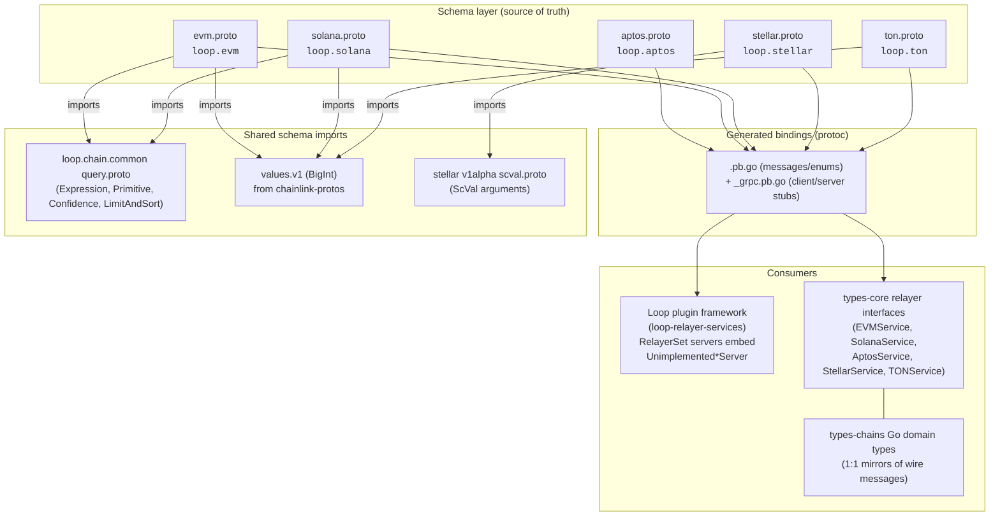
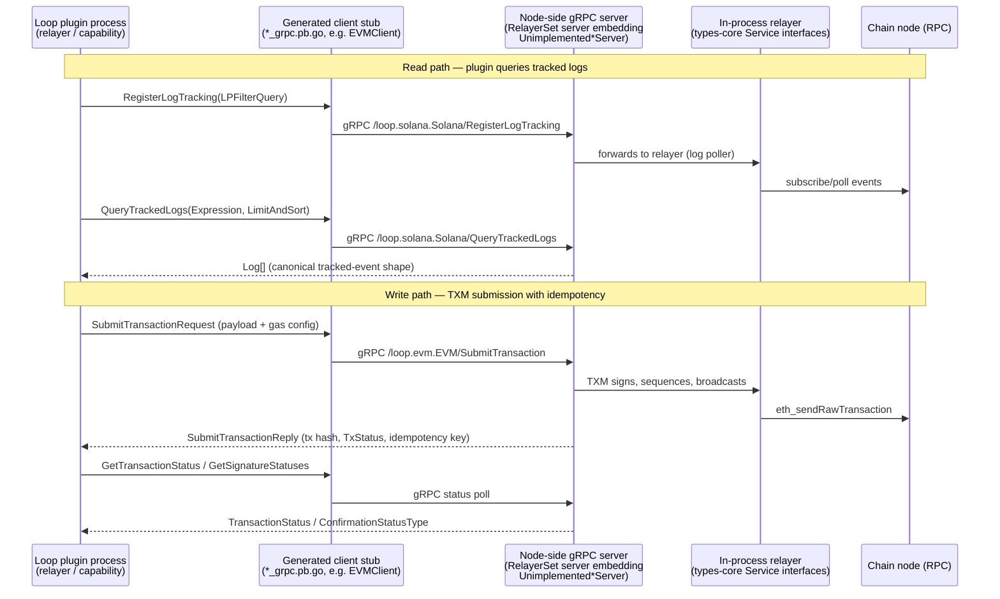

# Chain gRPC Protos (`chain-grpc-protos`)

> **Location in codebase:** `chainlink-common/pkg/chains/{aptos,evm,solana,stellar,ton}`

## 1. Overview

The **chain-grpc-protos** module hosts the Protocol Buffers schemas and their generated Go/gRPC bindings that define the **wire contracts ("Chain Services") for every blockchain family** the Chainlink node supports. Each sub-package declares one gRPC service that abstracts a chain family's node API behind a small, uniform surface:

- **Chain/ledger reads** — balance, block, transaction, and contract-call queries
- **Transaction management (TXM)** — submission, status, and fee estimation with idempotency keys
- **Log/event tracking (Log Poller)** — registration, querying, and lifecycle of tracked event filters

These contracts are the transport layer of the **Loop plugin framework**: out-of-process plugin binaries (relayers, reporting plugins, chain capabilities) speak these gRPC services back to the Chainlink node, while in-process relayers implement the equivalent Go interfaces from [`types-core`](types-core.md) and [`types-chains`](types-chains.md).

### Package inventory

| Package | Schema | gRPC service (proto package) | Capabilities exposed |
|---|---|---|---|
| `pkg/chains/aptos` | `aptos.proto` | `loop.aptos.Aptos` | Ledger version, APT balance, `View` (read-only functions), transaction by hash, account transactions, transaction submission |
| `pkg/chains/evm` | `evm.proto` | `loop.evm.EVM` | Contract calls, log filtering, balances, gas estimation, receipts, header lookups, log-polling, transaction submission/status/fees, forwarder lookup |
| `pkg/chains/solana` | `solana.proto` | `loop.solana.Solana` | Account/block queries, fee quotes, program accounts, signature statuses, transaction simulation/submission, log tracking |
| `pkg/chains/stellar` | `stellar.proto` | `loop.stellar.Stellar` | Ledger entries, ledger history, Soroban simulation, contract events, transaction fetch/submission |
| `pkg/chains/ton` | `ton.proto` | `loop.ton.TON` | LiteClient (masterchain info, block data, balances), TXM (send/status/fees), Log Poller (filter registration) |

### File layout convention

Every chain package follows the same three-layer layout:

```text
pkg/chains/<chain>/
├── <chain>.proto        # Hand-authored schema — the single source of truth
├── <chain>.pb.go        # Message & enum types (generated by protoc-gen-go)
└── <chain>_grpc.pb.go   # Client/server stubs (generated by protoc-gen-go-grpc)
```

All `.pb.go` files are generated (`// Code generated by protoc-gen-go. DO NOT EDIT.`). Behavior changes are made in the `.proto` files and regenerated with the toolchain described in [§6 Regeneration & tooling](#6-regeneration--tooling).

## 2. Architecture

The schemas are the *contract layer* between chain-specific relayer implementations and their consumers. Two consumption paths exist:

1. **Out-of-process (Loop/gRPC):** plugin binaries receive generated client stubs and call the node, which serves the generated server interfaces (e.g. the Loop relayer-set `evmServer` embeds `evmpb.UnimplementedEVMServer` in `chainlink-common/pkg/loop/internal/relayerset/evm.go`).
2. **In-process (Go interfaces):** the node's own relayers implement Go-native interfaces/types that mirror the wire messages (e.g. `chainlink-common/pkg/types/chains/evm/evm.go::CallContractRequest` mirrors the proto `CallContractRequest` field-for-field: `Msg`, `BlockNumber`, `ConfidenceLevel`, `IsExternal`).



The `loop.<chain>` proto package names and the shared `loop.chain.common` imports make the Loop lineage explicit: these are the contracts served by the node across the gRPC boundary to Loop plugins.

## 3. Cross-chain design conventions

Despite targeting very different chains, all five schemas share the same idioms — reading them is a transferable skill:

| Convention | Where it appears | Purpose |
|---|---|---|
| **Request/Reply wrapper messages** | Every RPC (`SubmitTransactionRequest`/`Reply`, `GetBalanceRequest`/`Reply`, …) | Forward-compatible evolution: new optional fields can be added to envelopes without breaking signatures |
| **Idempotency keys** | `tx_idempotency_key` (Aptos), `transaction_id` (EVM), `idempotency_key` (Solana/Stellar) | TXM deduplication of transaction submissions across retries |
| **TxStatus / TransactionStatus enums** | `TX_STATUS_{FATAL,REVERTED,ABORTED,SUCCESS}` | Uniform three-state outcome reporting (fatal / reverted-or-aborted / success) regardless of chain semantics |
| **Finality / confidence semantics** | EVM: `loop.chain.common.Confidence` (`Unconfirmed`/`Finalized`/`Safe`) with sentinel block numbers (`-2` latest, `-3` finalized, `-4` safe); Solana: `CommitmentType`; Solana: `ConfirmationStatusType` | Callers express how much confirmation they require; servers may error if the requested level is not met |
| **`is_external` flag** | Solana/EVM read RPCs | When `true`, the request comes from an external (plugin) caller and server-side limits (e.g. response size caps) may be applied |
| **Log-poller filter lifecycle** | `RegisterLogTracking` / `UnregisterLogTracking` / `QueryTrackedLogs` / `GetFiltersNames` + `LPFilterQuery` (`LPFilter` on EVM) | Declarative, named event filters with retention, rate limits, and subkey/topic selectors — the node polls and caches so plugins never talk to chain nodes directly |
| **Raw vs. parsed data via `oneof`** | `TransactionEnvelope_Raw`/`_Parsed` (Solana), `DataBytesOrJSON_Raw`/`_Json` (Solana), `TypeTag_Vector`/`_Struct`/`_Generic` (Aptos) | Strongly-typed alternatives instead of ad-hoc byte blobs |
| **Fixed-size byte addresses** | EVM `[20]byte` addresses / `[32]byte` hashes; Aptos & Solana 32-byte `bytes` | Avoids hex/base58 string parsing on the hot path; encoding is the caller's concern |

### Shared schema dependencies

| Dependency | Used by | Provides |
|---|---|---|
| `loop/chain-common/query.proto` | EVM, Solana | Expression trees (`Expression`, `Primitive`, `BooleanExpression`), `ComparisonOperator`, `Confidence`, `LimitAndSort` — the chain-agnostic query algebra (documented in [Loop query primitives](<../Plugin_Process_Framework_(Loop)/loop-plugin-core/loop-plugin-core_query_primitives.md>)) |
| `values/v1/values.proto` (from `chainlink-protos`) | EVM, Solana, TON | `BigInt` for unbounded integers (balances, block numbers, fees); Go-side counterpart is the [`values`](values.md) library |
| `capabilities/blockchain/stellar/v1alpha/scval.proto` | Stellar | Typed `ScVal` Soroban arguments for contract calls and events |
| `google/protobuf/{empty,timestamp}.proto` | EVM, Solana, Stellar, TON | Empty request markers and timestamps |

## 4. Runtime data flow

A representative flow — a plugin querying tracked logs, and the TXM submitting a transaction — shows how the pieces fit together:



Key properties of this flow:

- **Plugins never hold chain credentials or RPC endpoints** — all chain I/O funnels through the node's relayer implementations.
- **Status polling is uniform**: whatever the chain's native confirmation model, the reply reduces to the module's `TxStatus` / `TransactionStatus` / `ConfirmationStatusType` enums.
- **Filter state is node-owned**: filters are registered once by name and survive plugin restarts; `GetFiltersNames` lets plugins rediscover them.

## 5. Sub-module documentation

The module decomposes naturally into one sub-module per chain family:

| Sub-module | Files | Summary |
|---|---|---|
| [chain-grpc-protos_aptos](chain-grpc-protos/chain-grpc-protos_aptos.md) | `aptos.proto`, `aptos.pb.go`, `aptos_grpc.pb.go` | The `loop.aptos.Aptos` service: ledger version, APT balance, `View` read-only calls, transaction lookup/listing, and submission. Highlights the recursive `TypeTag` algebra (`VectorTag`/`StructTag`/`GenericTag` oneofs) that models Aptos' Move type system on the wire. |
| [chain-grpc-protos_evm](chain-grpc-protos/chain-grpc-protos_evm.md) | `evm.proto`, `evm_grpc.pb.go` | The `loop.evm.EVM` service — the richest surface (18 RPCs): contract calls, log filtering, gas estimation, receipts, log-polling registration, transaction status/fees, and OCR forwarder lookup. Shows `loop.chain.common.Confidence` finality semantics and `values.v1.BigInt` usage. |
| [chain-grpc-protos_solana](chain-grpc-protos/chain-grpc-protos_solana.md) | `solana.proto`, `solana.pb.go`, `solana_grpc.pb.go` | The `loop.solana.Solana` service (16 RPCs): account/program queries, fee quotes, signature statuses, TX simulation/submission, and log tracking. Covers the `DataBytesOrJSON` and `TransactionEnvelope` raw/parsed oneofs and the Solana-flavored `Expression`/`Primitive` filter tree built on the shared query algebra. |
| [chain-grpc-protos_stellar](chain-grpc-protos/chain-grpc-protos_stellar.md) | `stellar.proto`, `stellar_grpc.pb.go` | The `loop.stellar.Stellar` service: ledger entries/history, Soroban contract simulation (with auth modes and restore preambles), contract events, and TXM-managed submission with XDR result metadata. Uses typed `ScVal` arguments from the CRE capabilities schemas. |
| [chain-grpc-protos_ton](chain-grpc-protos/chain-grpc-protos_ton.md) | `ton.proto`, `ton_grpc.pb.go` | The `loop.ton.TON` service, organized in three groups: LiteClient (masterchain/block/balance), TXM (send/status/fees by logical time), and Log Poller (filter registration with retention). |

## 6. Regeneration & tooling

Proto generation is orchestrated by the `chainlink-common` module build (`chainlink-common/Makefile`):

- **`make generate`** — the umbrella target; chains `install-protoc`, `cre-protoc`, and Go-code generation for the whole module.
- **`make install-protoc`** — installs `protoc` plus `protoc-gen-go` and `protoc-gen-go-grpc` (versions pinned in `.tool-versions`), via `chainlink-common/script/install-protoc.sh`.
- **`make cre-protoc`** — builds the custom `protoc-gen-cre` plugin from `chainlink-common/pkg/capabilities/v2/protoc` used for CRE-side code generation.

Generated-file headers record the pinned toolchain: `protoc-gen-go v1.36.12`, `protoc v5.29.3`, `protoc-gen-go-grpc v1.5.1`, requiring **gRPC-Go v1.64.0+** (`grpc.SupportPackageIsVersion9`). The generated server stubs use the standard forward-compatibility pattern: implementations embed `Unimplemented*Server` (by value), while `Unsafe*Server` opts out of forward compatibility.

> **Editing rule:** never edit `.pb.go` / `_grpc.pb.go` by hand. Change the `.proto` and regenerate; the header of every generated file repeats this contract.

## 7. Related modules

| Module | Relationship |
|---|---|
| [`types-core`](types-core.md) | Go-native service interfaces (`Relayer`, `EVMService`, `RelayerSet`, …) that these protos put on the wire; see [types-core_relayer](types-core/types-core_relayer.md) |
| [`types-chains`](types-chains.md) | Go domain types mirroring these wire messages 1:1 (e.g. `CallContractRequest`, `SubmitTransactionRequest` per chain) |
| [Loop relayer services](<../Plugin_Process_Framework_(Loop)/loop-relayer-services/loop-relayer-services_relayerset.md>) | The gRPC servers that implement these services for out-of-process plugins (per-chain `*Server` wrappers embedding `Unimplemented*Server`) |
| [Loop plugin core](<../Plugin_Process_Framework_(Loop)/loop-plugin-core/loop-plugin-core_query_primitives.md>) | Owns the shared `loop.chain.common` query algebra imported by the EVM and Solana schemas |
| [`values`](values.md) | Go-side arbitrary-precision integer library corresponding to `values.v1.BigInt` used across the schemas |
