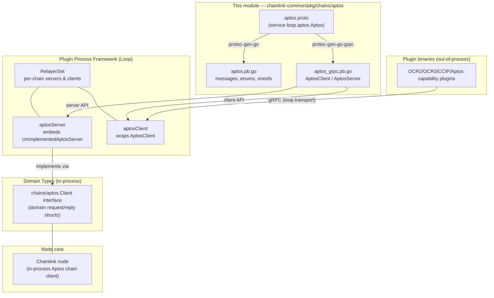
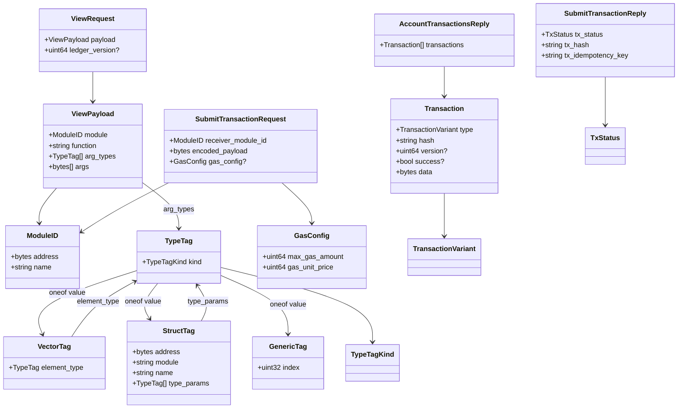
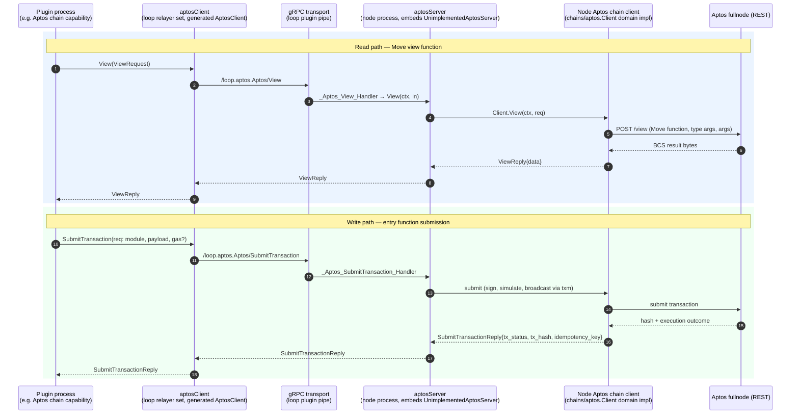

# Chain gRPC Protos — Aptos (`chainlink-common/pkg/chains/aptos`)

> **Module tree position:** [Shared Foundation Libraries & Domain Types](../../Shared_Foundation_Libraries___Domain_Types.md) › [chain-grpc-protos](../chain-grpc-protos.md) › **aptos**

## Introduction

The `chain-grpc-protos_aptos` module defines the canonical **gRPC wire contract for Aptos chain access** within Chainlink's shared foundation libraries. It lives in `chainlink-common/pkg/chains/aptos/` and consists of a protobuf service definition (`aptos.proto`) plus its generated Go bindings (`aptos.pb.go`, `aptos_grpc.pb.go`).

The module exists to solve a specific architectural problem: Chainlink plugins (OCR2/OCR3 reporting plugins, CCIP plugins, CRE chain capabilities) run in **separate processes** from the Chainlink node via the [Loop plugin framework](../../../Plugin_Process_Framework_(Loop)/loop-plugin-core.md). Whenever a plugin needs to query ledger state, execute read-only Move view functions, or submit transactions on Aptos, that request must cross the process boundary. This module supplies the language-neutral contract that makes that possible: the in-process node implements the generated `AptosServer`, while out-of-process plugins receive a generated `AptosClient` proxy.

The `package loop.aptos` namespace in the proto explicitly signals this role — it is part of the "loop" plugin ecosystem, sitting alongside the analogous contracts for EVM, Solana, Stellar, and TON (see the sibling modules [evm](chain-grpc-protos_evm.md), [solana](chain-grpc-protos_solana.md), [stellar](chain-grpc-protos_stellar.md), and [ton](chain-grpc-protos_ton.md)).

## Files & Responsibilities

| File | Kind | Responsibility |
|------|------|----------------|
| `aptos.proto` | Source of truth | Defines the `loop.aptos.Aptos` gRPC service, 20 messages, and 3 enums (`TypeTagKind`, `TransactionVariant`, `TxStatus`). Go package target: `github.com/smartcontractkit/chainlink-common/pkg/chains/aptos`. |
| `aptos.pb.go` | Generated (protoc-gen-go v1.36.12) | Go structs for all messages/enums, protobuf serialization, oneof wrappers (`TypeTag_Vector`, `TypeTag_Struct`, `TypeTag_Generic`), and the compressed file descriptor. **Do not edit by hand.** |
| `aptos_grpc.pb.go` | Generated (protoc-gen-go-grpc v1.5.1) | `AptosClient` interface + implementation, `AptosServer` interface, `UnimplementedAptosServer` (forward-compatibility embed), `UnsafeAptosServer`, per-RPC handlers, and `Aptos_ServiceDesc` for registration. |

All three files share the Go package `aptos`; consumers import it as `aptospb` (the convention used throughout the repository, e.g. in the Loop relayer set wiring).

## Architecture

The module is a *leaf* in the dependency graph: it depends only on the protobuf/gRPC runtime, but is depended upon by the Loop relayer services, the Aptos domain types, and the Aptos chain capability.

Key relationships:

1. **Server side (node process):** `chainlink-common/pkg/loop/internal/relayerset/aptos.go` defines `aptosServer`, which embeds `aptospb.UnimplementedAptosServer` and delegates to the node's in-process Aptos chain client (the domain `Client` interface described in [types-chains_aptos](../types-chains/types-chains_aptos.md)).
2. **Client side (plugin process):** the same file defines `aptosClient{relayID types.RelayID; client aptospb.AptosClient}` — a thin handle pairing a relay identity with the generated gRPC client stub. The [Loop relayer services](../../../Plugin_Process_Framework_(Loop)/loop-relayer-services/loop-relayer-services_relayerset.md) module owns this wiring.
3. **Domain types:** `chainlink-common/pkg/types/chains/aptos/aptos.go` declares a `Client` interface whose method set (`LedgerVersion`, `AccountAPTBalance`, `View`, `TransactionByHash`, `AccountTransactions`) mirrors the RPCs (its read-side methods intentionally omit the write RPC; transaction submission is surfaced through relayer/txm abstractions in [types-core_relayer](../types-core/types-core_relayer.md)). The request/reply structs in that package (e.g. `ViewRequest{Payload, LedgerVersion}`, `SubmitTransactionRequest{ReceiverModuleID, EncodedPayload, GasConfig}`) are field-for-field counterparts of the proto messages, kept in sync by convention.

## The `Aptos` gRPC Service

All RPCs are unary. Full method names follow the pattern `/loop.aptos.Aptos/<Method>`.

| RPC | Request → Reply | Purpose |
|-----|-----------------|---------|
| `LedgerVersion` | `LedgerVersionRequest` → `LedgerVersionReply{ledger_version}` | Returns the latest committed ledger (transaction) version — used for chain height polling. |
| `AccountAPTBalance` | `{address: bytes}` → `{value}` | Native APT balance in **octas** for a 32-byte account address. |
| `View` | `ViewRequest{payload, ledger_version?}` → `ViewReply{data}` | Executes a read-only **Move view function**; optionally pinned to a historical ledger version. Returns the raw BCS-serialized result bytes. |
| `TransactionByHash` | `{hash: string}` → `TransactionByHashReply{transaction?}` | Looks up a pending or committed transaction by hash (hex string with `0x` prefix). |
| `AccountTransactions` | `{address, start?, limit?}` → `repeated Transaction` | Lists committed transactions for an account. `start` defaults to most recent; `limit` defaults to ~100. |
| `SubmitTransaction` | `SubmitTransactionRequest` → `SubmitTransactionReply` | Submits an entry-function transaction with a pre-encoded payload, target module ID, and optional gas configuration. |

### Submission semantics

`SubmitTransactionRequest` carries:

- `receiver_module_id` (`ModuleID`) — the target Move module (32-byte address + name).
- `encoded_payload` (`bytes`) — the already-encoded entry function payload (callers such as the [Aptos chain capability actions](../../../Workflow___Capability_Runtime_(CRE_Engine)/chain_capability_aptos/chain_capability_aptos_actions.md) build this, e.g. with `Vec<Option<address>>` wrapper types like `moveOptionAddress`).
- `gas_config` (`GasConfig`, optional) — `max_gas_amount` (gas units) and `gas_unit_price` (per unit, in octas).

`SubmitTransactionReply` reports:

- `tx_status` — one of:
  - `TX_STATUS_FATAL` — processing failed due to a network/RPC issue or other fatal error;
  - `TX_STATUS_REVERTED` — sent successfully but the Move execution reverted;
  - `TX_STATUS_SUCCESS` — sent, executed, and mined into a block.
- `tx_hash` — the on-chain transaction hash.
- `tx_idempotency_key` — a caller-suppliable correlation key enabling safe retries of idempotent submissions.

## Data Model

### Message relationships

### Type system modeling (`TypeTag`)

The `TypeTag` message models Aptos Move type annotations and is the most structurally interesting part of the schema:

- `kind` — a `TypeTagKind` discriminant covering the full Move primitive ladder (`BOOL`, `U8`, `U16`, `U32`, `U64`, `U128`, `U256`), plus `ADDRESS`, `SIGNER`, `VECTOR`, `STRUCT`, and `GENERIC`.
- `value` — a protobuf `oneof` holding the payload for composite kinds, generated in Go as the `isTypeTag_Value` interface with three wrappers (documented components `TypeTag_Vector`, `TypeTag_Struct`, `TypeTag_Generic`):
  - `VectorTag{element_type: TypeTag}` — recursively typed vectors;
  - `StructTag{address, module, name, type_params}` — a fully-qualified Move struct, including generic type parameters;
  - `GenericTag{index: uint32}` — a reference to a generic type parameter.

The recursion (`TypeTag → VectorTag/StructTag → TypeTag`) lets arbitrary Move signatures be expressed as wire data — this is what allows `View` calls to be typed generically and lets contract reader/writer configs (see [types-chains_aptos](../types-chains/types-chains_aptos.md)) address specific Move functions.

### Transaction representation

`Transaction` intentionally keeps only common fields (`type`, `hash`, optional `version` and `success`) plus `data: bytes` holding the **raw transaction payload**. The `TransactionVariant` enum spans `PENDING`, `USER`, `GENESIS`, `BLOCK_METADATA`, `BLOCK_EPILOGUE`, `STATE_CHECKPOINT`, `VALIDATOR`, and `UNKNOWN`. Optionality matters: `version` is absent for pending transactions, and `success` is absent for pending/genesis transactions — both are generated as pointer types (`*uint64`, `*bool`) in Go.

## Code Generation Workflow

The generated files are produced from `aptos.proto` by the repository toolchain and must never be edited manually. The process is driven by the `chainlink-common` Makefile (`chainlink-common/Makefile`):

- The `install-protoc` target installs `protoc` (version pinned via `.tool-versions`) plus `protoc-gen-go` and `protoc-gen-go-grpc` (the latter pinned via `.tool-versions` as well).
- The `generate` target chains `mockery install-protoc gomods cre-protoc modgraph release-modules` and then runs `gomods -go generate -x ./...`, which executes `//go:generate` directives — including the protoc invocations that regenerate `aptos.pb.go` and `aptos_grpc.pb.go` from `aptos.proto`.
- `cre-protoc` builds the in-house `protoc-gen-cre` plugin used elsewhere in the workspace (capabilities monitoring protos), illustrating the shared codegen environment in which this module's files are produced.

Generated code compatibility is enforced at compile time: `aptos.pb.go` asserts protobuf runtime version 20, and `aptos_grpc.pb.go` asserts `grpc.SupportPackageIsVersion9` (gRPC-Go ≥ v1.64.0). The relevant gRPC/protobuf runtime dependencies are declared in `chainlink-common/go.mod`.

### Forward compatibility

The generated server surface follows the standard gRPC-GO evolution strategy:

- **`UnimplementedAptosServer`** must be embedded (by value) by any server implementation; it returns `codes.Unimplemented` for all six methods. `aptosServer` in the Loop relayer set does exactly this, so new RPCs added to the proto do not break existing servers.
- **`UnsafeAptosServer`** (the documented component of this module) opts out of forward compatibility: embedding it means adding a method to `AptosServer` becomes a compile error rather than a runtime gap. Its use is discouraged and reserved for code that is regenerated in lockstep.
- `RegisterAptosServer` guards against a nil-by-pointer embed of `UnimplementedAptosServer`, which would panic on the first unimplemented method call.

## Runtime Data Flow

### Read flow (`View`) and write flow (`SubmitTransaction`) through the Loop boundary

Notes on the write path: the plugin supplies only the encoded payload and target module; signing and gas management are performed node-side (the `GasConfig` is optional and node defaults apply when omitted). The tri-state `TxStatus` lets callers distinguish *retries that are safe* (`REVERTED`, `SUCCESS` — final outcomes, plus retries keyed on `tx_idempotency_key`) from *fatal* transport/RPC failures that require re-evaluation.

### Polling flow (chain height & balances)

Capabilities and plugins poll chain state on intervals (e.g. the Aptos capability's `ChainHeightPollPeriod` / `ObservationPollPeriod` in `capabilities/chain_capabilities/aptos/config/config.go`). Those loops call `LedgerVersion` / `AccountAPTBalance` over the same wire contract, keeping request volume proportional to configured poll periods.

## Consumers Across the System

| Consumer | What it uses | Link |
|----------|--------------|------|
| **Loop relayer set** (`chainlink-common/pkg/loop/internal/relayerset/aptos.go`) | Generated `AptosServer`/`AptosClient` — the concrete plumbing point | [loop-relayer-services_relayerset](../../../Plugin_Process_Framework_(Loop)/loop-relayer-services/loop-relayer-services_relayerset.md) |
| **Relayer abstraction** | `Relayer`/`AptosService` interfaces that plugins obtain chain clients through | [types-core_relayer](../types-core/types-core_relayer.md) |
| **Aptos domain types** (`chainlink-common/pkg/types/chains/aptos/aptos.go`, `.../types/aptos/`) | Mirror structs + `Client` interface that the server side delegates to; contract reader/writer module configs for Move functions/events | [types-chains_aptos](../types-chains/types-chains_aptos.md) |
| **Aptos chain capability** (`capabilities/chain_capabilities/aptos`) | Builds encoded entry-function payloads (e.g. `moveOptionAddress`) and consumes relayer chain services that ride this contract | [chain_capability_aptos](../../../Workflow___Capability_Runtime_(CRE_Engine)/chain_capability_aptos.md), [actions](../../../Workflow___Capability_Runtime_(CRE_Engine)/chain_capability_aptos/chain_capability_aptos_actions.md) |
| **CCIP Aptos support** (`chainlink/core/capabilities/ccip/ocrimpls/aptos_contract_transmitter.go`) | Transmits OCR reports to Aptos via relayer services backed by this contract | [ccip_ocr_transmitters](../../CCIP_Cross-Chain_Protocol/ccip/ccip_ocr_transmitters.md) |

## Design Conventions & Gotchas

- **Addresses are raw 32-byte values** (`bytes`), not hex strings — conversion to/from the hex-encoded form Aptos uses elsewhere in the repo (e.g. `creForwarderAddress` config) happens at the boundary layers.
- **Balances are in octas** (1 APT = 10⁸ octas); both `AccountAPTBalanceReply.value` and `GasConfig.gas_unit_price` use this unit.
- **Domain-type sync is by convention.** The proto messages and the structs in `chainlink-common/pkg/types/chains/aptos` evolve together but are not derived from one another; a proto change requires a manual, mirrored update to the domain types and the relayer-set adapter code.
- **`TypeTag` is recursive by design** — exercise care when constructing tags for deeply nested or self-referential Move types to avoid unbounded messages.
- **The write RPC is the only state-changing RPC** in the contract; all other methods are read-only, which keeps the plugin trust boundary simple (a plugin can read anything but can only cause effects through `SubmitTransaction`).

## See Also

- Parent module: [chain-grpc-protos](../chain-grpc-protos.md) — the multi-chain proto family and shared generation conventions.
- Sibling contracts: [EVM](chain-grpc-protos_evm.md), [Solana](chain-grpc-protos_solana.md), [Stellar](chain-grpc-protos_stellar.md), [TON](chain-grpc-protos_ton.md).
- [Plugin Process Framework (Loop)](../../../Plugin_Process_Framework_(Loop)/loop-plugin-core.md) — how plugin RPCs are transported and multiplexed.
- [Shared Foundation Libraries & Domain Types](../../Shared_Foundation_Libraries___Domain_Types.md) — the full foundation library catalog.
