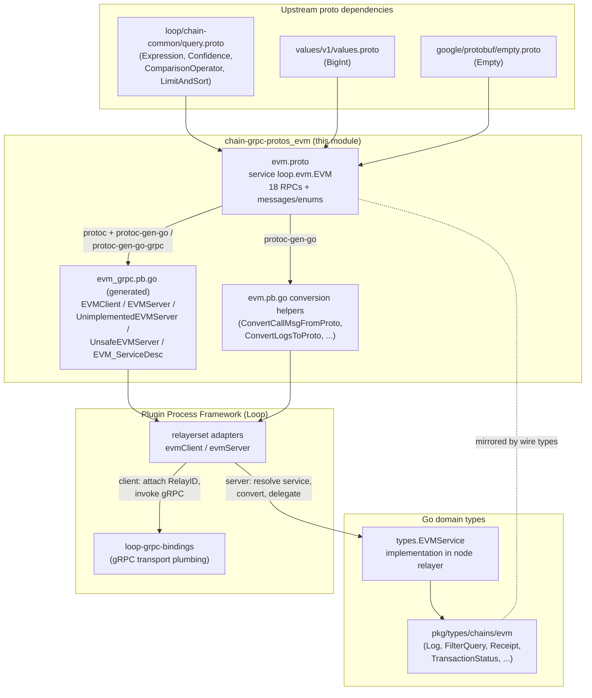
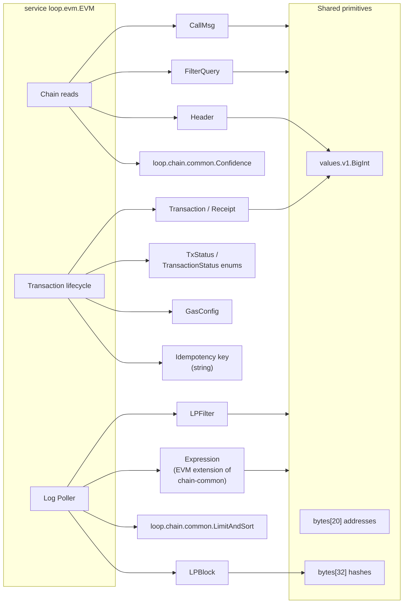
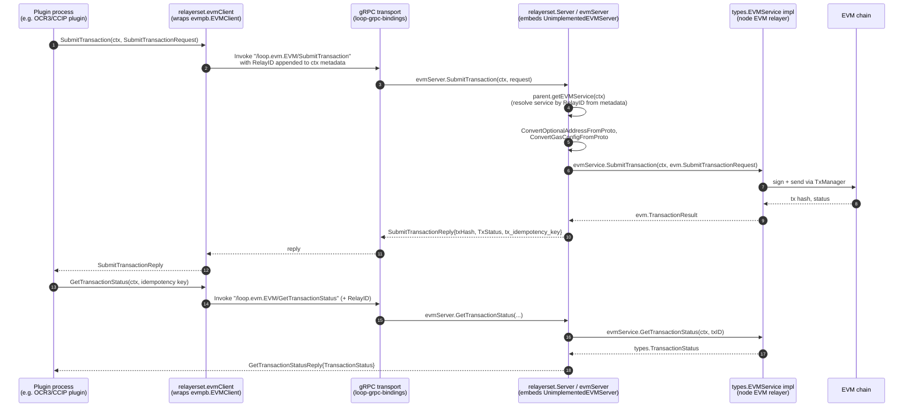
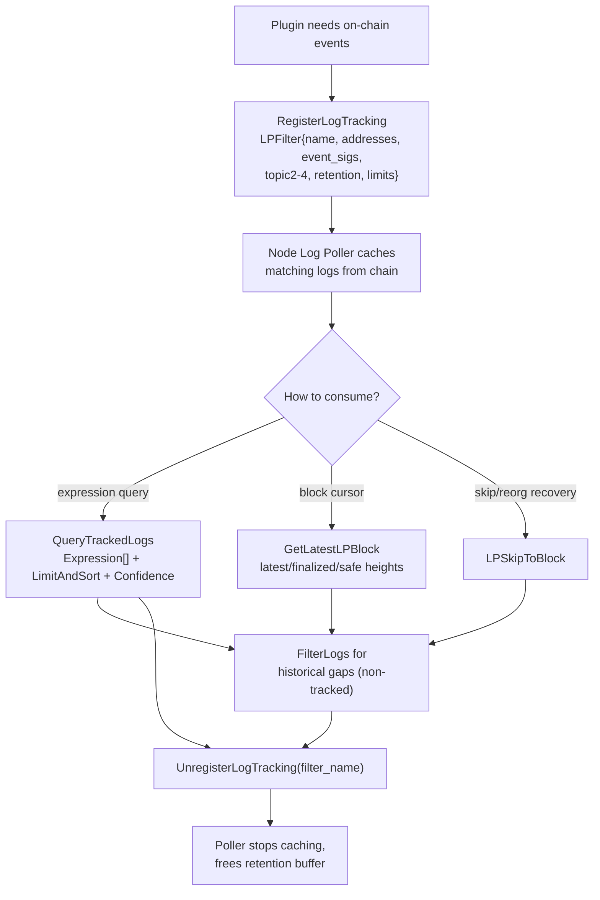
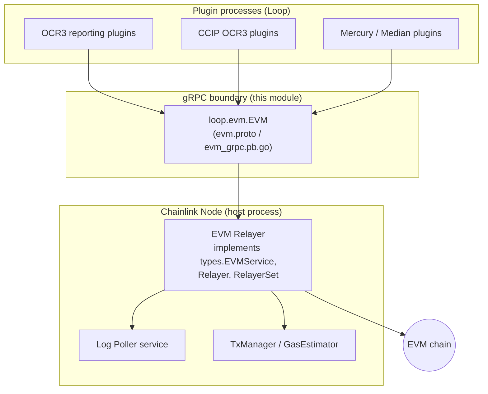

# EVM Chain gRPC Protobuf Service (`chain-grpc-protos_evm`)

## 1. Introduction

The `chain-grpc-protos_evm` module defines the **wire protocol for EVM chain access across process boundaries** in the Chainlink stack. It consists of two files in `chainlink-common/pkg/chains/evm/`:

| File | Role |
|---|---|
| `evm.proto` | Source of truth: the `loop.evm.EVM` protobuf service definition (18 RPCs) plus all request/reply/data messages |
| `evm_grpc.pb.go` | Generated gRPC Go bindings (`EVMClient`, `EVMServer`, `UnimplementedEVMServer`, `UnsafeEVMServer`, `EVM_ServiceDesc`), produced by `protoc-gen-go-grpc` v1.5.1 with `protoc` v5.29.3 |

The contract packages a complete EVM-style remote-access surface — reads (`CallContract`, `FilterLogs`, `BalanceAt`, `HeaderByNumber`, …), transaction lifecycle management (`SubmitTransaction`, `GetTransactionStatus`, `GetTransactionFee`), and integration with the node's Log Poller (`RegisterLogTracking`, `QueryTrackedLogs`, `GetLatestLPBlock`, `LPSkipToBlock`) — so that **plugin processes** (OCR2/OCR3 reporting plugins, CCIP, Mercury, etc.) can interact with EVM chains without importing node internals.

It is one of five chain protocols in the [chain-grpc-protos](../chain-grpc-protos.md) family, alongside [Aptos](chain-grpc-protos_aptos.md), [Solana](chain-grpc-protos_solana.md), [Stellar](chain-grpc-protos_stellar.md), and [TON](chain-grpc-protos_ton.md), and is a submodule of the [Shared Foundation Libraries & Domain Types](../../Shared_Foundation_Libraries___Domain_Types.md) layer.

> **Key distinction:** the *wire types* live here; the *Go domain types* these messages mirror (`evm.Log`, `evm.FilterQuery`, `evm.Transaction`, `evm.Receipt`, …) are documented in [types-chains_evm](../types-chains/types-chains_evm.md), and the service interface contracts (`EVMService`, `Relayer`, `RelayerSet`) in [types-core_relayer](../types-core/types-core_relayer.md).

---

## 2. Architecture and Component Relationships

The protobuf definition sits between its upstream schema dependencies and the runtime adapters that put the generated code to work:

**How the pieces fit together:**

1. **`evm.proto`** defines the service in package `loop.evm` with `go_package` `github.com/smartcontractkit/chainlink-common/pkg/chains/evm`. It extends the chain-agnostic query language from `loop/chain-common/query.proto` with EVM-specific primitives (contract addresses, event signatures, topic comparators).
2. **`evm_grpc.pb.go`** is fully generated and must never be hand-edited (see [§7 Code generation](#7-code-generation--build-integration)).
3. **`relayerset`** in the [Loop relayer services](../../Plugin_Process_Framework_(Loop)/loop-relayer-services/loop-relayer-services_relayerset.md) module wraps this service: `evmClient` attaches a `types.RelayID` to every call's gRPC context metadata, and `evmServer` resolves the matching `types.EVMService` implementation on the node side and converts between proto and Go domain types.
4. **`loop-grpc-bindings`** ([page](../../Plugin_Process_Framework_(Loop)/loop-grpc-bindings.md)) provides the generic transport (connections, proxies, service registration) over which this service is served to plugin processes.

---

## 3. gRPC Service Surface

The `EVM` service (`/loop.evm.EVM`) exposes 18 unary RPCs, logically grouped by capability:

### 3.1 Chain reads (read-only, non-mutating)

| RPC | Request → Reply | Purpose |
|---|---|---|
| `CallContract` | `CallContractRequest` → `CallContractReply` | Executes a read-only message call in the node's EVM without mining a transaction. Supports block-number targeting and confidence-level verification; `is_external` enables response-size limits for untrusted callers. |
| `FilterLogs` | `FilterLogsRequest` → `FilterLogsReply` | `eth_getLogs`-style historical log fetch using a `FilterQuery` (block hash *or* from/to range + addresses + topic lists), with confidence verification on the `toBlock`. |
| `BalanceAt` | `BalanceAtRequest` → `BalanceAtReply` | Account balance in wei at a block height / confidence level. |
| `EstimateGas` | `EstimateGasRequest` → `EstimateGasReply` | Simulates a `CallMsg` and returns the approximate gas units required. |
| `GetTransactionByHash` | `GetTransactionByHashRequest` → `GetTransactionByHashReply` | Fetches a transaction by its 32-byte hash. |
| `GetTransactionReceipt` | `GetTransactionReceiptRequest` → `GetTransactionReceiptReply` | Fetches the receipt (status, gas, logs, L1 fee) for a transaction hash. |
| `HeaderByNumber` | `HeaderByNumberRequest` → `HeaderByNumberReply` | Block header lookup with sentinel block numbers (see [§5.2](#52-block-number-sentinels)). |

### 3.2 Transaction lifecycle (mutations)

| RPC | Request → Reply | Purpose |
|---|---|---|
| `SubmitTransaction` | `SubmitTransactionRequest` → `SubmitTransactionReply` | Submits a transaction (`to`, ABI-encoded `data`, optional `GasConfig`) through the node's TxManager. Returns the tx hash, a `TxStatus`, and a generated **idempotency key** (`tx_idempotency_key`) for later tracking. |
| `GetTransactionStatus` | `GetTransactionStatusRequest` → `GetTransactionStatusReply` | Looks up the lifecycle `TransactionStatus` (pending → unconfirmed → finalized / failed / fatal) by idempotency key. |
| `GetTransactionFee` | `GetTransactionFeeRequest` → `GetTransactionFeeReply` | Returns the total execution cost in wei for a submitted transaction, keyed by idempotency key. |
| `CalculateTransactionFee` | `CalculateTransactionFeeRequest` → `CalculateTransactionFeeReply` | Pure computation of a fee from `ReceiptGasInfo` (gas used, effective gas price, L1 fee) — no chain state required. |
| `GetForwarderForEOA` | `GetForwarderForEOARequest` → `GetForwarderForEOAReply` | Resolves a gasless forwarder contract for an EOA, optionally constrained to a specific OCR2 aggregator address / `plugin_type`. |

### 3.3 Log Poller (LP) integration

| RPC | Request → Reply | Purpose |
|---|---|---|
| `RegisterLogTracking` | `RegisterLogTrackingRequest` → `Empty` | Installs a persistent `LPFilter` (named address/event-sig/topic filter with retention, log-count, and per-block rate limits) so matching logs are polled and cached by the node. |
| `QueryTrackedLogs` | `QueryTrackedLogsRequest` → `QueryTrackedLogsReply` | Queries cached/tracked logs using composable `Expression` filters, `LimitAndSort` pagination, and a confidence level. |
| `GetFiltersNames` | `Empty` → `GetFiltersNamesReply` | Lists registered filter names. **Deprecated** — marked for removal by `TODO PLEX-1465`. |
| `UnregisterLogTracking` | `UnregisterLogTrackingRequest` → `Empty` | Removes a filter by its persistent `filter_name`. |
| `GetLatestLPBlock` | `Empty` → `GetLatestLPBlockReply` | Returns the Log Poller's consolidated view (`LPBlock`) of latest / finalized / safe block heights with hash and timestamp. |
| `LPSkipToBlock` | `LPSkipToBlockRequest` → `Empty` | Skips LP processing forward to the given block number (reorg-recovery / catch-up). |

### 3.4 RPC dependency map

All numeric values that can exceed `uint64` (balances, gas prices, block numbers, fees, wei amounts) are carried as `values.v1.BigInt` — see the [values module](../values.md).

---

## 4. Message Catalog

### 4.1 Core chain-data messages

| Message | Fields (wire types) | Mirrors Go type |
|---|---|---|
| `CallMsg` | `from`, `to` (`bytes`, 20-byte address), `data` (ABI-encoded `bytes`) | `evm.CallMsg` |
| `Log` | `address`, `topics` (`repeated bytes`, 32-byte each), `tx_hash`, `block_hash`, `data`, `eventSig`, `block_number` (`BigInt`), `tx_index`, `index`, `removed` | `evm.Log` |
| `FilterQuery` | `block_hash` (exact-block mode), `fromBlock`/`toBlock` (`BigInt`), `addresses`, `topics` (`repeated Topics` — outer position = topic index, inner = OR alternatives) | `evm.FilterQuery` |
| `Transaction` | `nonce`, `gas`, `to`, `data`, `hash`, `value` (`BigInt`), `gas_price` (`BigInt`) | `evm.Transaction` |
| `Receipt` | `status`, `gas_used`, `tx_index`, `block_hash`, `logs`, `tx_hash`, `effective_gas_price`, `block_number`, `contract_address`, `l1_Fee` (L2 chains only) | `evm.Receipt` |
| `Header` | `timestamp` (unix), `block_number` (`BigInt`), `hash`, `parent_hash` | `evm.Header` |
| `ReceiptGasInfo` | `gas_used`, `effective_gas_price`, `l1_Fee` | `evm.ReceiptGasInfo` |
| `LPBlock` | `hash`, `latest_block_number`, `block_timestamp`, `finalized_block_number`, `safe_block_number` | `evm.LPBlock` |

### 4.2 Log-tracker filter and query messages

- **`LPFilter`** — persistent caching filter: `max_logs_kept` (0 = unlimited), `retention_time` (seconds), `logs_per_block` (rate limit, 0 = unlimited), `name` (stable identifier required for later unregistration), plus `addresses`, `event_sigs` and per-position topic value lists `topic2`/`topic3`/`topic4`.
- **`Expression` / `Primitive` (EVM extension)** — the EVM package defines its own `Expression` whose `Primitive` oneof extends the generic `loop.chain.common.Primitive` with EVM-native filters:
  - `contract_address` — 20-byte address match
  - `event_sig` — 32-byte keccak256 event-signature match
  - `EventByWord` / `EventByTopic` — position-based comparisons (`HashValueComparator` = list of 32-byte values + `ComparisonOperator`) over log topics/words
  - `general_primitive` — delegates to chain-agnostic primitives (`Comparator`, `Block`, `Confidence`, `Timestamp`, `TxHash` from [query.proto](../../Plugin_Process_Framework_(Loop)/loop-plugin-core/loop-plugin-core_query_primitives.md))
- **`BooleanExpression`, `And`, `Or`** — composable AND/OR nesting of `Expression` trees.
- **`QueryTrackedLogsRequest`** combines a list of `Expression`s with `loop.chain.common.LimitAndSort` (cursor pagination + sort by timestamp/block/sequence) and a `Confidence`.

### 4.3 Transaction-management messages

- **`GasConfig`** — optional `gas_limit` override for `SubmitTransactionRequest`; omitted fields fall back to the node's gas estimator configuration.
- **`SubmitTransactionRequest` / `SubmitTransactionReply`** — `to` + `data` + optional `GasConfig`; the reply carries `txHash`, `TxStatus`, and the server-generated idempotency key used for `GetTransactionStatus` / `GetTransactionFee`.
- **`GetForwarderForEOARequest`** — `addr` (EOA, required), `aggr` (optional aggregator constraint), `plugin_type` (optional; suggested values from `pkg/types.OCR2PluginType`).

---

## 5. Enumerations and Conventions

### 5.1 Status enums

The proto defines **two distinct** status enums because they answer different questions:

| Enum | Values | Answers | Go counterpart |
|---|---|---|---|
| `TxStatus` | `TX_FATAL` (0), `TX_REVERTED` (1), `TX_SUCCESS` (2) | "What happened to the contract execution?" | `evm.TransactionStatus` (`TxFatal` / `TxReverted` / `TxSuccess`) |
| `TransactionStatus` | `UNKNOWN` (0), `PENDING` (1), `UNCONFIRMED` (2), `FINALIZED` (3), `FAILED` (4), `FATAL` (5) | "Where is the transaction in its lifecycle?" | `types.TransactionStatus` |

`SubmitTransactionReply` reports the *submittal outcome* (`TxStatus`), while `GetTransactionStatusReply` reports the *lifecycle progression* (`TransactionStatus`). The proto comments note the 1-1 mapping requirement of `TransactionStatus` to the Go type — conversion is numeric and enforced in the relayer adapters.

### 5.2 Block number sentinels

Several requests use `values.v1.BigInt block_number` with sentinel semantics (negative values are sentinels; positive values are literal heights):

| Value | Meaning |
|---|---|
| nil / `-2` | latest block |
| `-3` | finalized block |
| `-4` | safe block |
| `> 0` | specific block height |

This convention applies to `HeaderByNumberRequest`, `CallContractRequest.block_number`, and `BalanceAtRequest.block_number`.

### 5.3 Confidence levels

All targeted-at-height requests accept a `loop.chain.common.Confidence` (`Unconfirmed` = 0, `Finalized` = 1, `Safe` = 2). For positive block heights the server must return an error if the requested block has not reached the requested confirmation level; for sentinel values the confidence is implied by the sentinel. Applicable RPCs: `HeaderByNumber`, `CallContract`, `FilterLogs` (verifies `toBlock`), `BalanceAt`, `QueryTrackedLogs`.

### 5.4 Wire-encoding conventions

- **Fixed-size byte arrays**: EVM addresses are always exactly 20 bytes (`bytes` fields with `[20]byte` semantics) and hashes/topics/signatures exactly 32 bytes. No hex strings on the wire — the [types-chains_evm](../types-chains/types-chains_evm.md) Go aliases (`Address = [20]byte`, `Hash = [32]byte`) convert directly via slicing.
- **ABI payloads**: `data` fields contain raw Solidity-spec ABI-encoded bytes; no interpretation at the transport layer.
- **Idempotency**: transaction submission is idempotent via `tx_idempotency_key`; clients must persist it to correlate `GetTransactionStatus` / `GetTransactionFee` calls.
- **`is_external`**: read RPCs (`CallContract`, `FilterLogs`, `GetTransactionByHash`, `GetTransactionReceipt`) accept this flag so the node can apply response-size limits when the caller is outside the trust boundary.

---

## 6. Data Flow Through the System

### 6.1 End-to-end component interaction (transaction submission)

The sequence below shows a plugin process submitting a transaction through the generated bindings and the relayer-set adapters, down to the node's EVM service:

**Adaptation responsibilities of the relayerset layer** (implemented in `chainlink-common/pkg/loop/internal/relayerset/evm.go`, not in this module):

- *Client side*: `evmClient` satisfies `evmpb.EVMClient` and injects `types.RelayID` into the gRPC metadata of **every** method, allowing a single connection to multiplex requests across many EVM chains.
- *Server side*: `evmServer` embeds `evmpb.UnimplementedEVMServer` for forward compatibility and dispatches each handler through `parent.getEVMService(ctx)` (RelayID-based resolution), converting proto ↔ Go types with helpers such as `ConvertCallMsgFromProto`, `ConvertFilterFromProto`, `ConvertLogsToProto`, `chaincommonpb.ConfidenceFromProto`, `chaincommonpb.ConvertLimitAndSortFromProto`, and `valuespb.NewBigIntFromInt` / `NewIntFromBigInt`.

### 6.2 Log-tracking lifecycle

The split between `FilterLogs` (point-in-time, `eth_getLogs` semantics) and `RegisterLogTracking` + `QueryTrackedLogs` (persistent caching) exists because plugins need guaranteed log delivery across restarts and reorgs; tracked filters survive process lifecycles, keyed by their `name`.

---

## 7. Code Generation & Build Integration

`evm_grpc.pb.go` is generated and carries strict version markers:

- `protoc-gen-go-grpc v1.5.1`, `protoc v5.29.3`, `grpc.SupportPackageIsVersion9` (requires **gRPC-Go v1.64.0+**).
- The companion `evm.pb.go` (message structs + conversion helpers) is generated by `protoc-gen-go` from the same `.proto`.

Generation is driven by the `chainlink-common` build system (`chainlink-common/Makefile`):

- `make install-protoc` — installs `protoc` and both Go plugin binaries, with versions pinned in `.tool-versions` (`protoc`, `protoc-gen-go-grpc`) and the Go protobuf module version.
- `make generate` — runs the full toolchain (`mockery install-protoc gomods cre-protoc modgraph release-modules`), which includes protoc regeneration for all `*.proto` files in the module, including this one.
- `make cre-protoc` — builds the custom `protoc-gen-cre` plugin used by capability protos (not required for this file, but part of the same generation pipeline; see [build-and-repo-tooling](../../Build,_CI___Release_Infrastructure/build-and-repo-tooling.md)).

**Rule of thumb for maintainers:** edit `evm.proto`, then regenerate; never edit `evm_grpc.pb.go` by hand. Any wire-format change is a cross-repo compatibility event, since plugin processes may be built against older bindings.

### Generated API notes

- `UnsafeEVMServer` (the component exported by this module's tree) is the **opt-out-of-forward-compatibility** marker interface: embedding it means newly added service methods cause compile errors instead of falling through to `Unimplemented`. The recommended pattern — used by the relayerset `evmServer` — is to embed `UnimplementedEVMServer` by value instead.
- All 18 methods are plain unary RPCs (`EVM_ServiceDesc.Streams` is empty); every client method uses `grpc.StaticMethod()` for cheaper dispatch.
- `RegisterEVMServer(s grpc.ServiceRegistrar, srv EVMServer)` performs an embedded-by-value sanity check before registering under service name `loop.evm.EVM`.

---

## 8. How This Module Fits Into the Overall System

- **Trust boundary**: the protobuf contract is the stability guarantee between node releases and independently versioned plugin binaries. Because plugins communicate through [Loop plugin framework](../../Plugin_Process_Framework_(Loop)/loop-plugin-core.md) surfaces, the `evm.proto` messages must remain backward compatible.
- **Chain family symmetry**: EVM, Aptos, Solana, Stellar and TON each have a comparable proto package under `pkg/chains/`; the chain-agnostic filter primitives they all share come from `loop.chain.common` ([query primitives](../../Plugin_Process_Framework_(Loop)/loop-plugin-core/loop-plugin-core_query_primitives.md)), while EVM adds its own `Expression`/`Primitive` extension documented in [§4.2](#42-log-tracker-filter-and-query-messages).
- **Domain-type decoupling**: node-internal code never depends on the proto types directly — it depends on the Go interfaces and structs in [types-core_relayer](../types-core/types-core_relayer.md) and [types-chains_evm](../types-chains/types-chains_evm.md); the conversion layer lives in the relayerset adapters. This keeps the wire format free to evolve behind stable Go interfaces.

---

## 9. Related Documentation

| Topic | Page |
|---|---|
| Chain proto family overview (Aptos / Solana / Stellar / TON siblings) | [chain-grpc-protos](../chain-grpc-protos.md) |
| Foundation libraries home | [Shared_Foundation_Libraries___Domain_Types](../../Shared_Foundation_Libraries___Domain_Types.md) |
| Go-native EVM domain types mirrored by this proto | [types-chains_evm](../types-chains/types-chains_evm.md) |
| `EVMService` / `Relayer` / `RelayerSet` service contracts | [types-core_relayer](../types-core/types-core_relayer.md) |
| Relayer-set client/server adapters that route `RelayID`s and convert types | [loop-relayer-services_relayerset](../../Plugin_Process_Framework_(Loop)/loop-relayer-services/loop-relayer-services_relayerset.md) |
| gRPC transport bindings used to serve/expose the contract | [loop-grpc-bindings](../../Plugin_Process_Framework_(Loop)/loop-grpc-bindings.md) |
| Shared chain-agnostic query language (`Expression`, `Confidence`, `LimitAndSort`) | [loop-plugin-core_query_primitives](../../Plugin_Process_Framework_(Loop)/loop-plugin-core/loop-plugin-core_query_primitives.md) |
| `values.v1.BigInt` arbitrary-precision encoding | [values](../values.md) |
| Protoc toolchain and generation targets | [build-and-repo-tooling](../../Build,_CI___Release_Infrastructure/build-and-repo-tooling.md) |
