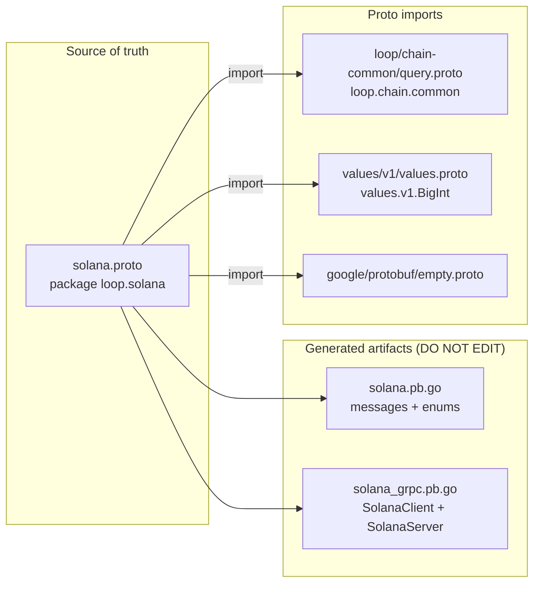
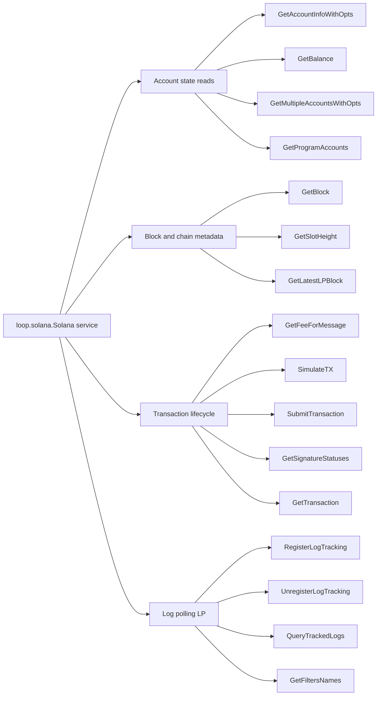
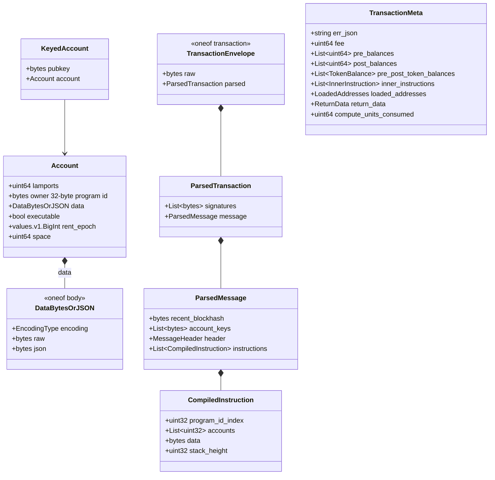
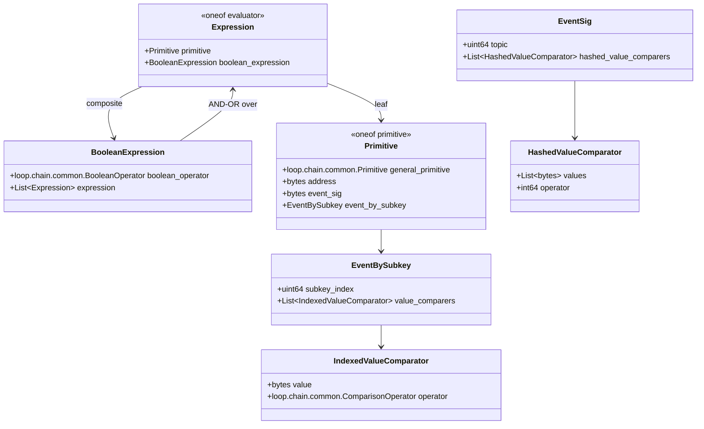
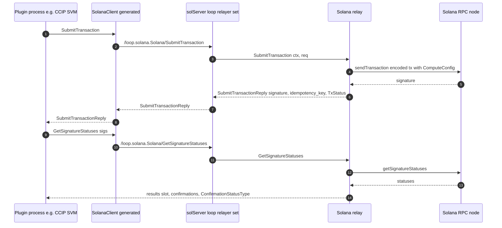
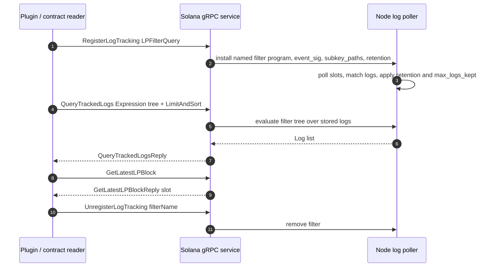

# chain-grpc-protos / Solana

> **Location:** `chainlink-common/pkg/chains/solana/` · **Proto package:** `loop.solana` · **Service:** `loop.solana.Solana`
>
> **Parent module:** [chain-grpc-protos](../chain-grpc-protos.md) — the per-chain gRPC protocol family (alongside [Aptos](chain-grpc-protos_aptos.md), [EVM](chain-grpc-protos_evm.md), [Stellar](chain-grpc-protos_stellar.md), and [TON](chain-grpc-protos_ton.md)).

## 1. Overview

This module defines the **canonical wire contract** for the Chainlink platform's Solana chain integration. It is the protobuf schema for a single gRPC service — `loop.solana.Solana` — that exposes every chain operation a Chainlink node or off-chain plugin needs against a Solana cluster:

- **Account & program state reads** (balances, account info, `getProgramAccounts` with memcmp/data-size filters)
- **Block & chain metadata reads** (block headers, slot height, log-poller progress)
- **Transaction lifecycle** (fee estimation, simulation, submission, signature-status tracking, retrieval with full execution metadata)
- **Log polling (LP)** — the registration, querying, and management of tracked on-chain program events, described with a chain-agnostic filter expression tree

Because the contract is expressed in protobuf, it can be served across **process boundaries**: the Chainlink node hosts the service, and plugin processes (OCR2/OCR3 reporting plugins, CCIP oracles, etc., managed by the [Loop plugin framework](../../Plugin_Process_Framework_(Loop)/loop-plugin-core/loop-plugin-core_plugin_runtime.md)) consume it through a generated gRPC client. The same operations are also mirrored 1:1 as in-process Go domain types — see [types-chains / Solana](../types-chains/types-chains_solana.md).

## 2. Artifacts and Code Generation

The module consists of three artifacts, all in `chainlink-common/pkg/chains/solana/`:

| File | Role | Managed how? |
|---|---|---|
| `solana.proto` | **Source of truth.** Defines the `Solana` service, 4 enums, and ~60 messages. | Hand-edited |
| `solana.pb.go` | Generated Go bindings for messages and enums (`protoc-gen-go v1.36.12`, `protoc v5.29.3`). | Regenerated — **DO NOT EDIT** |
| `solana_grpc.pb.go` | Generated gRPC client/server bindings (`protoc-gen-go-grpc v1.5.1`, `grpc.SupportPackageIsVersion9`; requires **gRPC-Go ≥ v1.64.0**). | Regenerated — **DO NOT EDIT** |



The generated code pulls in two external dependency trees visible in `solana.pb.go`'s imports:

- `github.com/smartcontractkit/chainlink-common/pkg/loop/chain-common` — the shared, chain-agnostic query model (`chain_common`).
- `github.com/smartcontractkit/chainlink-protos/cre/go/values/pb` — platform value primitives (`pb.BigInt`, used for `Account.rent_epoch`).

## 3. Service Surface: `loop.solana.Solana`

The service exposes **16 unary RPCs** (no streaming). The full method names follow `/loop.solana.Solana/<Method>` and are registered via `RegisterSolanaServer` using the exported `Solana_ServiceDesc`.

### 3.1 Account & Program State Reads

| RPC | Request → Reply | Notes |
|---|---|---|
| `GetAccountInfoWithOpts` | `GetAccountInfoWithOptsRequest` → `GetAccountInfoWithOptsReply` | Single account with encoding, commitment, `DataSlice` window, and `min_context_slot`; reply carries `RPCContext.slot`. |
| `GetBalance` | `GetBalanceRequest` → `GetBalanceReply` | Lamports for a 32-byte Pubkey at a commitment level. |
| `GetMultipleAccountsWithOpts` | `GetMultipleAccountsWithOptsRequest` → `GetMultipleAccountsWithOptsReply` | Batch fetch; results use `OptionalAccountWrapper` so *nil entries* (missing accounts) are representable. |
| `GetProgramAccounts` | `GetProgramAccountsRequest` → `GetProgramAccountsReply` | All accounts owned by a program, filterable via `RPCFilter` (`RPCFilterMemcmp` byte-offset match or `data_size` match); returns `KeyedAccount` list. |

The `is_external` boolean on these requests marks externally-triggered calls so the serving node may apply protective limits ("limits like response size limit may be applied").

### 3.2 Block & Chain Metadata

| RPC | Request → Reply | Notes |
|---|---|---|
| `GetBlock` | `GetBlockRequest` → `GetBlockReply` | Block hash, parent hash, parent slot, optional `block_time`, block height. |
| `GetSlotHeight` | `GetSlotHeightRequest` → `GetSlotHeightReply` | Current chain height at a commitment level. |
| `GetLatestLPBlock` | `google.protobuf.Empty` → `GetLatestLPBlockReply` | Slot of the latest block processed by the node's **log poller** (used for progress/health checks). |

### 3.3 Transaction Lifecycle

| RPC | Request → Reply | Notes |
|---|---|---|
| `GetFeeForMessage` | `GetFeeForMessageRequest` → `GetFeeForMessageReply` | Fee (lamports) for a base58-encoded `Message`. |
| `SimulateTX` | `SimulateTXRequest` → `SimulateTXReply` | Dry-run: signature verification, blockhash replacement, optional account return; yields logs and `units_consumed`. |
| `SubmitTransaction` | `SubmitTransactionRequest` → `SubmitTransactionReply` | Carries a `ComputeConfig` (compute-unit limit + max price), the target program, and the encoded transaction; replies with the 64-byte signature, an idempotency key, and a `TxStatus`. |
| `GetSignatureStatuses` | `GetSignatureStatusesRequest` → `GetSignatureStatusesReply` | 1:1 status per signature: slot, confirmations, error JSON, `ConfirmationStatusType`. |
| `GetTransaction` | `GetTransactionRequest` → `GetTransactionReply` | Full transaction envelope (raw **or** parsed) plus `TransactionMeta`; `is_external` supported. |

### 3.4 Log Polling (LP)

| RPC | Request → Reply | Notes |
|---|---|---|
| `RegisterLogTracking` | `RegisterLogTrackingRequest` → `RegisterLogTrackingReply` | Installs an `LPFilterQuery` filter (named). |
| `UnregisterLogTracking` | `UnregisterLogTrackingRequest` → `UnregisterLogTrackingReply` | Removes a filter by name. |
| `QueryTrackedLogs` | `QueryTrackedLogsRequest` → `QueryTrackedLogsReply` | Queries stored logs with an `Expression` filter tree and `loop.chain.common.LimitAndSort` paging. |
| `GetFiltersNames` | `google.protobuf.Empty` → `GetFiltersNamesReply` | Lists all registered filter names (observability/reconciliation). |



## 4. Wire Data Model

### 4.1 Enums

| Enum | Values | Purpose |
|---|---|---|
| `EncodingType` | `NONE=0`, `BASE58=1` (data < 129 bytes), `BASE64=2`, `BASE64_ZSTD=3`, `JSON_PARSED=4` (program parsers, base64 fallback), `JSON=5` | How account/program data is encoded on the wire. |
| `CommitmentType` | `NONE=0`, `FINALIZED=1` (cluster-finalized), `CONFIRMED=2` (supermajority vote), `PROCESSED=3` (node's latest) | Read consistency for all state queries. |
| `ConfirmationStatusType` | `NONE=0`, `PROCESSED=1`, `CONFIRMED=2`, `FINALIZED=3` | Per-signature cluster confirmation status. |
| `TxStatus` | `FATAL=0`, `ABORTED=1`, `SUCCESS=2` | Execution classification returned by submitters/simulators. |

> ⚠️ **Note the `TxStatus` zero value:** `TX_STATUS_FATAL = 0`. Any reply with an *unset* status deserializes as `FATAL`, so submitters must always set the field explicitly. All other enums use a benign `NONE` zero value.

### 4.2 Accounts and Transactions



Key design points:

- **`DataBytesOrJSON`** models Solana RPC's dual return format: program-owned bytes (`raw`) or the `jsonParsed` payload (`json`), tagged with an `EncodingType`.
- **`TransactionEnvelope`** lets the same RPC return either raw wire bytes or a fully parsed transaction (`ParsedTransaction` → `ParsedMessage` → `CompiledInstruction`), matching the `ENCODING_TYPE_JSON_PARSED` vs. base64/base58 choice.
- **`TransactionMeta`** is the complete execution receipt: fees, pre/post lamport and token balances (`TokenBalance`/`UiTokenAmount`), runtime logs, CPI (`InnerInstruction`), address-lookup-table expansion (`LoadedAddresses`), program `ReturnData`, and consumed compute units.
- Compute-budget control for submissions is expressed via **`ComputeConfig`** (`compute_limit` CUs, `compute_max_price` lamports/CU).

### 4.3 Log Polling and the Filter Expression Model

Canonical tracked events are surfaced as **`Log`**: `chain_id`, per-block `log_index`, `block_hash`, slot-based `block_number`, `block_timestamp`, `address` (program id), `event_sig` (8-byte Anchor discriminator), `tx_hash` (64-byte signature), raw `data`, a monotonic `sequence_num`, and a decode `error` field.

Filters are declared with **`LPFilterQuery`** — the Solana flavor of the shared log-poller filter:

| Field | Purpose |
|---|---|
| `name` | Stable filter identifier (used by `UnregisterLogTracking` / `GetFiltersNames`). |
| `address`, `event_sig` | 32-byte program id + 8-byte event discriminator. |
| `starting_block` | Start slot. |
| `subkey_paths` (`Subkeys`) | Path selectors into the event structure, e.g. `["events","0","fields","owner"]`. |
| `retention`, `max_logs_kept` | Storage control (seconds / cap; `0 = unlimited`). |
| `include_reverted` | Whether rolled-back transactions are kept. |
| `contract_idl_json` | Anchor IDL for decoding; **`event_idl_json` (field 6) is deprecated** in its favor. |
| `cpi_filter_config` (`CPIFilterConfig`) | Optional CPI filtering (`dest_address` + `method_name`). |

Complex predicate matching is expressed with the shared expression tree:



The compositional types (`Expression`, `BooleanOperator`, `ComparisonOperator`, `Primitive`, `LimitAndSort`) come from the chain-agnostic [query primitives](../../Plugin_Process_Framework_(Loop)/loop-plugin-core/loop-plugin-core_query_primitives.md) of the Loop framework — the same vocabulary used by the chain-agnostic contract reader interfaces (see [types-chains / Solana](../types-chains/types-chains_solana.md)). This keeps Solana filters semantically aligned with every other chain family.

### 4.4 Generated Oneof Wrapper Types

In the generated Go code, each protobuf `oneof` becomes a sealed wrapper hierarchy. The following wrapper types (from `solana.pb.go`) are the concrete case types you pattern-match on:

| Oneof | Wrapper types |
|---|---|
| `DataBytesOrJSON.body` | `DataBytesOrJSON_Raw`, `DataBytesOrJSON_Json` |
| `TransactionEnvelope.transaction` | `TransactionEnvelope_Raw`, `TransactionEnvelope_Parsed` |
| `Expression.evaluator` | `Expression_Primitive`, `Expression_BooleanExpression` |
| `Primitive.primitive` | `Primitive_GeneralPrimitive`, `Primitive_Address`, `Primitive_EventSig`, `Primitive_EventBySubkey` |

## 5. Dependencies

**Proto-level:**

| Import | Package | Provides |
|---|---|---|
| `loop/chain-common/query.proto` (`chainlink-common/pkg/loop/chain-common/`) | `loop.chain.common` | `Expression` primitives, `ComparisonOperator`, `BooleanOperator`, `LimitAndSort` (paging/sorting). Transitively imports `internal/codec/codec.proto` (`VersionedBytes`). |
| `values/v1/values.proto` (`chainlink-protos` repo) | `values.v1` | `BigInt` (used for `Account.rent_epoch`). |
| `google/protobuf/empty.proto` | `google.protobuf` | `Empty` request for `GetLatestLPBlock` / `GetFiltersNames`. |

**Go-level:** `google.golang.org/protobuf`, `google.golang.org/grpc`, plus the two generated-dependency modules above (declared in `chainlink-common/go.mod`).

## 6. System Integration

```mermaid
flowchart TB
    subgraph proto["chain-grpc-protos Solana - this module"]
        P["solana.proto"]
        GRPC["solana_grpc.pb.go<br/>SolanaClient and SolanaServer"]
        P --> GRPC
    end

    subgraph host["Chainlink node - host process"]
        SOL["solServer<br/>loop relayer set<br/>embeds UnimplementedSolanaServer"]
        RELAY["Solana relay<br/>chain service, txm, log poller"]
        RPCN["Solana RPC node"]
        RELAY --> RPCN
    end

    subgraph plugin["Plugin process - Loop framework"]
        CL["SolanaClient<br/>NewSolanaClient"]
    end

    SOL -. implements .-> GRPC
    CL -. consumes .-> GRPC
    SOL --> RELAY
    CL --> "gRPC /loop.solana.Solana/*" --> SOL
```

- **Server side (host node):** the node's Solana relay implements the `SolanaServer` interface. In the [Loop relayer services](../../Plugin_Process_Framework_(Loop)/loop-relayer-services/loop-relayer-services_relayerset.md), the per-chain server `solServer` (`chainlink-common/pkg/loop/internal/relayerset/solana.go`) embeds `solpb.UnimplementedSolanaServer` and forwards calls to the node's relay, exposing the service to external plugin processes over the plugin gRPC bus. The node's overall relay/keyring contracts live in [types-core / relayer](../types-core/types-core_relayer.md) (`SolanaService`).
- **Client side (plugin processes):** plugins (e.g., the CCIP Solana oracle in [CCIP](../../CCIP_Cross-Chain_Protocol/ccip.md), or the [Solana chain capability](../../Workflow___Capability_Runtime_(CRE_Engine)/chain_capability_solana.md)) obtain a `SolanaClient` from `NewSolanaClient(conn)` and perform chain reads/writes through it.
- **In-process mirror:** the Go domain types in `chainlink-common/pkg/types/chains/solana` (the `Client` interface, `SubmitTransactionRequest/Reply`, `LPBlock`, `Log`, `LPFilterQuery`) intentionally mirror these protobuf messages 1:1, so host-internal callers and gRPC callers share one mental model. Config-driven contract access (`ChainContractReader` with Anchor IDL, `ContractWriterConfig`) compiles down onto these operations — documented in [types-chains / Solana](../types-chains/types-chains_solana.md).

## 7. Typical Process Flows

### 7.1 Transaction Submission and Confirmation



The relay classifies the submit outcome into `TxStatus` (`SUCCESS` / `ABORTED` / `FATAL`), and the idempotency key echoed in `SubmitTransactionReply` lets callers safely correlate retries. `SimulateTX` follows the same path but stops before submission, returning logs, returned accounts, and `units_consumed`.

### 7.2 Log Tracking Lifecycle



`GetFiltersNames` supports reconciliation: callers can compare the node's registered filter set against their expectations after restarts or reconfigurations.

## 8. Regeneration and Tooling

All code is generated from `solana.proto` by the `chainlink-common` build tooling (see `chainlink-common/Makefile`):

- **`make generate`** — orchestrates codegen for the whole module: installs tools (`mockery`, `gomods`) and runs `go generate ./...`.
- **`make install-protoc`** — pins `protoc` from `.tool-versions`, installs `protoc-gen-go` (version matched to the module's `google.golang.org/protobuf` dependency) and `protoc-gen-go-grpc`.
- **`make cre-protoc`** — builds the custom `protoc-gen-cre` generator used by sibling proto surfaces in the workspace.
- Linting of the module (including generated-code hygiene) runs via the `lint` / `lint-workspace` targets.

**To change the wire contract:** edit `solana.proto`, regenerate, and commit all three files together. Never edit `solana.pb.go` or `solana_grpc.pb.go` by hand.

## 9. Compatibility and Evolution Notes

- **Wire evolution:** new fields must use fresh field numbers; new filter/encoding variants should be added as new `oneof` arms (the existing `Expression`, `Primitive`, `TransactionEnvelope`, and `DataBytesOrJSON` oneofs are the established extension points).
- **Deprecated field:** `LPFilterQuery.event_idl_json` (field 6) is deprecated — use `contract_idl_json` (field 11).
- **Server forward compatibility:** server implementations must embed `UnimplementedSolanaServer` **by value** so that adding RPCs does not break existing servers at runtime. `UnsafeSolanaServer` exists only to opt out of forward compatibility (new methods then become compile errors) and is explicitly not recommended.
- **Client generation pin:** the gRPC bindings require `grpc.SupportPackageIsVersion9` — i.e., **gRPC-Go v1.64.0 or later**.
- **Zero-value semantics:** unlike the other enums, `TxStatus` has no `NONE` value — its zero value (`TX_STATUS_FATAL`) doubles as the "unknown/unset" default; handle this explicitly when reading replies.

## 10. Related Documentation

- [chain-grpc-protos](../chain-grpc-protos.md) — overview of the per-chain proto family and shared conventions.
- Sibling chain protocols: [Aptos](chain-grpc-protos_aptos.md) · [EVM](chain-grpc-protos_evm.md) · [Stellar](chain-grpc-protos_stellar.md) · [TON](chain-grpc-protos_ton.md).
- [types-chains / Solana](../types-chains/types-chains_solana.md) — the in-process Go domain types mirroring these messages (`Client`, `LPBlock`, `Log`, `SubmitTransactionRequest/Reply`, Anchor IDL, reader/writer configs).
- [types-core / relayer](../types-core/types-core_relayer.md) — the `Relayer`/`SolanaService` interfaces the node implements against this protocol.
- [Loop query primitives](../../Plugin_Process_Framework_(Loop)/loop-plugin-core/loop-plugin-core_query_primitives.md) — the shared `loop.chain.common` filter vocabulary imported by this proto.
- [Loop relayer services / relayer set](../../Plugin_Process_Framework_(Loop)/loop-relayer-services/loop-relayer-services_relayerset.md) — where `solServer` mounts this service for plugin processes.
- [Solana chain capability (CRE)](../../Workflow___Capability_Runtime_(CRE_Engine)/chain_capability_solana.md) and [CCIP protocol](../../CCIP_Cross-Chain_Protocol/ccip.md) — high-level consumers of this chain surface.
