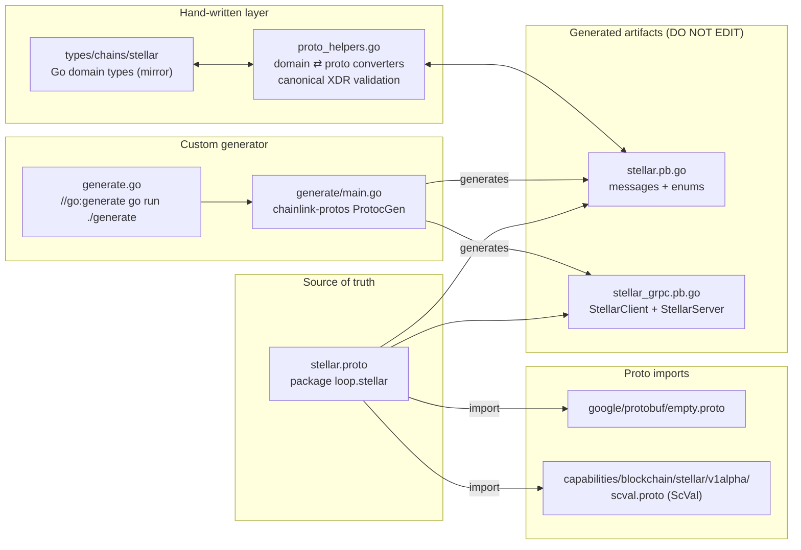
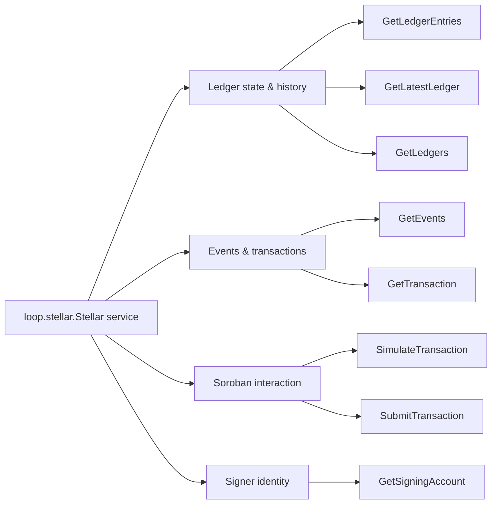
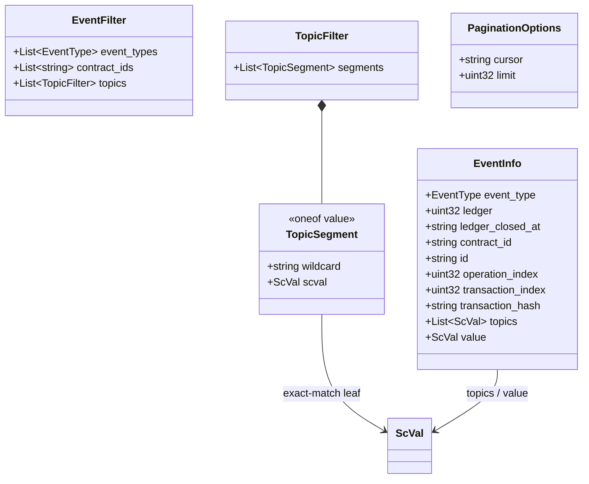
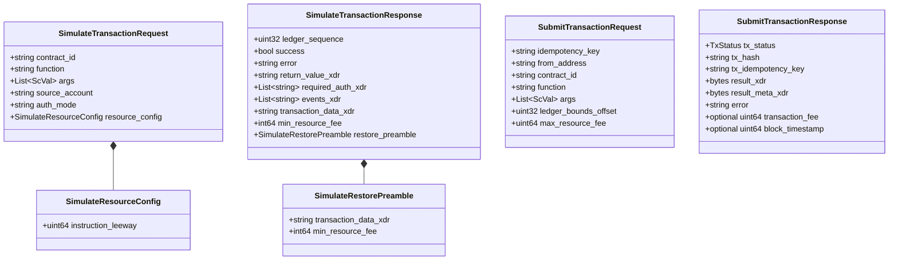
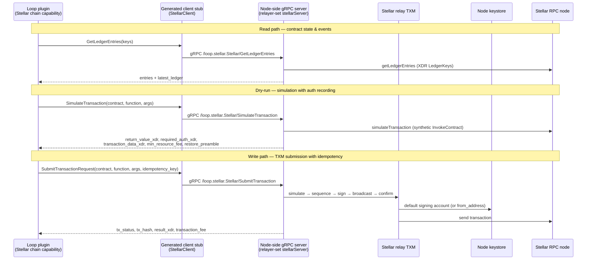

# chain-grpc-protos / Stellar

> **Location:** `chainlink-common/pkg/chains/stellar/` · **Proto package:** `loop.stellar` · **Service:** `loop.stellar.Stellar`
>
> **Parent module:** [chain-grpc-protos](../chain-grpc-protos.md) — the per-chain gRPC protocol family (alongside [Aptos](chain-grpc-protos_aptos.md), [EVM](chain-grpc-protos_evm.md), [Solana](chain-grpc-protos_solana.md), and [TON](chain-grpc-protos_ton.md)) within [Shared Foundation Libraries & Domain Types](../../Shared_Foundation_Libraries___Domain_Types.md).

## 1. Overview

This module defines the **canonical wire contract** for the Chainlink platform's Stellar chain integration, with a focus on **Soroban smart-contract interaction**. It is the protobuf schema for a single gRPC service — `loop.stellar.Stellar` — that exposes every chain operation a Chainlink node or off-chain plugin needs against a Stellar network:

- **Ledger state & history reads** — ledger entries by XDR key (e.g. contract storage / sequence lookups), latest ledger state (timeout detection), and paginated historical ledgers with full header/close metadata
- **Contract event queries** — filtered, paginated Soroban contract/system events with typed `ScVal` topics and values
- **Transaction lifecycle** — retrieval of confirmed transactions (fee/ledger metadata) and TXM-managed submission (simulation, sequence management, fee bumping, signing, confirmation, idempotency)
- **Soroban contract-call simulation** — dry-running a synthetic single-operation `InvokeContract` transaction, including authorization recording and restore preambles for archived ledger entries
- **Signer identity** — exposing the relayer's default TXM signing account so callers can encode `require_auth` contract arguments without hard-coding configuration

Because the contract is expressed in protobuf, it can be served across **process boundaries**: the Chainlink node hosts the service, and plugin processes (the [Stellar chain capability](<../../Workflow___Capability_Runtime_(CRE_Engine)/chain_capability_stellar.md>) and other [Loop framework](<../../Plugin_Process_Framework_(Loop)/loop-plugin-core/loop-plugin-core_plugin_runtime.md>) plugins) consume it through a generated gRPC client. The same operations are mirrored 1:1 as in-process Go domain types — see [types-chains / Stellar & TON](../types-chains/types-chains_stellar-ton.md).

## 2. Artifacts and Code Generation

The module lives in `chainlink-common/pkg/chains/stellar/` and follows the standard chain-proto layout, plus a Stellar-specific hand-written conversion layer and a dedicated generator:

| File | Role | Managed how? |
|---|---|---|
| `stellar.proto` | **Source of truth.** Defines the `Stellar` service, 2 enums, and ~30 messages. | Hand-edited |
| `stellar.pb.go` | Generated Go bindings for messages and enums. | Regenerated — **DO NOT EDIT** |
| `stellar_grpc.pb.go` | Generated gRPC client/server bindings (`protoc-gen-go-grpc v1.5.1`, `grpc.SupportPackageIsVersion9`; requires **gRPC-Go ≥ v1.64.0**). | Regenerated — **DO NOT EDIT** |
| `proto_helpers.go` | Hand-written domain ⇄ proto converters + **canonical XDR validation**. | Hand-edited |
| `proto_helpers_test.go` | Tests for the conversion/validation helpers. | Hand-edited |
| `generate.go`, `generate/main.go` | Custom code-generation entrypoint (see below). | Hand-edited |



### 2.1 Custom generation pipeline

Stellar is the only chain package in `chain-grpc-protos` with its own generator program:

- `generate.go` carries the `//go:generate go run ./generate` directive.
- `generate/main.go` uses the `pkg.ProtocGen` installer from the `chainlink-protos/cre/go` module (pinned in `chainlink-common/go.mod`) with the standard **`GoPlugin` + `go-grpc`** plugin pair. It registers two source directories — the `chainlink-protos` repo root (to resolve the shared `scval.proto`) and the package itself — and links the import `capabilities/blockchain/stellar/v1alpha/scval.proto` to the Go package `chainlink-common/pkg/capabilities/v2/chain-capabilities/stellar/scval`.

The protobuf compiler toolchain itself is installed and pinned by the `chainlink-common` build (see [Build & repo tooling](<../../Build,_CI___Release_Infrastructure/build-and-repo-tooling.md>)): `make install-protoc` installs `protoc`, `protoc-gen-go`, and `protoc-gen-go-grpc` from `.tool-versions` via `chainlink-common/script/install-protoc.sh`, and `make generate` chains that with the custom `cre-protoc` plugin and Go-code generation.

## 3. Service Surface: `loop.stellar.Stellar`

The service exposes **8 unary RPCs** (no streaming). Full method names follow `/loop.stellar.Stellar/<Method>` and are registered via `RegisterStellarServer` using the exported `Stellar_ServiceDesc`. Server implementations must embed `UnimplementedStellarServer` (by value) for forward compatibility; `UnsafeStellarServer` opts out.

### 3.1 Ledger state & history

| RPC | Request → Reply | Notes |
|---|---|---|
| `GetLedgerEntries` | `GetLedgerEntriesRequest` → `GetLedgerEntriesResponse` | Fetches entries by binary XDR `LedgerKey` (primary use: contract-storage / sequence-number lookups). Each `LedgerEntryResult` carries `key_xdr`, `data_xdr`, `last_modified_ledger`, an optional `live_until_ledger_seq` (modeled with the `has_live_until_ledger_seq` presence flag), and `extension_xdr`. |
| `GetLatestLedger` | `google.protobuf.Empty` → `GetLatestLedgerResponse` | Current ledger state: raw 32-byte `hash`, `protocol_version`, `sequence`, `ledger_close_time`, plus full XDR of the `LedgerHeader` and `LedgerCloseMeta`. Used for timeout detection. |
| `GetLedgers` | `GetLedgersRequest` → `GetLedgersResponse` | Paginated historical ledger range. `start_ledger` is required unless `pagination.cursor` is set — **the two are mutually exclusive** (native Stellar RPC rejects both). Returns `LedgerInfo` records (hash, sequence, close time, `LedgerHeaderHistoryEntry` and `LedgerCloseMeta` XDR), the latest/oldest ledger bounds with close times, and a cursor for the next page. |

### 3.2 Events & transactions

| RPC | Request → Reply | Notes |
|---|---|---|
| `GetEvents` | `GetEventsRequest` → `GetEventsResponse` | Contract-event queries over a `[start_ledger, end_ledger]` window with repeated `EventFilter`s and cursor/limit pagination. Returns `EventInfo` records plus a continuation cursor and latest/oldest ledger bounds & close times. |
| `GetTransaction` | `GetTransactionRequest` → `GetTransactionResponse` | Fetches a confirmed transaction by hash; replies with `fee_stroops`, `ledger_sequence`, and `ledger_close_time`. |

### 3.3 Soroban contract interaction

| RPC | Request → Reply | Notes |
|---|---|---|
| `SimulateTransaction` | `SimulateTransactionRequest` → `SimulateTransactionResponse` | Builds a **synthetic single-operation Soroban `InvokeContract`** transaction from `contract_id` + `function` + typed `ScVal` args and simulates it without submitting. Supports an optional `source_account`, an RPC auth mode, and a resource config (`instruction_leeway`). Returns the simulated outcome incl. return value, recorded auth entries, diagnostics, Soroban transaction data, min resource fee, and a restore preamble. |
| `SubmitTransaction` | `SubmitTransactionRequest` → `SubmitTransactionResponse` | Invokes a Soroban contract **via the TXM pipeline** — the TXM handles simulation, sequence management, fee bumping, signing, and confirmation. Supports an optional idempotency key (TXM assigns one if empty), signer override, per-transaction ledger-bounds offset, and a per-request resource-fee ceiling. |

The `auth_mode` on simulation maps to the underlying Stellar RPC protocol values:

| Value | Meaning |
|---|---|
| `""` (empty) | Service default — recommended to default to `"record"` |
| `"record"` | Record required auth entries |
| `"enforce"` | Enforce existing auth entries |
| `"record_allow_nonroot"` | Record non-root auth entries where supported |



## 4. Wire Data Model

### 4.1 Enums

| Enum | Values | Purpose |
|---|---|---|
| `EventType` | `EVENT_TYPE_SYSTEM=0`, `EVENT_TYPE_CONTRACT=1` | Classification of Soroban events returned by `GetEvents`. |
| `TxStatus` | `TX_STATUS_FATAL=0`, `TX_STATUS_FAILED=1`, `TX_STATUS_SUCCESS=2` | Outcome of a `SubmitTransaction`: `FATAL` = submission failed before on-chain inclusion; `FAILED` = included on-chain but execution failed; `SUCCESS` = included and succeeded. |

> ⚠️ **Note the `TxStatus` zero value:** `TX_STATUS_FATAL = 0`. Any reply with an *unset* status deserializes as `FATAL`, so submitters must always set the field explicitly. The same convention applies in the [Solana](chain-grpc-protos_solana.md) schema — see the cross-chain conventions in the [parent module](../chain-grpc-protos.md).

### 4.2 Event model



Key design points:

- **Topic matching is positional and typed.** A `TopicFilter` is a list of `TopicSegment`s; each segment is either a `wildcard` (match anything at that position) or an exact `ScVal`. This mirrors EVM log topic semantics but uses Soroban's native typed values instead of raw hashes.
- **`EventInfo` is a full-fidelity event record**: on-chain location (`ledger`, `ledger_closed_at`, `operation_index`, `transaction_index`, `transaction_hash`), identity (`contract_id`, `id`), and the typed payload (`topics` + `value` as `ScVal`s).
- **`ScVal` reuse:** all Soroban values on the wire — simulation args, event topics/values, topic-filter segments — are the shared `capabilities.blockchain.stellar.v1alpha.ScVal` message, so every consumer decodes Soroban values with one type.

### 4.3 Simulation & submission model



Key design points:

- **Contract-call simulator, not a generic envelope simulator.** `SimulateTransactionRequest` deliberately expresses the call as `contract_id + function + args` rather than accepting a raw transaction envelope — the service assembles the synthetic single-operation `InvokeContract` transaction itself.
- **Source account ≠ authorized address.** The `source_account` is only the synthetic transaction/operation source; it is *not* necessarily the `Address` argument a contract checks via `require_auth`. `GetSigningAccount` complements this by exposing the relayer's default TXM signing account so callers can encode `require_auth` arguments (e.g. a forwarder report's `transmitter` parameter) without hard-coding capability config.
- **Simulation output is submission-ready material.** `required_auth_xdr` (recorded `SorobanAuthorizationEntry`s), `transaction_data_xdr` (`SorobanTransactionData`), and `min_resource_fee` can be reused to assemble a submit-ready transaction; `restore_preamble` reports what must be restored (with its own transaction data + fee) when archived ledger entries block the invocation.
- **TXM delegation.** `SubmitTransaction` offloads the whole lifecycle to the node's transaction manager: idempotency dedup (`idempotency_key` → `tx_idempotency_key`), sequence management, fee bumping, signing, and confirmation. The reply carries the binary XDR `TransactionResult`/`TransactionMeta`, an on-chain failure `error` string, and optional `transaction_fee` (stroops, `FeeCharged`) and `block_timestamp` (microseconds) — the two proto3 `optional` fields representing "unset when unavailable".
- **XDR passthrough with canonical validation.** The proto layer is a transport envelope: ledger keys/entries, ScVal returns, auth entries, transaction data, results, and metadata all travel as XDR (binary `bytes` in ledger reads/submission replies, base64 strings in simulation replies). The hand-written `proto_helpers.go` enforces **canonical XDR** for `LedgerKey`s — rejecting empty, trailing-byte, and non-canonical round-trip encodings — and converts between the wire `bytes` and the domain types' base64-string representation.

### 4.4 Generated oneof wrapper types

In the generated Go code, the protobuf `oneof` becomes a sealed wrapper hierarchy:

| Oneof | Wrapper types |
|---|---|
| `TopicSegment.value` | `TopicSegment_Wildcard`, `TopicSegment_Scval` |

## 5. Dependencies

**Proto-level:**

| Import | Package | Provides |
|---|---|---|
| `capabilities/blockchain/stellar/v1alpha/scval.proto` (from the `chainlink-protos` repo; Go bindings in `chainlink-protos/cre/go`, pinned in `chainlink-common/go.mod`) | `capabilities.blockchain.stellar.v1alpha` | Typed `ScVal` Soroban arguments for contract calls and event topics/values |
| `google/protobuf/empty.proto` | `google.protobuf` | Empty request markers for `GetLatestLedger` and `GetSigningAccount` |

> Unlike the [EVM](chain-grpc-protos_evm.md) and [Solana](chain-grpc-protos_solana.md) schemas, `stellar.proto` imports **neither** the `loop.chain.common` query algebra **nor** `values.v1.BigInt` — event filtering uses its own `EventFilter`/`TopicFilter` model and there is no unbounded-integer field on the wire.

**Go-level** (from `chainlink-common/go.mod`): `google.golang.org/grpc`, `google.golang.org/protobuf`, `github.com/smartcontractkit/chainlink-protos/cre/go` (ScVal bindings + the protoc installer used by `generate/main.go`), and `github.com/stellar/go-stellar-sdk` (+ its `go-xdr` dependency) used by `proto_helpers.go` for XDR marshaling/unmarshaling and canonicality validation.

## 6. System Integration

```mermaid
flowchart TB
    subgraph proto["chain-grpc-protos Stellar - this module"]
        P["stellar.proto"]
        GRPC["stellar_grpc.pb.go<br/>StellarClient and StellarServer"]
        P --> GRPC
    end

    subgraph host["Chainlink node - host process"]
        S["stellarServer<br/>loop relayer set<br/>embeds UnimplementedStellarServer"]
        RELAY["Stellar relay<br/>TXM + keystore + RPC client"]
        RPCN["Stellar RPC node"]
        RELAY --> RPCN
    end

    subgraph plugin["Plugin process - Loop framework"]
        CL["stellarClient<br/>wraps stelpb.StellarClient + RelayID"]
        CAP["Stellar chain capability<br/>(actions, forwarder, monitoring)"]
        CAP --> CL
    end

    subgraph mirror["In-process consumers"]
        DT["types/chains/stellar domain Client<br/>(read/simulate surface)"]
        HLP["proto_helpers.go converters"]
        DT <--> HLP
    end

    S -. implements .-> GRPC
    CL -. consumes .-> GRPC
    S --> RELAY
    CL --> "gRPC /loop.stellar.Stellar/*" --> S
    HLP --> GRPC
```

- **Server side (host node):** the Loop relayer-set's `stellarServer` (`chainlink-common/pkg/loop/internal/relayerset/stellar.go`) embeds the generated `UnimplementedStellarServer` and forwards calls to the node's Stellar relay, which serves reads from its RPC client and drives `SubmitTransaction` through the TXM (key material comes from the node [keystore](../../Node_Platform_Services/keystore.md)). See [Loop relayer services / relayer set](<../../Plugin_Process_Framework_(Loop)/loop-relayer-services/loop-relayer-services_relayerset.md>).
- **Client side (plugin process):** `stellarClient` wraps the generated `stelpb.StellarClient` together with a `types.RelayID`, giving Loop plugins chain access without chain credentials or RPC endpoints. The **Stellar chain capability** (plugin runtime `main.go`/`capabilityGRPCService`, `Stellar`/`WriteReport` actions, `CREForwarderClient`/`TxHashRetriever`, monitoring, metering) is the primary consumer — see [chain-capability-stellar](<../../Workflow___Capability_Runtime_(CRE_Engine)/chain_capability_stellar.md>).
- **In-process path:** the Go domain types in `chainlink-common/pkg/types/chains/stellar` mirror the wire messages 1:1 (e.g. domain `Client` exposes `GetLedgerEntries`, `GetLatestLedger`, `GetLedgers`, `GetEvents`, `GetTransaction`, and `SimulateTransaction`; `SubmitTransaction` remains TXM-only). `proto_helpers.go` converts between the two representations, translating binary XDR to the domain types' base64 strings and validating canonical XDR encodings.

### 6.1 Representative flows



Key properties:

- **Plugins never hold chain credentials or RPC endpoints** — all chain I/O funnels through the node's Stellar relay and TXM.
- **`GetSigningAccount` closes the `require_auth` gap**: plugins query the TXM's default account to encode transmitter-style contract arguments, keeping capability config free of node-specific identities.
- **Simulation precedes submission** either explicitly (caller-inspected `SimulateTransaction`) or implicitly (the TXM simulates as part of `SubmitTransaction`).

## 7. Related modules

| Module | Relationship |
|---|---|
| [chain-grpc-protos](../chain-grpc-protos.md) | Parent module: shared conventions, cross-chain comparison, and regeneration tooling for all five chain proto packages |
| [Aptos](chain-grpc-protos_aptos.md) / [EVM](chain-grpc-protos_evm.md) / [Solana](chain-grpc-protos_solana.md) / [TON](chain-grpc-protos_ton.md) | Sibling wire contracts following the same service-per-chain layout |
| [types-chains / Stellar & TON](../types-chains/types-chains_stellar-ton.md) | Go domain types mirroring these wire messages 1:1 (base64 XDR strings instead of raw bytes) |
| [Loop relayer services / relayer set](<../../Plugin_Process_Framework_(Loop)/loop-relayer-services/loop-relayer-services_relayerset.md>) | Hosts `stellarServer`/`stellarClient` wrappers around this generated service for out-of-process plugins |
| [Loop plugin core / plugin runtime](<../../Plugin_Process_Framework_(Loop)/loop-plugin-core/loop-plugin-core_plugin_runtime.md>) | The Loop framework that transports these gRPC contracts to plugin processes |
| [chain-capability-stellar](<../../Workflow___Capability_Runtime_(CRE_Engine)/chain_capability_stellar.md>) | Primary consumer: the Stellar CRE chain capability (plugin runtime, actions/forwarder, monitoring, metering) built on this client |
| [Keystore](../../Node_Platform_Services/keystore.md) | Provides the signing accounts behind `GetSigningAccount` and `SubmitTransaction.from_address` |
| [Build & repo tooling](<../../Build,_CI___Release_Infrastructure/build-and-repo-tooling.md>) | protoc toolchain installation and the `generate` targets that regenerate this package |
