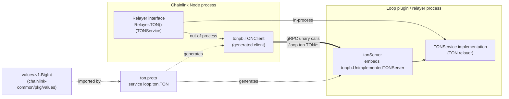
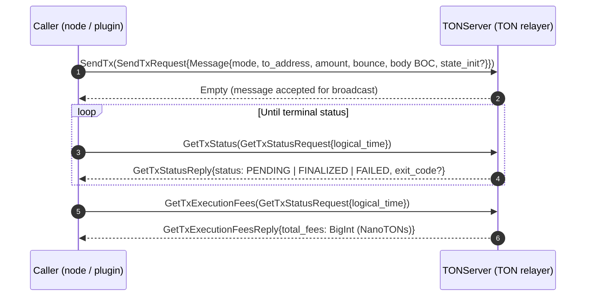
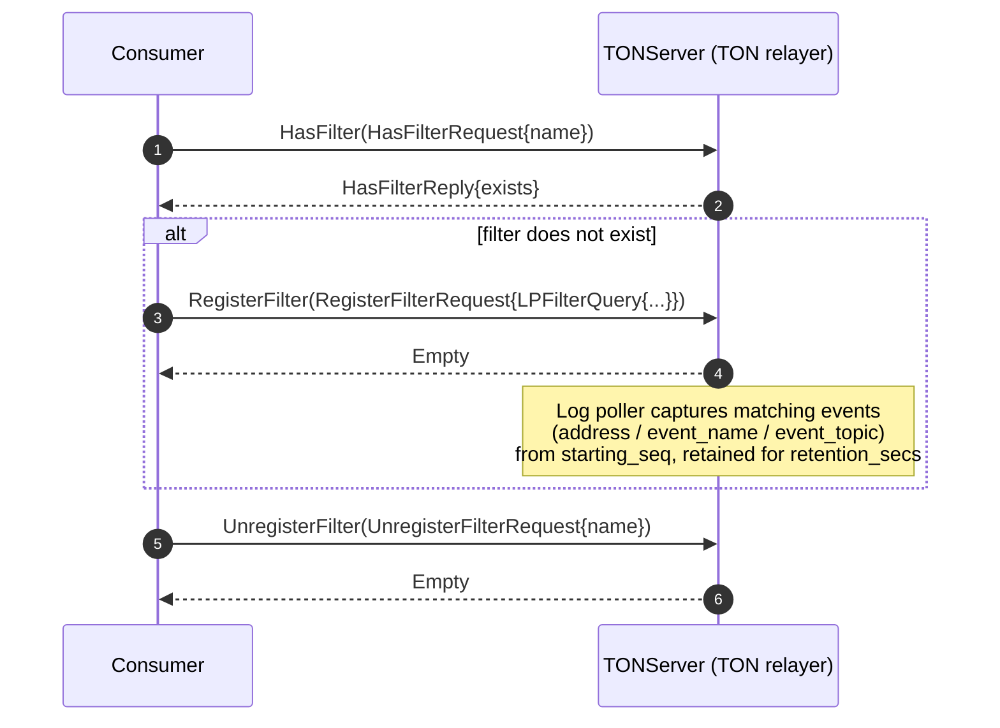
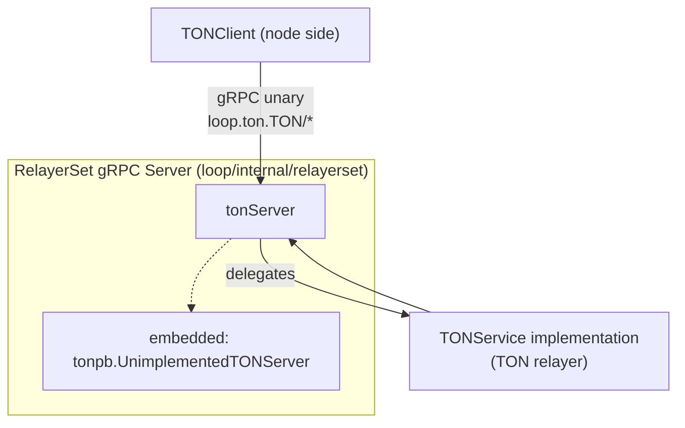

# TON Chain gRPC Protos (`chain-grpc-protos_ton`)

## Introduction

The `chain-grpc-protos_ton` module defines the **gRPC wire contract for TON (The Open Network) chain services** used by the Chainlink node and its Loop plugin ecosystem. It is one of five per-chain protobuf packages under [chain-grpc-protos](../chain-grpc-protos.md) (alongside [Aptos](chain-grpc-protos_aptos.md), [EVM](chain-grpc-protos_evm.md), [Solana](chain-grpc-protos_solana.md), and [Stellar](chain-grpc-protos_stellar.md)) within the [Shared Foundation Libraries & Domain Types](../../Shared_Foundation_Libraries___Domain_Types.md) layer.

The module consists of exactly two files in `chainlink-common/pkg/chains/ton/`:

| File | Role |
|---|---|
| `ton.proto` | Hand-authored contract: protobuf package `loop.ton`, Go package `github.com/smartcontractkit/chainlink-common/pkg/chains/ton`. Defines the `TON` gRPC service, its RPCs, and all request/response messages. |
| `ton_grpc.pb.go` | Machine-generated Go gRPC bindings (protoc-gen-go-grpc **v1.5.1**, protoc **v5.29.3**). **Do not hand-edit.** |

The `loop.ton` package name signals that this contract is part of the [Loop plugin process framework](../../Plugin_Process_Framework_(Loop)/loop-plugin-core.md): it allows a TON relayer to be consumed **in-process** via the `TONService` Go interface or **out-of-process** by Loop plugins over gRPC, using the same service shape. The service supports three functional areas — a **LiteClient** (read-only chain data), **TXM** (transaction management), and a **Log Poller** (event filter management) — mirroring the TON-specific surface of the [`Relayer`](../types-core/types-core_relayer.md) interface.

---

## Architecture and Context

The proto contract is the shared vocabulary between two sides of a process boundary:

- **The Chainlink node** (or another plugin) acts as the gRPC *client* through the generated `TONClient`.
- **The TON relayer implementation** exposes itself as the gRPC *server*. In the Loop framework, the relayer-set `tonServer` embeds the generated `UnimplementedTONServer` and delegates each call to the in-process `TONService` ([loop-relayer-services_relayerset](../../Plugin_Process_Framework_(Loop)/loop-relayer-services/loop-relayer-services_relayerset.md)).

The message shapes intentionally mirror the TON **domain types** in `chainlink-common/pkg/types/chains/ton/ton.go` ([types-chains_stellar-ton](../types-chains/types-chains_stellar-ton.md)), so the same semantic model is used on both sides of the wire.

**Key relationships:**

- The generated code is the *only* artifact consumed at runtime; `ton.proto` is the source of truth and the regeneration input.
- `ton.proto` imports `google/protobuf/empty.proto`, `google/protobuf/timestamp.proto`, and `values/v1.BigInt` from the separate [`values`](../values.md) Go module for arbitrary-precision balances/fees.
- The `Relayer` interface exposes `TON() (TONService, error)`, making `TONService` the canonical in-process abstraction that this proto mirrors for the wire ([types-core_relayer](../types-core/types-core_relayer.md)).

---

## Service Contract: `loop.ton.TON`

The `TON` service exposes **nine unary RPCs** (no streaming — `TON_ServiceDesc.Streams` is empty), grouped in the proto into three sub-services:

```mermaid
flowchart TB
    TON["service TON<br/>(loop.ton.TON)"]

    subgraph LC["LiteClient — read-only chain data"]
        direction TB
        M1["GetMasterchainInfo(Empty) → BlockIDExt"]
        M2["GetBlockData(GetBlockDataRequest) → Block"]
        M3["GetAccountBalance(GetAccountBalanceRequest) → Balance"]
    end

    subgraph TXM["TXM — transaction management"]
        direction TB
        T1["SendTx(SendTxRequest) → Empty"]
        T2["GetTxStatus(GetTxStatusRequest) → GetTxStatusReply"]
        T3["GetTxExecutionFees(GetTxStatusRequest) → GetTxExecutionFeesReply"]
    end

    subgraph LP["Log Poller — event filter management"]
        direction TB
        L1["HasFilter(HasFilterRequest) → HasFilterReply"]
        L2["RegisterFilter(RegisterFilterRequest) → Empty"]
        L3["UnregisterFilter(UnregisterFilterRequest) → Empty"]
    end

    TON --> LC
    TON --> TXM
    TON --> LP
```

### RPC reference

| Group | RPC | Request | Response | Purpose |
|---|---|---|---|---|
| LiteClient | `GetMasterchainInfo` | `google.protobuf.Empty` | `BlockIDExt` | Returns the latest masterchain block identity (workchain, shard, `seq_no`). |
| LiteClient | `GetBlockData` | `GetBlockDataRequest` | `Block` | Fetches block data for a given `BlockIDExt`; the block carries `global_id` (the EVM-equivalent chain ID for TVM). |
| LiteClient | `GetAccountBalance` | `GetAccountBalanceRequest` | `Balance` | Returns the balance of an `address` at a given block as an arbitrary-precision `values.v1.BigInt` (NanoTONs). |
| TXM | `SendTx` | `SendTxRequest` | `google.protobuf.Empty` | Submits a TON message (external message) for inclusion. |
| TXM | `GetTxStatus` | `GetTxStatusRequest` | `GetTxStatusReply` | Polls transaction status by `logical_time`; may include an optional smart-contract `exit_code`. |
| TXM | `GetTxExecutionFees` | `GetTxStatusRequest` | `GetTxExecutionFeesReply` | Returns the total execution fees (`values.v1.BigInt`, NanoTONs) for the transaction at `logical_time`. |
| Log Poller | `HasFilter` | `HasFilterRequest` | `HasFilterReply` | Reports whether a named log filter exists on the relayer. |
| Log Poller | `RegisterFilter` | `RegisterFilterRequest` | `google.protobuf.Empty` | Registers an `LPFilterQuery` so the relayer's log poller starts capturing matching events. |
| Log Poller | `UnregisterFilter` | `UnregisterFilterRequest` | `google.protobuf.Empty` | Removes a registered filter by name. |

---

## Data Types

### LiteClient types

| Message | Fields | Notes |
|---|---|---|
| `BlockIDExt` | `workchain int32`, `shard int64`, `seq_no uint32` | Identifies a TON block; `seq_no` is the block sequence number. |
| `GetBlockDataRequest` | `block BlockIDExt` | — |
| `Block` | `global_id int32` | Represents the EVM-equivalent ChainID for TVM. |
| `GetAccountBalanceRequest` | `address string`, `block BlockIDExt` | Balance is queried at a specific block. |
| `Balance` | `balance values.v1.BigInt` | Arbitrary precision; domain layer documents units as **NanoTONs**. |

### Transaction management (TXM) types

| Message / Enum | Fields / Values | Notes |
|---|---|---|
| `Message` | `mode uint32`, `to_address string`, `amount string`, `bounce bool`, `body bytes`, `state_init bytes (optional)` | `body` and `state_init` are **BOC** (Bag-of-Cells) encoded. Amounts are decimal strings in tons, while balances/fees are `BigInt` NanoTONs — note the deliberate asymmetry. |
| `SendTxRequest` | `message Message` | — |
| `GetTxStatusRequest` / `GetTxExecutionFeesRequest` | `logical_time uint64` | The TON logical time (`lt`) acts as the transaction handle for status and fee queries. |
| `GetTxStatusReply` | `status TransactionStatus`, `exit_code int32 (optional)` | `exit_code` is populated when the smart contract aborted. |
| `GetTxExecutionFeesReply` | `total_fees values.v1.BigInt` | NanoTONs. |
| `enum TransactionStatus` | `TRANSACTION_STATUS_UNKNOWN=0`, `TRANSACTION_STATUS_PENDING=1`, `TRANSACTION_STATUS_FINALIZED=2`, `TRANSACTION_STATUS_FAILED=3` | UNKNOWN (zero value) keeps the enum forward-compatible. |

### Log Poller types

| Message | Fields | Notes |
|---|---|---|
| `LPFilterQuery` | `id int64`, `name string`, `address string`, `event_name string`, `event_topic uint64`, `starting_seq uint32`, `retention_secs int64` | Filter identity and matching criteria; `starting_seq` sets the starting block sequence; retention is expressed in seconds on the wire (as `time.Duration` in the domain type). |
| `Log` | `id`, `filter_id`, `seq_no`, `address`, `event_topic`, `data bytes`, `received_at Timestamp`, `expires_at Timestamp (optional)`, `error string (optional)` | The persisted log-record shape shared with the domain layer. **Note:** no RPC in this service currently returns `Log`; it defines the record schema consumed by the relayer's log poller implementation. |
| `HasFilterRequest` / `HasFilterReply` | `name` / `exists bool` | — |
| `RegisterFilterRequest` / `UnregisterFilterRequest` | `filter LPFilterQuery` / `name string` | — |

### Typical process flows

**Transaction lifecycle (TXM):**

**Log filter management (Log Poller):**

---

## Generated gRPC Bindings (`ton_grpc.pb.go`)

The generated file provides the full client/server plumbing for the `TON` service. It requires **gRPC-Go v1.64.0 or later** (`grpc.SupportPackageIsVersion9`) and registers under the fully qualified service name **`loop.ton.TON`** with metadata `ton.proto`.

| Artifact | Kind | Purpose |
|---|---|---|
| `TONClient` | interface | Client-side API: one typed method per RPC. |
| `tONClient` / `NewTONClient(cc)` | struct / constructor | Wraps any `grpc.ClientConnInterface`; every method appends `grpc.StaticMethod()` and invokes the corresponding full method name. |
| `TON_Get*_FullMethodName` | constants | Canonical method paths, e.g. `/loop.ton.TON/SendTx`. |
| `TONServer` | interface | Server-side API; implementations **must embed `UnimplementedTONServer`** for forward compatibility. |
| `UnimplementedTONServer` | struct | Default methods returning `codes.Unimplemented`; must be embedded **by value** (embedding by pointer would panic on unimplemented methods — guarded at registration time by `testEmbeddedByValue`). |
| `UnsafeTONServer` | interface | Opt-out of forward compatibility; adding methods to `TONServer` becomes a compile error for implementers. Not recommended. |
| `RegisterTONServer(s, srv)` | function | Registers the service, validating the by-value embedding of `UnimplementedTONServer`. |
| `_TON_*_Handler` | functions | Per-RPC unary handlers; support optional server interceptors via `grpc.UnaryServerInterceptor`. |
| `TON_ServiceDesc` | descriptor | The `grpc.ServiceDesc` used by `RegisterService` (9 methods, no streams). |

**Forward-compatibility convention:** when the proto evolves, new RPCs appear on `TONServer`; servers that embed `UnimplementedTONServer` keep compiling and simply return `Unimplemented` for new methods until they are wired up. All RPCs in this service are unary; there is no streaming surface.

---

## Relationship to TON Domain Types

The proto messages are the wire-level mirror of the hand-written Go domain types in `chainlink-common/pkg/types/chains/ton/ton.go`, which define the in-process `TONService` interface (composed of `LiteClient` + TXM + Log Poller methods):

| Proto (wire) | Domain type (`pkg/types/chains/ton`) | Mapping notes |
|---|---|---|
| `BlockIDExt{workchain, shard, seq_no}` | `BlockIDExt{Workchain, Shard, SeqNo}` | 1:1. |
| `Block{global_id}` | `Block{GlobalID int32}` | 1:1. |
| `Balance{balance values.v1.BigInt}` | `Balance{Balance *big.Int}` | NanoTONs on both sides. |
| `Message{mode, to_address, amount, bounce, body, state_init}` | `Message{Mode uint8, ToAddress, Amount string, Bounce, Body BOC, StateInit BOC}` | `state_init` optional on both sides; BOC cells. |
| `GetTxStatusReply{status, exit_code?}` | `GetTxStatus(ctx, lt) (TransactionStatus, ton.ExitCode, error)` | Exit code is optional/zero-value on the wire. |
| `GetTxExecutionFeesReply{total_fees}` | `TransactionFee{TransactionFee *big.Int}` | NanoTONs. |
| `LPFilterQuery{..., retention_secs}` | `LPFilterQuery{..., Retention time.Duration}` | Seconds on the wire vs. duration in Go. |
| `Log{...}` | `Log{ID, FilterID, SeqNo, Address, EventTopic, Data, ReceivedAt, ExpiresAt, Error}` | 1:1; log retrieval is handled by the relayer's log poller, not by this service's RPCs. |

The full domain-type catalog is documented in [types-chains_stellar-ton](../types-chains/types-chains_stellar-ton.md); the `Relayer` factory interface (`TON()`) and chain services live in [types-core_relayer](../types-core/types-core_relayer.md).

---

## Integration Points

1. **`Relayer` interface** — `TON() (TONService, error)` is the in-process accessor; this proto provides the equivalent remote surface for Loop plugins ([types-core_relayer](../types-core/types-core_relayer.md)).
2. **Loop relayer set** — `chainlink-common/pkg/loop/internal/relayerset/ton.go` defines `tonServer`, which embeds `tonpb.UnimplementedTONServer` and delegates calls through its parent `Server` to a `TONService` implementation. The relayer-set test harness (`TestTON`) drives the surface with a mocked `TONService` ([loop-relayer-services_relayerset](../../Plugin_Process_Framework_(Loop)/loop-relayer-services/loop-relayer-services_relayerset.md)).
3. **Loop gRPC bindings** — this package is one of the per-chain gRPC surfaces registered by the Loop framework, alongside the generic relayer/oracle, OCR-reporting, CCIP, and Mercury bindings ([loop-grpc-bindings](../../Plugin_Process_Framework_(Loop)/loop-grpc-bindings.md)).

---

## Code Generation and Maintenance

The generated artifacts are produced by the standard toolchain configured in `chainlink-common/Makefile`:

- **`make install-protoc`** — installs `protoc` (version pinned in `.tool-versions`) via [`chainlink-common/script/install-protoc.sh`](../../Build,_CI___Release_Infrastructure/build-and-repo-tooling.md), which downloads the official protobuf release binary for Linux/macOS, plus the Go plugins `protoc-gen-go` (version matched to the module's `google.golang.org/protobuf` dependency) and `protoc-gen-go-grpc` (pinned in `.tool-versions`).
- **`make generate`** — the aggregate target (depends on `mockery`, `install-protoc`, `gomods`, `cre-protoc`, `modgraph`, `release-modules`) regenerates all protobuf-derived code in the module, including `ton_grpc.pb.go`.

**Maintenance rules:**

- Never hand-edit `ton_grpc.pb.go`; regenerate it after changing `ton.proto`.
- Keep the Go package path in the `option go_package` declaration (`github.com/smartcontractkit/chainlink-common/pkg/chains/ton`) stable — it is the import path consumers rely on.
- Version bumps to `protoc`/`protoc-gen-go-grpc` flow through `.tool-versions` and the Makefile targets; the generated header records the versions used (currently `protoc-gen-go-grpc v1.5.1`, `protoc v5.29.3`).
- Preserve zero-valued enum members (e.g. `TRANSACTION_STATUS_UNKNOWN = 0`) and `optional` field markers when evolving the contract to remain wire- and source-compatible.

---

## Related Documentation

- [chain-grpc-protos](../chain-grpc-protos.md) — parent module: the family of per-chain gRPC proto packages and shared conventions.
- Sibling chain protos: [chain-grpc-protos_aptos](chain-grpc-protos_aptos.md), [chain-grpc-protos_evm](chain-grpc-protos_evm.md), [chain-grpc-protos_solana](chain-grpc-protos_solana.md), [chain-grpc-protos_stellar](chain-grpc-protos_stellar.md).
- [types-chains_stellar-ton](../types-chains/types-chains_stellar-ton.md) — TON domain types (`LiteClient`, `TONService`, `Message`, `Log`, …) mirrored by this contract.
- [types-core_relayer](../types-core/types-core_relayer.md) — the `Relayer` interface and `TON()` service factory.
- [loop-relayer-services_relayerset](../../Plugin_Process_Framework_(Loop)/loop-relayer-services/loop-relayer-services_relayerset.md) — where `tonServer` bridges the generated server API to `TONService`.
- [loop-grpc-bindings](../../Plugin_Process_Framework_(Loop)/loop-grpc-bindings.md) and [loop-plugin-core](../../Plugin_Process_Framework_(Loop)/loop-plugin-core.md) — the Loop plugin framework this contract belongs to.
- [build-and-repo-tooling](../../Build,_CI___Release_Infrastructure/build-and-repo-tooling.md) — protobuf toolchain installation and code generation targets.
