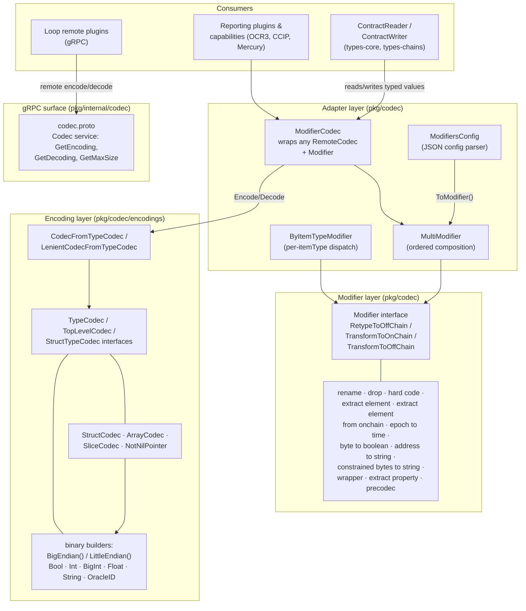
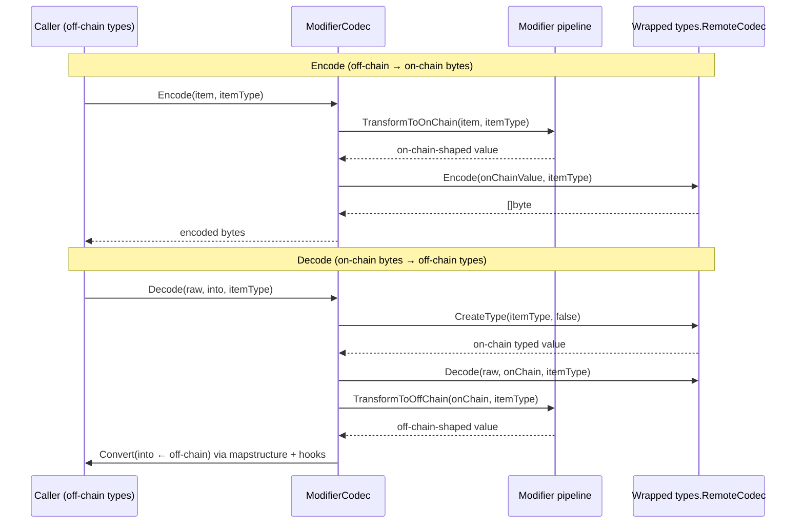

# codec

> **Package locations:** `chainlink-common/pkg/codec` (modifiers, transformation engine, utilities — detailed in [codec modifiers](codec/codec_modifiers.md)), `chainlink-common/pkg/codec/encodings` (+ `encodings/binary`) (primitive and composite wire-format codecs — detailed in [codec encodings](codec/codec_encodings.md)), `chainlink-common/pkg/internal/codec` (gRPC service definition — detailed in [codec gRPC service](codec/codec_grpc_service.md)).
>
> Part of the [Shared Foundation Libraries & Domain Types](../Shared_Foundation_Libraries___Domain_Types.md) documentation set.

## Purpose

The `codec` module is Chainlink's reflection-based **type transformation and binary encoding framework**. Its job is to bridge the gap between two worlds that must interoperate constantly:

1. **On-chain world** — fixed-size, binary wire formats (ABI words, big-endian integers, fixed byte arrays, epoch timestamps) dictated by smart contract ABIs and OCR report layouts.
2. **Off-chain world** — idiomatic Go/JSON types (`string`, `bool`, `time.Time`, nested structs, pointers) that plugins, workflows, and capabilities want to work with.

It provides:

- **Modifiers** — composable, reflection-driven transformers that retype on-chain structs into off-chain-friendly structs and convert values in both directions (rename/drop fields, extract elements, convert `uint8 → bool`, epoch → `time.Time`, address bytes → string, wrap values, pre-encode nested payloads, hard-code values).
- **Encodings** — a `TypeCodec` abstraction plus endianness-aware builders for primitives (`bool`, ints, `big.Int`, floats, strings) and composites (structs, arrays, slices) that serialize to and from compact binary.
- **Codec adapters** — `ModifierCodec` and `CodecFromTypeCodec`, which package the above into the `types.RemoteCodec` interface so any consumer of the codec contract (contract readers/writers, reporting plugins, capabilities) can transparently read and write typed data.
- **A gRPC surface** (`pkg/internal/codec`) for exposing encode/decode across process boundaries, e.g. for remotely executed plugins in the [Loop plugin framework](../Plugin_Process_Framework_(Loop)/loop-plugin-core.md).

The codec interfaces it implements are defined in the [types-core](types-core.md) module — specifically `types.RemoteCodec`, `types.Encoder`, `types.Decoder`, and `types.TypeProvider` (see [types-core: chain contracts](types-core/types-core_chain-contracts.md)). Chain-specific codecs built on these contracts (e.g. CCIP address/extra-data codecs) are documented separately in [ccip chain codecs](../CCIP_Cross-Chain_Protocol/ccip/ccip_chain_codecs.md).

## Architecture

The module is organized in three layers. Each layer only depends on the layers beneath it, and everything converges on the `types.RemoteCodec` contract from [types-core](types-core.md):



### Key concepts

| Concept | Role | Defined in |
|---|---|---|
| `types.RemoteCodec` | The module's public contract: `Encode`, `Decode`, `GetMaxEncodingSize`, `GetMaxDecodingSize`, `CreateType`, keyed by an `itemType` name | [types-core chain-contracts](types-core/types-core_chain-contracts.md) |
| `Modifier` | Reflection-based transformer with `RetypeToOffChain(onChainType, itemType)`, `TransformToOnChain(offChainValue, itemType)`, `TransformToOffChain(onChainValue, itemType)` | `pkg/codec/modifier.go` — see [codec modifiers](codec/codec_modifiers.md) |
| `ModifiersConfig` / `ModifierConfig` | JSON-configurable modifier pipelines (`{"Type": "rename", ...}`), case-insensitive, mapped to concrete modifiers at `ToModifier()` | `pkg/codec/config.go` — see [codec modifiers](codec/codec_modifiers.md) |
| `MultiModifier` / `ByItemTypeModifier` | Composition helpers: apply modifiers in order (reversed for the on-chain direction) or dispatch per `itemType` | `pkg/codec/multi_modifier.go`, `by_item_type_modifier.go` |
| `ModifierCodec` | `types.RemoteCodec` decorator: converts between on-chain and off-chain representations around a wrapped codec | `pkg/codec/modifier_codec.go` |
| `TypeCodec` | Binary primitive/composite codec: `Encode`, `Decode`, `GetType`, `Size(n)`, `FixedSize()` | [codec encodings](codec/codec_encodings.md) |
| `TopLevelCodec` / `StructTypeCodec` | Extensions of `TypeCodec` for report-level sizing (`SizeAtTopLevel`) and per-field traversal (`FieldCodec`) | [codec encodings](codec/codec_encodings.md) |
| `Builder` (encodings) | Factory for endian-specific primitive codecs; `binary.BigEndian()` and `binary.LittleEndian()` are the built-in implementations | [codec encodings](codec/codec_encodings.md) |
| `CodecFromTypeCodec` | Adapts a `map[string]TypeCodec` into a `types.RemoteCodec`, including dotted-path traversal into nested struct fields | [codec encodings](codec/codec_encodings.md) |

### Data flow

Encoding and decoding always follow the same shape — the modifier pipeline performs the *type* translation, while the wrapped codec performs the *bytes* translation:



All conversions between differently-shaped Go values are performed by the shared `Convert` helper (mapstructure-based, with `BigIntHook`, `EpochToTimeHook`, and `SliceToArrayVerifySizeHook` decode hooks) and the path utilities `ValueForPath` / `SetValueAtPath` / `ItemTyper` in `pkg/codec/utils.go` and `field_and_indices.go`.

## Sub-modules

| Sub-module | Documentation | Contents |
|---|---|---|
| Modifiers & configuration | [codec modifiers](codec/codec_modifiers.md) | The `Modifier` interface, all built-in modifiers, the JSON `ModifiersConfig` DSL, composition (`MultiModifier`, `ByItemTypeModifier`), the `ModifierCodec` adapter, and reflection/path utilities |
| Encodings & binary wire format | [codec encodings](codec/codec_encodings.md) | `TypeCodec`/`TopLevelCodec`/`StructTypeCodec` interfaces, the `Builder` abstraction, the `binary` package (big/little-endian primitive codecs incl. `big.Int` handling), struct/array/slice codecs, and `CodecFromTypeCodec` |
| gRPC codec service | [codec gRPC service](codec/codec_grpc_service.md) | `pkg/internal/codec/codec.proto` — the `Codec` service (`GetEncoding`, `GetDecoding`, `GetMaxSize`) and generated bindings used for remote codec execution |

## Configuration-driven usage

Modifiers are usually not wired by hand; they are declared as JSON (or chain-config maps) and materialized via `ModifiersConfig.UnmarshalJSON` + `ToModifier()`. The supported, case-insensitive `Type` values are: `rename`, `drop`, `hard code`, `extract element`, `extract element from onchain`, `epoch to time`, `byte to boolean`, `address to string`, `constrained bytes to string`, `wrapper`, `extract property`, and `precodec`. See [codec modifiers](codec/codec_modifiers.md) for the full config reference of each type.

A condensed example (from `pkg/codec/example_test.go`):

```go
mods, _ := json.Unmarshal(config, &codec.ModifiersConfig{})  // [{"Type":"drop",...},{"Type":"epoch to time",...}]
modifier, _ := mods.ToModifier()
byItemType, _ := codec.NewByItemTypeModifier(map[string]codec.Modifier{
    "SecondItem": modifier,
    "Unmodified": codec.MultiModifier{},
})
c, _ := codec.NewModifierCodec(&ExampleStructJSONCodec{}, byItemType)
b, _ := c.Encode(ctx, input, "SecondItem")   // bytes are the unmodified wire format
_ = c.Decode(ctx, b, output, "SecondItem")   // output has the modified, off-chain shape
```

## Error handling & testing

- All sentinel errors (`types.ErrInvalidType`, `types.ErrInvalidEncoding`, `types.ErrSliceWrongLen`, `types.ErrInvalidConfig`, …) come from the [types-core](types-core.md) module; modifiers and codecs wrap them rather than inventing new error families.
- Reflection-based retyping guards against panics from `reflect.StructOf` and converts them into `types.ErrInvalidType` errors.
- The module is extensively tested: each modifier has a dedicated `_test.go` file exercising retype + both transforms across structs, pointers, slices, arrays, and nested paths (`pkg/codec/*_test.go`), the encodings layer includes table-driven and fuzz tests (`pkg/codec/encodings/*_test.go`, `type_codec_fuzz_test.go`), and `example_test.go` doubles as end-to-end documentation with verified output.

## Relationship to other modules

- **[types-core](types-core.md)** — defines the `RemoteCodec`/`Encoder`/`Decoder`/`TypeProvider` contracts implemented here, plus the shared error types.
- **[types-chains](types-chains.md)** — chain-specific `ChainReader`/`ChainWriter` configs (EVM, Solana, Aptos, Sui, …) reference codecs by `itemType` when declaring how contract data is read and written.
- **[CCIP chain codecs](../CCIP_Cross-Chain_Protocol/ccip/ccip_chain_codecs.md)** — CCIP's chain-specific address/extra-data codecs and message hashers are consumers built on the same interfaces.
- **[Loop plugin framework](../Plugin_Process_Framework_(Loop)/loop-plugin-core.md)** — remotely executed plugins communicate typed values across the process boundary; `pkg/internal/codec` provides the encode/decode gRPC service used for that transport, and plugin surfaces (e.g. Mercury data sources, OCR3 reporting) carry `RemoteCodec` implementations.
- **[values](values.md)** — the dynamically-typed `values` package is a common producer/consumer of codec input when types are not known at compile time.
