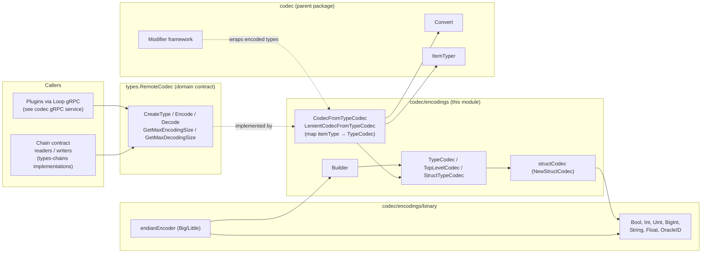
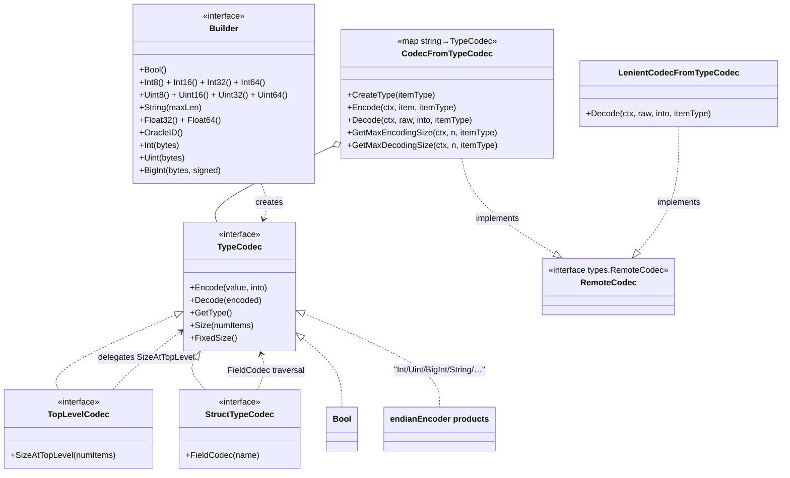
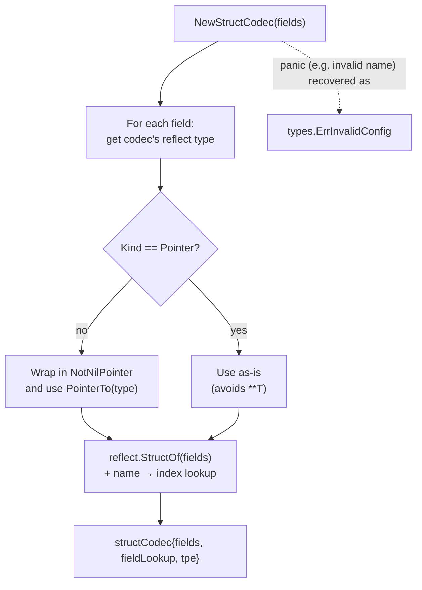
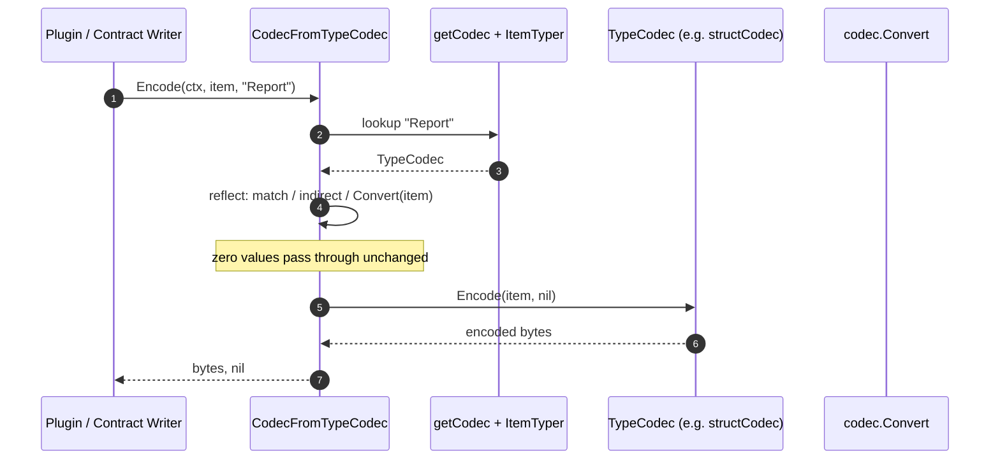
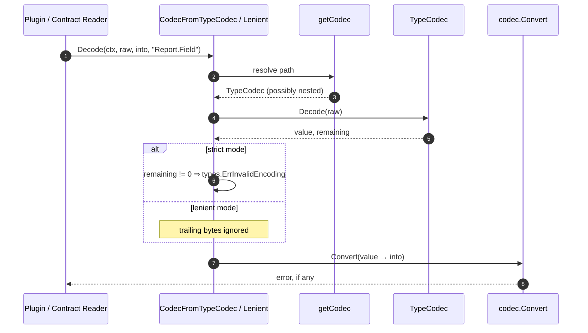
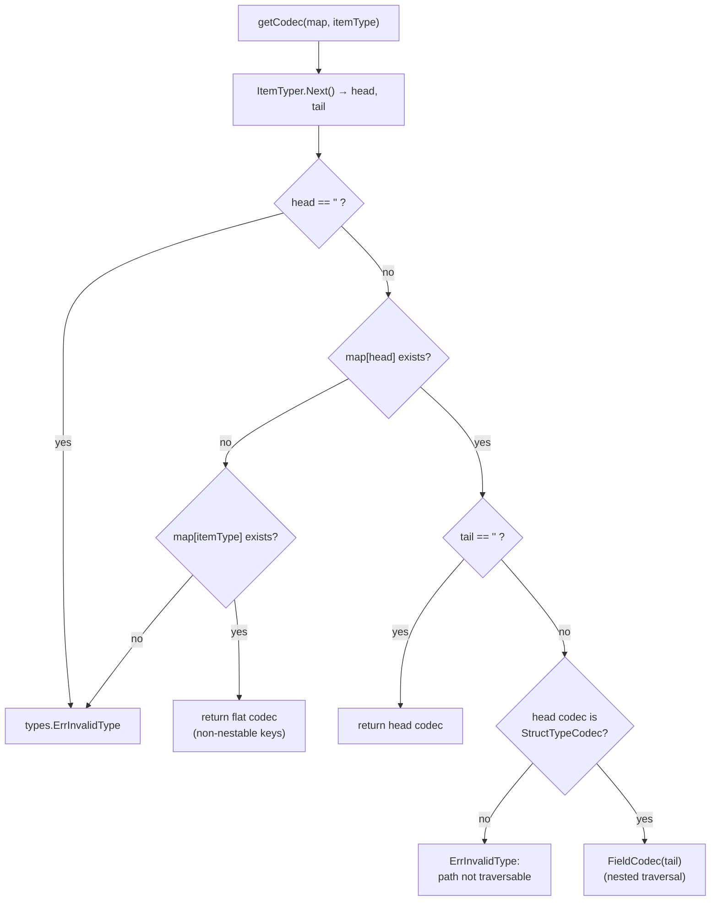

# Codec Encodings

> Module: `chainlink-common/pkg/codec/encodings`
> Parent: [codec package overview](../codec.md) · [Shared Foundation Libraries & Domain Types](../../Shared_Foundation_Libraries___Domain_Types.md)

## 1. Introduction

The **codec_encodings** module is the binary (de)serialization engine of the `chainlink-common` codec library. It provides:

- **`TypeCodec`** – the fundamental contract for encoding a single Go value to bytes and decoding bytes back, plus reflective type information and static size computation.
- **Specialized interfaces** – `TopLevelCodec` (codecs that sit at the top level of a report, where N items may be concatenated) and `StructTypeCodec` (codecs that expose per-field codecs for nested path traversal).
- **`Builder`** – a factory abstraction for constructing primitive `TypeCodec`s with a chosen byte order (big- or little-endian), implemented by the `binary` sub-package.
- **Adapters** – `CodecFromTypeCodec` and `LenientCodecFromTypeCodec`, which map item-type strings to `TypeCodec`s and adapt them to the [`types.RemoteCodec`](../types-core/types-core_chain-contracts.md) interface consumed by chain contract readers/writers.

The module is intentionally chain-agnostic: it knows nothing about ABIs, IDLs, or wire formats of specific blockchains. Chain-specific codecs are *composed* from these primitives (see [types-chains](../types-chains.md) and the chain capabilities, e.g. the [EVM chain capability](../../Workflow___Capability_Runtime_(CRE_Engine)/chain_capability_evm.md)).

## 2. Position in the System

The `chainlink-common` Go module (`chainlink-common/go.mod`, module path `github.com/smartcontractkit/chainlink-common`) hosts this library. Its neighbours interact as follows:



Related documentation:

| Topic | Page |
|---|---|
| Parent package, modifiers wiring, examples | [codec overview](../codec.md) |
| Post-encode/decode value transformations (`Modifier`, `ModifierConfig`) | [codec modifiers](codec_modifiers.md) |
| Exposing codecs over the Loop plugin boundary | [codec gRPC service](codec_grpc_service.md) |
| `types.RemoteCodec`, contract reader/writer contracts | [types-core: chain contracts](../types-core/types-core_chain-contracts.md) |

## 3. Core Abstractions

All interfaces live in `chainlink-common/pkg/codec/encodings/type_codec.go` and `builder.go`.



### 3.1 `TypeCodec` — the unit of binary encoding

| Method | Semantics |
|---|---|
| `Encode(value any, into []byte) ([]byte, error)` | Appends the binary encoding of `value` to `into` and returns the result. |
| `Decode(encoded []byte) (any, []byte, error)` | Decodes the *first* value from `encoded`; returns the decoded value plus the **remaining** unconsumed bytes. |
| `GetType() reflect.Type` | The Go type this codec produces/consumes. |
| `Size(numItems int) (int, error)` | Size in bytes of the encoding when there are `numItems` reports. Nested variable-size elements must be queried with their count; ambiguous nesting (e.g. `[][]int`) returns an error. |
| `FixedSize() (int, error)` | Size when the element count is implicit; returns an error if a count would be required. |

### 3.2 `TopLevelCodec` and `StructTypeCodec`

- **`TopLevelCodec`** adds `SizeAtTopLevel(numItems int)`. When a codec appears at the top level of a report (N concatenated items), each *member* may be sized with `Size(numItems)` instead of `Size(1)` — this is how variable-length top-level members (e.g. a `[]int` field) can be bounded. For `structCodec`, `Size(n)` sums each field's `Size(1)`-equivalent contribution while `SizeAtTopLevel(n)` propagates `n` to every field (see the [sizing semantics](#6-sizing-semantics) section).
- **`StructTypeCodec`** adds `FieldCodec(name string) (TypeCodec, error)`, enabling `CodecFromTypeCodec` to resolve dotted item types such as `"Report.SomeField"`.

### 3.3 `CodecFromTypeCodec` — the `RemoteCodec` adapter

`CodecFromTypeCodec` is a `map[string]TypeCodec` implementing `types.RemoteCodec`:

- **`CreateType(itemType, forEncoding)`** – returns a fresh pointer to the codec's Go type (`reflect.New`), dereferencing pointer kinds so the result is `*T`, never `**T`.
- **`Encode(ctx, item, itemType)`** – looks up the codec, then uses the parent package's `codec.Convert` (reflection-based conversion, see [codec overview](../codec.md)) to coerce `item` to the codec's Go type unless it already matches or is a zero value. Non-pointer items are indirected when the target is non-pointer.
- **`GetMaxEncodingSize(ctx, n, itemType)`** – delegates to `SizeAtTopLevel(n)` when the resolved codec is a `TopLevelCodec`, otherwise to `Size(n)`.
- **`GetMaxDecodingSize(ctx, n, itemType)`** – currently identical to the max encoding size.
- **`Decode(ctx, raw, into, itemType)`** – strict mode: after decoding, any **remaining bytes cause an error** (`types.ErrInvalidEncoding`), then the decoded value is converted into `into` via `codec.Convert`.

`LenientCodecFromTypeCodec` embeds the same map semantics but **tolerates trailing bytes** after the decoded value (common when on-chain layouts append dynamic tails) and forwards `CreateType`, `Encode` and sizing to `CodecFromTypeCodec`.

### 3.4 `Builder` — primitive codec factory

`Builder` (in `builder.go`) produces `TypeCodec`s for fixed-width integers (`Int8`–`Int64`, `Uint8`–`Uint64`), floats, booleans, `OracleID`, length-bounded `String(maxLen)`, and width-parametrized `Int(bytes)`, `Uint(bytes)`, `BigInt(bytes, signed)`. The `binary` package provides the two production implementations, `binary.BigEndian()` and `binary.LittleEndian()`.

## 4. The `binary` Sub-Package

`binary/builder.go` defines the `endianEncoder`, which composes a `binary.ByteOrder`/`AppendByteOrder` with a `bigIntEncoder` strategy:

- **`bigBigInt`** – big-endian `*big.Int` serialization via `libocr/bigbigendian`; unsigned serialization rejects negative values and values wider than `size*8` bits (`types.ErrInvalidType`).
- **`littleBigInt`** – implements little-endian by reversing the bytes produced/consumed by the big-endian strategy (`slices.Reverse`), for both signed and unsigned forms.

Factory methods on `endianEncoder`:

| Builder method | Constructed codec |
|---|---|
| `Bool()` | `Bool` (see below) |
| `String(maxLen)` | `NewString(maxLen, e)` — a length-prefixed byte slice: header width `⌈bits(maxLen)/8⌉` via `e.Int`, elements via `e.Uint8`, composed with `NewSlice` |
| `Int/Uint(bytes)` | fixed-width, endian-aware integer codecs |
| `BigInt(bytes, signed)` | `NewBigInt(bytes, signed, e.bigIntEncoder)` |
| `Float32/Float64()` | IEEE-754 codecs bound to the byte order |
| `OracleID()` | dedicated OCR oracle-ID codec |

`binary/bool.go` shows the canonical minimal `TypeCodec`: `Bool` encodes `true`/`false` as a single `1`/`0` byte, decodes via the generic bounds-checked helper **`encodings.SafeDecode[T]`** (`utils.go`), reports `reflect.TypeFor[bool]`, and is always size `1`.

The struct codec (below) composes these primitives: `NewSlice(field, size)` validates that the size codec decodes to `int` and that both arguments are non-nil (`types.ErrInvalidConfig` otherwise), then returns a size-prefixed slice codec.

## 5. Struct Codec

`struct.go` provides `NewStructCodec(fields []NamedTypeCodec) (TopLevelCodec, error)` where `NamedTypeCodec{Name string, Codec TypeCodec}`:



- The generated Go type is `*struct{...}` with **every field a pointer** (validated by `struct_test.go`'s `GetType` assertions); non-pointer codecs are adapted by the internal `NotNilPointer` wrapper so users never deal with pointer-to-pointer.
- Field names must be unique and non-empty; violations surface as `types.ErrInvalidConfig` (also via the recover-guard, since `reflect.StructOf` panics on invalid names).
- `Encode` concatenates field encodings in declaration order and honours a caller-provided prefix buffer; `Decode` consumes fields in order and returns leftover bytes as `remaining`.
- `FieldCodec(name)` resolves a field's codec, enabling nested item-type traversal (see below).

## 6. Sizing Semantics

Understanding `Size` vs `SizeAtTopLevel` is the trickiest part of the module. The unit tests in `struct_test.go` illustrate it with three 1/3-byte fields (`Foo`, `Bar`, `Baz`):

| Call | Result | Interpretation |
|---|---|---|
| `structCodec.Size(100)` | `5` | One struct instance: each field contributes its fixed size (`Size(1)` semantics); the item count is *not* propagated. |
| `structCodec.SizeAtTopLevel(100)` | `500` | 100 struct instances at the top level of a report: the count **is** propagated to every field, so variable-length fields scale. |
| `structCodec.FixedSize()` | `5` | Implicit-count size; error for codecs that need a count (e.g. nested slices of slices). |

`CodecFromTypeCodec.GetMaxEncodingSize` therefore calls `SizeAtTopLevel(n)` for top-level codecs so that per-report capacity calculations (used to bound OCR report payloads) account for variable-size members, and falls back to `Size(n)` otherwise.

## 7. Data Flow

### 7.1 Encoding



### 7.2 Decoding (strict vs lenient)



### 7.3 Item-type resolution (`getCodec`)



## 8. Error Model

The module consistently wraps sentinel errors from `chainlink-common/pkg/types` (documented with the [types-core chain contracts](../types-core/types-core_chain-contracts.md)):

| Sentinel | Raised when |
|---|---|
| `types.ErrInvalidType` | Value's Go type doesn't match the codec; unknown item type; non-traversable dotted path; `BigInt` value negative for unsigned or too wide. |
| `types.ErrInvalidEncoding` | Not enough bytes to decode; strict decode leaves trailing bytes. |
| `types.ErrInvalidConfig` | Duplicate/empty struct field names; `NewSlice` given nil codecs or non-int size codec; panic inside `NewStructCodec`. |

## 9. Typical Usage

A chain integration builds a `CodecFromTypeCodec` from a `Builder` and composes it with [modifiers](codec_modifiers.md), which retype on-chain structs into friendlier off-chain shapes before/after encoding:

```go
b := binary.BigEndian()
fieldCodec, _ := encodings.NewStructCodec([]encodings.NamedTypeCodec{
    {Name: "AccountId", Codec: b.Uint(32)},          // e.g. Solana pubkey
    {Name: "Amount",    Codec: must(b.BigInt(32, false))},
})

codec := encodings.CodecFromTypeCodec{
    "MyReport": fieldCodec,   // "MyReport.Amount" resolves via FieldCodec
}

raw, err := codec.Encode(ctx, report, "MyReport")
var out *MyReportGoStruct
err = codec.Decode(ctx, raw, &out, "MyReport") // strict: no trailing bytes
```

Swap `CodecFromTypeCodec` for `LenientCodecFromTypeCodec` when the on-chain payload may carry bytes beyond the logical report (e.g. append-only tail fields).

## 10. Testing

- `struct_test.go` covers struct construction validation, in-order encode/decode, prefix handling, leftover-byte propagation, `Size`/`FixedSize`/`SizeAtTopLevel` semantics, and `FieldCodec` traversal, using the `testutils.TestTypeCodec` fake (declared via the local `fieldCodec` test interface).
- The parent package's tests (`example_test.go`, `precodec_test.go`, `wrapper_test.go`, etc.) exercise these codecs end-to-end together with modifiers — see [codec overview](../codec.md) and [codec modifiers](codec_modifiers.md).

## 11. Related Modules

- [codec overview](../codec.md) — package entry point, `Modifier` wiring, `Convert`.
- [codec modifiers](codec_modifiers.md) — `Modifier`/`ModifierConfig` transformations layered on encodings.
- [codec gRPC service](codec_grpc_service.md) — protobuf/gRPC surface (`chainlink-common/pkg/internal/codec`), used by the [Loop plugin framework](../../Plugin_Process_Framework_(Loop)/loop-grpc-bindings.md) to serve `RemoteCodec` across process boundaries.
- [types-core: chain contracts](../types-core/types-core_chain-contracts.md) — the `RemoteCodec` contract this module implements.
- [types-chains](../types-chains.md) — chain-specific reader/writer configuration that consumes codecs.
