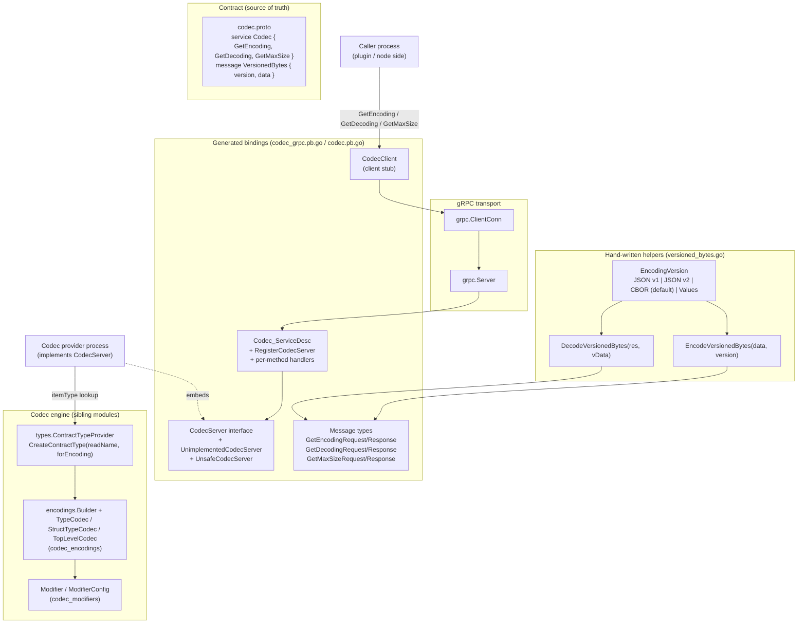
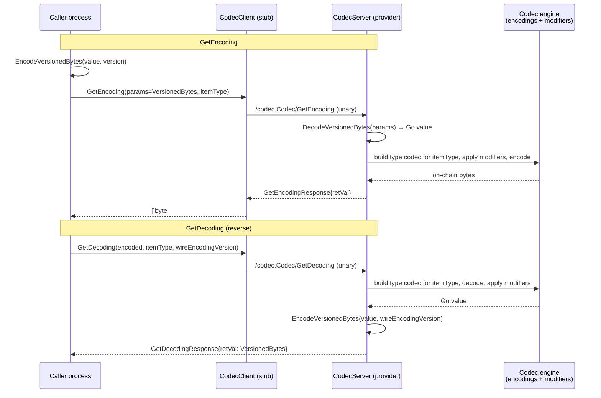
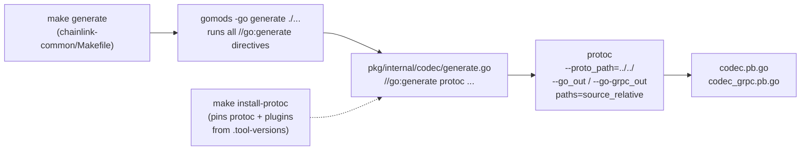

# Codec gRPC Service (`chainlink-common/pkg/internal/codec`)

## Introduction

The `codec_grpc_service` module defines the **network contract for the Chainlink codec engine**: a small, protocol-first surface (a single protobuf file plus its generated gRPC bindings) that lets one process ask another to **encode to an on-chain binary representation**, **decode from an on-chain binary representation**, or **compute the maximum wire size** of typed values.

The module lives in `chainlink-common/pkg/internal/codec` and consists of:

| File | Role |
| --- | --- |
| `codec.proto` | Protobuf definition of the `Codec` service (3 unary RPCs) and its request/response messages. |
| `codec_grpc.pb.go` | Generated gRPC bindings (`CodecClient`, `CodecServer`, `UnimplementedCodecServer`, `UnsafeCodecServer`, `RegisterCodecServer`, `Codec_ServiceDesc`). |
| `codec.pb.go` | Generated message types (`VersionedBytes`, `GetEncodingRequest`, ...). |
| `versioned_bytes.go` | Hand-written helpers implementing the versioned value wire format used by the service (`EncodeVersionedBytes`, `DecodeVersionedBytes`, `EncodingVersion`). |
| `generate.go` | `//go:generate` directive that invokes `protoc` to regenerate the `.pb.go` files. |

The service is intentionally minimal: it is the **remote-boundary twin** of the in-process codec engine documented in [codec.md](../codec.md). Everything *between* the bytes — type-codec composition, struct layout, binary encodings — is owned by the codec library modules [codec encodings](codec_encodings.md) and [codec modifiers](codec_modifiers.md); this module only fixes *what travels over the wire* and *how the peers invoke each other*.

> **Placement note:** the package is under `internal/`, so Go's import rules restrict it to code whose import path is rooted at `github.com/smartcontractkit/chainlink-common/...`. Other repositories that need remote codec services consume them through public wrappers built on top of this contract.

---

## Architecture Overview



Key ideas:

1. **One service, three operations.** The `Codec` service mirrors the engine's core API — encode, decode, and max-size — each parameterized by an `itemType` string (see [Service contract](#service-contract)).
2. **Versioned value envelope.** Values crossing the boundary are wrapped in `VersionedBytes`, which pairs the raw payload with the *wire encoding version* used to serialize it. This decouples the evolution of the dynamic value format from the protobuf schema.
3. **Thin generated layer.** The `.pb.go` files are pure `protoc` output (no hand-edits), kept in sync via `go:generate` (see [Code generation and build](#code-generation-and-build)).
4. **Compile-time safety.** All three RPCs are unary; the generated stubs attach `grpc.StaticMethod()` and the service exposes no streaming surfaces.

---

## Service contract

Defined in `chainlink-common/pkg/internal/codec/codec.proto` (package `codec`, service `codec.Codec`):

```protobuf
service Codec {
  rpc GetEncoding(GetEncodingRequest) returns (GetEncodingResponse);
  rpc GetDecoding(GetDecodingRequest) returns (GetDecodingResponse);
  rpc GetMaxSize(GetMaxSizeRequest) returns (GetMaxSizeResponse);
}
```

| RPC | Semantics | In-process equivalent |
| --- | --- | --- |
| `GetEncoding` | Encode a value (serialized as `VersionedBytes`) into the on-chain binary representation for `itemType`. Returns the raw encoded bytes. | `ChainCodec.Encode(itemType, item)` |
| `GetDecoding` | Decode on-chain `encoded` bytes into the versioned wire format for `itemType`, serializing the result using `wireEncodingVersion`. | `ChainCodec.Decode(itemType, bytes, into)` |
| `GetMaxSize` | Compute the maximum size in bytes occupied by `n` items of `itemType`, either when encoding (`forEncoding = true`) or when decoding (`forEncoding = false`). | `TopLevelCodec.SizeAtTopLevel(numItems)` |

### Messages

| Message | Fields | Purpose |
| --- | --- | --- |
| `VersionedBytes` | `version uint32`, `data bytes` | Envelope pairing a payload with the wire-encoding version used to produce it. |
| `GetEncodingRequest` | `params VersionedBytes`, `itemType string` | The value to encode (already in a versioned wire format) plus the target item type. |
| `GetEncodingResponse` | `retVal bytes` | On-chain encoded bytes. |
| `GetDecodingRequest` | `encoded bytes`, `itemType string`, `wireEncodingVersion uint32` | On-chain bytes, target item type, and the desired version for the serialized result. |
| `GetDecodingResponse` | `retVal VersionedBytes` | The decoded value in the requested wire format. |
| `GetMaxSizeRequest` | `n int32`, `itemType string`, `forEncoding bool` | Item count, item type, and direction (encode vs. decode sizing). |
| `GetMaxSizeResponse` | `sizeInBytes int32` | Upper bound of the wire size. |

### `itemType` semantics

`itemType` names a type known to the codec engine — the same identifiers used by chain reader/writer configurations. Concrete Go types are produced from these names by `ContractTypeProvider.CreateContractType(readName string, forEncoding bool)` (see [types-core chain-contracts](../types-core/types-core_chain-contracts.md)); the type-codec machinery that gives each name its wire layout is documented in [codec encodings](codec_encodings.md), and the on-chain ⇄ off-chain representation adjustments are described in [codec modifiers](codec_modifiers.md).

The `GetMaxSize` operation exists because on-chain environments impose hard transaction size limits — most notably Solana's transaction size budget, which motivates the size-buffering options found in the Solana writer configuration (`chainlink-common/pkg/types/solana/contract_writer.go`, `MethodConfig.BufferPayloadMethod`) — so callers must be able to ask "how large can this payload get?" before attempting a write.

---

## `VersionedBytes` and the wire encoding versions

`versioned_bytes.go` implements the envelope used by `GetEncodingRequest.params` and `GetDecodingResponse.retVal`:

| `EncodingVersion` | Value | Serialization |
| --- | --- | --- |
| `JSONEncodingVersion1` | 0 | Standard library `encoding/json` (decoding uses `UseNumber()` to preserve numeric precision). |
| `JSONEncodingVersion2` | 1 | `go-json-experiment/json` with `StringifyNumbers(true)` (numbers marshaled as strings). |
| `CBOREncodingVersion` | 2 | Canonical deterministic CBOR (`fxamacker/cbor`, `CoreDetEncOptions`, RFC 3339 nano time) — **the default** (`DefaultEncodingVersion`). |
| `ValuesEncodingVersion` | 3 | CRE dynamic `values` protobuf (`github.com/smartcontractkit/chainlink-protos/cre/go/values`), proto-marshaled; supports unwrapping directly into a target Go value or into a `values.Value`. |

Design properties:

- **Explicit, extensible versioning.** Every payload self-describes its encoding, so new formats can be added without changing the protobuf schema or breaking old peers. Unknown versions fail fast with an "unsupported encoding version" error that wraps the shared `types.ErrInvalidEncoding` / `types.ErrInvalidType` / `types.ErrInternal` error taxonomy.
- **Deterministic by default.** The CBOR default is *canonical* (deterministic) encoding, so identical logical values always produce identical bytes — a prerequisite for hashing and consensus-adjacent flows.
- **Bidirectional helpers.** `EncodeVersionedBytes(data, version)` and `DecodeVersionedBytes(res, vData)` are the single place where the envelope's version ↔ codec mapping is implemented; gRPC callers should never hand-roll this conversion.

The CRE `values` integration links this module to the broader CRE value system documented in [values](../values.md).

---

## Generated code and API surface

`codec_grpc.pb.go` is generated by `protoc-gen-go-grpc` **v1.5.1** (protoc **v5.29.3**) and requires **gRPC-Go ≥ v1.64.0** (`grpc.SupportPackageIsVersion9`). Its public surface:

| Symbol | Kind | Notes |
| --- | --- | --- |
| `CodecClient` | interface | Client API: `GetEncoding`, `GetDecoding`, `GetMaxSize` against a `grpc.ClientConnInterface`. Obtain via `NewCodecClient(cc)`. |
| `codecClient` | struct | Generated stub; each call attaches `grpc.StaticMethod()`. |
| `CodecServer` | interface | Server API. Implementations must embed `UnimplementedCodecServer` (by value) for forward compatibility. |
| `UnimplementedCodecServer` | struct | Forward-compat default: unimplemented methods return `codes.Unimplemented`. |
| `UnsafeCodecServer` | interface | Opt-*out* of forward compatibility (embedding it forces compile errors when the service grows). Listed as the module's core component; use of it is discouraged by the generator's own docs. |
| `RegisterCodecServer(s grpc.ServiceRegistrar, srv CodecServer)` | func | Registers the service; panics at startup if `UnimplementedCodecServer` was embedded by pointer (nil-deref guard via `testEmbeddedByValue`). |
| `Codec_ServiceDesc` | `grpc.ServiceDesc` | Service descriptor (`codec.Codec`), three unary methods, **no streams**, metadata `internal/codec/codec.proto`. |
| `Codec_Get{Encoding,Decoding,MaxSize}_FullMethodName` | consts | Full method names, e.g. `/codec.Codec/GetEncoding`. |

Typical wiring:

```go
// Provider side
codec.RegisterCodecServer(grpcServer, myCodecServer) // myCodecServer embeds codec.UnimplementedCodecServer

// Caller side
client := codec.NewCodecClient(conn)
out, err := client.GetEncoding(ctx, &codec.GetEncodingRequest{ ... })
```

### Encoding / decoding flow



`GetMaxSize` follows the same pattern without the value envelope: the request carries only `n`, `itemType`, and `forEncoding`.

---

## Code generation and build

The `.pb.go` files are generated artifacts and must never be edited by hand. The pipeline is:



Concrete facts from the repository:

- `chainlink-common/pkg/internal/codec/generate.go` contains the directive:
  ```
  //go:generate protoc --proto_path=../../ --go_out=../.. --go_opt=paths=source_relative \
  --go-grpc_out=../.. --go-grpc_opt=paths=source_relative internal/codec/codec.proto
  ```
  The `paths=source_relative` options place outputs next to the `.proto` file; the `go_package` option in `codec.proto` pins the import path.
- `chainlink-common/Makefile` wires this up: `generate` runs `gomods -go generate ./...` (executing the directive above), and `install-protoc` installs the protoc binary plus `protoc-gen-go` / `protoc-gen-go-grpc` at the versions pinned in `.tool-versions`. Regenerate with:
  ```bash
  cd chainlink-common && make install-protoc generate
  ```
- Compatibility gates baked into the generated file: `grpc.SupportPackageIsVersion9` (requires gRPC-Go v1.64.0+) and the generator/protoc version banner.

When evolving the contract, follow the standard additive workflow: add fields with new field numbers, add new RPCs only together with `UnimplementedCodecServer` updates (consumers embedding `UnsafeCodecServer` will fail to compile, by design), and bump/extend the `EncodingVersion` enum in `versioned_bytes.go` for value-format changes.

---

## Design notes and constraints

- **Internal by design.** Living under `pkg/internal/` restricts imports to the `chainlink-common` module tree; anything outside must go through published wrapper APIs. This lets the contract evolve without an external compatibility promise.
- **Unary-only surface.** All RPCs are simple request/response calls (`Codec_ServiceDesc.Streams` is empty) and use `grpc.StaticMethod()`, keeping the codec boundary latency-profile identical to an in-process function call plus one network hop.
- **Separation of concerns.** The gRPC layer knows nothing about binary layouts; it only shuttles `VersionedBytes` envelopes and `itemType` strings. All encoding knowledge stays in [codec encodings](codec_encodings.md) and [codec modifiers](codec_modifiers.md), so the wire contract is stable even as per-chain encodings change.
- **Peer symmetry with other boundary services.** The codec service follows the same *generated pb + forward-compatible server interface + registered service descriptor* pattern used across the plugin process framework — see [loop-plugin-core](../../Plugin_Process_Framework_(Loop)/loop-plugin-core.md) for how plugin processes and the node exchange such gRPC services, and [chain-grpc-protos](../chain-grpc-protos.md) for the per-chain service protos this complements (those protos carry chain I/O; this one carries typed value encoding).

## Related documentation

- [codec.md](../codec.md) — codec module overview (this module's parent page).
- [codec_encodings.md](codec_encodings.md) — `Builder`, `TypeCodec`, `StructTypeCodec`, `TopLevelCodec` (implements the layouts the RPCs rely on, including `SizeAtTopLevel` behind `GetMaxSize`).
- [codec_modifiers.md](codec_modifiers.md) — `Modifier` / `ModifierConfig` transformations applied before encoding / after decoding.
- [types-core_chain-contracts.md](../types-core/types-core_chain-contracts.md) — `ContractTypeProvider` and contract reader/writer types that define the `itemType` universe.
- [chain-grpc-protos.md](../chain-grpc-protos.md) — per-chain gRPC service contracts (EVM, Solana, Aptos, Stellar, TON).
- [loop-plugin-core.md](../../Plugin_Process_Framework_(Loop)/loop-plugin-core.md) — the plugin process framework in which cross-process gRPC services like this one are hosted.
- [values.md](../values.md) — CRE dynamic values used by `ValuesEncodingVersion`.
