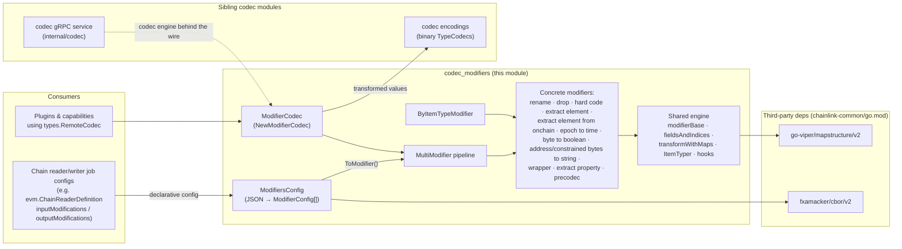
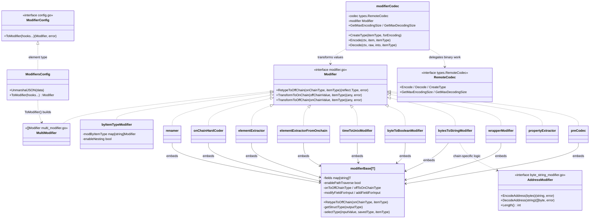
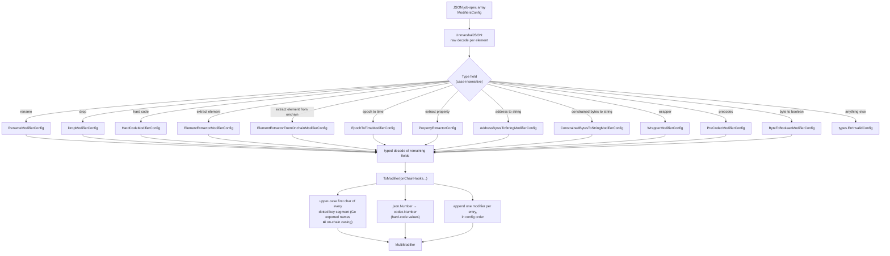
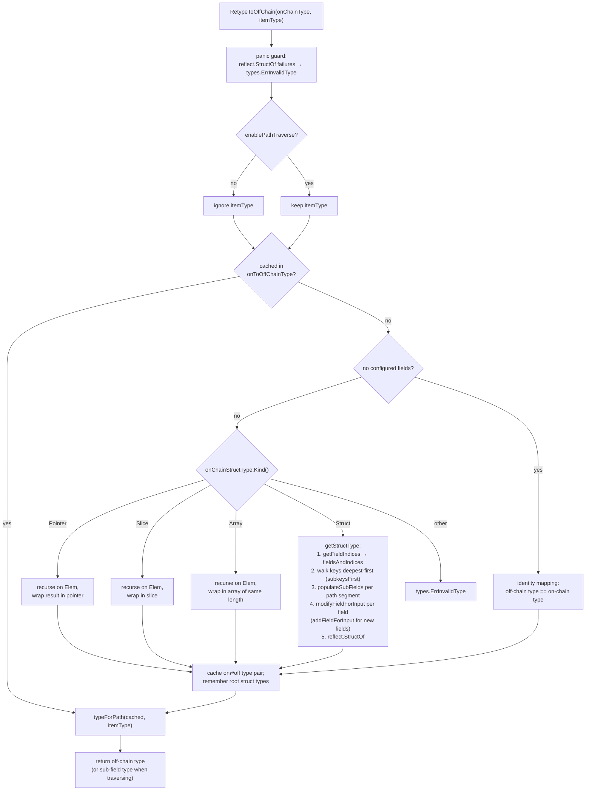
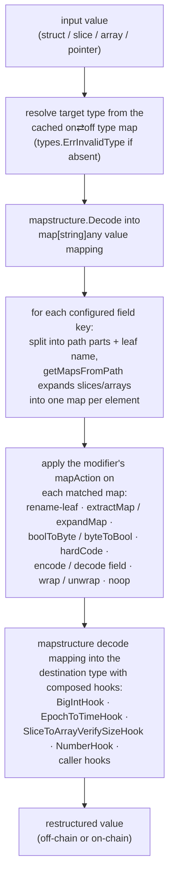
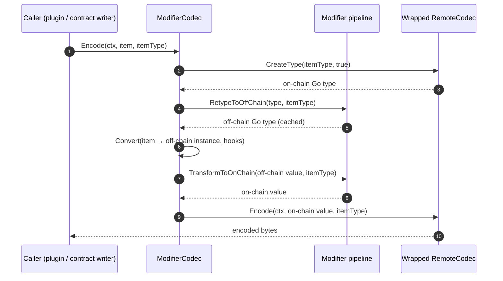
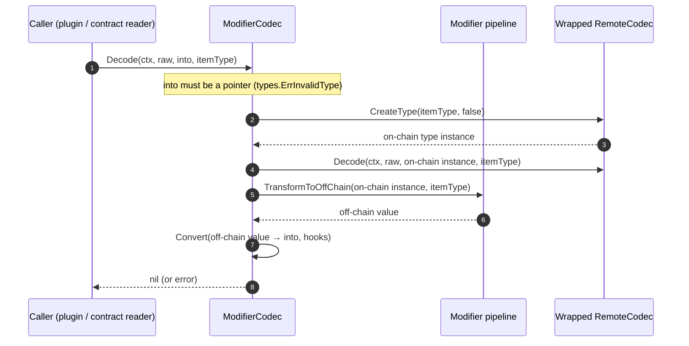

# Codec Modifiers

> Module: `chainlink-common/pkg/codec` (modifiers layer)
> Parent: [codec package overview](../codec.md) · [Shared Foundation Libraries & Domain Types](../../Shared_Foundation_Libraries___Domain_Types.md)

## 1. Introduction

The **codec_modifiers** module is the *type-transformation engine* of the `chainlink-common` codec library. It bridges the gap between the two type worlds that Chainlink nodes constantly move between:

- **On-chain types** — fixed-size binary shapes dictated by contract ABIs and OCR report layouts (`[20]byte` addresses, `uint64` epochs, `uint8` flags, single-element fields, opaque `[]byte` payloads).
- **Off-chain types** — idiomatic Go/JSON shapes that plugins, workflows, and capabilities prefer (`string` addresses, `time.Time`, `bool`, slices, wrapped structs, decoded nested payloads).

It provides:

- **`Modifier`** — the core interface: retype an on-chain Go type into its off-chain counterpart, and convert values in both directions (`chainlink-common/pkg/codec/modifier.go`).
- **`ModifiersConfig` / `ModifierConfig`** — a declarative, JSON-serializable catalog of 12 concrete modifiers (rename, drop, hard code, element extraction, epoch↔time, byte↔boolean, address bytes↔string, wrapping, property extraction, pre-codec) that are parsed from job specs and compiled into a runtime `Modifier` pipeline (`chainlink-common/pkg/codec/config.go`).
- **Composition & dispatch helpers** — `MultiModifier` (ordered pipelines) and `byItemTypeModifier` (per-itemType dispatch).
- **`ModifierCodec`** — a `types.RemoteCodec` adapter that transparently injects a modifier pipeline in front of any binary codec (`chainlink-common/pkg/codec/modifier_codec.go`).
- **A shared reflection engine** — `modifierBase[T]`, `fieldsAndIndices`, map-based transformations, path-traversal utilities, and mapstructure hooks (`modifier_base.go`, `field_and_indices.go`, `utils.go`).

All transformations are reflection-driven and chain-agnostic; chain-specific behavior (e.g. address formatting) is injected through small interfaces such as `AddressModifier` and `types.RemoteCodec`.

## 2. Position in the System

The module lives in the `chainlink-common` Go module (module path `github.com/smartcontractkit/chainlink-common`, see `chainlink-common/go.mod`), which pins its two principal third-party dependencies: `github.com/go-viper/mapstructure/v2` (the value-conversion engine underneath every transformation) and `github.com/fxamacker/cbor/v2` (CBOR marshalling of the `Number` hard-code type).



Related documentation:

| Topic | Page |
|---|---|
| Parent package, wiring, examples | [codec overview](../codec.md) |
| Primitive & composite binary codecs (`TypeCodec`, `Builder`) | [codec encodings](codec_encodings.md) |
| Exposing encode/decode over the Loop plugin boundary | [codec gRPC service](codec_grpc_service.md) |
| `types.RemoteCodec` / `ContractTypeProvider` contracts | [types-core: chain contracts](../types-core/types-core_chain-contracts.md) |
| Chain-specific codecs (CCIP address/extra-data codecs) | [CCIP chain codecs](../../CCIP_Cross-Chain_Protocol/ccip/ccip_chain_codecs.md) |

Typical consumers declare modifier pipelines directly in job specs: `ChainReaderDefinition.InputModifications` and `OutputModifications` are `codec.ModifiersConfig` fields (see `chainlink-common/pkg/types/evm/chain_reader.go`; equivalent structs exist for Solana, Aptos, Stellar, and Sui readers).

## 3. Core Abstractions



### 3.1 The `Modifier` interface

Defined in `chainlink-common/pkg/codec/modifier.go`:

| Method | Semantics |
|---|---|
| `RetypeToOffChain(onChainType reflect.Type, itemType string) (reflect.Type, error)` | Computes the off-chain Go type for an on-chain type. `itemType` is empty for the whole struct; a dot-separated path retypes a nested field. **Must be called first with the entire struct** before any other transformation or path traversal can function — results are cached per type. |
| `TransformToOnChain(offChainValue any, itemType string) (any, error)` | Converts a value of the retyped (off-chain) type back to the on-chain type. With path traversal, `offChainValue` is the field value identified by `itemType`, not the whole struct. |
| `TransformToOffChain(onChainValue any, itemType string) (any, error)` | The reverse: restructures a decoded on-chain value into the off-chain shape (used after decoding, before handing data to plugins). |

### 3.2 Composition helpers

- **`MultiModifier []Modifier`** (`multi_modifier.go`) — applies each element in order for `RetypeToOffChain` and `TransformToOffChain`; **reverse order** for `TransformToOnChain` (so the last configured modifier's retyping is the first undone). This is what `ModifiersConfig.ToModifier()` returns.
- **`byItemTypeModifier`** (`by_item_type_modifier.go`) — `NewByItemTypeModifier(map[string]Modifier)` dispatches to the modifier registered under the current `itemType`. `NewNestableByItemTypeModifier` splits a dotted item type with `ItemTyper`: the head segment selects the modifier, the tail is handed to it (enabling per-sub-type pipelines like the one in the package example). Unknown item types yield `types.ErrInvalidType`.

### 3.3 `ModifierCodec` — wiring modifiers into the codec contract

`NewModifierCodec(codec types.RemoteCodec, modifier Modifier, hooks ...mapstructure.DecodeHookFunc)` wraps any binary codec so callers only ever see off-chain types. It rejects nil codec/modifier and composes the hooks once for all conversions.

## 4. The `ModifiersConfig` JSON layer

`ModifiersConfig` (`config.go`) unmarshals a JSON array in which each element carries a **case-insensitive `Type` discriminator**. Each element is decoded twice: first to read `Type`, then into the matching typed config. Unknown types fail with `types.ErrInvalidConfig`.



Every config also implements `MarshalJSON` via the generic `modifierMarshaller[T]`, which re-adds the `Type` discriminator so configs round-trip. `EnablePathTraverse` fields opt the modifier into nested-field addressing (see [§7](#7-path-traversal-semantics)).

## 5. Modifier Catalog

| JSON `Type` | Config struct | Constructor | On-chain ⇄ Off-chain behavior | Lossy? |
|---|---|---|---|---|
| `rename` | `RenameModifierConfig{Fields map[string]string}` | `NewRenamer` / `NewPathTraverseRenamer` | Renames fields. Identical memory layout lets transforms reuse the underlying bytes via pointer reinterpretation; renaming to a lower-case name unexports the field. | No |
| `drop` | `DropModifierConfig{Fields []string}` | (implemented as a renamer) | Renames each field to a private `dropFieldPrivateName*`, which prevents serialization. Needed only when a rename collides with an existing name. | Yes (dropped) |
| `hard code` | `HardCodeModifierConfig{OnChainValues, OffChainValues map[string]any}` | `NewHardCoder` / `NewPathTraverseHardCoder` | Injects constants in either direction; a scalar assigned to a slice/array field is broadcast to every element (`hardCodeManyHook`); new fields can be introduced; may compose extra `mapstructure` hooks. Keys must not be prefixes of one another (`types.ErrInvalidConfig`). | No |
| `extract element` | `ElementExtractorModifierConfig{Extractions map[string]*ElementExtractorLocation}` | `NewElementExtractor` | On-chain field is a single value; off-chain field is a slice. To on-chain: picks the `first`/`middle` (default)/`last` element. To off-chain: wraps the value in a length-1 slice. | Yes |
| `extract element from onchain` | `ElementExtractorFromOnchainModifierConfig{Extractions …}` | `NewElementExtractorFromOnchain` | On-chain field is a slice/array; off-chain field is a single element (`field.Type.Elem()`). To off-chain: extracts by location; to on-chain: expands back into a slice. | Yes |
| `epoch to time` | `EpochToTimeModifierConfig{Fields []string}` | `NewEpochToTimeModifier` / `NewPathTraverseEpochToTimeModifier` | Integer-convertible fields (incl. `*big.Int`) become `*time.Time`; slices/arrays become `[]*time.Time` (arrays validated by `SliceToArrayVerifySizeHook`). Uses `EpochToTimeHook` + `BigIntHook`. | No |
| `byte to boolean` | `ByteToBooleanModifierConfig{Fields []string}` | `NewByteToBooleanModifier` | `uint8`/`*uint8` fields (possibly nested, e.g. `"B.C"`) become `bool`/`*bool` (`0` ⇔ `false`). | No |
| `address to string` | `AddressBytesToStringModifierConfig{Fields, Modifier AddressModifier json:"-"}` | `NewAddressBytesToStringModifier` / `NewPathTraverseAddressBytesToStringModifier` | Fixed byte arrays of the injected `Length()` (`[N]byte`, `*[N]byte`, `[2][N]byte`, `[][N]byte`, or named byte-array types) become strings via chain-specific `EncodeAddress`/`DecodeAddress`. | No |
| `constrained bytes to string` | `ConstrainedBytesToStringModifierConfig{Fields, MaxLen}` | `NewConstrainedLengthBytesToStringModifier` / `NewPathTraverse…` | Like above with a built-in `AddressModifier`: NUL-trimmed string on encode, zero-padded to `MaxLen` on decode. | No |
| `wrapper` | `WrapperModifierConfig{Fields map[string]string}` | `NewWrapperModifier` / `NewPathTraverseWrapperModifier` | Each listed field `T` becomes a struct with one field (map value) of type `T`; a single entry keyed `""` wraps the whole value (validated: any other multi-entry use of `""` → `types.ErrInvalidConfig`). Does not preserve original pointers. | No |
| `extract property` | `PropertyExtractorConfig{FieldName, EnablePathTraverse}` | `NewPropertyExtractor` / `NewPathTraversePropertyExtractor` | Collapses a struct to one of its properties. A property nested under a slice of structs expands to one value per element — completely lossy, cannot round-trip. | Yes |
| `precodec` | `PreCodecModifierConfig{Fields map[string]string, Codecs map[string]types.RemoteCodec json:"-"}` | `NewPreCodec` / `NewPathTraversePreCodec` | On-chain field must be `[]byte`/`*[]byte`; the off-chain type comes from the injected remote codec's `CreateType`. To on-chain: encodes the value via the remote codec into bytes; to off-chain: decodes bytes into the typed value. Lets nested payloads travel as generic bytes. Every type definition must have a codec at construction. | No |

Chain-specific address handling is injected through the `AddressModifier` interface (`byte_string_modifier.go`): `EncodeAddress([]byte) (string, error)`, `DecodeAddress(string) ([]byte, error)`, `Length() int`. The package ships `ExampleAddressModifier` (base64, 32 bytes) for tests; production implementations live with each chain's codec.

## 6. The Shared Transformation Engine

Almost every modifier embeds the generic **`modifierBase[T]`** (`modifier_base.go`), which owns the two responsibilities that all transformations share: computing the off-chain **type** (retyping) and converting **values** through map/string intermediaries.

### 6.1 Retyping (`RetypeToOffChain`)



Key mechanics:

- **`fieldsAndIndices`** (`field_and_indices.go`) mirrors a struct's fields (plus per-field sub-structs) so modifiers can rewrite nested fields in place and rebuild the type with `reflect.StructOf`. Because reflected types may lack a package path, a default `pkgPath` (the codec package) is substituted when creating unexported fields — the trick that makes `drop` work.
- **Caching contract:** the first `RetypeToOffChain` call must receive the *entire* struct; afterwards the type maps are fixed and sub-field retyping is answered from cache (`typeForPath`).

### 6.2 Value transformation (`transformWithMaps`)



Failures inside a field's action are wrapped in **`PathMappingError`**, which reports the offending dotted path.

### 6.3 Utilities (`utils.go`)

| Utility | Purpose |
|---|---|
| `BigIntHook` | Converts `*big.Int` ⇄ every int/uint type (range-checked via `FitsInNBitsSigned`, overflow → `types.ErrInvalidType`) and decimal strings. |
| `EpochToTimeHook` | Unix epoch integers (incl. `*big.Int`) ⇄ `time.Time`/`*time.Time`; maps use an intermediate `map[string]any` representation so nested fields round-trip. |
| `SliceToArrayVerifySizeHook` | Enforces exact length when mapstructure would otherwise zero-pad slices into arrays (empty slices allowed and zeroed, to support late hard-coded values). |
| `NumberHook` | Converts the `Number` hard-code type into concrete numeric Go types. |
| `getMapsFromPath` | Navigates a struct-as-map representation, expanding slices/arrays into one map per element — the basis of all nested-field edits. |
| `ValueForPath` / `SetValueAtPath` | Dotted-path read/write on `reflect.Value`s of structs and maps (arrays unsupported → `types.ErrInvalidType`). |
| `Number` (`config.go`) | A string-typed JSON number used in hard-code configs; marshals to CBOR as `float64` (if it contains `.`) or `int64`, and to JSON as `json.Number`. |

## 7. Path Traversal Semantics

Many modifiers accept an `EnablePathTraverse` flag. When enabled, every `itemType` is treated as a dot-separated address (`ItemTyper.Next()` splits head/tail in `modifier_base.go`):

- **Retyping:** `RetypeToOffChain(type, "A.B.C")` returns the off-chain type of just field `A.B.C`, leaving the cached whole-struct mapping untouched.
- **Transforms:** a caller may pass *only the field value*; `selectType` rebuilds a full struct instance by embedding the value at the path (`SetValueAtPath`) with all other fields zeroed, transforms it, then extracts the modified leaf via `ValueForPath`. For the hard coder, the path may even reference a field that exists only after hard-coding (e.g. `A.B.C` when the off-chain type lacks `C`).
- **Modifiers without the flag** (element extractors, wrapper) ignore `itemType` in their transforms and always operate on whole values.

## 8. Data Flow Through `ModifierCodec`

`ModifierCodec` is the standard integration point: it makes a modifier pipeline invisible behind the ordinary `types.RemoteCodec` contract.

### 8.1 Encoding (off-chain → on-chain bytes)



### 8.2 Decoding (on-chain bytes → off-chain types)



`GetMaxEncodingSize` / `GetMaxDecodingSize` pass straight through to the wrapped codec — modifiers change types, never wire sizes.

### 8.3 `Convert` (`modifier_codec.go`)

The public conversion helper used above: identical pointer types are copied directly (no mapstructure), pointers to the target type are linked, arrays/slices recurse per element (`types.ErrSliceWrongLen` on array length mismatch), and everything else goes through mapstructure with `Squash: true` and the composed hook chain.

## 9. Typical Usage

From the package's executable example (`example_test.go`) — a JSON-configured pipeline applied per item type through `NewByItemTypeModifier`, then wrapped around a JSON `RemoteCodec` with `NewModifierCodec`:

```json
[
  { "Type": "drop", "Fields": ["Bb"] },
  { "Type": "hard code", "OnChainValues": {"Ff": "dog", "Bb": "bb"}, "OffChainValues": {"Zz": "foo"} },
  { "Type": "rename", "Fields": {"Aa": "Bb"} },
  { "Type": "extract element", "Extractions": {"Dd": "middle"} },
  { "Type": "epoch to time", "Fields": ["Ee"] }
]
```

```go
modifierConfig := &codec.ModifiersConfig{}
_ = json.Unmarshal([]byte(config), modifierConfig)

mod, _ := modifierConfig.ToModifier()          // → MultiModifier

mods, _ := codec.NewByItemTypeModifier(map[string]codec.Modifier{
    "SecondItem": mod,                // modified type
    "Unmodified":  codec.MultiModifier{}, // identity
})
c, _ := codec.NewModifierCodec(&ExampleStructJSONCodec{}, mods)

_ = c.Encode(ctx, input, "SecondItem")   // transforms, then encodes
_ = c.Decode(ctx, raw, output, "SecondItem") // decodes, then transforms back
```

The same `ModifiersConfig` type is what appears in chain-reader job specs (e.g. `InputModifications`/`OutputModifications` in `chainlink-common/pkg/types/evm/chain_reader.go`), so node operators configure the exact pipeline shown above from TOML/JSON without code changes.

## 10. Error Model

All errors are sentinel-wrapped from `chainlink-common/pkg/types` (see [types-core: chain contracts](../types-core/types-core_chain-contracts.md)):

| Sentinel / type | Raised when |
|---|---|
| `types.ErrInvalidType` | Unknown `itemType`; field is not a slice/array where required; value's Go type doesn't match a transform (`uint8`→`bool` on non-byte, non-integer epoch field, bad address length); `byItemTypeModifier` lookup miss; `Convert`/`Decode` on non-pointers; unsupported kinds; `reflect.StructOf` panics (recovered). |
| `types.ErrInvalidConfig` | Unknown modifier `Type`; hard-code key is a prefix of another key; wrapper config with `""` plus other keys; missing `PreCodec` remote codec for a type definition. |
| `types.ErrSliceWrongLen` | Slice → array conversion with mismatched length (`SliceToArrayVerifySizeHook`, `Convert`). |
| `PathMappingError` | Any per-field mapping failure inside `transformWithMaps`; wraps the cause and names the dotted path. |

## 11. Testing

The module is covered by table- and example-driven tests alongside each modifier, all under `chainlink-common/pkg/codec/`:

- `config_test.go`, `multi_modifier_test.go`, `by_item_type_modifier_test.go`, `modifier_codec_test.go` — parsing, ordering (reverse on-chain direction), dispatch, and codec wiring.
- `renamer_test.go`, `hard_coder_test.go`, `element_extractor_test.go`, `element_extractor_from_onchain_test.go` — structural retyping across structs, pointers, slices, arrays, and nested fields; lossiness contracts.
- `epoch_to_time_test.go`, `byte_to_boolean_modifier_test.go`, `byte_string_modifier_test.go` — type conversions, pointer preservation, and rejection of invalid inputs (`testInvalidStruct` cases).
- `wrapper_test.go` — field and whole-value wrapping, including nested slices.
- `precodec_test.go` — remote-codec injection, byte-only on-chain fields, deep-nesting.
- `utils_test.go`, `property_extractor_test.go` — hooks (`BigIntHook`, `EpochToTimeHook`, `SliceToArrayVerifySizeHook`), path helpers, and slice-nested extraction.

## 12. Related Modules

- **[codec encodings](codec_encodings.md)** — the binary `TypeCodec` layer that `ModifierCodec` sits in front of; its `CodecFromTypeCodec` adapter and this module's `ModifierCodec` compose freely.
- **[codec gRPC service](codec_grpc_service.md)** — exposes encode/decode remotely for [Loop plugins](../../Plugin_Process_Framework_(Loop)/loop-plugin-core.md); the modifiers here run on whichever side owns the codec engine.
- **[types-core: chain contracts](../types-core/types-core_chain-contracts.md)** — defines `types.RemoteCodec`, `types.TypeProvider`, and the sentinel errors reused here.
- **[codec overview](../codec.md)** — the parent page tying encodings, modifiers, and the gRPC surface together.
