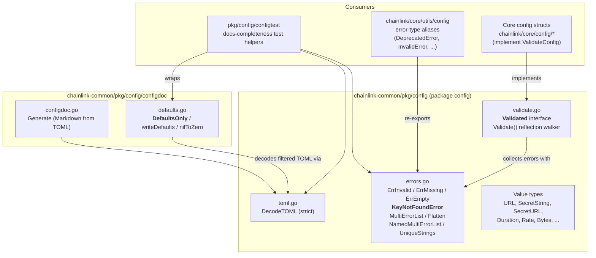
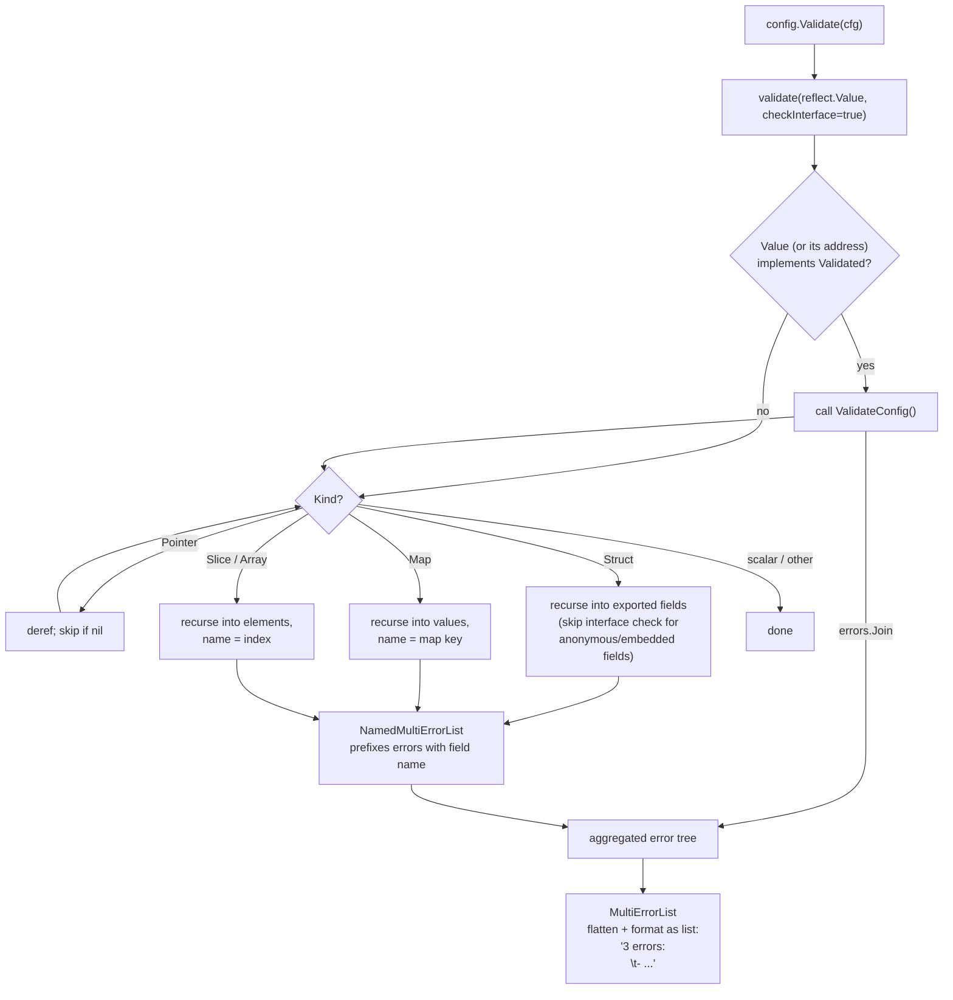
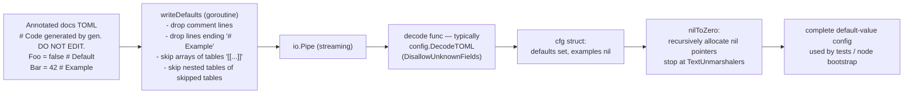

# Config Validation (`chainlink-common/pkg/config`)

## 1. Purpose and Scope

The **config-validation** module is the shared foundation that every Chainlink component uses to *define, validate, and document* its configuration. It lives in the `github.com/smartcontractkit/chainlink-common` Go module (see [`chainlink-common/go.mod`](https://github.com/smartcontractkit/chainlink-common/blob/main/go.mod)) under two packages:

| Package | Role |
|---|---|
| `chainlink-common/pkg/config` | The `Validated` contract, a reflection-based recursive validator, shared configuration error types, and TOML decoding helpers. |
| `chainlink-common/pkg/config/configdoc` | Documentation-driven defaults: it parses annotated "docs TOML" files, generates Markdown reference documentation, and can decode *only* `# Default`-marked values back into a config struct. |

The module answers three questions that recur across the node, capabilities, and deployment tooling:

1. **Is this configuration tree valid?** — a single `Validate(cfg)` call walks the entire nested struct/map/slice tree and invokes every `ValidateConfig()` implementation it finds, aggregating *all* errors rather than stopping at the first.
2. **How do we report invalid configuration consistently?** — a lightweight, dependency-free set of error types (`ErrInvalid`, `ErrMissing`, `ErrEmpty`, `KeyNotFoundError`) plus multi-error formatting utilities (`MultiErrorList`, `Flatten`, `NamedMultiErrorList`) and a `UniqueStrings` duplicate tracker.
3. **Can our user-facing docs double as machine-readable defaults?** — yes: `configdoc` derives both Markdown documentation and test/default values from the same annotated TOML source, so docs and code can never drift.

Because it is a leaf foundation library, **nothing in this module imports other Chainlink packages** — consumers depend on it, never the reverse.

## 2. Architecture Overview

Three architectural pillars emerge, each covered in its own sub-module page:

1. **Validation engine** ([`config-validation_validation.md`](config-validation/config-validation_validation.md)) — the `Validated` interface and the recursive `Validate` walker in `chainlink-common/pkg/config/validate.go`.
2. **Shared error vocabulary** (same page as the validation engine, and detailed there) — `chainlink-common/pkg/config/errors.go` with `KeyNotFoundError` and the multi-error utilities the validator relies on.
3. **Documentation-driven defaults** ([`config-validation_configdoc.md`](config-validation/config-validation_configdoc.md)) — the `configdoc` subpackage, whose `DefaultsOnly` behaviour is pinned down by the `cfg`-typed table-driven tests in `configdoc/defaults_test.go`.

### Component Map (core components of this module)

| Component | File | Responsibility |
|---|---|---|
| `Validated` | `chainlink-common/pkg/config/validate.go` | Interface every validatable config type must implement (`ValidateConfig() error`); entry point for the reflection walker. |
| `KeyNotFoundError` | `chainlink-common/pkg/config/errors.go` | Canonical "key not found" error (`unable to find <type> key with id <id>`); part of the shared error vocabulary incl. `ErrInvalid`, `ErrMissing`, `ErrEmpty`, `UniqueStrings`, `MultiErrorList`, `Flatten`, `NamedMultiErrorList`. |
| `cfg` (test fixtures) | `chainlink-common/pkg/config/configdoc/defaults_test.go` | Table-driven tests that define the contract for `DefaultsOnly`: which TOML lines become defaults, which are ignored, and how pointers are zero-filled. |

## 3. How Validation Works (end-to-end flow)

Key behavioural details:

- **Error accumulation**: `ValidateConfig` implementations are expected to use `errors.Join`/multierr semantics; `validate.go` joins sibling errors with `errors.Join` and flattens them at the top with `MultiErrorList` so users see *every* problem in one report.
- **Embedded structs**: for anonymous fields the interface check is skipped on the field itself (`!ft.Anonymous`) because the parent struct inherits those methods and would otherwise be validated twice; errors from anonymous fields are *not* re-prefixed.
- **Nil handling**: nil pointers, nil map values and nil slice elements are skipped — a `nil` field is not an error unless the owning `ValidateConfig` says so.
- **`TextUnmarshaler` boundaries**: value types in the same package (e.g. `SecretURL`, `URL`) implement `encoding.TextUnmarshaler`; downstream helpers deliberately stop descending at those boundaries.

## 4. How Defaults-From-Docs Works (end-to-end flow)

The `cfg` fixtures in `configdoc/defaults_test.go` lock in the tricky TOML semantics: arrays of tables (`[[Extra]]`) are always ignored, including keys that follow a blank line inside them; tables that *follow* a skipped array of tables are kept; map entries (`[Chains.1]`) *are* descended into; and `# Example` lines decode as zero values.

> For the Markdown-generation side (`Generate`, table/keyval parsing, `**ADVANCED**`/`**MAP**` tokens), see the sibling library [x-config-framework](x-config-framework.md), which provides the newer, reflection-based config documentation CLI framework.

## 5. Relationship to Other Modules

- **[x-config-framework](x-config-framework.md)** — the experimental `chainlink-common/x/config` module (own `go.mod`) builds *user-facing* config CLIs and docs from struct tags. This module supplies the *runtime* validation and error types it complements.
- **[core_shared_utilities_config_validation](../Node_Application_Core___Interfaces/core_shared_utilities/core_shared_utilities_config_validation.md)** — `chainlink/core/utils/config` aliases this module's error types (`InvalidError = commonconfig.ErrInvalid`, `UniqueStrings = commonconfig.UniqueStrings`, …) and adds core-only errors such as `DeprecatedError`. Read that page for the node-side usage; this page for the shared definitions.
- **Core config packages** — settings interfaces under `chainlink/core/config` (e.g. `Dispatcher`, `AggregatorSecret`, documented in [core_config](../Node_Application_Core___Interfaces/core_config.md)) are backed by TOML structs that implement `Validated.ValidateConfig()` and are decoded with `DecodeTOML`.
- **[configtest helpers](config-validation.md)** — `pkg/config/configtest` (part of this module's ecosystem) builds directly on `MultiErrorList`, `DecodeTOML` and `configdoc.DefaultsOnly` to assert docs completeness in CI.

## 6. Sub-module Documentation

The detailed sub-module pages are saved under `Shared_Foundation_Libraries___Domain_Types/config-validation/` (final file names as generated):

| Sub-module page | Final file | Contents |
|---|---|---|
| **config-validation_validation** | [config-validation_validation.md](config-validation/config-validation_validation.md) | The `Validated` contract and recursive `Validate` walker (`validate.go`), plus the shared error model (`errors.go`): `KeyNotFoundError`, `ErrInvalid`, `ErrMissing`, `ErrEmpty`, the multi-error aggregation helpers (`MultiErrorList`, `Flatten`, `NamedMultiErrorList`) and the `UniqueStrings` duplicate tracker. |
| **config-validation_configdoc** | [config-validation_configdoc.md](config-validation/config-validation_configdoc.md) | The `configdoc` subpackage: the annotated TOML documentation format, `Generate` (Markdown output), `DefaultsOnly` streaming defaults extraction (`writeDefaults` → pipe → decode → `nilToZero`), and the `cfg` test contract from `defaults_test.go` that pins down defaults-vs-example semantics. |

Both pages link back to this overview, and to the neighbouring [x-config-framework](x-config-framework.md) and [core_shared_utilities_config_validation](../Node_Application_Core___Interfaces/core_shared_utilities/core_shared_utilities_config_validation.md) pages where their responsibilities overlap.

## 7. Build and Dependency Notes

- The module is part of the `github.com/smartcontractkit/chainlink-common` workspace root — `chainlink-common/go.mod` (Go 1.27.1). TOML decoding uses `github.com/pelletier/go-toml/v2` (strict mode, unknown fields rejected).
- `configdoc` and `pkg/config` are internal to this module; they add no extra module boundary. The x/config framework, by contrast, is its own module (`chainlink-common/x/config/go.mod`).
- Lint/build tooling for `chainlink-common` (which runs these tests) is described in [build-and-repo-tooling](../Build,_CI___Release_Infrastructure/build-and-repo-tooling.md).
