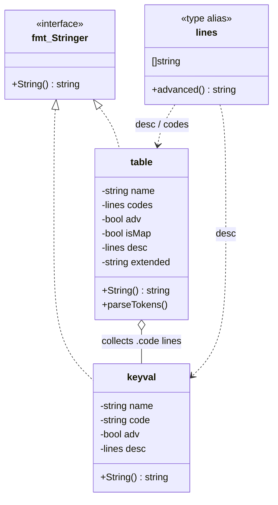
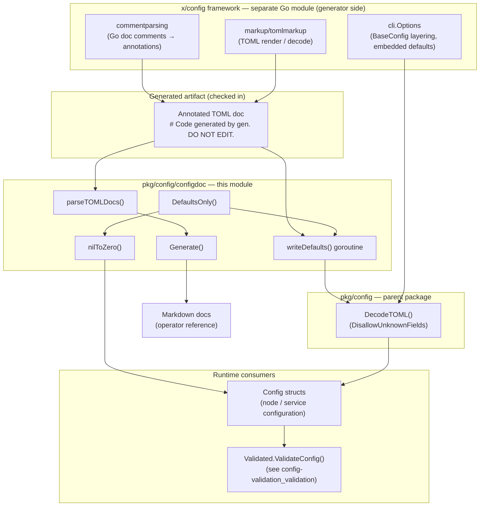
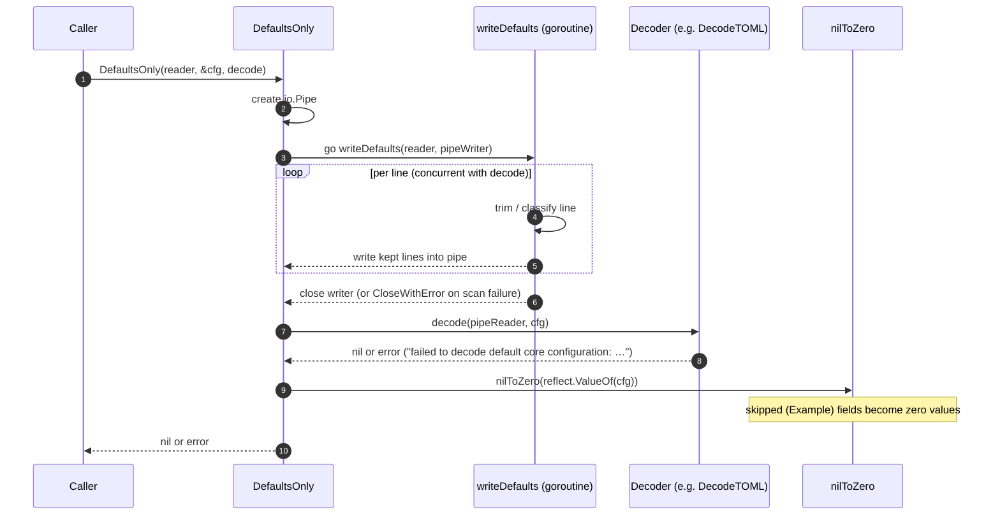
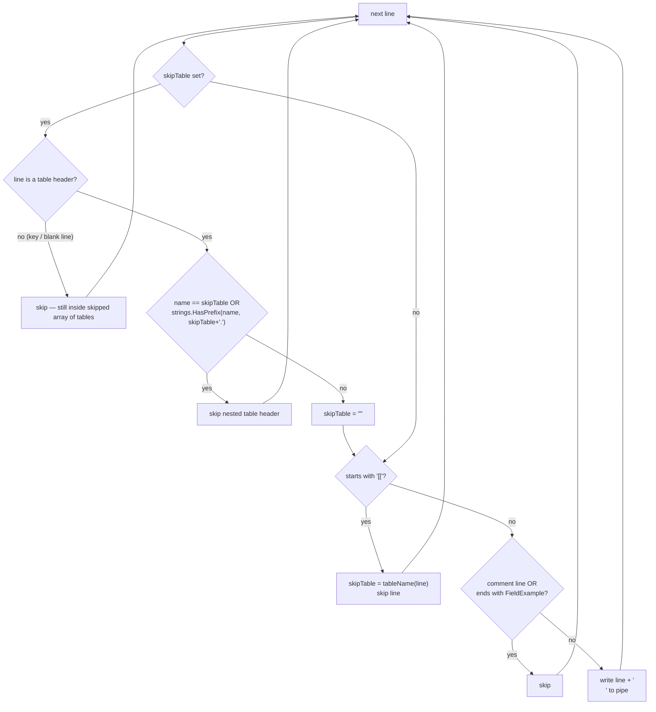

# Config Documentation & Defaults Extraction (`configdoc`)

> **Module:** `chainlink-common/pkg/config/configdoc` (module `github.com/smartcontractkit/chainlink-common`, see `chainlink-common/go.mod`)
> **Page:** Shared Foundation Libraries → [Config Validation](../config-validation.md) → **configdoc**

The `configdoc` package is the **consumption side** of Chainlink's configuration-documentation pipeline. It reads a *machine-generated, comment-annotated TOML file* — the rendered documentation of a Go configuration struct — and turns that single artifact into two outputs:

1. **Human-readable Markdown documentation** (`Generate`) — the reference page for operators, with per-field sections, examples and extended descriptions.
2. **A defaults-only configuration** (`DefaultsOnly`) — a streaming filter that strips every illustrative ("Example") value and comment from the annotated TOML, decodes what remains into a config struct, and zero-fills the stripped fields. This is how an embedded, "file operators can read" set of defaults ([x-config-framework](../x-config-framework.md)) is loaded at runtime.

Because both outputs are derived from **one generated artifact**, documentation and runtime defaults can never drift apart: if a field's documentation changes, its default changes with it.

---

## 1. The Annotated TOML Documentation Format

The package defines an implicit contract over the generated TOML file. Each entry is a TOML key/value whose **description lives in the preceding comment lines** and whose **value is annotated by a trailing marker**:

```toml
# Code generated by gen. DO NOT EDIT.

# Foo is a boolean field.
Foo = false # Default
# Bar is a number.
Bar = 42 # Example
[Nested]
  # Test holds a string.
  Test = "test" # Example
  # Count is a number.
  Count = 7 # Default
  [[Nested.Keys]] # Example
    # Key is the API key.
    Key = "abc" # Example
[Chains.1]
  # Count is a number.
  Count = 9 # Default
```

(Example taken verbatim from the test fixtures in `chainlink-common/pkg/config/configdoc/defaults_test.go`.)

### Format markers

| Marker | Where it appears | Meaning |
|---|---|---|
| `# Default` (`FieldDefault`) | Trailing comment on a value line | The value is a **default**; it is kept by `DefaultsOnly`. |
| `# Example` (`FieldExample`) | Trailing comment on a value line (also on `[[table]]` headers) | The value is **illustrative only**; it is dropped and the field becomes a zero value. |
| `TokenAdvanced` | First line of a comment block | The entry/table is *advanced*; the token is stripped from the rendered description. |
| `TokenMap` | First line of a table's comment block | The table is a **map** keyed by data (chain selector, label…), not by a struct field. |
| `Code generated by …` | First comment of the file | Generator preamble; dropped from rendered docs by `isGeneratedPreamble` (matching is deliberately restricted to the prefix "code generated by", so ordinary notes like "this value is generated by the node" survive). |

`FieldDefault`, `FieldExample`, `TokenAdvanced` and `TokenMap` are package-level constants of `configdoc`; the `Default`/`Example` literals are visible in the test fixtures above.

---

## 2. Core Components

| Component | Location | Kind | Role |
|---|---|---|---|
| `Generate` | `pkg/config/configdoc/configdoc.go` | func | Assembles a complete Markdown page from annotated TOML, an example block and per-table extended descriptions. |
| `parseTOMLDocs` | `pkg/config/configdoc/configdoc.go` | func | Line-based parser/validator: annotated TOML → `[]fmt.Stringer` (tables, key/values, description blocks). |
| `table` | `pkg/config/configdoc/configdoc.go` | struct | Section state: `name`, `codes`, `adv`, `isMap`, `desc`, `extended`; implements `String()`. |
| `keyval` | `pkg/config/configdoc/configdoc.go` | struct | One documented key: `name` (fully qualified), `code` (raw line), `adv`, `desc`; implements `String()`. |
| `table.parseTokens` | `pkg/config/configdoc/configdoc.go` | method | Consumes leading `TokenAdvanced`/`TokenMap` tokens from a table's description. |
| `newTable` / `newArrayOfTables` | `pkg/config/configdoc/configdoc.go` | funcs | Table constructors; attach extended description by table name. |
| `newKeyval` | `pkg/config/configdoc/configdoc.go` | func | Key constructor; detects the advanced token, qualifies the name with the enclosing table. |
| `tableName` / `keyName` / `indexOutsideQuotes` | `pkg/config/configdoc/configdoc.go` | helpers | Quote-aware extraction of table and key names (handles `[[ Extra ]]` and `#`/`=` inside strings). |
| `isGeneratedPreamble` | `pkg/config/configdoc/configdoc.go` | helper | Recognizes and drops "Code generated by …" comments. |
| `DefaultsOnly` | `pkg/config/configdoc/defaults.go` | func | Public API: stream-filter annotated TOML to defaults, decode into `cfg`, zero-fill skipped fields. |
| `writeDefaults` | `pkg/config/configdoc/defaults.go` | func | The goroutine-side line filter (see §5). |
| `nilToZero` | `pkg/config/configdoc/defaults.go` | func | Reflection walk replacing nil pointers with zero values (see §6). |
| `cfg` | `pkg/config/configdoc/defaults_test.go` | test type | Test-local struct exercising pointers, nested structs, slices and maps of pointers. |
| `DecodeTOML` | `pkg/config/toml.go` | func (parent package) | Canonical decoder injected by callers: go-toml v2 with `DisallowUnknownFields()` and strict-missing error translation. |

### Document-item model



---

## 3. Architecture and Position in the System

The package sits between the **generator** (the [x-config-framework](../x-config-framework.md), a separate Go module `github.com/smartcontractkit/chainlink-common/x/config` — see `chainlink-common/x/config/go.mod`) and the **runtime configuration consumers** (node configuration trees such as those documented in [Node Application → Config](../../Node_Application_Core___Interfaces/node_application/node_application_config.md)).



**Key relationships**

- **Generator → artifact:** the [x-config-framework](../x-config-framework.md) parses Go doc comments (`commentparsing`) and renders TOML (`markup/tomlmarkup`) to produce the annotated file. Its `cli.Options.BaseConfig` field documents the intended runtime pattern: *"layered under every `--config` file, usually embedded, so defaults live in a file operators can read"* (`chainlink-common/x/config/cli/options.go`). `DefaultsOnly` is the tool that makes such an embedded doc file loadable.
- **Artifact → docs:** `Generate` renders the operator-facing Markdown.
- **Artifact → defaults:** `DefaultsOnly` filters + decodes into a config struct; decoding is delegated to an injected decoder — canonically [`DecodeTOML`](../config-validation.md) from the parent `pkg/config` package.
- **Defaults → validation:** once loaded, the resulting config is checked by `Validated` implementations (`ValidateConfig()`) from the sibling module — see [config-validation_validation](config-validation_validation.md).
- **Build wiring:** the artifact is checked in as generated code ("Code generated by gen. DO NOT EDIT."), refreshed via `go generate ./...` (the `generate` target in `chainlink-common/Makefile` runs `gomods -go generate -x ./...` across the module).

---

## 4. Data Flow — `DefaultsOnly`

`DefaultsOnly(r io.Reader, cfg any, decode func(io.Reader, any) error) error` streams the annotated TOML through an `io.Pipe`, so filtering and decoding run **concurrently** with bounded memory use.



Any decode failure is wrapped as `failed to decode default core configuration: %w`. Because the canonical decoder enables `DisallowUnknownFields()`, a stale generated artifact (keys not present in the target struct) fails loudly instead of silently misconfiguring a node — the parser and the struct definition must evolve together.

---

## 5. Process Flow — the `writeDefaults` Line Filter

`writeDefaults` is a small state machine over trimmed lines. Its only state is `skipTable`, the name of an array-of-tables currently being elided.



### Filtering rules (guaranteed by the test suite)

| Situation | Behavior |
|---|---|
| `Key = v # Default` | Kept and decoded. |
| `Key = v # Example` | Dropped; the field later becomes a zero value via `nilToZero`. |
| Comment-only lines (`# …`) | Dropped (descriptions must never reach the decoder). |
| `[[Table]]` — any array of tables, marked or not | Header and **all** of its entries skipped, including when it is marked `# Example`. |
| Blank line inside a skipped `[[Table]]` block | Still part of the array of tables — TOML ends a table only at the next header, so the skip continues. |
| Nested tables of a skipped array (`[[Table.X]]`) | Skipped via the `skipTable.` prefix check. |
| Whitespace inside brackets (`[[ Extra ]]`, `[ Nested ]`) | Tolerated — `tableName` trims brackets and space. |
| Plain table header following a skipped array of tables | **Kept** — the skip ends at the first non-nested header. |
| `[Chains.1]` style map entries | Not special-cased here: plain tables are written through, so the decoder descends into map keys. |

---

## 6. Post-Decode Normalization — `nilToZero`

Because every `# Example` line was dropped, the corresponding struct fields remain nil pointers after decoding. `nilToZero(reflect.ValueOf(cfg))` walks the result and materializes them:

| Value kind | Behavior |
|---|---|
| Nil pointer | Replaced by a pointer to a zero value (`reflect.New(elem)`). |
| Pointer whose type implements `encoding.TextUnmarshaler` | Materialized, but **not descended into** — the whole zero value is left for the custom unmarshaler semantics. |
| Struct (not a `TextUnmarshaler`) | Recurse into fields. |
| Map (non-nil) | Recurse into each value. |
| Slice (non-nil) | Recurse into each element. |
| Anything else | Untouched. |

The `TextUnmarshaler` guard matters for Chainlink config types that parse from strings (durations, addresses, …): a nil custom-unmarshaled type must not be half-populated.

---

## 7. Documentation Generation — `Generate` & `parseTOMLDocs`

### Parsing and validation contract

`parseTOMLDocs` processes the annotated TOML line by line, accumulating items into a `Global` pseudo-table (dropped if empty) plus one item per table, array-of-tables header, key/value and standalone description block. It **validates while parsing**, accumulating all errors (joined via `config.MultiErrorList` in the parent package, mirroring the `multierr` guidance of [`Validated`](config-validation_validation.md)):

- every key must carry a **description**, and its first line must **begin with the key's short name** (`"<name>: missing description"` / `"<name>: description does not begin with %q"` otherwise);
- every value must end in **either** `FieldDefault` **or** `FieldExample` (`"%s: is not one of [# Default # Example]"` otherwise);
- a map table's entries (`isMap` set via `TokenMap`) **inherit the table's description** when they have none of their own — map keys are data (chain selectors, labels) and have no declaring struct field to host a comment;
- "Code generated by …" preamble comments are dropped from the rendered output (`isGeneratedPreamble`).

### Rendering

`Generate(toml, header, example string, extendedDescriptions map[string]string) (string, error)` emits:

1. the caller-provided `header`,
2. an `## Example` section with the full example fenced in a `toml` code block,
3. one section per parsed item:
   - `table.String()` → `## <table name>` followed by the advanced marker, the table's code lines (headers), its description and the per-name **extended description** (looked up in `extendedDescriptions`),
   - `keyval.String()` → `### <short field name>` followed by the advanced marker, the raw TOML line fenced as `toml`, and the description lines.

---

## 8. Test Coverage Map (`defaults_test.go::cfg`)

The module's test component `cfg` is a purpose-built struct combining pointer fields (`*bool`, `*int`, `*string`), a nested struct, a slice of structs and a `map[string]*nested` — exactly the shapes `nilToZero` and the filter must handle. `TestDefaultsOnly` pins the module's contract:

| Sub-test | Verifies |
|---|---|
| `basic test` | Defaults decode (`Foo=false`, `Nested.Count=7`, `Chains["1"].Count=9`); Examples decode as zero values (`Bar`, `Nested.Test`); arrays of tables ignored (`Keys`, `Extra`); map entries are descended into (`Chains["1"].Test` zero). |
| `array of tables / followed by a table with no blank line` | Tables **after** a skipped array of tables are kept (`Nested.Count`, `Chains["1"].Count`). |
| `array of tables / with a blank line before its own keys` | Blank lines do not end an array of tables — trailing keys still belong to it and are skipped. |
| `array of tables / with whitespace inside the brackets` | `[[ Extra ]]` / `[ Nested ]` parse correctly. |
| `array of tables / marked as an example` | Defaults under an example-marked `[[Table]]` are ignored. |

All sub-tests inject `config.DecodeTOML`, exercising the strict decoder end-to-end.

---

## 9. Usage Example

```go
import (
    "github.com/smartcontractkit/chainlink-common/pkg/config"
    "github.com/smartcontractkit/chainlink-common/pkg/config/configdoc"
)

type ChainCfg struct { /* documented config struct */ }

var annotatedDocs = `... embedded generated TOML ...` // "Code generated by gen. DO NOT EDIT."

func loadDefaults() (*ChainCfg, error) {
    var c ChainCfg
    if err := configdoc.DefaultsOnly(strings.NewReader(annotatedDocs), &c, config.DecodeTOML); err != nil {
        return nil, err
    }
    // c now holds exactly the documented defaults; example values are zeroed.
    return &c, nil
}
```

The result feeds the layered-loading pattern of the [x-config CLI framework](../x-config-framework.md) (`Options.BaseConfig`), and should subsequently be checked with its `ValidateConfig()` implementation ([config-validation_validation](config-validation_validation.md)).

---

## 10. References

- Parent module: [Config Validation (`config-validation`)](../config-validation.md) — format/decoder context and module overview.
- Sibling module: [Config Validation (`config-validation_validation`)](config-validation_validation.md) — `Validated`, `KeyNotFoundError`; runtime validation applied after defaults are loaded.
- Generator framework: [x-config-framework](../x-config-framework.md) — `commentparsing`, `markup/tomlmarkup`, `cli.Options` (BaseConfig layering).
- Foundation library group: [Shared Foundation Libraries & Domain Types](../../Shared_Foundation_Libraries___Domain_Types.md).
- Example consumer domain: [Node Application → Config](../../Node_Application_Core___Interfaces/node_application/node_application_config.md) — the class of node configuration trees this pipeline documents.

**Source files:** `chainlink-common/pkg/config/configdoc/defaults.go`, `chainlink-common/pkg/config/configdoc/configdoc.go`, `chainlink-common/pkg/config/configdoc/defaults_test.go`, `chainlink-common/pkg/config/toml.go`, `chainlink-common/x/config/cli/options.go`, `chainlink-common/x/config/go.mod`, `chainlink-common/go.mod`, `chainlink-common/Makefile`.
