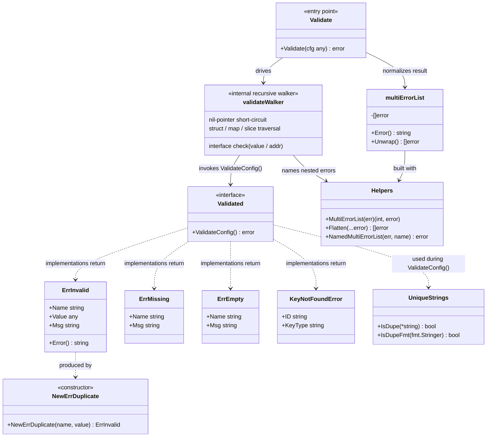
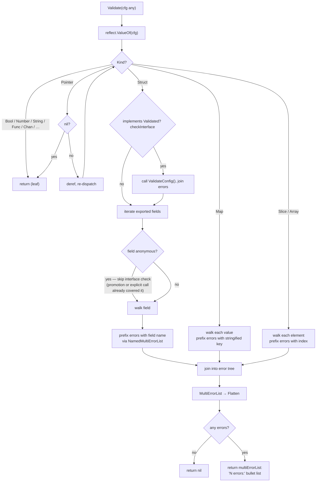
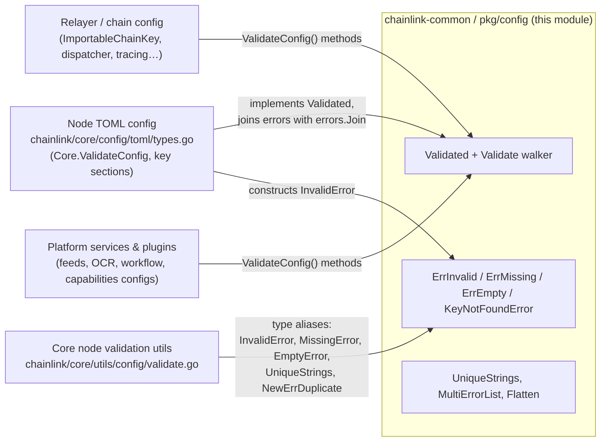

# Config Validation — Validation Contract & Error Model

> **Module:** `config-validation_validation` (part of [config-validation](../config-validation.md))
> **Package:** `github.com/smartcontractkit/chainlink-common/pkg/config`
> **Go module:** `chainlink-common` (`chainlink-common/go.mod`, Go 1.27.1)
> **Core components:** `chainlink-common/pkg/config/validate.go::Validated`, `chainlink-common/pkg/config/errors.go::KeyNotFoundError`

## Introduction

This module is the **foundation contract for configuration validation** across the entire Chainlink ecosystem. It defines:

1. **`Validated`** — the interface that any configuration type implements to declare self-validation rules (`ValidateConfig() error`).
2. **`Validate(cfg any)`** — a dependency-free, reflection-based walker that recursively discovers and invokes every `Validated` implementation nested inside an arbitrary configuration tree (structs, maps, slices, arrays, pointers) and aggregates all failures.
3. **A shared error taxonomy** — `ErrInvalid`, `ErrMissing`, `ErrEmpty`, and `KeyNotFoundError`, which give all configuration consumers uniform, structured error types instead of ad-hoc strings.
4. **Multi-error aggregation helpers** — `MultiErrorList`, `NamedMultiErrorList`, and `Flatten`, which turn deeply joined error trees into flat, human-readable, path-prefixed reports.
5. **`UniqueStrings`** — a nil-safe duplicate-detection set used while validating collections (e.g., lists of chain keys).

Because it depends **only on the Go standard library** (`errors`, `fmt`, `reflect`, `strconv`, `strings`), it can be embedded in every binary, plugin, and shared library without pulling in transitive dependencies — which is why it lives in the [Shared Foundation Libraries](../config-validation.md) tier.

---

## Core Functionality

### 1. The `Validated` contract

```go
type Validated interface {
    // ValidateConfig returns nil if the config is valid, otherwise an error describing why it is invalid.
    //
    // For implementations:
    //  - Use package multierr to accumulate all errors, rather than returning the first encountered.
    //  - If an anonymous field also implements ValidateConfig(), it must be called explicitly!
    ValidateConfig() error
}
```

The interface imposes two conventions that the ecosystem relies on:

| Convention | Rationale |
|---|---|
| **Accumulate, don't short-circuit** | Implementations join all violations (`errors.Join` / multierr) so the operator sees *every* problem in a single run, not just the first one. |
| **Anonymous (embedded) fields must be called explicitly** | The reflection walker deliberately *skips* the interface check on anonymous fields to avoid double-invocation — since a promoted `ValidateConfig` method is already reachable through the parent. If an outer struct defines its own `ValidateConfig` (shadowing promotion), it must explicitly delegate to the embedded field. |

### 2. The recursive validator

`Validate(cfg any)` is the single entry point. It wraps the internal walker `validate(v reflect.Value, checkInterface bool)` and normalizes the result through `MultiErrorList` so callers always receive either `nil` or a flat, list-formatted error.

Key behaviors of the walker:

| Input shape | Behavior |
|---|---|
| Value / addressable value implementing `Validated` | Calls `ValidateConfig()` and joins the result (skipped when `checkInterface` is false, i.e. for anonymous fields). |
| Nil pointers | Skipped entirely (a `nil` section means "not configured", not "invalid"). |
| Struct | Walks **exported** fields only; errors from named fields are prefixed with the field name via `NamedMultiErrorList`. |
| Map | Walks every value; errors are prefixed with the stringified map key (e.g. chain name/ID). |
| Slice / array | Walks every element; errors are prefixed with the numeric index. |
| Primitives (numbers, strings, bools, funcs, chans, …) | Terminates recursion. |

This design means a whole node configuration — hundreds of nested sections — is validated with a single call, and every failure is reported with a dotted path such as `SolKeys[2].ID` or `Database`.

---

## Architecture



---

## Validation Process Flow



### Walked-example output

Given the real node config types (see [Consumers](#module-context--consumers)), a call like `Validate(tomlConfig)` produces a flat report:

```text
3 errors:
	- RootDir: invalid value (true): Failed to expand RootDir. Please use an explicit path: …
	- P2P.V2.Enabled: invalid value (false): P2P required for OCR or OCR2. …
	- SolKeys: SolKeys[2]: invalid value (...): invalid SolKey
```

`NamedMultiErrorList` handles the naming discipline:

- **1 underlying error** → rendered inline as `Name.<single error text>`.
- **Multiple errors** → rendered as `Name:` followed by an indented bullet list; nested indentation is preserved by replacing newlines with `\n\t`, so deeply nested sections stay visually aligned.

---

## Error Taxonomy

All errors are lightweight value types (copied from the legacy core package) so they compare cheaply and never allocate goroutines, channels, or locks.

| Type | Fields | Semantics | Typical message |
|---|---|---|---|
| `ErrInvalid` | `Name`, `Value`, `Msg` | A present value is wrong (range, format, cross-field rule). | `Name: invalid value (v): msg` |
| `NewErrDuplicate(name, value)` | returns `ErrInvalid` | Standard duplicate error. | `Name: invalid value (v): duplicate - must be unique` |
| `ErrMissing` | `Name`, `Msg` | A required setting is absent. | `Name: missing: msg` |
| `ErrEmpty` | `Name`, `Msg` | A setting is present but empty. | `Name: empty: msg` |
| `KeyNotFoundError` | `ID`, `KeyType` | A referenced key (e.g. p2p/OCR key by ID) does not exist. | `unable to find <KeyType> key with id <ID>` |

`Flatten` recursively expands every error implementing `Unwrap() []error` (the shape produced by `errors.Join`) into a flat sequence, which is what makes the joined error trees from nested `ValidateConfig()` calls printable as one list.

---

## Supporting Utility: `UniqueStrings`

```go
type UniqueStrings map[string]struct{}
```

A small helper used inside `ValidateConfig()` implementations to enforce uniqueness across collections:

- `IsDupe(s *string) bool` — returns `true` if `*s` was already seen; registers it otherwise. Nil pointers and empty strings are ignored (never registered, never flagged).
- `IsDupeFmt(t fmt.Stringer) bool` — same behavior keyed on `String()`; **nil-safe**, including the typed-nil interface case (`reflect.ValueOf(t).IsNil()` check), so a `nil` value inside a non-nil interface cannot panic.

---

## Module Context & Consumers

The module sits at the bottom of the dependency graph. Everything above it — node application config, platform services, plugins, and tests — either **implements** `Validated`, **returns** its error types, or **aliases** them for historical compatibility.



### Verified consumers in this repository

1. **`chainlink/core/utils/config/validate.go`** — the core node's validation utility package is a thin compatibility layer over this module:
   - `type InvalidError = commonconfig.ErrInvalid`
   - `type MissingError = commonconfig.ErrMissing`
   - `type EmptyError = commonconfig.ErrEmpty`
   - `type UniqueStrings = commonconfig.UniqueStrings`
   - `func NewErrDuplicate(name string, value any) InvalidError` (delegates to `commonconfig.NewErrDuplicate`)
   - It additionally defines core-only errors (`OverrideError` for rejected duplicate keys across multiple secrets files, and `DeprecatedError` for settings scheduled for removal).

   Details and the full core-side validation story are documented in [core_shared_utilities_config_validation](../../Node_Application_Core___Interfaces/core_shared_utilities/core_shared_utilities_config_validation.md).

2. **`chainlink/core/config/toml/types.go`** — the node's TOML configuration types (e.g. `Core`, `SolKey`, `AptosKey`, `StellarKey`) implement `ValidateConfig()`, accumulate results with `errors.Join`, and construct violations using `configutils.InvalidError` (the alias of `ErrInvalid` shown above). Examples of rules expressed this way: `RootDir` must expand to an explicit path; OCR/OCR2 require `P2P.V2.Enabled`; tracing collector target must differ from the telemetry endpoint; chain keys must all be nil or all non-nil with valid chain IDs.

   How these sections surface in the running application is covered in [node_application_config](../../Node_Application_Core___Interfaces/node_application/node_application_config.md).

### Related-but-distinct mechanisms

- **`chainlink-common/x/config`** — a separate Go module providing the CLI/struct-tag binding framework (options registration, comment parsing, TOML markup). It deals with *binding and documenting* configuration; validation semantics remain here. See [x-config-framework](../x-config-framework.md).
- **`configdoc`** — sibling sub-module of [config-validation](../config-validation.md) that generates documentation of configuration defaults from the same struct shapes. See [config-validation_configdoc](config-validation_configdoc.md).
- **`chainlink-common/pkg/types/core/validation.go`** — defines the gRPC `ValidationService` / `ValidationServiceClient` / `ValidationServiceServer` used to carry configuration-validation requests across the [Loop plugin process boundary](../../Plugin_Process_Framework_(Loop)/loop-grpc-bindings.md). It is a *transport* for validation; the semantics defined here are what implementations of that service execute. See [types-core_plugin-services](../types-core/types-core_plugin-services.md).

---

## Design Rules & Conventions

For anyone implementing `Validated` in this codebase:

1. **Return every error.** Join with `errors.Join` (or multierr) rather than returning the first violation. The walker flattens the whole tree, so the final report lists all problems.
2. **Do not double-validate embedded structs.** If your outer struct relies on the promoted `ValidateConfig` of an embedded type, add no extra call; the walker already invokes it through the parent. If you shadow it with your own method, call the embedded one explicitly.
3. **Use the shared taxonomy.** Build violations with `ErrInvalid` / `NewErrDuplicate` / `ErrMissing` / `ErrEmpty` / `KeyNotFoundError` (directly or through the core aliases) so operators get consistent formatting and downstream code can pattern-match on structured errors.
4. **Prefer value semantics.** The error types are plain structs; return them by value and compare with `errors.As` where needed.
5. **Treat nil as "unset".** The walker skips nil pointers; implementations should generally do the same for optional sections and instead flag only genuinely contradictory combinations.

---

## Build & Packaging Notes

- The package belongs to the **`chainlink-common`** Go module (`module github.com/smartcontractkit/chainlink-common`, `go 1.27.1` — see `chainlink-common/go.mod`).
- Both files (`validate.go`, `errors.go`) import **only the standard library**, keeping the foundation layer free of third-party dependencies and safe to vendor into every workspace (`chainlink`, `capabilities`, `cre-cli`, system tests, …).
- Because the same types are re-exported by the core node (`chainlink/core/utils/config`), renaming or moving `ErrInvalid` / `UniqueStrings` etc. in this package is a **breaking change** for every consumer; prefer adding new types over mutating existing ones.

---

## Related Documentation

- Parent module: [config-validation](../config-validation.md)
- Sibling sub-module: [config-validation_configdoc](config-validation_configdoc.md)
- Core-node compatibility layer: [core_shared_utilities_config_validation](../../Node_Application_Core___Interfaces/core_shared_utilities/core_shared_utilities_config_validation.md)
- Node configuration surfaces: [node_application_config](../../Node_Application_Core___Interfaces/node_application/node_application_config.md)
- CLI/config binding framework: [x-config-framework](../x-config-framework.md)
- gRPC validation transport for plugins: [types-core_plugin-services](../types-core/types-core_plugin-services.md)
