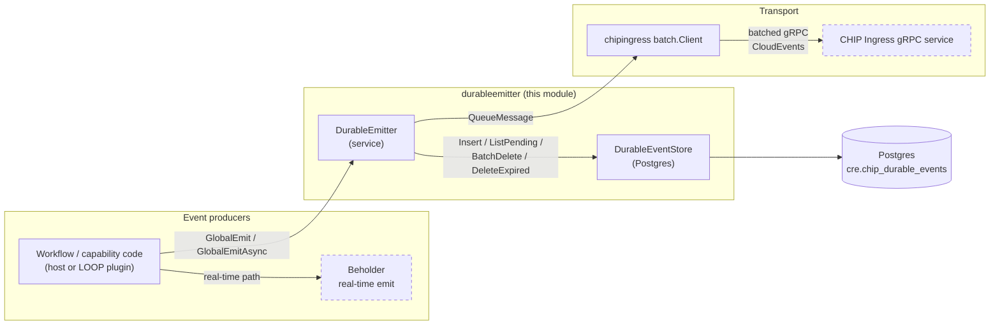
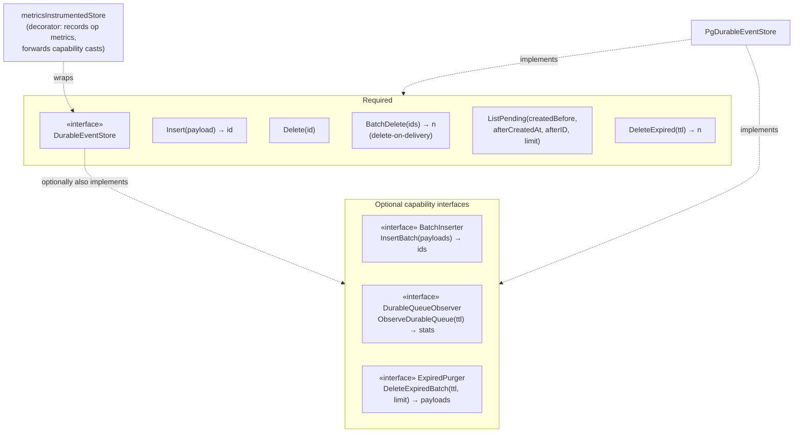
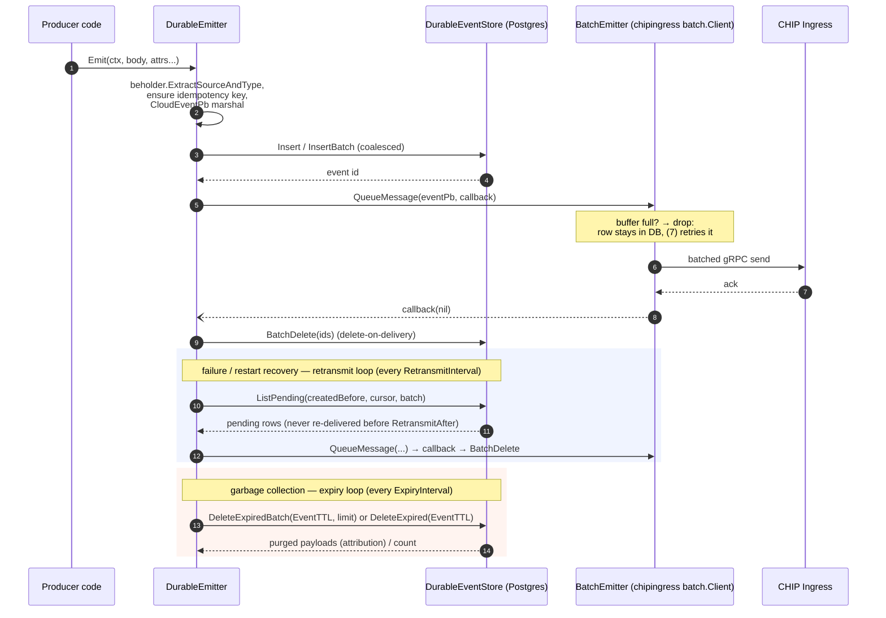
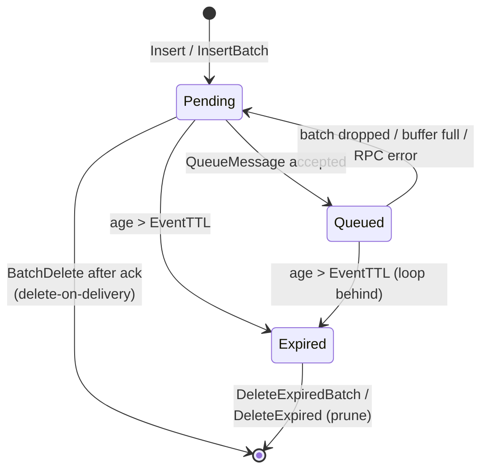

# Durable Emitter (`chainlink-common/pkg/durableemitter`)

The **durable-emitter** module is the durability layer of Chainlink's CloudEvent telemetry pipeline. It persists events as opaque byte payloads in a Postgres table **before** handing them to the asynchronous [CHIP Ingress](../Telemetry___Observability_Platform/chip-ingress.md) transport, guaranteeing *at-least-once* delivery: if the network, the CHIP Ingress service, or the process goes down, a background retransmit loop recovers the undelivered rows and re-publishes them.

It answers a simple operational problem — "what happens to telemetry when the node cannot reach CHIP Ingress?" — with a small, dependency-light package:

- **Persist first, deliver later.** `Emit` writes a serialized `CloudEventPb` to the `cre.chip_durable_events` table, then enqueues the event for batched gRPC delivery. Nothing is lost if the caller is ahead of the network.
- **Delete-on-delivery.** Successful delivery physically deletes the row (no tombstones, no extra write per event). A delete lost to a crash is harmless: the row is simply re-delivered (idempotently) or reclaimed by the expiry loop.
- **Retransmit with poison-event protection.** The retransmit loop pages through the pending backlog using a `(created_at, id)` cursor and wraps to the start, so a persistently failing event cannot monopolise the head of the list.
- **TTL-based garbage collection.** An expiry loop prunes events older than `EventTTL`, optionally returning purged payloads so metrics can attribute what was dropped.
- **Optional observability.** OpenTelemetry metrics (queue depth/age/TTL-budget gauges, store operation timings, publish counters), distributed tracing spans, and latency hooks are all opt-in.

The package lives in `chainlink-common` (rather than the `chainlink` core node) so that **LOOP plugin processes** can share the same persistence code — see the note in `chainlink/core/services/durableemitter/durable_event_store_orm_test.go`: *"Durable Emitter ORM lives in chainlink-common/pkg/durableemitter for reusability in LOOPs"*.

---

## 1. Where it fits in the system

Within [Shared_Foundation_Libraries___Domain_Types](../Shared_Foundation_Libraries___Domain_Types.md), this module sits alongside the other foundation libraries and is consumed by the node host process and by LOOP plugin processes:

- The **real-time path** (Beholder → OTLP) is documented in [beholder-telemetry](../Telemetry___Observability_Platform/beholder-telemetry.md); the durable path implemented here is its persistence complement. On hot paths, `EmitAsync`/`GlobalEmitAsync` fire the durable write in the background because the real-time emit has already happened.
- Delivery goes through the **CHIP Ingress batch client** (`pkg/chipingress/batch`), which handles seqnum stamping, gRPC size splitting, concurrency limiting and graceful shutdown; the raw client and protobufs are documented in [chip-ingress](../Telemetry___Observability_Platform/chip-ingress.md).
- Persistence builds on [sqlutil](sqlutil.md) (`sqlutil.DataSource`, `sqlutil.TransactDataSource`) and the service lifecycle on [services](services.md) (`services.Service`/`services.Engine`).
- The same package is wired into **LOOP plugin processes** — in plugins, `RetransmitEnabled` is set to `false` and the host's retransmit loop picks up any rows the plugin-side emitters wrote to the shared database. The plugin/process isolation mechanism itself is part of the [Plugin Process Framework (Loop)](../Plugin_Process_Framework_(Loop).md).

---

## 2. Architecture

### 2.1 Package layout

| File | Responsibility |
|---|---|
| `observable_store.go` | **Contracts & instrumentation.** `DurableEvent`, `DurableQueueStats`, the required `DurableEventStore` interface, three optional capability interfaces (`DurableQueueObserver`, `BatchInserter`, `ExpiredPurger`), and the `metricsInstrumentedStore` decorator. → [Sub-module: durable-emitter event-store contracts](durable-emitter/durable-emitter_event-store-contracts.md) |
| `store.go` | **Postgres implementation.** `PgDurableEventStore` (implements all four interfaces), the `cre.chip_durable_events` SQL, and the scan structs `row` / `chipDurableQueueAgg`. → [Sub-module: durable-emitter Postgres event store](durable-emitter/durable-emitter_pg-event-store.md) |
| `durable_emitter.go` | The `DurableEmitter` service itself: `Config`, `Hooks`, the `BatchEmitter` transport interface, emit path, write/delete coalescing workers, retransmit/expiry/metrics loops. |
| `setup.go` | Global-emitter convenience (`SetGlobalEmitter`, `GlobalEmit`, `GlobalEmitAsync`) and `Setup`, which wires a dedicated chip ingress batch client around a caller-supplied store. |
| `auth.go` | Chip ingress auth header provider (`AuthConfig`, `NewAuthHeaderProvider`, `SetGlobalSigner`). |
| `durable_emitter_metrics.go` | `DurableEmitterMetricsConfig` and the `durable_emitter.*` OpenTelemetry instruments (counters, histograms, gauges). |
| `process_stats.go` / `process_stats_stub.go` | Optional process-level gauges (heap/CPU) for the metrics loop. |
| Tests (ORM) | `chainlink/core/services/durableemitter/durable_event_store_orm_test.go` — kept in the node repo because the tests require the `cre` schema DB migrations. |

### 2.2 Component model

The design is a thin required interface plus opt-in capability interfaces — the `DurableEmitter` degrades gracefully depending on what the store supports:

Key rule documented in `observable_store.go`: `newMetricsInstrumentedStore` **always** returns a value that type-asserts as `BatchInserter`/`DurableQueueObserver`/`ExpiredPurger`, even if the inner store does not implement them (it returns an error at call time). `NewDurableEmitter` therefore checks the *unwrapped* store for these capabilities before installing the decorator and keeps working references to them.

### 2.3 Runtime wiring (`Setup` and the service engine)

`Setup` (in `setup.go`) is the one-call wiring point used by hosts: it builds the chip ingress auth header provider, creates the `chipingress.NewClient` gRPC client, wraps it in a `chipingressbatch.NewBatchClient` (batch size 50, interval 50 ms, ≤4 concurrent sends, 10 000-message buffer, 5 s publish timeout, 30 s shutdown timeout by default), then constructs the `DurableEmitter` via `NewDurableEmitter(store, batchClient, retransmitEnabled, cfg, lggr, meter)` and registers it as the **global** emitter. The emitter embeds `services.Service`/`services.Engine` (see [services](services.md)); `Start` launches the background goroutines and `Close` drains them.

`RetransmitEnabled` deserves special attention:

| Process | `RetransmitEnabled` | Rationale |
|---|---|---|
| Chainlink node host | `true` | Owns the retransmit + expiry loops; drains pending rows written by itself *and* by plugins sharing the DB. |
| LOOP plugin process | `false` | The host retransmits on the plugin's behalf, avoiding duplicate loops andDB contention; `DisablePruning` is likewise honoured only where the loops run. |

---

## 3. Event lifecycle and data flow

### 3.1 Happy path and failure path

1. `Emit` requires the service to be *Started* (`eng.IfStarted`), records an `emit` span, and fails fast (metric `emit.failure`) if the attributes cannot be resolved to a source domain / entity type or the event cannot be marshalled.
2. Writes can be **coalesced**: when `InsertBatchSize > 0` and the store implements `BatchInserter`, concurrent `Emit` calls funnel payloads through a channel to worker goroutines that issue multi-row `INSERT ... RETURNING id` statements; the caller blocks until its row's batch commits. Delivered ids are likewise funneled to delete-coalescing workers that issue one `BatchDelete` for many ids.
3. `EmitAsync` (and `GlobalEmitAsync`) run the whole flow on a detached-context goroutine for hot paths where the real-time Beholder emit already happened and durability is best-effort.

### 3.2 Event states

Under delete-on-delivery there is no "delivered" tombstone state — a row still exists iff it is undelivered (or is being reclaimed by expiry):

### 3.3 Design decisions worth knowing

| Decision | Where | Why |
|---|---|---|
| Delete-on-delivery instead of tombstone + purge | `durable_emitter.go` docs, `BatchDelete` | Avoids an extra write and index churn per event; a lost delete commit only causes idempotent re-delivery or expiry reclaim. |
| `SET LOCAL synchronous_commit = off` in the delete transaction | `store.go::BatchDelete` | Removes the commit WAL-flush wait (`IO:XactSync`) that dominates at high delete rates; safe because delete durability is not required (see above). |
| `FOR UPDATE SKIP LOCKED` | `BatchDelete`, `DeleteExpiredBatch` | Lets multiple coalescer workers / purge ticks grab disjoint id sets without blocking each other. |
| `(created_at, id) > (afterCreatedAt, afterID)` row-value cursor | `ListPending` | Forward-only paging through the backlog with wrap-to-zero, so a "poison" event cannot starve events behind it. |
| Bounded `DeleteExpiredBatch` (limit, oldest first) | `store.go`, `observable_store.go` | Large backlogs drain in slices instead of one statement streaming every payload back at once; returned payloads let the `expired_purged` counter be attributed per CloudEvent source/type. |
| `TTLBudget = EventTTL − OldestPendingAge` gauge | `DurableQueueStats` | Headroom of the event closest to expiry — the DLQ-pressure proxy (there is no separate dead-letter table); goes negative when the expiry loop falls behind. |

---

## 4. Persistence model (Postgres)

`PgDurableEventStore` targets the table `cre.chip_durable_events` (schema constant in `store.go`). The SQL implies the following shape:

| Column | Role |
|---|---|
| `id` | Bigint identity — returned by `Insert`/`InsertBatch` and used as the paging cursor tiebreaker. |
| `payload` | Bytea — the serialized `CloudEventPb` proto. |
| `created_at` | Set by the DB on insert; drives `ListPending` ordering, `RetransmitAfter` filtering and TTL expiry. |
| `delivered_at` | Nullable — always `NULL` in practice (delete-on-delivery); `ListPending`/queue gauges filter on `delivered_at IS NULL`, and `count(*)` (all rows) is the authoritative gauge. |

Operations at a glance:

| Operation | SQL strategy |
|---|---|
| `Insert` | Single-row `INSERT ... RETURNING id`. |
| `InsertBatch` | Multi-row `VALUES ($1),($2),... RETURNING id` (one round-trip per batch). |
| `BatchDelete` | `DELETE ... WHERE id = ANY($1) FOR UPDATE SKIP LOCKED` inside a transaction with `synchronous_commit = off`. |
| `ListPending` | Cursor paged, `delivered_at IS NULL AND created_at < createdBefore`, ordered `(created_at, id)` ascending, `LIMIT`. |
| `DeleteExpired` | CTE `DELETE ... WHERE created_at <= now() - ttl RETURNING id` + `count(*)`. |
| `DeleteExpiredBatch` | CTE selecting oldest ≤ `limit` expired ids `FOR UPDATE SKIP LOCKED`, deleting them and returning `payload`s. |
| `ObserveDurableQueue` | Single aggregate with `FILTER (WHERE delivered_at IS NULL)` for backlog depth/payload bytes/oldest age, plus `count(*)` for `TotalRows`. |

The detailed walkthrough — including the full query text, the `chipDurableQueueAgg` scan struct and the `row` type — lives in the [Postgres event store sub-module](durable-emitter/durable-emitter_pg-event-store.md).

> **Deployment note.** The ORM itself performs no migrations; the `cre` schema is provisioned by the chainlink node. The store's ORM tests are therefore kept in the node repo at `chainlink/core/services/durableemitter/durable_event_store_orm_test.go`, where they run against a migrated DB (`pgtest.NewSqlxDB`) and `TRUNCATE TABLE cre.chip_durable_events RESTART IDENTITY` for determinism.

---

## 5. Observability

All instrumentation is **opt-in**: `Config.Metrics != nil` plus a non-nil `metric.Meter` passed to `NewDurableEmitter` (nil meter is a hard error when metrics are enabled).

- **Store ops** — the `metricsInstrumentedStore` decorator times every store call (`insert`, `delete`, `batch_delete`, `list_pending`, `delete_expired`, `insert_batch`) into `storeOps` / `storeOpDuration`.
- **Queue gauges** — a `metricsLoop` polls `ObserveDurableQueue` every `PollInterval` (default 10 s) and exports `Depth`, `TotalRows` (authoritative queue-depth gauge), `PayloadBytes`, `OldestPendingAge` and `TTLBudget`, plus an optional `capacity_usage_ratio` when `MaxQueuePayloadBytes` is configured.
- **Publish path** — counters/histograms for batch vs. retransmit phases, delivery completions, buffer-full drops, and coalescer fill ratios.
- **Tracing** — spans for emit/deliver/retransmit/expiry via `Config.TracerProvider` (falls back to the global OTel tracer provider).
- **Hooks** — `OnEmitInsert`, `OnBatchPublish`, `OnBatchDelete` callbacks for load tests and profiling.

The contract-side details (interfaces, `DurableQueueStats` semantics, decorator behaviour) are in the [event-store contracts sub-module](durable-emitter/durable-emitter_event-store-contracts.md).

---

## 6. Configuration

`Config` (with `DefaultConfig()` values) — timings drive the background loops and coalescers:

| Field | Default | Meaning |
|---|---|---|
| `RetransmitInterval` | 5 s | Retransmit loop tick. |
| `RetransmitAfter` | 10 s | Minimum event age before retransmit (lets the primary publish path win the race). |
| `RetransmitBatchSize` | 100 | Rows listed per retransmit tick. |
| `ExpiryInterval` | 1 min | Expiry loop tick. |
| `EventTTL` | 1 h | Maximum event age. |
| `ExpiryBatchSize` | 5000 | Rows per `DeleteExpiredBatch` statement; the tick loops until drained. |
| `PublishTimeout` | 5 s | Deadline for DB ops inside delivery callbacks (the gRPC timeout is the batch client's). |
| `InsertBatchSize` / `InsertBatchFlushInterval` / `InsertBatchWorkers` | 100 / 50 ms / 4 | Write coalescing (requires `BatchInserter`). |
| `DeleteBatchSize` / `DeleteBatchFlushInterval` / `DeleteBatchWorkers` | 100 / 500 ms / 2 | Delete coalescing. |
| `DisablePruning` | `false` | Skips the expiry loop (post-test analysis). |
| `Metrics`, `TracerProvider`, `Hooks` | nil | Opt-in observability. |

`SetupConfig` adds the transport-side knobs (chip ingress `Endpoint`, TLS, `Auth`, batch-client tuning, and the `RetransmitEnabled` process-role switch discussed above).

---

## 7. Sub-modules

Detailed documentation for the module's two core source files was generated as separate sub-module pages:

- [**Durable Emitter — Event Store Contracts**](durable-emitter/durable-emitter_event-store-contracts.md) (`durable-emitter/durable-emitter_event-store-contracts.md`, source: `observable_store.go`) — the `DurableEvent`/`DurableQueueStats` value types, the required `DurableEventStore` interface, the optional `DurableQueueObserver`/`BatchInserter`/`ExpiredPurger` capability interfaces, and the `metricsInstrumentedStore` decorator.
- [**Durable Emitter — Postgres Event Store (`PgDurableEventStore`)**](durable-emitter/durable-emitter_pg-event-store.md) (`durable-emitter/durable-emitter_pg-event-store.md`, source: `store.go`) — the production implementation over `cre.chip_durable_events`, its SQL strategies (cursor paging, `SKIP LOCKED`, `synchronous_commit` relaxation, bounded purge) and the `row` / `chipDurableQueueAgg` scan structs.

Both sub-module pages cross-link back to this overview and to each other.

---

## 8. Related modules

- [chip-ingress](../Telemetry___Observability_Platform/chip-ingress.md) — the gRPC client/protos and batch client used as the transport (`BatchEmitter`).
- [beholder-telemetry](../Telemetry___Observability_Platform/beholder-telemetry.md) — the real-time emit path; `Emit` reuses `beholder.ExtractSourceAndType` for source/type attribution.
- [sqlutil](sqlutil.md) — `DataSource` and `TransactDataSource` used by the Postgres store.
- [services](services.md) — `services.Service`/`Engine` lifecycle and `StopChan` used by `DurableEmitter`.
- [Plugin Process Framework (Loop)](../Plugin_Process_Framework_(Loop).md) — LOOP plugin processes host plugin-side emitters with retransmit disabled; the host retransmits their rows.
