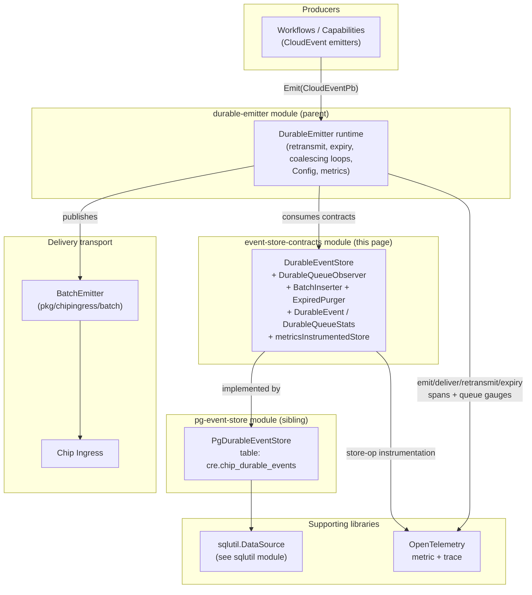
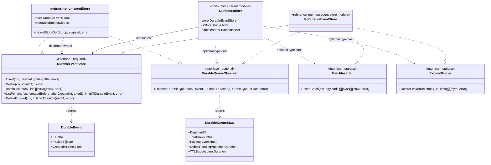
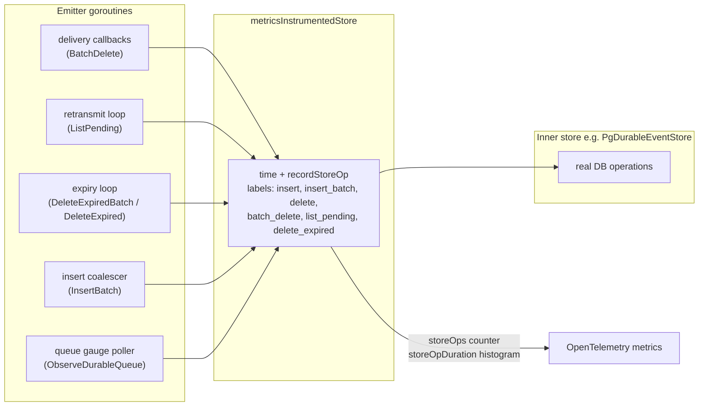
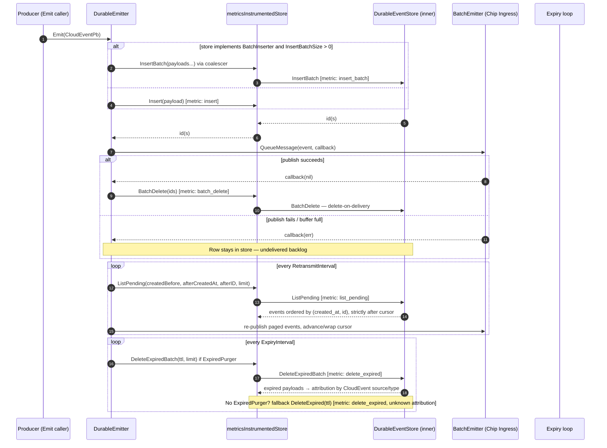
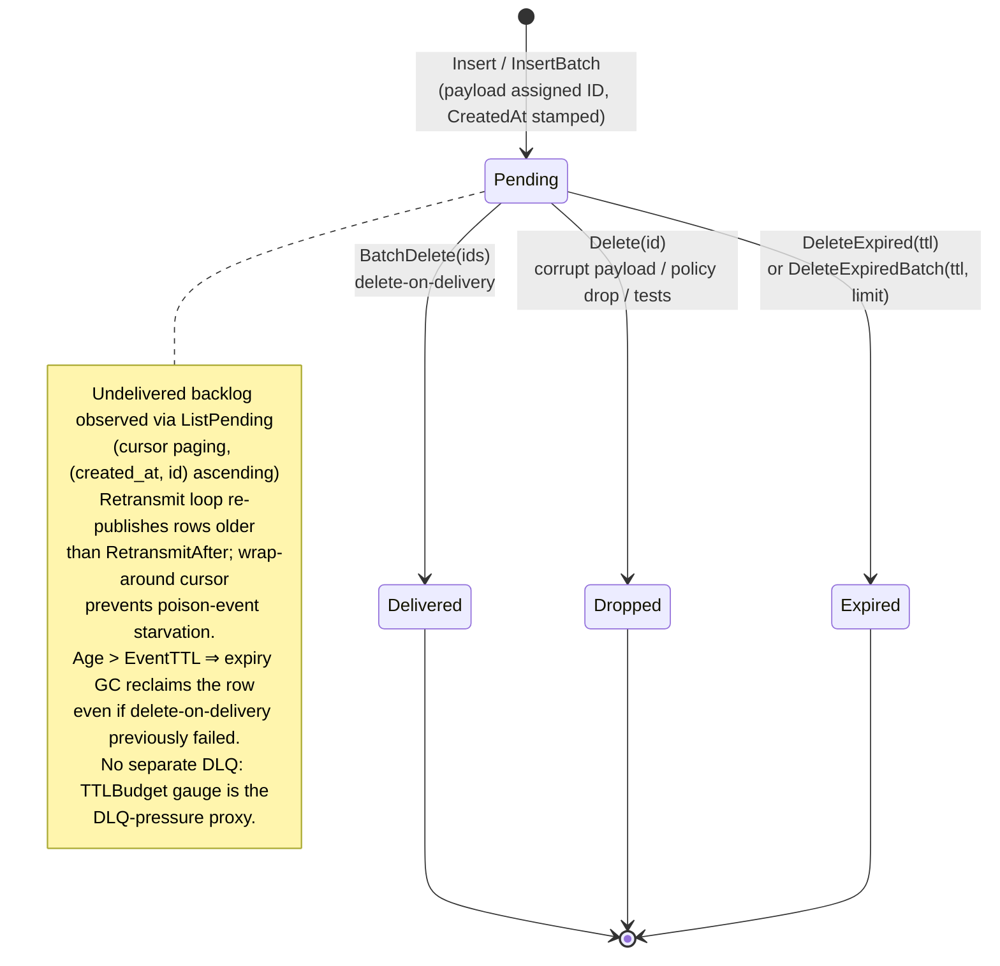

# Durable Emitter — Event Store Contracts

## Introduction

This module defines the **persistence contracts** for the durable event emitter (`chainlink-common/pkg/durableemitter/observable_store.go`). It is the seam between the [DurableEmitter runtime](../durable-emitter.md) — which reliably delivers CloudEvents to Chip Ingress and retransmits after failures — and whatever storage backend persists those events between delivery attempts.

The module specifies:

- **`DurableEventStore`** — the required core persistence contract (insert, list-pending, delete-on-delivery, TTL garbage collection).
- **`DurableQueueObserver`** and **`ExpiredPurger`** — two of the three *optional capability* contracts (`DurableQueueObserver`, `ExpiredPurger`, plus `BatchInserter`) that stores may implement to unlock queue metrics, high-throughput batch inserts, and attributed expiry accounting.
- **Data types** — `DurableEvent` (a persisted, undelivered event) and `DurableQueueStats` (a point-in-time queue snapshot for metrics).
- **`metricsInstrumentedStore`** — a transparent decorator that instruments every store operation with OpenTelemetry metrics.

Implementations must be **safe for concurrent use**. The reference implementation is the Postgres store documented in [durable-emitter_pg-event-store](durable-emitter_pg-event-store.md); the emitter runtime that consumes these contracts is documented in the parent module [durable-emitter](../durable-emitter.md).

---

## Module position in the system



- **Upstream:** [durable-emitter](../durable-emitter.md) — owns the `DurableEmitter` service, its `Config` (retransmit/expiry intervals, `EventTTL`, batch coalescing sizes) and the `BatchEmitter` transport abstraction.
- **Downstream:** [durable-emitter_pg-event-store](durable-emitter_pg-event-store.md) — the Postgres implementation of every contract defined here (`PgDurableEventStore`, table `cre.chip_durable_events`, aggregate type `chipDurableQueueAgg`, row mapping type `row`).
- **Peer libraries:** [sqlutil](../sqlutil.md) supplies the `sqlutil.DataSource` abstraction the reference store is built on; [chip-ingress](../../Telemetry___Observability_Platform/chip-ingress.md) is the delivery target of the events these contracts persist.

---

## Contract architecture



The core contract is `DurableEventStore`; the three optional interfaces are discovered via Go type assertions. This design lets a minimal store support the emitter's correctness features while richer stores opt into performance (batch inserts) and observability (queue stats, attributed expiry) features.

---

## Core contract: `DurableEventStore`

`DurableEventStore` abstracts the persistence layer for durable Chip events. Implementations **must be safe for concurrent use** — the emitter calls it from delivery callbacks, background retransmit/expiry goroutines, and coalescing workers simultaneously.

| Method | Semantics |
|---|---|
| `Insert(ctx, payload []byte) (int64, error)` | Persists one serialized event (a `CloudEventPb` proto) and returns its **assigned ID**. |
| `Delete(ctx, id int64) error` | Physically removes a row — used for corrupt payloads, policy drops, and tests. |
| `BatchDelete(ctx, ids []int64) (int64, error)` | Records **successful delivery** of multiple events by deleting them in a single operation (*delete-on-delivery*). Returns rows affected. |
| `ListPending(ctx, createdBefore, afterCreatedAt time.Time, afterID int64, limit int) ([]DurableEvent, error)` | Returns undelivered events created before `createdBefore`, ordered by `(created_at, id)` **ascending** and strictly after the `(afterCreatedAt, afterID)` cursor, up to `limit` rows. A zero cursor (`time.Time{}`, `0`) starts from the oldest. |
| `DeleteExpired(ctx, ttl time.Duration) (int64, error)` | Time-based garbage collector: removes events older than `ttl` and returns the count deleted. Also reclaims rows whose delete-on-delivery failed (e.g. a DB error inside the delivery callback), so nothing lingers past `EventTTL`. |

### The delete-on-delivery invariant

The emitter uses a **delete-on-delivery** model: a row is removed exactly when delivery to Chip succeeds. Consequently, *every row still present in the store is undelivered*, which is what makes `ListPending` equivalent to "the pending backlog" without a delivered-flag column. This invariant is the single most important behavioral guarantee an implementation must preserve.

### Cursor paging contract

`ListPending`'s cursor is what prevents a persistently-failing ("poison") event from starving the queue:

1. The retransmit loop pages through the backlog in `(created_at, id)` order using `(afterCreatedAt, afterID)`.
2. It advances the cursor on each tick and **wraps to a zero cursor** at the end of the list.
3. A poison event therefore can't monopolise the head of the list — everything behind it is still served on every full pass.

Implementations must honor strict-after-cursor semantics and stable `(created_at, id)` ordering for this to work.

---

## Data types

### `DurableEvent`

A persisted event awaiting delivery to Chip.

| Field | Type | Meaning |
|---|---|---|
| `ID` | `int64` | Store-assigned row identifier (from `Insert`/`InsertBatch`). |
| `Payload` | `[]byte` | Serialized `CloudEventPb` proto. |
| `CreatedAt` | `time.Time` | Persist timestamp; drives retransmit eligibility and TTL expiry. |

### `DurableQueueStats`

A point-in-time snapshot of the pending queue, produced by `DurableQueueObserver` and exported as gauges by the emitter when metrics are enabled.

| Field | Meaning |
|---|---|
| `Depth` | Number of undelivered (`delivered_at IS NULL`) rows — the delivery backlog. |
| `TotalRows` | Rows physically present in the table, including delivered-but-not-yet-purged rows. This is the **authoritative queue depth**: it is read directly from the DB so it stays correct regardless of how many writers share the table or which in-memory delta updates were lost to failed/partial DB operations. |
| `PayloadBytes` | Sum of stored payload sizes. |
| `OldestPendingAge` | Age of the oldest still-pending event (`0` if the queue is empty). |
| `TTLBudget` | Remaining time before the oldest pending event hits `EventTTL` (`EventTTL - OldestPendingAge`). It is the headroom of the event closest to expiry and serves as a **DLQ-pressure proxy** — there is no separate dead-letter table in the default design. It goes **negative** when the expiry loop is behind and equals `EventTTL` when the queue is empty. |

---

## Optional capability contracts

### `DurableQueueObserver`

```go
ObserveDurableQueue(ctx context.Context, eventTTL time.Duration) (DurableQueueStats, error)
```

Optionally implemented by stores so the emitter can export queue depth and age **gauges** when metrics are enabled. The `eventTTL` argument always matches the emitter's `Config.EventTTL` and is used to derive `DurableQueueStats.TTLBudget` for the oldest pending event. Without this capability, queue gauges are simply not exported — emitter correctness is unaffected.

### `BatchInserter`

```go
InsertBatch(ctx context.Context, payloads [][]byte) ([]int64, error)
```

Optionally implemented to support **multi-row inserts for higher throughput**. When the store implements this interface *and* `Config.InsertBatchSize > 0`, the emitter coalesces concurrent `Emit()` calls into batched INSERTs through its write coalescer (see [durable-emitter](../durable-emitter.md) for coalescer tuning: `InsertBatchSize`, `InsertBatchFlushInterval`, `InsertBatchWorkers`), dramatically reducing per-event transaction overhead. The returned IDs correspond positionally to the input payloads.

### `ExpiredPurger`

```go
DeleteExpiredBatch(ctx context.Context, ttl time.Duration, limit int) ([][]byte, error)
```

Optionally implemented by stores that can hand back the **payloads of the events they expire**. The emitter uses it to attribute the `expired_purged` counter by the events' CloudEvent *source* (domain) and *type* (subject) instead of only counting rows, so a purge can be explained after the fact.

Semantics:

- Removes up to `limit` events older than `ttl`, **oldest first**.
- Returns their payloads.
- A result **shorter than `limit`** means the backlog of expired rows has been drained (the expiry tick loops until drained; see `Config.ExpiryBatchSize` in the [parent module](../durable-emitter.md)).

**Fallback:** stores without `ExpiredPurger` fall back to plain `DeleteExpired`, and the counter is recorded with *unknown* attribution. All four contracts are implemented by the reference `PgDurableEventStore` (verified with compile-time assertions in [durable-emitter_pg-event-store](durable-emitter_pg-event-store.md)).

---

## Metrics instrumentation decorator: `metricsInstrumentedStore`

`newMetricsInstrumentedStore(inner DurableEventStore, m *durableEmitterMetrics) DurableEventStore` wraps any store to record **store operation metrics**. If `m` is `nil` (metrics disabled), the inner store is returned unwrapped — zero overhead.

Every method times its call and forwards to `durableEmitterMetrics.recordStoreOp`, feeding the `storeOps` counter and `storeOpDuration` histogram with these operation labels:

| Operation label | Triggered by |
|---|---|
| `insert` | `Insert` |
| `insert_batch` | `InsertBatch` (via `BatchInserter` cast) |
| `delete` | `Delete` |
| `batch_delete` | `BatchDelete` |
| `list_pending` | `ListPending` |
| `delete_expired` | `DeleteExpired` **and** `DeleteExpiredBatch` (same label for both expiry paths) |

The wrapper also satisfies `DurableQueueObserver` and transparently satisfies `BatchInserter`/`ExpiredPurger` by type-casting the inner store.

> ⚠️ **Cast caveat (important for integrators):** the returned `DurableEventStore` *always* passes type casts to `BatchInserter`/`ExpiredPurger`/`DurableQueueObserver`, **even if the inner store does not implement them** (the optional methods return an error in that case). Therefore, capability checks should be performed **against the inner store directly, ahead of time**, whenever possible. The emitter tracks exactly this with its `isStoreQueue` flag ("whether the innermost `DurableEventStore` is a `DurableQueueObserver`, since the metrics wrapper always passes a cast").



---

## End-to-end interaction flow

The sequence below shows how the contracts participate in the emitter's lifecycle. Loop intervals, TTLs, and batch sizes come from `Config` and are documented in [durable-emitter](../durable-emitter.md).



---

## Event lifecycle (data flow)

Every persisted `DurableEvent` row follows this state machine. The store's responsibility is to make each transition durable and race-free across concurrent callers.



---

## Implementing the contracts

A store implementation checklist:

1. **Concurrency:** all methods may be invoked concurrently from multiple goroutines; implementations must be safe for concurrent use.
2. **IDs:** `Insert`/`InsertBatch` must return the store-assigned IDs that later identify rows to `Delete`/`BatchDelete`.
3. **Ordering & cursor:** `ListPending` must return rows ordered by `(created_at, id)` ascending, **strictly after** the given cursor, filtered by `createdBefore`, capped at `limit`.
4. **Delete-on-delivery invariant:** a row present in the store ⇒ undelivered. `BatchDelete` is the success-recording path and must be a single atomic operation returning the number of rows removed.
5. **TTL GC:** `DeleteExpired` must remove all rows older than `ttl` (not just some) and return the count — it is the safety net for failed delivery deletes.
6. **Optional capabilities** are strictly additive; implement `BatchInserter` for throughput, `DurableQueueObserver` for queue gauges, `ExpiredPurger` for expiry attribution. Omitting them only degrades observability/performance, never correctness.
7. **Testing:** the Postgres reference store keeps its DB-migration-dependent tests in `chainlink/core/services/durableemitter`; expiry-purge behaviour has dedicated coverage in `chainlink-common/pkg/durableemitter/expiry_purge_test.go`.

---

## Related modules

| Module | Relationship |
|---|---|
| [durable-emitter](../durable-emitter.md) (parent) | Consumes these contracts; owns `DurableEmitter`, `Config`, `BatchEmitter` abstraction, coalescers, and top-level metrics/tracing. |
| [durable-emitter_pg-event-store](durable-emitter_pg-event-store.md) (sibling) | Postgres implementation of all contracts; table `cre.chip_durable_events`; types `row` and `chipDurableQueueAgg` (feeds `ObserveDurableQueue`). |
| [sqlutil](../sqlutil.md) | `sqlutil.DataSource` used by the reference store. |
| [chip-ingress](../../Telemetry___Observability_Platform/chip-ingress.md) | Delivery target for persisted events (via `BatchEmitter`). |
| [Shared_Foundation_Libraries___Domain_Types](../../Shared_Foundation_Libraries___Domain_Types.md) | Parent catalog of shared foundation libraries. |

**Source:** `chainlink-common/pkg/durableemitter/observable_store.go`
