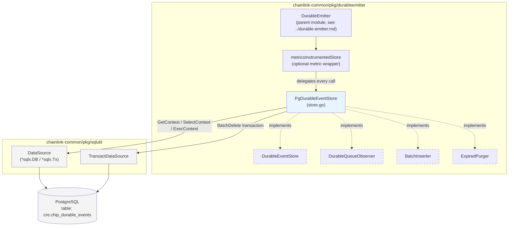
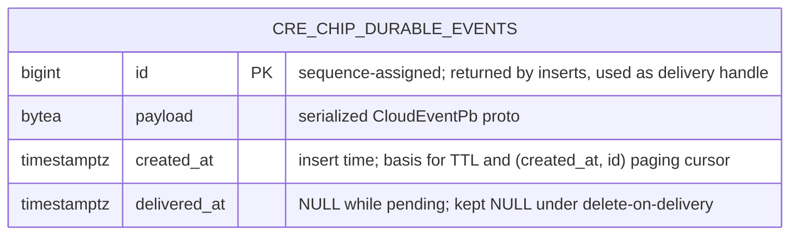
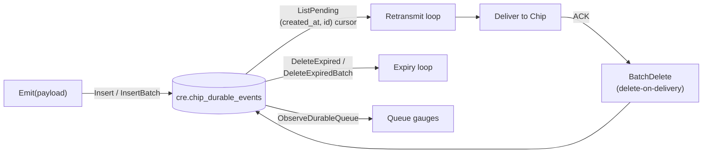

# Durable Emitter — Postgres Event Store (`PgDurableEventStore`)

`PgDurableEventStore` is the Postgres-backed persistence layer for the durable emitter subsystem. It lives in `chainlink-common/pkg/durableemitter/store.go` (Go module `github.com/smartcontractkit/chainlink-common`) and is the concrete, production implementation of the store contracts defined in [durable-emitter_event-store-contracts](durable-emitter_event-store-contracts.md). Its job is simple but critical: durably queue serialized CloudEvent protobufs destined for Chip ingestion so that a node crash never loses an event, and so delivery can be retried with at-least-once semantics.

The module's named core components are `chipDurableQueueAgg` (the scan target for the queue-statistics aggregate query) and the local `row` scan struct used by `ListPending`. Both are internal mapping types between SQL result rows and the domain types exposed by the contracts module.

> **Positioning:** this module implements contracts and is consumed by the emitter loop. Read [../durable-emitter.md](../durable-emitter.md) for the emitter runtime and [durable-emitter_event-store-contracts.md](durable-emitter_event-store-contracts.md) for the interface definitions (`DurableEventStore`, `DurableQueueObserver`, `BatchInserter`, `ExpiredPurger`, `DurableEvent`, `DurableQueueStats`).

---

## Architecture

`PgDurableEventStore` is a thin, stateless adapter: it owns no caches, goroutines, or locks of its own — concurrency safety comes from the shared `*sqlx.DB` connection pool behind the injected `sqlutil.DataSource` (see [../sqlutil.md](../sqlutil.md)). All behavior is expressed as SQL against a single table, `cre.chip_durable_events`.



### Contract satisfaction

The store satisfies the full contract surface via compile-time assertions at the top of `store.go`:

| Contract | Role in the system |
|---|---|
| `DurableEventStore` | Required core: insert, delete, batch-delete, list pending, expire. |
| `DurableQueueObserver` | Optional: exports queue depth/age gauges when metrics are enabled. |
| `BatchInserter` | Optional: enables coalescing of `Emit()` calls into multi-row inserts when `InsertBatchSize > 0`. |
| `ExpiredPurger` | Optional: returns payloads of purged rows so the emitter can attribute the `expired_purged` counter by CloudEvent source/type instead of counting anonymous rows. |

Because `PgDurableEventStore` implements *all* optional contracts, it is safe to type-assert on it either directly or through `metricsInstrumentedStore` (the wrapper's doc comment warns that its cast-forwarding makes type assertions always pass — checking the inner store ahead of time is preferred, and with this store the check succeeds either way).

---

## Storage schema

All operations target the single table `cre.chip_durable_events` (constant `chipDurableEventsTable`). The physical DDL is owned by the node's DB migrations — the file's own comment notes that tests live in `chainlink/core/services/durableemitter` for exactly this reason, since they need the migrated schema (see [Testing](#testing)). The column set is fully determined by the queries in `store.go`:



Two schema/semantics notes worth calling out:

- **Delete-on-delivery, not tombstones.** Successful delivery physically removes the row (verified by the ORM tests: `count(*) = 0` after `BatchDelete`). The `delivered_at IS NULL` filters are kept in every read path so the store reports correctly for any rows marked by other writers or alternate modes, and `TotalRows` in the aggregate still counts any delivered-but-not-yet-purged rows present.
- **`created_at` is the ordering spine.** Both keyset pagination (`ListPending`) and TTL expiry (`DeleteExpired` / `DeleteExpiredBatch`) key off `created_at` (with `id` as tiebreaker), so an index supporting `(created_at, id)` is what the query shapes below are written for.

---

## Store operations

`NewPgDurableEventStore(ds sqlutil.DataSource)` constructs the store; every method is a single SQL round trip on the injected `DataSource`.

| Method | Contract | SQL shape | Semantics |
|---|---|---|---|
| `Insert` | `DurableEventStore` | `INSERT … VALUES ($1) RETURNING id` | Persists one payload, returns the sequence-assigned id. |
| `InsertBatch` | `BatchInserter` | `INSERT … VALUES ($1),($2),… RETURNING id` (placeholders built with `strings.Join`) | One round trip for N events; no-op for empty input. |
| `Delete` | `DurableEventStore` | `DELETE WHERE id = $1` | Physical single-row removal (corrupt payloads, policy drops, tests). |
| `BatchDelete` | `DurableEventStore` | `DELETE WHERE id IN (SELECT id … WHERE id = ANY($1) FOR UPDATE SKIP LOCKED)` inside `sqlutil.TransactDataSource` | Delete-on-delivery, idempotent, relaxed `synchronous_commit` (see below). |
| `ListPending` | `DurableEventStore` | `SELECT … WHERE delivered_at IS NULL AND created_at < $1 AND (created_at, id) > ($2, $3) ORDER BY created_at, id LIMIT $4` | Keyset-paged pending backlog. |
| `DeleteExpired` | `DurableEventStore` | CTE: `WITH deleted AS (DELETE … WHERE created_at <= now() - $1::interval RETURNING id) SELECT count(*)` | Unbounded time-based GC; returns count. |
| `DeleteExpiredBatch` | `ExpiredPurger` | CTE: bounded `SELECT id … ORDER BY created_at LIMIT $2 FOR UPDATE SKIP LOCKED` → `DELETE … RETURNING payload` | Bounded purge; returns payloads for attribution. |
| `ObserveDurableQueue` | `DurableQueueObserver` | Single aggregate `SELECT count(*) FILTER (WHERE delivered_at IS NULL), count(*), sum(octet_length(payload)) FILTER (…), min(created_at) FILTER (…)` | Queue statistics snapshot (see [Observability](#observability)). |

### Data flow

The emitter runtime orchestrates these operations in three loops; this module provides the durable side effects:



### Delivery lifecycle (process flow)

```mermaid
sequenceDiagram
    autonumber
    participant E as DurableEmitter
    participant S as PgDurableEventStore
    participant P as PostgreSQL
    participant C as Chip consumer

    Note over E,S: Persist
    E->>S: Insert(payload) / InsertBatch(payloads)
    S->>P: INSERT ... RETURNING id
    P-->>S: assigned id(s)
    S-->>E: id(s)

    Note over E,C: Retransmit loop
    loop pages through backlog, wrapping cursor
        E->>S: ListPending(createdBefore, cursor, limit)
        S->>P: SELECT ... delivered_at IS NULL AND (created_at,id) > cursor
        P-->>S: rows
        S-->>E: []DurableEvent
        E->>C: deliver events
        C-->>E: ACK
        E->>S: BatchDelete(ids)
        S->>P: BEGIN; SET LOCAL synchronous_commit = off;
        S->>P: DELETE ... WHERE id = ANY($1) FOR UPDATE SKIP LOCKED; COMMIT
        P-->>S: rows affected
    end

    Note over E,S: Expiry loop
    E->>S: DeleteExpiredBatch(ttl, limit)
    S->>P: CTE: expired SELECT ... FOR UPDATE SKIP LOCKED; DELETE RETURNING payload
    P-->>S: payloads
    S-->>E: payloads (for purge attribution)

    Note over E,S: Observability
    E->>S: ObserveDurableQueue(eventTTL)
    S->>P: aggregate query
    P-->>S: aggregate row
    S-->>E: DurableQueueStats
```

### Key design decisions in the SQL

- **Relaxed durability for deletes (`BatchDelete`).** The delete transaction runs `SET LOCAL synchronous_commit = off`, which removes the commit WAL-flush wait (`IO:XactSync`) that dominates at high delete rates. This is safe *because of the delete-on-delivery model*: a delete commit lost to a crash merely leaves the row to be re-delivered (idempotent at the consumer) or reclaimed by the expiry loop. The `SET LOCAL` scoping means the relaxation only applies inside this transaction. The `id = ANY($1)` clause is bound with `pq.Array(ids)` (`github.com/lib/pq`, pinned in `chainlink-common/go.mod`).
- **Poison-event protection (`ListPending`).** The `(created_at, id) > ($2, $3)` row-value comparison is the paging cursor. The retransmit loop advances it forward through the backlog and wraps to a zero cursor (`time.Time{}`, `0`) at the end, so a persistently-failing ("poison") event cannot monopolise the head of the list and starve everything behind it. `createdBefore` bounds the upper edge of the scan; `limit` bounds page size.
- **Bounded, attributed expiry (`DeleteExpiredBatch`).** A `limit <= 0` is rejected outright. The `FOR UPDATE SKIP LOCKED` selection of the oldest `limit` expired ids means a large backlog is drained in slices rather than in one statement that streams every payload back at once, and concurrent purgers/workers don't contend on the same rows. Returning `payload` lets the emitter attribute the purge to the events' CloudEvent source (domain) and type (subject). A result shorter than `limit` signals the expired backlog is drained.
- **Loss-safe GC (`DeleteExpired`).** Beyond TTL-based cleanup, the expiry path also reclaims rows whose delivery-time delete failed (e.g. a DB error in the delivery callback), so nothing lingers past `EventTTL`.
- **Contention-free batch semantics.** `FOR UPDATE SKIP LOCKED` in both `BatchDelete` and `DeleteExpiredBatch` lets multiple loops or workers operate on the queue concurrently without row-level blocking.

### Internal scan types (module core components)

- **`row`** — local struct inside `ListPending` with `db:"id"`, `db:"payload"`, `db:"created_at"` tags; each scanned row is converted to a `DurableEvent` via `DurableEvent(r)`, keeping the wire/result mapping co-located with the query.
- **`chipDurableQueueAgg`** — scan target for the `ObserveDurableQueue` aggregate: `Cnt` (`cnt`), `Total` (`total`), `PayloadSum` (`payload_sum`), and `MinCreated` (`min_created`, nullable). It is the bridge between the SQL aggregation and `DurableQueueStats`.

---

## Observability

`ObserveDurableQueue` maps the `chipDurableQueueAgg` aggregate onto `DurableQueueStats` (defined in [durable-emitter_event-store-contracts.md](durable-emitter_event-store-contracts.md)):

| `DurableQueueStats` field | Source | Meaning |
|---|---|---|
| `Depth` | `count(*) FILTER (WHERE delivered_at IS NULL)` | Delivery backlog (undelivered rows). |
| `TotalRows` | `count(*)` | Authoritative physical row count, including delivered-but-not-purged rows; read from the DB so it stays correct regardless of how many writers share the table or which in-memory deltas were lost. |
| `PayloadBytes` | `sum(octet_length(payload)) FILTER (WHERE delivered_at IS NULL)` | Byte size of the undelivered backlog. |
| `OldestPendingAge` | `now() - min(created_at)` over pending rows | `0` when the queue is empty. |
| `TTLBudget` | `eventTTL - OldestPendingAge` | Headroom of the event closest to expiry; a DLQ-pressure proxy (there is no separate dead-letter table in the default design). Equals `eventTTL` when the queue is empty and goes **negative** when the expiry loop is behind. "Near expiry" thresholding is applied downstream by the alert engine, not in the store. |

Operation metrics (per-op latency/error recording for `insert`, `insert_batch`, `delete`, `batch_delete`, `list_pending`, `delete_expired`) are added by the `metricsInstrumentedStore` wrapper in `observable_store.go`, not by this store — see the contracts page for that decorator.

---

## Dependencies

- **`chainlink-common/pkg/sqlutil`** — `DataSource` (satisfied by `*sqlx.DB` and `*sqlx.Tx`) is the single I/O abstraction injected via the constructor; `TransactDataSource` provides the transaction shell used by `BatchDelete`. Details in [../sqlutil.md](../sqlutil.md). Note that `Transact` executes the callback directly against the DataSource when it does not support beginning a transaction (or is already inside one).
- **`github.com/lib/pq`** — `pq.Array` for binding `[]int64` to `id = ANY($1)`; **`github.com/jmoiron/sqlx`** underlies `sqlutil`. Both are pinned in `chainlink-common/go.mod` (module `github.com/smartcontractkit/chainlink-common`, Go 1.27.1), which also carries the pgx/otelsql driver stack used to build `DataSource` instances.
- **PostgreSQL features relied upon:** CTE-writable `DELETE … RETURNING`, row-value comparisons, `FILTER` aggregates, `octet_length`, `::interval` casts (fed Go `time.Duration.String()`, e.g. `1h0m0s`), and `FOR UPDATE SKIP LOCKED`.
- Build, generation and lint tooling for the owning Go module are documented in [Build, CI & Release Infrastructure — build-and-repo-tooling](../../Build,_CI___Release_Infrastructure/build-and-repo-tooling.md) (`chainlink-common/Makefile`).

---

## Testing

Unit tests live outside the package at `chainlink/core/services/durableemitter/durable_event_store_orm_test.go` — as `store.go` itself notes, they require the DB migrations that create `cre.chip_durable_events` (via `pgtest.NewSqlxDB`), so they belong with the node's migration test harness. They truncate with `TRUNCATE TABLE cre.chip_durable_events RESTART IDENTITY` for determinism on shared databases and verify, among other things:

- **Round trip:** `Insert` → `ListPending` returns the same id/payload; `Delete` empties the queue.
- **Delete-on-delivery:** after `BatchDelete` the row is gone (not tombstoned — `count(*) = 0`), and a second `BatchDelete` of the same id is idempotent (returns `0`).
- **Cursor/limit semantics:** `ListPending` respects `createdBefore` (past ⇒ empty, future ⇒ rows) and `limit`.
- **TTL semantics:** `DeleteExpired` with a large TTL deletes nothing; with TTL `0` it deletes everything.
- **Queue stats:** `ObserveDurableQueue` reflects `Depth`, `PayloadBytes`, and a positive `OldestPendingAge` after an insert.

When extending the SQL in this module, add coverage there rather than inside `chainlink-common` — the migration dependency is deliberate.

---

## Operational characteristics (summary)

| Concern | How this store addresses it |
|---|---|
| Durability model | At-least-once delivery: events persisted before emission; lost delete commits degrade to idempotent redelivery or expiry reclaim, never data loss. |
| Throughput | `InsertBatch` collapses N emits into one round trip; `synchronous_commit = off` on the delete path removes the dominant WAL-flush wait at high delete rates. |
| Head-of-line blocking | `(created_at, id)` cursor with wrap-around prevents a poison event from starving the backlog. |
| Contention | `FOR UPDATE SKIP LOCKED` on delete and purge paths; pool-backed concurrency with no internal locking. |
| Unbounded growth | Dual expiry paths: unbounded `DeleteExpired` GC and bounded `DeleteExpiredBatch` that drains large backlogs in slices and returns payloads for attribution. |
| Observability | DB-authoritative queue gauges (`Depth`, `TotalRows`, `PayloadBytes`, `OldestPendingAge`, `TTLBudget`) plus wrapper-level per-op metrics. |

---

## Related documentation

- [Durable Emitter (parent module)](../durable-emitter.md) — emitter runtime that drives these operations.
- [Durable Emitter — Event Store Contracts](durable-emitter_event-store-contracts.md) — `DurableEventStore`, `DurableQueueObserver`, `BatchInserter`, `ExpiredPurger`, `DurableEvent`, `DurableQueueStats`, and the metrics-instrumented decorator.
- [sqlutil](../sqlutil.md) — `DataSource` and `TransactDataSource`, the persistence abstractions this store is built on.
- [Shared Foundation Libraries & Domain Types](../../Shared_Foundation_Libraries___Domain_Types.md) — module-group overview.
- Source: `chainlink-common/pkg/durableemitter/store.go` (this module), `chainlink-common/pkg/durableemitter/observable_store.go` (contracts), `chainlink/core/services/durableemitter/durable_event_store_orm_test.go` (tests requiring migrations).
