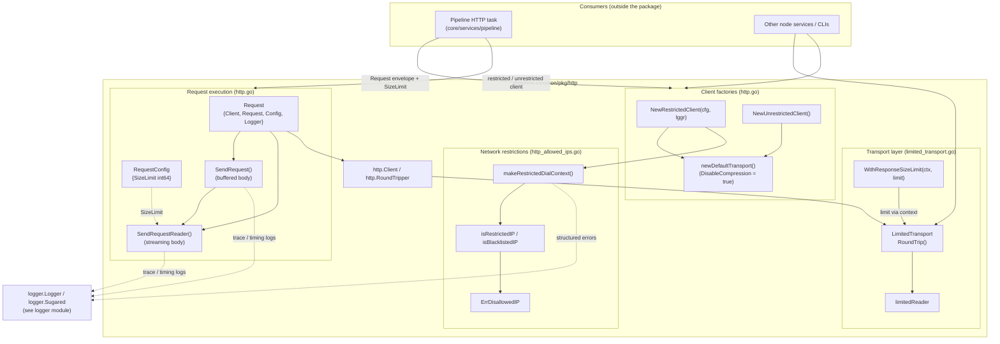
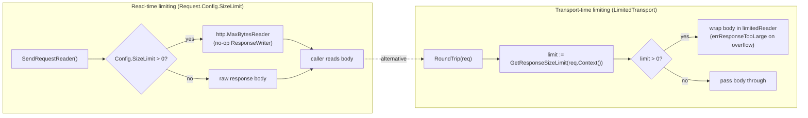
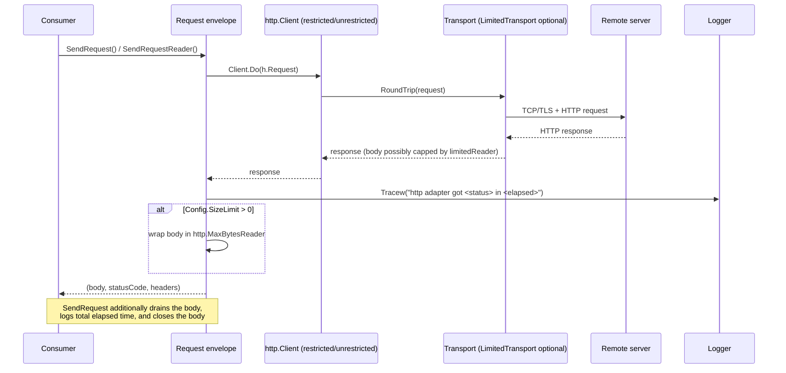

# HTTP Client (`chainlink-common/pkg/http`)

> Parent module: [Shared Foundation Libraries & Domain Types](../Shared_Foundation_Libraries___Domain_Types.md)

## 1. Purpose and Scope

The **http-client** module is the shared HTTP utility layer of the Chainlink platform, implemented in `chainlink-common/pkg/http`. It lives inside the `github.com/smartcontractkit/chainlink-common` Go module (see [`chainlink-common/go.mod`](../../repo/chainlink-common/go.mod)) and is consumed by any service that needs to make outbound HTTP calls under the platform's security policies.

The package solves four recurring problems for outbound HTTP traffic in a security-sensitive oracle node:

1. **Network egress control** – a factory for *restricted* HTTP clients whose dialer refuses connections to loopback, private, link-local, multicast and other dangerous IP ranges, mitigating SSRF-style attacks (`NewRestrictedClient`), plus an escape hatch for callers that explicitly opt out (`NewUnrestrictedClient`).
2. **Hardened transport defaults** – all clients created by this package disable HTTP compression at the transport level, cutting off an entire class of compression-based side-channel vulnerabilities (e.g. BREACH/CRIME-style attacks).
3. **Uniform request execution** – a `Request` envelope that bundles a `Client`, an `*http.Request`, per-request configuration (`RequestConfig`) and a [logger](logger.md), and exposes buffered (`SendRequest`) and streaming (`SendRequestReader`) execution with consistent trace logging and timing.
4. **Response size limiting** – a transport-level wrapper (`LimitedTransport`) that caps how many bytes of a response body may be read, with the limit supplied per-request through the `context.Context`.

## 2. Architecture Overview

The package is deliberately small and layered: consumers either pick a client factory (restricted or unrestricted), execute requests through the `Request` envelope, or wrap any `http.RoundTripper` with `LimitedTransport` when they need transport-level body caps.

### 2.1 Core building blocks

| Component | File | Responsibility |
|---|---|---|
| `NewRestrictedClient` / `NewUnrestrictedClient` | `http.go` | Build `*http.Client`s on a cloned default transport with compression disabled; the restricted variant installs a security-checking dialer. Documented in the [request sub-module](http-client/http-client_request.md). |
| `Client` interface | `http.go` | Minimal `Do(*http.Request) (*http.Response, error)` abstraction so request execution is mockable (tests swap in a mock transport). Documented in the [request sub-module](http-client/http-client_request.md). |
| `Request` / `RequestConfig` | `http.go` | Execution envelope: carries the client, the `*http.Request`, a `SizeLimit` and a [logger](logger.md); implements buffered and streaming send. Documented in the [request sub-module](http-client/http-client_request.md). |
| `makeRestrictedDialContext`, `isRestrictedIP`, `ErrDisallowedIP` | `http_allowed_ips.go` | Post-dial IP verification that rejects loopback/private/link-local/multicast addresses, plus IPs matching the configured database URL host (SSRF protection). See [Security model](#22-security-model-restricted-egress) below. |
| `LimitedTransport`, `WithResponseSizeLimit`, `limitedReader` | `limited_transport.go` | `http.RoundTripper` decorator that trims response bodies to a context-scoped byte limit and reports `errResponseTooLarge`. Documented in the [transport sub-module](http-client/http-client_transport.md). |

### 2.2 Security model: restricted egress

`NewRestrictedClient` installs a dialer produced by `makeRestrictedDialContext` (`chainlink-common/pkg/http/http_allowed_ips.go`). After a successful dial, the remote IP is evaluated by `isRestrictedIP`:

- **Rejected outright:** anything that is not global unicast — loopback (`127.0.0.0/8`, `::1`), RFC1918 private ranges (`10/8`, `172.16/12`, `192.168/16`), link-local (`169.254/16`, `fe80::/10`), unique-local IPv6 (`fc00::/7`), multicast, broadcast, unspecified and zero addresses.
- **Database-URL blacklist:** the resolved IPs of the host in the configured `clientConfig.URL()` (the node's database URL) are also rejected, preventing requests from bouncing off the node's own infrastructure.
- **Fail-open with loud logging:** if the blacklist check itself errors (e.g. DNS lookup failure), the connection is *allowed* but an error is logged — availability is preferred over silent breakage, while still surfacing the anomaly.
- **Rejection signal:** disallowed dials close the connection and return an error that wraps the exported sentinel `ErrDisallowedIP`, so callers (like the [pipeline HTTP task](../Oracle_Engines___Data_Pipelines/pipeline.md), which wraps it with per-task remediation advice in `chainlink/core/services/pipeline/task.http.go`) can detect and explain the refusal.

### 2.3 Two complementary size-limiting mechanisms

The package offers size control at two different layers, and it is important to know when each applies:

- **`Request.Config.SizeLimit`** acts when the *consumer reads* the body: `SendRequestReader` wraps the body with `http.MaxBytesReader` so reads fail once the limit is exceeded. It is convenient for callers already using the `Request` envelope.
- **`LimitedTransport`** acts as soon as the *transport returns*: any reader of the response body — including code paths that never touch the `Request` envelope — is capped, and the limit travels per-request in the `context` via `WithResponseSizeLimit`. This makes it suitable for shared clients whose callers have heterogeneous limits.

### 2.4 Request execution flow

Both send methods log status codes and elapsed time at `Tracew` level through [logger.Sugared](logger.md); `SendRequest` additionally guarantees the response body is closed (`ErrorIfFn(source.Close, ...)`) after fully draining it into memory, while `SendRequestReader` hands the open body to the caller — **the caller is responsible for closing it**.

## 3. Sub-modules

The package splits naturally along its two core concerns. Detailed documentation for each:

| Sub-module | Core component | Documentation |
|---|---|---|
| Request execution layer | `http.go::Request` | [http-client_request.md](http-client/http-client_request.md) |
| Response-limiting transport | `limited_transport.go::LimitedTransport` | [http-client_transport.md](http-client/http-client_transport.md) |

- **Request execution layer** — the `Request`/`RequestConfig` envelope, the `Client` interface, the restricted/unrestricted client factories and their buffered/streaming send paths. This is the primary entry point for service code.
- **Response-limiting transport** — `LimitedTransport` and its context-scoped limit helpers, a drop-in `http.RoundTripper` decorator usable independently of the `Request` envelope (e.g. by code that owns its own `http.Client` but still needs per-request body caps).

## 4. How this module fits into the system

- **Consumed by the data pipeline.** The [pipeline execution engine](../Oracle_Engines___Data_Pipelines/pipeline.md) builds its `http` pipeline tasks on this package (`clhttp "github.com/smartcontractkit/chainlink-common/pkg/http"` in `chainlink/core/services/pipeline/task.http.go`): it selects between a restricted and an unrestricted client depending on the task's `allowUnrestrictedNetworkAccess` setting, enforces `DefaultHTTPLimit()` through `RequestConfig.SizeLimit`, and translates a wrapped `ErrDisallowedIP` into user-facing remediation guidance.
- **Depends on the shared logger.** All logging goes through `logger.Logger` / `logger.Sugared` from the [logger module](logger.md); tests use `logger.Nop()`.
- **Sibling foundation utilities.** [jsonrpc2](jsonrpc2.md) defines RPC response types that are typically transported over HTTP, and the [settings/limits](settings.md) framework governs resource caps similar in spirit to this package's body-size limits — but the http-client package itself has no dependency on them.

## 5. Usage notes and gotchas

- **Streaming vs. buffered:** prefer `SendRequestReader` for large or streaming payloads to avoid buffering the whole response in memory; remember the body-close obligation. `SendRequest` is a convenience wrapper that drains, closes and logs.
- **`SizeLimit` semantics:** a non-positive `SizeLimit` disables read-time limiting in `SendRequestReader`; `http.MaxBytesReader` errors surface to the reader, not from the send call itself.
- **Restricted dialer is post-dial:** the connection is established and *then* inspected, so restricted IPs are reached briefly before being closed — rely on `ErrDisallowedIP` for control flow, not on connection failures alone.
- **Compression is always disabled** on clients from the factories; if a caller needs compressed transport (rare, and discouraged for security reasons), it must construct its own client outside this package.
- **`LimitedTransport` is opt-in per request:** without `WithResponseSizeLimit` in the request context, it behaves as a pass-through decorator around the wrapped `RoundTripper`.
