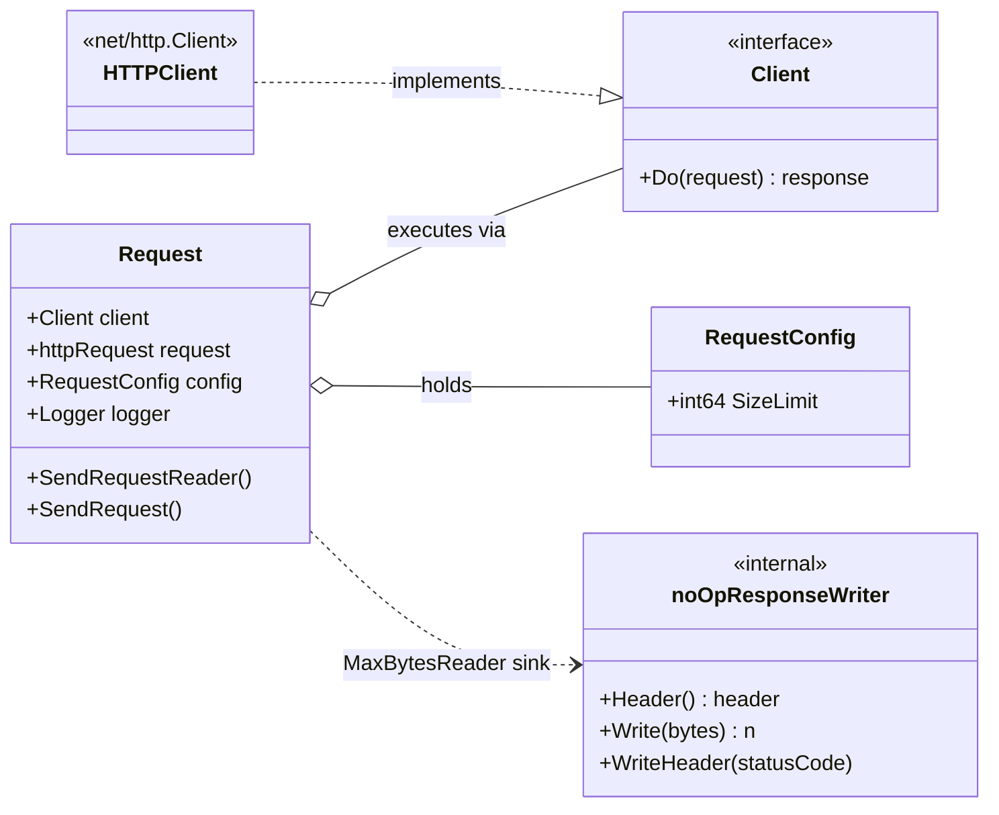
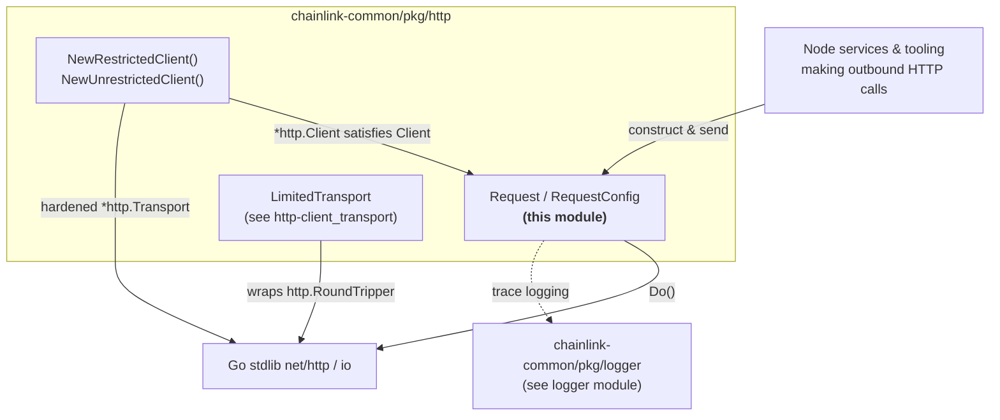
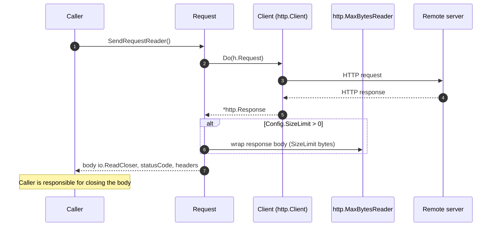

# HTTP Client — Request Execution (`chainlink-common/pkg/http`)

The `http-client_request` module implements the **request execution layer** of the shared HTTP client library in `chainlink-common/pkg/http`. Its centerpiece is the `Request` type, which bundles an injectable `Client`, the outgoing `*http.Request`, per-request settings (`RequestConfig`), and a structured `logger.Logger`, and exposes two execution modes:

- **`SendRequestReader`** — streams the response body without buffering it in memory (the caller owns and closes the body).
- **`SendRequest`** — a convenience wrapper that reads the whole body into memory and closes it for you.

The type is deliberately thin: it adds only what the node needs on top of Go's `net/http` — **response size limiting**, **trace-level timing/status logging**, and an **injectable client abstraction** for testability. Transport-level hardening (restricted dialing, egress limits) lives one layer below and is documented in [http-client_transport](http-client_transport.md).

## At a glance

| Aspect | Detail |
|---|---|
| Package | `github.com/smartcontractkit/chainlink-common/pkg/http` |
| Go module | `chainlink-common` (see `chainlink-common/go.mod`, module `github.com/smartcontractkit/chainlink-common`) |
| Core component | `chainlink-common/pkg/http/http.go::Request` |
| Key dependencies | Go stdlib `net/http`, `io`; [`logger`](../logger.md) module |
| Consumers | Any node component or tool that makes controlled outbound HTTP calls |
| Sibling module | [http-client_transport](http-client_transport.md) — transport construction and egress limiting |

## Scope

**In scope (this page)**

- `Request` execution semantics: streaming vs. buffered responses
- `RequestConfig.SizeLimit` enforcement via `http.MaxBytesReader`
- Trace logging of status codes and elapsed time
- The `Client` interface abstraction

**Out of scope (documented elsewhere)**

- Client construction and transport hardening (`NewRestrictedClient`, `NewUnrestrictedClient`, `LimitedTransport`) → [http-client_transport](http-client_transport.md)
- Logger configuration and interfaces → [logger](../logger.md)
- Overall package placement → [http-client](../http-client.md)

## Core components

| Component | Kind | Purpose |
|---|---|---|
| `Request` | struct | Execution wrapper holding `Client`, `*http.Request`, `RequestConfig`, `Logger` |
| `RequestConfig` | struct | Per-request settings; `SizeLimit int64` (bytes; `0` disables limiting) |
| `Client` | interface | `Do(*http.Request) (*http.Response, error)` — decouples `Request` from the concrete `*http.Client` so tests can inject mocks |
| `noOpResponseWriter` | internal | Discard `http.ResponseWriter` required as the sink when wrapping a body with `http.MaxBytesReader` |

```go
// Request holds the request and config struct for a http request
type Request struct {
	Client  Client
	Request *http.Request
	Config  RequestConfig
	Logger  logger.Logger
}

// RequestConfig holds the configurable settings for a http request
type RequestConfig struct {
	// SizeLimit in bytes
	SizeLimit int64
}
```

## Architecture

`Request` composes three concerns:

1. **Transport access** — through the `Client` interface, which is satisfied by `*http.Client` produced by the constructors in this package (`NewRestrictedClient` / `NewUnrestrictedClient`; see [http-client_transport](http-client_transport.md)).
2. **Response shaping** — `RequestConfig.SizeLimit` is applied lazily at read time by wrapping `r.Body` in `http.MaxBytesReader` (using the internal `noOpResponseWriter` as the required `http.ResponseWriter` sink).
3. **Observability** — timing and status are emitted at trace level through the shared [`logger`](../logger.md) module.



> Note: in the diagram, `request` is the wrapped `*http.Request` field. Exact field and method signatures are listed in the [API reference](#api-reference) below.

### Component context



## Execution flows

### Streaming: `SendRequestReader`



Step-by-step:

1. Delegates to `h.Client.Do(h.Request)` and starts a timer.
2. On transport error: logs `"http adapter got error"` at trace level and returns `(nil, 0, nil, err)` — no response, no status code.
3. On success: logs the status code and elapsed time at trace level (`statusCode`, `timeElapsedSeconds` fields).
4. If `Config.SizeLimit > 0`, wraps `r.Body` in `http.MaxBytesReader` with the internal `noOpResponseWriter` as sink; the limit is enforced **lazily**, as the caller reads.
5. Returns the (possibly wrapped) `io.ReadCloser`, status code, and headers. **The caller must close the body** — enforced by the method's contract, not by the runtime.

### Buffered: `SendRequest`

```mermaid
sequenceDiagram
    autonumber
    participant Caller
    participant Req as Request
    participant Cl as Client
    participant Srv as Remote server

    Caller->>Req: SendRequest()
    Req->>Req: SendRequestReader()
    Req->>Cl: Do(h.Request)
    Cl->>Srv: HTTP request
    Srv-->>Cl: HTTP response
    Cl-->>Req: *http.Response
    Req->>Req: io.ReadAll(body)
    Req->>Req: body.Close() (deferred; close errors logged, not returned)
    Req-->>Caller: body []byte, statusCode, headers
```

Step-by-step:

1. Calls `SendRequestReader()`; a transport error is propagated immediately (`nil` body, actual status, headers, error).
2. Reads the entire body with `io.ReadAll`, logging total elapsed time at trace level.
3. Closes the body via a deferred `source.Close`; close failures are logged at error level (`"Error closing SendRequest response body"`) but do not affect the result.
4. Returns the buffered body, status code, and headers.

## API reference

### Methods

| Signature | Behavior | Body ownership |
|---|---|---|
| `func (h *Request) SendRequestReader() (responseBody io.ReadCloser, statusCode int, headers http.Header, err error)` | Executes the request and streams the body. Transport errors → `(nil, 0, nil, err)`. | **Caller** must `Close()` the returned reader |
| `func (h *Request) SendRequest() (responseBody []byte, statusCode int, headers http.Header, err error)` | Executes the request and buffers the full body. | Library closes the body internally |

### Fields (`Request`)

| Field | Type | Notes |
|---|---|---|
| `Client` | `Client` (interface: `Do(*http.Request) (*http.Response, error)`) | Typically a `*http.Client` from `NewRestrictedClient` / `NewUnrestrictedClient` |
| `Request` | `*http.Request` | The outgoing request; not mutated by the executor |
| `Config` | `RequestConfig` | `SizeLimit int64` — max response bytes; `<= 0` disables the cap |
| `Logger` | `logger.Logger` | Used via `logger.Sugared(...)` for trace/error output; see [logger](../logger.md) |

### Constructors (defined in the same file, detailed in the transport module)

| Function | Behavior |
|---|---|
| `NewRestrictedClient(cfg clientConfig, lggr logger.Logger) *http.Client` | Secure client; the dial context is restricted so that requests to certain local addresses are blocked (SSRF hardening). `clientConfig` is the single-method interface `URL() url.URL`. |
| `NewUnrestrictedClient() *http.Client` | Client with the default transport and no dial restrictions. |
| `newDefaultTransport()` (internal) | Clones `http.DefaultTransport` and sets `DisableCompression = true` to eliminate compression side-channel vulnerability classes. |

## Behavioral contract & caveats

- **Streaming vs. buffering.** Prefer `SendRequestReader` for large or unbounded responses (feeds, gateways, file-like payloads) and drain incrementally. `SendRequest` is convenient but loads the whole body into memory subject to `SizeLimit`.
- **Size limits are lazy.** `SizeLimit` does not abort the request at header time; it takes effect while the body is read. Exceeding the limit surfaces as a read error from `http.MaxBytesReader` (`"http: request body too large"`).
- **Caveat — error propagation in `SendRequest`.** The error from `io.ReadAll` (including the size-limit error above) is captured into the named `err` return, but the final `return` statement yields a literal `nil`. Consequently, a limit-exceeded read returns a **truncated body with a nil error**. Callers that must strictly enforce `SizeLimit` should use `SendRequestReader` and inspect the read error themselves (or validate `Content-Length` upstream).
- **Close semantics differ.** `SendRequestReader` never closes the body; `SendRequest` always closes it (close errors logged at error level, not returned). Forgetting to close a streaming response leaks the connection.
- **Transport failure sentinel.** `SendRequestReader` returns status code `0` and nil headers when `Client.Do` fails; treat `err != nil` as authoritative before inspecting status.
- **Logging is trace-level.** All request telemetry (`"http adapter got error"`, `"http adapter got %v in %s"`, `"http adapter finished after %s"`) is emitted via `logger.Sugared(h.Logger).Tracew(...)` with `statusCode` and `timeElapsedSeconds` fields. Enable trace logging to see it; configure logging via the [logger](../logger.md) module.

## Dependencies & integration

- **`logger` module** — the only in-repo dependency of the execution layer (`logger.Logger`, `logger.Sugared`, `ErrorIfFn`). See [logger](../logger.md).
- **Go stdlib** — `net/http` (client, transport, `MaxBytesReader`), `io`, `net/url`, `time`, `fmt`.
- **Transport layer** — the restricted dialer and `LimitedTransport` (`chainlink-common/pkg/http/limited_transport.go`) shape *how* bytes leave the node; see [http-client_transport](http-client_transport.md).
- **Placement** — part of the shared foundation libraries that are consumed across the node, CLI, and capability processes; see [http-client](../http-client.md) and [Shared Foundation Libraries & Domain Types](../../Shared_Foundation_Libraries___Domain_Types.md).

## Usage examples

> The package name collides with stdlib `net/http`; alias both imports.

```go
import (
	stdhttp "net/http"

	pkghttp "github.com/smartcontractkit/chainlink-common/pkg/http"
)

// cfg implements clientConfig (URL() url.URL); lggr is a logger.Logger.
client := pkghttp.NewRestrictedClient(cfg, lggr)

req, err := stdhttp.NewRequestWithContext(ctx, stdhttp.MethodGet, url, nil)
if err != nil { /* ... */ }

r := pkghttp.Request{
	Client:  client,
	Request: req,
	Config:  pkghttp.RequestConfig{SizeLimit: 1 << 20}, // 1 MiB cap
	Logger:  lggr,
}
```

Buffered execution:

```go
body, status, headers, err := r.SendRequest()
if err != nil { /* transport-level failure */ }
// Note: SizeLimit violations are NOT reported as errors here (see caveats).
```

Streaming execution (strict limit enforcement):

```go
rc, status, headers, err := r.SendRequestReader()
if err != nil { /* transport-level failure */ }
defer rc.Close() // caller-owned

if _, readErr := io.Copy(sink, rc); readErr != nil {
	// includes "http: request body too large" when SizeLimit is exceeded
}
```

## Related documentation

- [http-client](../http-client.md) — parent module overview
- [http-client_transport](http-client_transport.md) — `LimitedTransport`, restricted dialing, client constructors
- [logger](../logger.md) — logging interfaces used for trace/error output
- [Shared Foundation Libraries & Domain Types](../../Shared_Foundation_Libraries___Domain_Types.md) — library family this package belongs to
