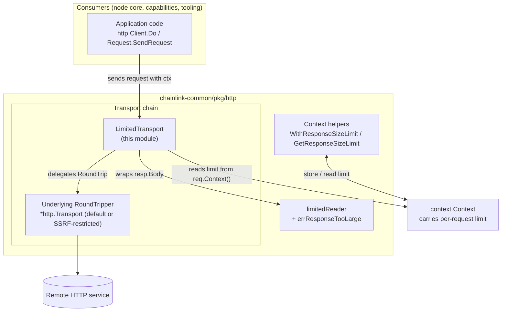
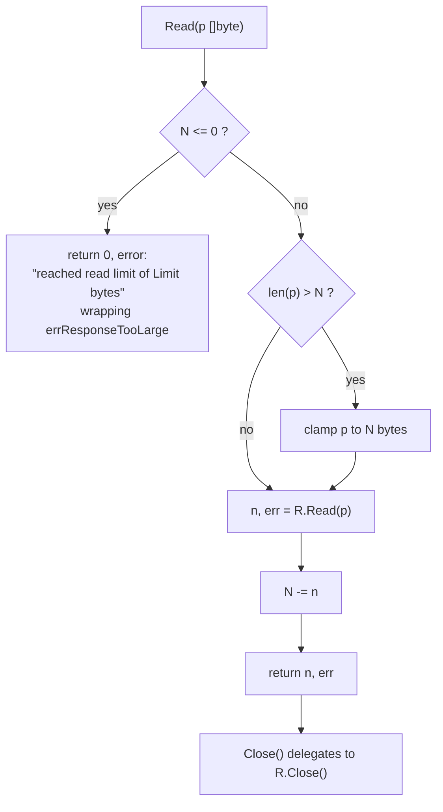

# HTTP Client — Transport Layer (`LimitedTransport`)

> **Source:** `chainlink-common/pkg/http/limited_transport.go`
> **Go module:** `github.com/smartcontractkit/chainlink-common` (see `chainlink-common/go.mod`)
> **Parent module:** [http-client](../http-client.md) · **Sibling module:** [http-client request](http-client_request.md)

## 1. Introduction

This module implements the **transport layer** of the shared `chainlink-common/pkg/http` foundation library. Its single exported component, `LimitedTransport`, is an `http.RoundTripper` **decorator** that bounds how many bytes of an HTTP response body may be read by the application.

The defining design decision is that **the size limit is not baked into the transport**. Instead, it travels **per request inside the `context.Context`**, set with `WithResponseSizeLimit`. This allows a single, shared `*http.Client` to enforce a *different* response-size budget for *different* requests — something a statically configured transport cannot do.

The module serves three goals:

1. **Memory protection** — prevent oversized or hostile remote responses from exhausting node memory.
2. **Per-request limits on shared clients** — attach a limit to one request without constructing a new `http.Client`.
3. **Explicit failure semantics** — surface a descriptive `response is too large` error instead of silently truncating the body (which is what the standard library's `io.LimitReader` does).

## 2. Position in the system

`chainlink-common/pkg/http` is one of the small, dependency-light libraries in the [Shared Foundation Libraries & Domain Types](../../Shared_Foundation_Libraries___Domain_Types.md) tier. The package consists of three cooperating files:

| File | Responsibility | Documentation |
|---|---|---|
| `http.go` | `Client` interface, `Request`/`RequestConfig` helper, restricted/unrestricted client factories | [http-client request](http-client_request.md) |
| `http_allowed_ips.go` | SSRF protection: dialer that blocks private/loopback/link-local addresses | [http-client](../http-client.md) |
| `limited_transport.go` | **This module** — context-driven response-size limiting at the transport layer | this page |

Because the package lives in `chainlink-common`, it is consumable by every Go module in the monorepo: the node core (`chainlink/...`), the capabilities workspace (`capabilities/...`), and the test/simulation environments.

### Architecture



`LimitedTransport` composes cleanly with the package's other transport-level hardening: the recommended base transport is either the package default (`http.DefaultTransport` clone with compression disabled — see the [http-client](../http-client.md) parent page) or the SSRF-restricted transport built by `NewRestrictedClient` (`http_allowed_ips.go`).

## 3. Component reference

| Symbol | Kind | Role |
|---|---|---|
| `LimitedTransport` | struct | `http.RoundTripper` decorator; wraps the response body with a size-limited reader |
| `(*LimitedTransport).RoundTrip` | method | Executes the request via the wrapped tripper and applies the limit |
| `WithResponseSizeLimit(ctx, limit)` | function | Returns a child context carrying a `uint32` byte limit |
| `GetResponseSizeLimit(ctx)` | function | Reads the limit from the context (`0` = unlimited) |
| `limitReader` / `limitedReader` | unexported | `io.ReadCloser` wrapper enforcing the limit while reading |
| `errResponseTooLarge` | unexported sentinel | Returned when the limit is exceeded |

### 3.1 `LimitedTransport`

```go
type LimitedTransport struct {
    RoundTripper http.RoundTripper
}
```

A single field holds the wrapped tripper — typically `http.DefaultTransport`, a custom `*http.Transport`, or the package's restricted transport. The struct is **stateless** and therefore safe for concurrent use by many `http.Client` goroutines, provided the wrapped tripper is (Go's `*http.Transport` is).

### 3.2 `RoundTrip`

`RoundTrip` follows the standard decorator pattern and honours the `http.RoundTripper` contract (it never mutates the request):

1. Delegate to `t.RoundTripper.RoundTrip(req)`; on error, return `nil, err` unchanged.
2. Read the limit from the *request's* context: `GetResponseSizeLimit(req.Context())`.
3. If a body exists **and** the limit is `> 0`, replace `resp.Body` with `limitReader(resp.Body, int64(respLimit))`.
4. Return the (possibly wrapped) response.

Two properties are worth highlighting:

- **Zero means unlimited.** If no limit was set (or it was set to `0`), the body is returned untouched and the wrapper behaves as a pure pass-through.
- **The limit is applied at wrap time, enforced at read time.** The HTTP exchange itself completes normally; the ceiling only takes effect as the caller reads the body.

### 3.3 Context helpers

```go
func WithResponseSizeLimit(ctx context.Context, limit uint32) context.Context
func GetResponseSizeLimit(ctx context.Context) uint32
```

- The value is stored under a **private** `contextKey` (`responseLimitCtxKey`), so it cannot collide with context values set by other packages, and it can only be written through `WithResponseSizeLimit`.
- `WithResponseSizeLimit` is a no-op passthrough when `limit <= 0`, i.e. a zero limit never enters the context.
- `GetResponseSizeLimit` performs a checked type assertion and returns `0` when the key is absent or holds a different type — `0` is the canonical *"no limit"* value throughout the module.

### 3.4 `limitedReader` and `errResponseTooLarge`

`limitedReader` is a custom replacement for `io.LimitedReader` with one crucial difference: **it errors instead of pretending EOF**.

```go
var errResponseTooLarge = errors.New("response is too large")
```

Reading logic:



- `N` tracks bytes **remaining**, `Limit` retains the original ceiling purely for the error message.
- Reads are clamped so the reader never hands out more than `N` bytes; the error is raised on the **first read attempt past the limit**, so `io.ReadAll` fails loudly rather than returning a silently truncated payload.
- `Close` propagates to the underlying body, which is what prevents connection reuse after a partial read (standard `net/http` behavior — an unread body forces the connection to be discarded rather than returned to the keep-alive pool).

## 4. Request lifecycle (data flow)

```mermaid
sequenceDiagram
    autonumber
    participant App as Application code
    participant Ctx as context.Context
    participant HC as http.Client
    participant LT as LimitedTransport
    participant UT as Underlying RoundTripper
    participant Svc as Remote HTTP service

    App->>Ctx: WithResponseSizeLimit(ctx, limit)
    Ctx-->>App: child ctx (limit under private key)
    App->>HC: Do(req with ctx)
    HC->>LT: RoundTrip(req)
    LT->>UT: RoundTrip(req)
    UT->>Svc: HTTP request
    Svc-->>UT: response (headers + streaming body)
    UT-->>LT: *http.Response
    LT->>LT: GetResponseSizeLimit(req.Context())
    alt body != nil and limit > 0
        LT->>LT: resp.Body = limitReader(resp.Body, limit)
    end
    LT-->>App: *http.Response (wrapped body)
    App->>App: Read body — bounded; first read past limit returns errResponseTooLarge
    App->>App: Close body (closes underlying body)
```

Step highlights:

1. **Limit attachment** — the caller decorates the context *before* constructing the request, so the limit is visible to the transport via `req.Context()`.
2. **Transparent dispatch** — the wrapped tripper performs the real network I/O; `LimitedTransport` adds no headers, no redirects, no retries.
3. **Bounded consumption** — every read of the returned body is accounted against the limit; excess data is simply never delivered to the application.
4. **Cleanup** — `Close` on the wrapper closes the real response body, even after a limit-induced error.

## 5. Interaction with the `Request` helper — two limiting mechanisms

The package ships **two complementary ways** to bound response size. Understanding the difference avoids misuse:

| Aspect | `RequestConfig.SizeLimit` (sibling [request module](http-client_request.md)) | `LimitedTransport` (this module) |
|---|---|---|
| Mechanism | `http.MaxBytesReader` applied by `Request.SendRequestReader` when handing back the body | `limitedReader` installed by the transport on the raw response |
| Limit source | Static field on the `Request` struct | **Per-request** context value (`uint32`) |
| Scope | Only calls routed through the `Request` helper | Any `http.Client` whose `Transport` is a `LimitedTransport` — including third-party code paths that only need `Client.Do` |
| Error on breach | Error returned while reading (readers return an error; body rejected) | `errResponseTooLarge` wrapped in `"reached read limit of N bytes"` |
| Composability | Independent of the transport | Composes with restricted dialers, custom TLS, metrics transports, etc. |

The two are not mutually exclusive: a pipeline task can use the `Request` helper (static limit) while the underlying shared client also runs a `LimitedTransport` (per-call dynamic limit). Whichever bound is hit first wins, so the *effective* limit is the strictest of the configured ones.

### Usage example

```go
// Build a hardened client once: SSRF-restricted dialer + compression disabled,
// then wrap its transport with the limiting decorator.
restricted := clhttp.NewRestrictedClient(cfg, lggr)
client := &http.Client{
    Transport: &clhttp.LimitedTransport{RoundTripper: restricted.Transport},
}

// Per call: decide the budget dynamically.
ctx := clhttp.WithResponseSizeLimit(ctx, 1<<20) // 1 MiB
req, _ := http.NewRequestWithContext(ctx, http.MethodGet, url, nil)

resp, err := client.Do(req)
// body reads are now bounded; a 2 MiB payload fails after ~1 MiB with:
//   reached read limit of 1048576 bytes: response is too large
```

## 6. Integration with the wider system

- **Pipeline engine (node core).** HTTP tasks in the data-pipeline runner build requests through the sibling `Request` helper (`clhttp.Request{Config: RequestConfig{SizeLimit: ...}}`); see [pipeline HTTP adapters](../../Oracle_Engines___Data_Pipelines/pipeline/pipeline_http_adapters.md). The `LimitedTransport` documented here is the mechanism of choice when such limits must be **dynamic per call** on a shared client rather than fixed per task spec.
- **Gateway network client.** The gateway service implements its own hardened outbound client (safeurl, allow-lists, `MaxResponseBytes` enforcement) rather than this package; see [gateway network](../../Node_Platform_Services/gateway/gateway_network.md). This illustrates the layering: `chainlink-common/pkg/http` provides the lightweight foundation, while platform services with stricter threat models build dedicated clients on top of similar primitives.
- **Resource limits.** For process-wide ceilings on other resources (tenants, concurrency, eviction), see the [settings module](../settings.md), which complements this module's per-request memory bound.
- **Logging.** The sibling `Request` helper logs request/response timing through the shared logger; see [logger](../logger.md).

## 7. Design notes and caveats

- **Enforcement is lazy by design.** The limit does not abort the download mid-flight; the response is received normally, and only the *application-visible* bytes are capped. Callers that never read the body incur no limit-related error. This keeps the transport side-effect-free and keeps error reporting at the point of consumption.
- **Sentinel error is unexported.** `errResponseTooLarge` cannot be matched with `errors.Is` from outside the package; callers should treat *any* body-read failure on a limited client as potentially limit-induced, or match on the wrapped `"reached read limit of"` wording. (Making it exported would be a small, backwards-compatible improvement.)
- **`uint32` limit type.** The context limit is a `uint32`, so the practical per-request ceiling is ~4 GiB; the internal `limitedReader` tracks the remainder as `int64`.
- **Connection reuse.** Closing the body before it is fully drained (including after a limit error) prevents the connection from returning to the keep-alive pool. This is desirable after a hostile-response event but worth knowing for legitimate large-response workloads.
- **RoundTripper contract compliance.** The request is never modified, making the decorator safe to layer anywhere in a transport chain (e.g., *above* the restricted dialer, *below* the `http.Client`).

## 8. References

- Source: `chainlink-common/pkg/http/limited_transport.go`
- Go module boundary: `chainlink-common/go.mod` (`module github.com/smartcontractkit/chainlink-common`)
- Parent: [http-client](../http-client.md) — package overview, client factories, SSRF dialer
- Sibling: [http-client request](http-client_request.md) — `Request`, `RequestConfig`, `SendRequest`/`SendRequestReader`
- Consumers: [pipeline HTTP adapters](../../Oracle_Engines___Data_Pipelines/pipeline/pipeline_http_adapters.md) · [gateway network](../../Node_Platform_Services/gateway/gateway_network.md) · [settings](../settings.md) · [logger](../logger.md)
