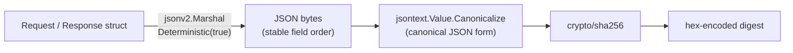
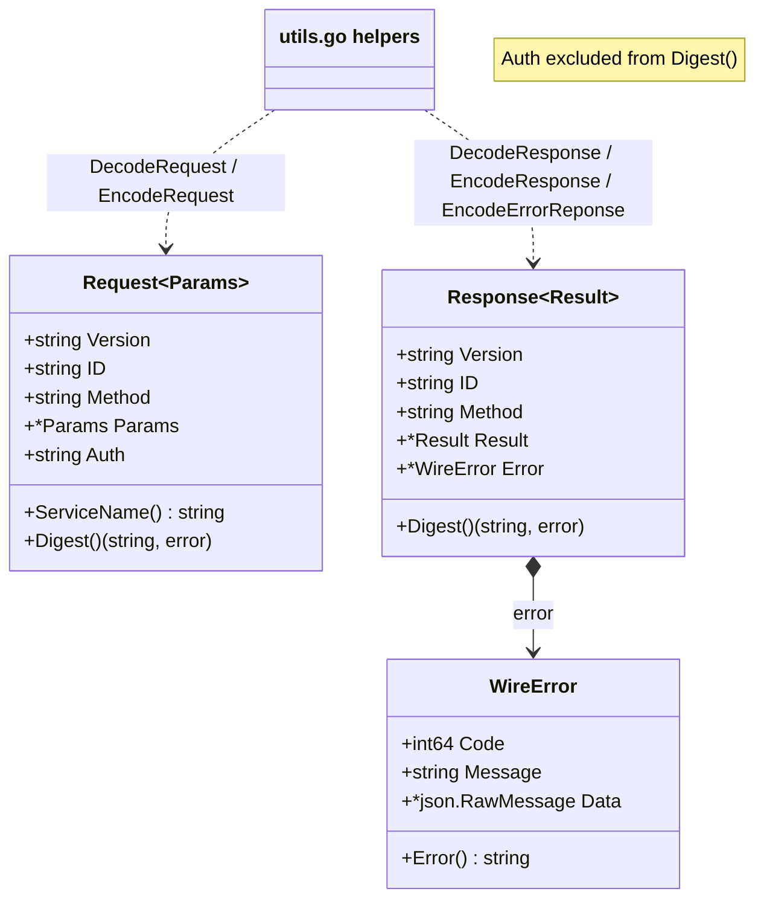
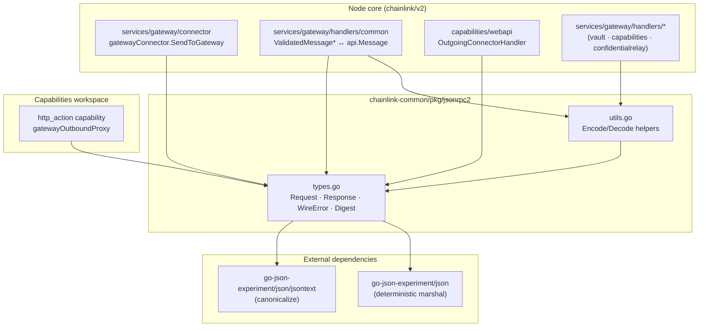
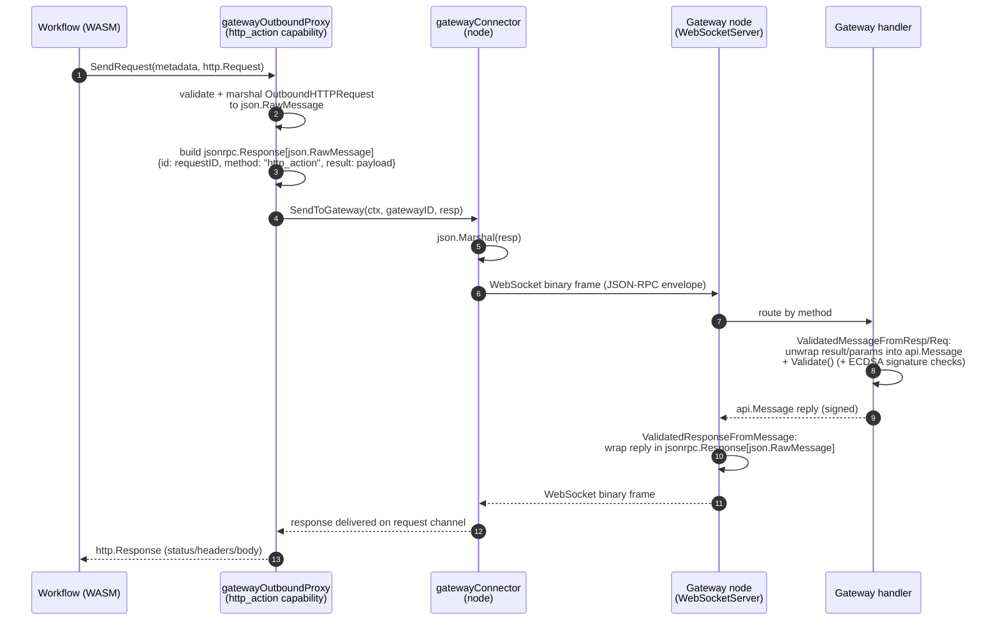

# jsonrpc2

> **Package:** `github.com/smartcontractkit/chainlink-common/pkg/jsonrpc2` · **Module:** [Shared Foundation Libraries & Domain Types](../Shared_Foundation_Libraries___Domain_Types.md)

## Introduction

`jsonrpc2` is a small, dependency-light package that provides **shared JSON-RPC 2.0 wire types** used across the Chainlink node, its capabilities, and the Gateway network. It wraps domain payloads into JSON-RPC 2.0 envelopes following the [JSON-RPC 2.0 specification](https://www.jsonrpc.org/specification), and augments them with two Chainlink-specific extensions:

1. **JWT transport (`auth` field)** — a non-standard request field that carries a JWT token for node↔service authentication, either embedded in the payload or supplied via the HTTP `Authorization` header.
2. **Canonical digests (`Digest()`)** — SHA-256 hashes over *deterministic, canonicalized* JSON of a message, used for request/response signature and integrity verification.

Because the same envelope types are shared between the node core, LOOP plugin processes, and gateway handlers, the package deliberately has no dependencies on any other Chainlink package — only on Go's standard library and the experimental `go-json-experiment/json` (encoding/json v2) package pinned in [`chainlink-common/go.mod`](https://github.com/smartcontractkit/chainlink-common) (line: `github.com/go-json-experiment/json v0.0.0-20250223041408-d3c622f1b874`).

---

## Module Structure

| File | Purpose |
|---|---|
| `types.go` | Core wire types (`Request`, `Response`, `WireError`), protocol version and error-code constants, `Digest()` methods, `ServiceName()` |
| `utils.go` | Generic encode/decode helpers (`DecodeRequest`, `EncodeRequest`, `DecodeResponse`, `EncodeResponse`, `EncodeErrorReponse`) |
| `types_test.go` | Golden-value digest tests (stable SHA-256 vectors) and error-path tests |
| `utils_test.go` | Encode/decode helper tests |

---

## Core Wire Types

### `Request[Params any]`

```go
type Request[Params any] struct {
    Version string  `json:"jsonrpc"`
    ID      string  `json:"id"`
    Method  string  `json:"method"`
    Params  *Params `json:"params"`
    Auth    string  `json:"auth,omitempty"` // non-standard: JWT token
}
```

- Generic over the params payload type; `Params` is a pointer so "missing params" is representable.
- `ID` is a `string` (Chainlink uses correlation IDs such as gateway `message_id` rather than the spec's number-or-string).
- `Auth` carries a JWT token and is **not part of the JSON-RPC specification** — it may be transported in the payload or attached to the request header.

**`ServiceName()`** — methods are namespaced as `"service.method"`; this helper returns the prefix before the first `.` (e.g. `"vault.getSecrets"` → `"vault"`). It lets servers route requests to registered handlers by service.

### `Response[Result any]`

```go
type Response[Result any] struct {
    Version string     `json:"jsonrpc"`
    ID      string     `json:"id"`
    Method  string     `json:"method"` // non-standard echo of the request method
    Result  *Result    `json:"result,omitempty"`
    Error   *WireError `json:"error,omitempty"`
}
```

- `Result` and `Error` are mutually exclusive (both `omitempty` pointers), matching the JSON-RPC rule that a response has either a result or an error.
- `Method` is a **non-standard extension**: the JSON-RPC spec does not include a method field on responses, but echoing it simplifies correlation in the node/gateway plumbing.
- Note: `Response` is also used as a generic *reply envelope* on node→gateway sends — see [Data Flow](#data-flow-node--gateway-messaging).

### `WireError`

```go
type WireError struct {
    Code    int64            `json:"code"`
    Message string           `json:"message"`
    Data    *json.RawMessage `json:"data,omitempty"` // optional structured details
}
```

Implements the `error` interface (`Error() string` returns `Message`), so a `WireError` can be returned/compared as a normal Go error.

### Error Code Constants

| Constant | Code | Meaning |
|---|---|---|
| `ErrParse` | `-32700` | Invalid JSON received by the server (spec) |
| `ErrInvalidRequest` | `-32600` | JSON sent is not a valid Request object (spec) |
| `ErrMethodNotFound` | `-32601` | Method does not exist / not available (spec) |
| `ErrInvalidParams` | `-32602` | Invalid method parameter(s) (spec) |
| `ErrInternal` | `-32603` | Internal error (defined for completeness) |
| `ErrServerOverloaded` | `-32000` | Message refused — server temporarily unable to accept new messages |
| `ErrUnknown` | `-32001` | Fallback for all non-coded errors |
| `ErrLimitExceeded` | `-32002` | Message refused — user exceeded a limit (e.g. requests/second) |
| `ErrConflict` | `-32003` | Request conflicts with an existing request |

`JsonRpcVersion = "2.0"` is the single source of truth for the version string.

---

## Integrity Digests

Both `Request` and `Response` expose `Digest() (string, error)`, which produces a **SHA-256 hex digest of the canonical JSON encoding** of the message. This is the hook used by JWT-based request authentication: the JWT claims embed the digest, and the verifier recomputes it to prove the payload was not tampered with (see [node-auth-jwt](node-auth-jwt.md) for the JWT generator/authenticator pair).



Key properties:

- **Determinism**: marshaling uses `jsonv2.Deterministic(true)` (from `go-json-experiment/json`) so the byte output is stable regardless of map iteration order or struct field order.
- **Canonicalization**: the resulting value is additionally canonicalized via `jsontext.Value.Canonicalize()`, so two semantically equal messages produce identical digests.
- **Auth exclusion**: `Request.Digest()` re-marshals the message into a fresh `Request` value with the `Auth` field **intentionally omitted** — the JWT itself authenticates the request, so it must not be part of the hashed body. `Response.Digest()` hashes the whole message (a response carries no auth field).
- **Stability**: golden digests are pinned in `types_test.go` (e.g. a known `Request` with a typed params struct yields digest `0d390d82…`), which acts as a regression guard against accidental wire-format changes.
- **Failure modes**: unmarshalable payloads (e.g. a Go `chan` inside params) surface as `error marshaling JSON: …` errors; canonicalization failures surface as `error canonicalizing JSON: …`.

---

## Codec Helpers (`utils.go`)

Thin, generic wrappers around `encoding/json` that encapsulate validation and auth fallback for the envelope types:

| Function | Behaviour |
|---|---|
| `DecodeRequest[Params](b []byte, jwtTokenFromHeader string)` | Unmarshals a request and validates: version must equal `JsonRpcVersion`, `Method` must be non-empty, `Params` must be non-nil. If the payload carries no `Auth`, the JWT token extracted from the transport header is spliced into `request.Auth` before returning. |
| `EncodeRequest[Params](r *Request[Params])` | JSON-marshals a request. |
| `DecodeResponse[Result](b []byte)` | Unmarshals a response. |
| `EncodeResponse[Result](r *Response[Result])` | JSON-marshals a response. |
| `EncodeErrorReponse[ErrorData](id string, err *WireError)` | Marshals a `Response[any]` carrying only version/ID/error — the canonical way to reply to a malformed request. (The function name's `Reponse` spelling is part of the current API.) |

### Wire Examples

Request with typed params (JWT in payload):

```json
{
  "jsonrpc": "2.0",
  "id": "req-42",
  "method": "vault.getSecrets",
  "params": { "key": "API_KEY", "namespace": "prod" },
  "auth": "eyJhbGciOi..."
}
```

Error response (built with `EncodeErrorReponse`):

```json
{
  "jsonrpc": "2.0",
  "id": "req-42",
  "error": { "code": -32602, "message": "invalid params" }
}
```

---

## Architecture

### Component View



### Dependency Graph

The package is intentionally a **leaf**: it depends only on `encoding/json` and `go-json-experiment/json` (+`jsontext`). Everything that needs to speak the node/gateway JSON-RPC dialect depends *on* it.



Where the consumers fit in the wider system:

- **Gateway connectivity** ([Node Platform Services → Gateway](../Node_Platform_Services/gateway.md)) — the node-side `gatewayConnector` serializes `jsonrpc.Response[json.RawMessage]` envelopes and writes them as WebSocket binary frames to gateway nodes; gateway handlers accept JSON-RPC messages and bridge them to the legacy, ECDSA-signed `api.Message` format via `ValidatedMessageFromReq` / `ValidatedMessageFromResp` / `ValidatedRequestFromMessage` / `ValidatedResponseFromMessage`.
- **Workflow capabilities** ([Workflow & Capability Runtime (CRE Engine) → http_action capability](../Workflow___Capability_Runtime_(CRE_Engine)/http_action_capability.md)) — the `gatewayOutboundProxy` wraps `OutboundHTTPRequest` payloads (`chainlink-common/pkg/types/gateway`, method `"http_action"`) in a `jsonrpc.Response[json.RawMessage]` and ships it through the connector.
- **JWT-based auth** ([node-auth-jwt](node-auth-jwt.md)) — the `Request.Auth` field and `Digest()` are consumed by node↔DON authentication flows. The digest semantics here (canonical JSON) are specific to this package; note that gRPC-side JWT flows in `nodeauth` use their own deterministic-protobuf digest (see [node-auth-jwt](node-auth-jwt.md) before mixing the two).

---

## Data Flow: Node → Gateway Messaging

The primary production use of the package is framing node↔gateway traffic. The example below traces an `http_action` request issued from a workflow:



Observations:

- The **`Response` type doubles as the outbound envelope** for node→gateway sends: the actual domain payload rides in `Result`, while `ID` carries the gateway correlation `message_id` and `Method` carries the routing method (e.g. `"http_action"`). On the gateway side the same types wrap `api.Message` in `Params` for gateway→node pushes.
- `ServiceName()` and the `handlers map[string]GatewayConnectorHandler` registry in the connector align: handlers register per method, and error replies use the shared error codes (`ErrServerOverloaded`, `ErrLimitExceeded`, …) so capabilities and gateways agree on failure semantics.
- The gateway's own `api.Message` ECDSA-signature scheme (keccak over aligned fixed-width body fields) is **orthogonal** to the JSON-RPC canonical digest in this package — message_util bridges the two formats without conflating their integrity mechanisms.

---

## Design Notes & Conventions

- **Generics over payloads.** `Request[Params]` / `Response[Result]` let each call site pick typed params/results, while `json.RawMessage` instantiations (`Request[json.RawMessage]`, `Response[json.RawMessage]`) serve as the transport-agnostic envelope for plumbing code.
- **Strings for IDs.** `ID` is always a string; producers must generate unique correlation IDs (e.g. `common.GetRequestID(method, workflowID, workflowExecutionID)` in the http_action proxy).
- **Determinism is security-relevant.** The whole point of using `go-json-experiment/json` with `Deterministic(true)` + canonicalization is that sender and verifier compute identical hashes from semantically equal messages. Any change to struct tags or field ordering that alters the canonical form will change digests — treat digest golden tests as wire-compatibility gates.
- **Version check happens on decode.** `DecodeRequest` rejects anything but `"2.0"`; hand-rolled decoders (e.g. `ValidatedMessageFromReq`) repeat this check.
- **No protocol logic.** The package provides no client/server, no batching, and no notifications — only the message model, integrity hashing, and codec helpers. Transport, routing, and retries live in the consumers ([gateway module](../Node_Platform_Services/gateway.md), capability proxies, etc.).

---

## Related Modules

| Module | Relationship |
|---|---|
| [types-core](types-core.md) | Domain interfaces (`core.GatewayConnectorHandler`, `core.MultiGatewayConnector`) implemented by jsonrpc2 consumers. |
| [http-client](http-client.md) | Shared HTTP client utilities; complementary outbound-request plumbing used by node services. |
| [node-auth-jwt](node-auth-jwt.md) | JWT generator/authenticator; the `Auth` + `Digest()` extension points of this package are designed for it (note the separate gRPC digest utility there). |
| [Gateway (Node Platform Services)](../Node_Platform_Services/gateway.md) | Primary consumer — WebSocket transport, connector, and handlers all frame traffic with these types. |
| [http_action capability (CRE Engine)](../Workflow___Capability_Runtime_(CRE_Engine)/http_action_capability.md) | Gateway-proxy mode builds JSON-RPC envelopes to reach external endpoints via gateways. |
