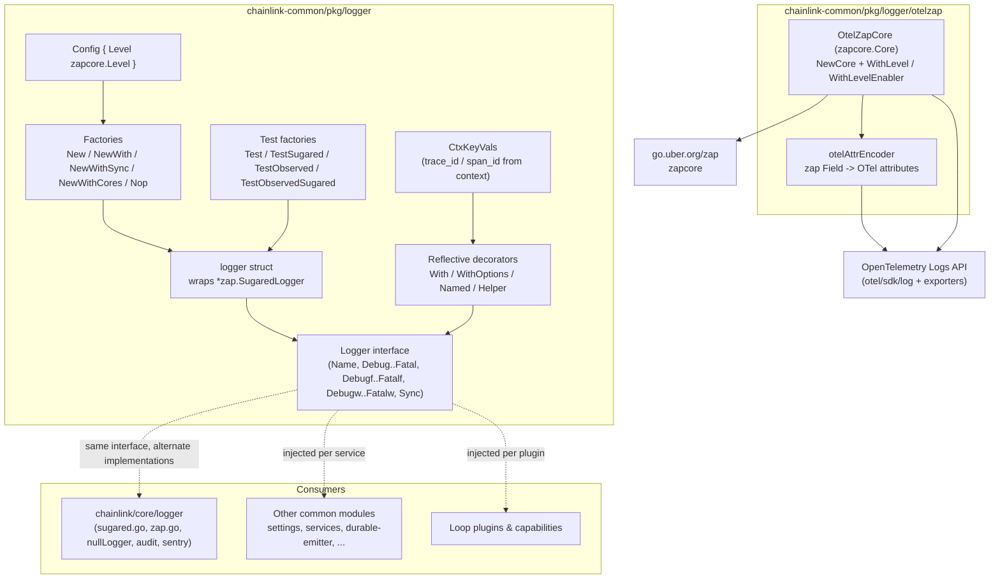
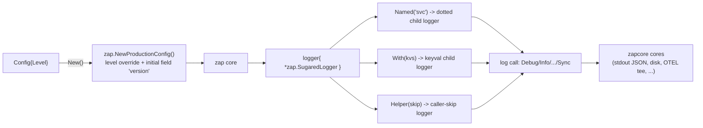
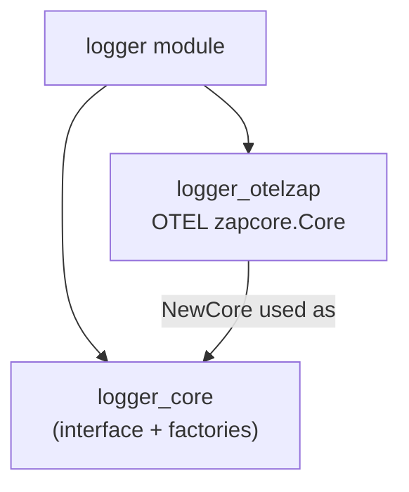

# Logger (`chainlink-common/pkg/logger`)

## 1. Purpose and Scope

The `logger` module is the **canonical logging abstraction of the Chainlink platform**. It lives in `chainlink-common` so that every Go workspace — the chainlink node core, capabilities, deployment tooling, CLI and SDKs — can log through one stable interface instead of depending on a concrete logging library.

The module provides:

| Concern | Where |
|---|---|
| The `Logger` interface (leveled, sugared-style API) | `chainlink-common/pkg/logger/logger.go` |
| `Config` for constructing production loggers | `chainlink-common/pkg/logger/logger.go` |
| Factory functions: `New`, `NewWith`, `NewCore`, `NewWithSync`, `NewWithCores`, `Nop` | `chainlink-common/pkg/logger/logger.go` |
| Test loggers wired to `testing.TB`: `Test`, `TestSugared`, `TestObserved`, `TestObservedSugared` | `chainlink-common/pkg/logger/logger.go` |
| Reflective decorators usable on *any* `Logger` implementation: `With`, `WithOptions`, `Named`, `Helper` | `chainlink-common/pkg/logger/logger.go` |
| Context-aware key/values (`CtxKeyVals`) and deprecated `Critical*` shims | `chainlink-common/pkg/logger/logger.go` |
| OpenTelemetry log-export bridge for zap | `chainlink-common/pkg/logger/otelzap` |

The interface is deliberately **zap-compatible**: the doc comment states it is "implemented by `smartcontractkit/chainlink/core/logger.Logger` and `go.uber.org/zap.SugaredLogger`". This lets the same interface be satisfied by the lightweight common implementation and by the node's richer logger (disk logging, audit log, Sentry, Prometheus counters) without coupling the common library to the node.

## 2. Architecture Overview

### 2.1 Logger construction and decoration flow

Key design points:

- **Injection over globals.** The interface doc mandates loggers be *injected and Named*: `lggr.Named("<service name>")`. There is no package-level singleton; `defaultConfig` is only a package-level default for `New()`.
- **Version stamping.** `Config.New` seeds every log entry with `{"version": "<build.Version>@<checksum prefix>"}` derived from `chainlink-common/pkg/config/build`, so production logs are attributable to a build.
- **Structural subtyping instead of imports.** `With`, `WithOptions`, `Named` and `Helper` first type-switch on the internal `*logger`; for *foreign* `Logger` implementations they use reflection (`MethodByName("With"|"Named"|"Helper")`) and degrade gracefully (return the original logger) when a method is missing. This is exactly how the node's `chainlink/core/logger` implementation is decorated without importing it.
- **Test-first ergonomics.** `Test(tb)` attaches a console encoder writing through `zaptest.NewTestingWriter` with sub-second timestamps; `TestObserved(tb, lvl)` tees an `observer.Core` so tests can assert on captured `ObservedLogs`. When running under `testing.Testing()`, `Named` also emits a `Helper(...).Debugf("New logger: %s", ...)` trace line.

### 2.2 Log-level semantics

The interface doc fixes the meaning of each level for the whole platform (also published in node operator docs under configuration variables):

| Level | Semantics | Example |
|---|---|---|
| Fatal | Logs then `os.Exit(1)` — does **not** unwind the stack | — |
| Panic | Unrecoverable error, invariant violation / programmer error | — |
| Error | Clearly node-op-side failure, no immediate action | database write timed out |
| Warn | Fault unclear, ops should review periodically | peer connection closed unexpectedly |
| Info | First level ops are expected to watch | entered new epoch, observation with value |
| Debug | Forensic only | message received/dropped |

### 2.3 OpenTelemetry bridge

The `otelzap` sub-package implements `zapcore.Core` (`OtelZapCore`) so that zap output can be exported through the **OpenTelemetry Logs API** instead of (or in addition to) plain files. It converts entries and zap fields to OTel attributes (caller, logger name, `exception.stacktrace`, `trace_id`/`span_id`/`trace_flags` from an attached `SpanContext`), maps zap severities onto OTel severity numbers, and emits `otel/log.Record` through an `otellog.Logger`. The core composes with `logger.NewWithCores` via `zapcore.NewTee`, enabling simultaneous console/disk and OTLP export.

> Detailed behaviour, attribute mapping tables and test strategy: [logger_otelzap](logger/logger_otelzap.md). Interface, config and factory details: [logger_core](logger/logger_core.md).

## 3. Sub-modules

| Sub-module | Documentation | Contents |
|---|---|---|
| Core logger interface, config & factories | [logger_core](logger/logger_core.md) | `Logger` interface, `Config`, all constructor/test factories, reflective decorators, `CtxKeyVals` |
| OpenTelemetry zap bridge | [logger_otelzap](logger/logger_otelzap.md) | `OtelZapCore`, `NewCore`, `WithLevel`/`WithLevelEnabler`, `otelAttrEncoder`, severity/attribute mapping |

## 4. Relationship to the Rest of the System

- **Node core logger** (`chainlink/core/logger`): implements the same `Logger` interface with production features (file/disk logging with stats, pretty console, Sentry, Prometheus counters, audit log, tracer). Its `nullLogger` is a zero-output implementation used where logging is not wired; see [core_shared_utilities_logging](../Node_Application_Core___Interfaces/core_shared_utilities/core_shared_utilities_logging.md) in the Node Application Core module. The reflective decorators in `logger_core` manipulate both implementations uniformly.
- **Shared foundation libraries**: every sibling library in this domain ([settings](settings.md), [services](services.md), [durable-emitter](durable-emitter.md), [sqlutil](sqlutil.md), [http-client](http-client.md), ...) accepts an injected `logger.Logger` rather than a concrete type; the `Service` pattern in [types-core](types-core.md) carries loggers through service lifecycles.
- **Plugin process framework (Loop)**: out-of-process plugins receive logging via gRPC surfaces rather than this interface directly; see [Plugin_Process_Framework_(Loop)](../Plugin_Process_Framework_(Loop).md).
- **Observability**: the OTel bridge is the on-node counterpart of the platform telemetry stack (Beholder, CHIP ingress); see [Telemetry___Observability_Platform](../Telemetry___Observability_Platform.md).

## 5. Build & Dependency Notes

Dependency selection is anchored in `chainlink-common/go.mod`:

- `go.uber.org/zap v1.28.0` — logging backend (sugared API, `zapcore` cores, `zaptest`, `observer`).
- `go.opentelemetry.io/otel/log v0.22.0` + `go.opentelemetry.io/otel/sdk/log v0.22.0` — the Logs API/SDK used by `otelzap`; exporters (`otlploggrpc`, `otlploghttp`, `stdoutlog`) live in the same module set.
- `go.opentelemetry.io/otel/trace v1.46.0` — used by `CtxKeyVals` and by the OTel core to extract span context fields.

The module is a plain library within the `github.com/smartcontractkit/chainlink-common` Go module; there is no dedicated build target beyond the workspace-wide tooling described in [Build,_CI___Release_Infrastructure](../Build,_CI___Release_Infrastructure.md) (`chainlink-common/Makefile`, lint scripts).
