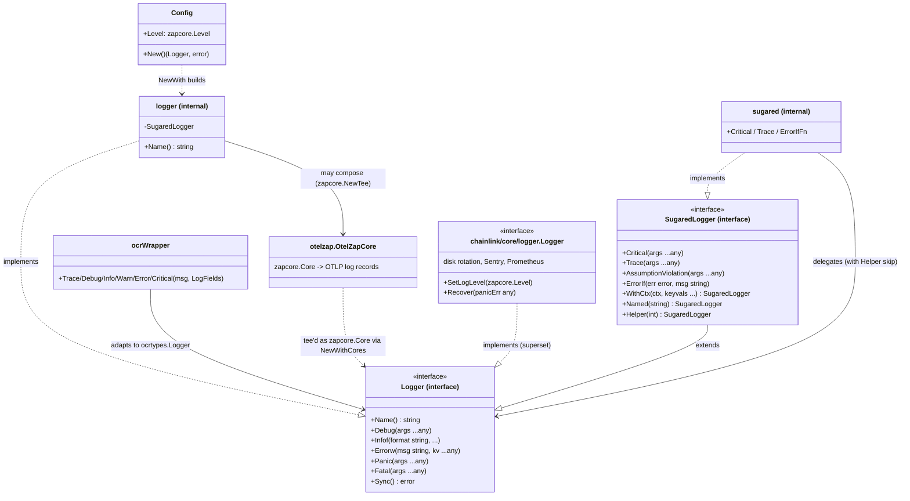
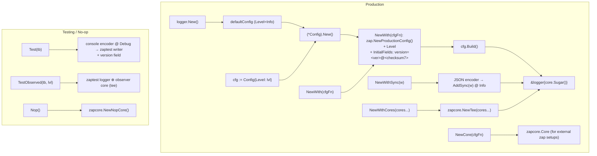
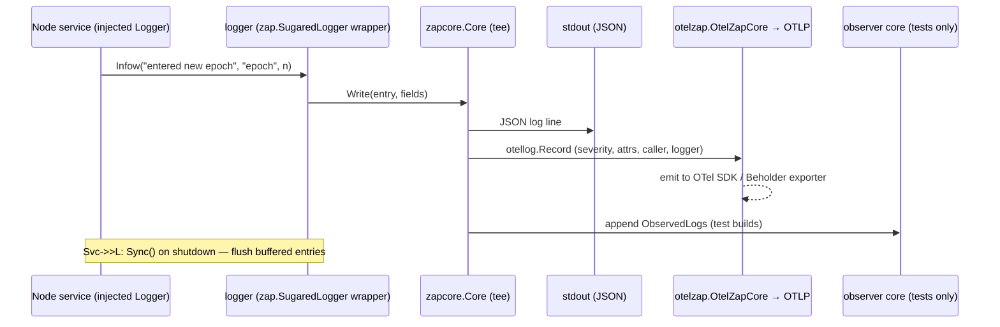
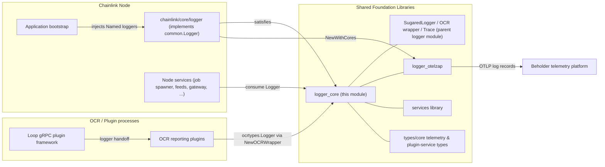

# Logger Core (`chainlink-common/pkg/logger`)

> **Module page:** `Shared_Foundation_Libraries___Domain_Types/logger/logger_core.md` · **Parent:** [logger](../logger.md) · **Domain root:** [Shared Foundation Libraries & Domain Types](../../Shared_Foundation_Libraries___Domain_Types.md)

## 1. Introduction

The `logger_core` module is the core of the shared logging library (`chainlink-common/pkg/logger`). It defines the **`Logger` interface** — the platform-wide logging abstraction — together with the **`Config`** type and a family of factory functions that build zap-backed loggers for production, testing, and no-op scenarios.

Because nearly every component in the Chainlink stack (node services, relayers, OCR plugins, capabilities, and shared libraries) depends on this abstraction, the module is deliberately tiny and dependency-light: it wraps [`go.uber.org/zap`](https://pkg.go.dev/go.uber.org/zap) and `go.opentelemetry.io/otel/trace`, and adds nothing else.

Key design principles, taken directly from the interface contract in `chainlink-common/pkg/logger/logger.go`:

- **Injection over globals** — *"Loggers should be injected (and usually Named as well): e.g. `lggr.Named("<service name>")`."*
- **Interface-first** — the module defines an interface, not a concrete type, so other implementations can substitute it (most notably the node's richer `chainlink/core/logger.Logger`, see [Core Node Logging](../../Node_Application_Core___Interfaces/core_shared_utilities/core_shared_utilities_logging.md)).
- **Testability** — dedicated test loggers (`Test`, `TestSugared`, `TestObserved`, `TestObservedSugared`) are provided; *"Tests should use a `[Test]` logger, with `[New]` being reserved for actual runtime and limited direct testing."*

This page documents the core interface, the `Config` component, the factory/helper functions in `logger.go`, and how they interoperate with the rest of the logging family:

| Sibling / related | Responsibility | Documentation |
|---|---|---|
| `sugared.go` — `SugaredLogger`, `Sugared()` | Extends `Logger` with `Critical`, `Trace`, `AssumptionViolation`, `ErrorIf`/`ErrorIfFn`, `WithCtx` | [logger (parent)](../logger.md) |
| `trace.go` / `trace_noop.go` | Build-tag-gated `Trace` implementations (`-tags trace`) | [logger (parent)](../logger.md) |
| `ocr.go` — `ocrWrapper` | Adapts `Logger` to libocr's `ocrtypes.Logger` for OCR reporting plugins | [logger (parent)](../logger.md) |
| `otelzap/` — `OtelZapCore` | `zapcore.Core` that exports log records to OpenTelemetry | [logger_otelzap](logger_otelzap.md) |
| `chainlink/core/logger` | The node's concrete logger (disk rotation, Sentry, Prometheus, `Critical`/`SetLogLevel`/`Recover`) | [Core Node Logging](../../Node_Application_Core___Interfaces/core_shared_utilities/core_shared_utilities_logging.md) |

---

## 2. Core Components

### 2.1 `Logger` interface

The basic logging contract, implemented by the internal zap-backed `logger` and structurally compatible with `chainlink/core/logger.Logger` and `*zap.SugaredLogger`:

```go
type Logger interface {
    Name() string                     // fully qualified, dot-separated (e.g. "JobSpawner.OCR2")
    Sync() error                      // flush buffered entries; insignificant errors suppressed

    Debug/Info/Warn/Error/Panic/Fatal(args ...any)               // plain
    Debugf/Infof/...f(format string, values ...any)              // printf-style
    Debugw/Infow/...w(msg string, keysAndValues ...any)          // structured (sugared)
}
```

Level semantics (from the documented contract in `logger.go`):

| Level | Meaning | Example |
|---|---|---|
| `Fatal` | Logs and then calls `os.Exit(1)`; **does not unwind the stack** | — |
| `Panic` | Unrecoverable error / invariant violation / programmer error | — |
| `Error` | Something bad happened, clearly on the node-op side; no immediate action needed | database write timed out |
| `Warn` | Something bad happened, unclear who is at fault; review occasionally | connection to peer closed unexpectedly |
| `Info` | High-level information; first level node ops are expected to watch | entered new epoch with leader |
| `Debug` | Forensic debugging; not expected for nops to watch | got a message, dropped a message |

Two additional levels exist **above** this core set in the extended `SugaredLogger` wrapper: `Critical` (a remapping of `zap.DPanicLevel`, or error-level with a `[crit]` prefix for foreign loggers) and build-tag-gated `Trace` — both documented in the [parent logger module](../logger.md).

### 2.2 `Config`

```go
type Config struct {
    Level zapcore.Level
}

var defaultConfig Config       // package-level default; Level zero-value == zapcore.InfoLevel

func New() (Logger, error)     // New with the default (zero-value) Config
func (c *Config) New() (Logger, error)
```

`Config` is the minimal production entry point for the common library: it selects the zap level and delegates to `NewWith`. The zero-value `Config` (used by `New()`) therefore produces an **Info-level** logger, suitable for library defaults.

### 2.3 Internal `logger` implementation

```go
type logger struct{ *zap.SugaredLogger }
```

A thin wrapper that implements `Logger` and adds:

- `Name()` — via `SugaredLogger.Desugar().Name()`
- `with` / `named` / `helper` — immutable derivatives returning `Logger`

### 2.4 Factory functions

| Function | Produces | Notes |
|---|---|---|
| `New()` / `(*Config).New()` | production `Logger` | `zap.NewProductionConfig()`, level from `Config.Level`, initial field `version=<ver>@<7-char checksum>` |
| `NewWith(cfgFn)` | production `Logger` | applies a mutation function to `zap.Config` before building — the general-purpose customization hook |
| `NewCore(cfgFn)` | `zapcore.Core` | for embedding this module's zap settings into an external zap setup |
| `NewWithSync(w io.Writer)` | `Logger` | JSON encoding to an arbitrary `io.Writer` at Info level |
| `NewWithCores(cores ...zapcore.Core)` | `Logger` | combines cores with `zapcore.NewTee` — the integration point for the [OTel core](logger_otelzap.md) |
| `Test(tb testing.TB)` | test `Logger` | console encoder, Debug level, `15:04:05.000000000` timestamps, writes through `zaptest.NewTestingWriter(tb)`, version field attached |
| `TestSugared(tb)` | test `SugaredLogger` | wraps `zaptest.NewLogger(tb)` |
| `TestObserved(tb, lvl)` | (`Logger`, `*observer.ObservedLogs`) | tees an `observer` core onto the test logger for in-test assertions |
| `TestObservedSugared(tb, lvl)` | (`SugaredLogger`, `*observer.ObservedLogs`) | same, returning a `SugaredLogger` |
| `Nop()` | no-op `Logger` | `zapcore.NewNopCore()`; discards everything |

### 2.5 Structural helpers (implementation-agnostic)

The `Logger` interface intentionally omits `With`/`Named`/`Helper`/`WithOptions` (those live on `SugaredLogger` and on the node's `Logger`). To keep helpers usable with **any** `Logger`, the module provides free functions that first try the fast-path type switch and then fall back to **reflection** on the method set:

| Function | Effect | Fast path | Reflection fallback |
|---|---|---|---|
| `With(l, keyvals...)` | derived logger with structured fields | `*logger` | method `With(...any) L` |
| `WithOptions(l, opts...)` | derived logger with zap options | `*logger` | method `WithOptions(...zap.Option) L` |
| `Named(l, n)` | derived logger, dot-scoped name | `*logger` | method `Named(string) L` |
| `Helper(l, skip)` | caller-skip wrapper (see `zap.AddCallerSkip`) | `*logger` | method `Helper(int) L` |

If the method is absent the original logger is returned unchanged, so helpers never panic on foreign implementations. Under test builds (`testing.Testing()`), `Named` additionally emits `Debugf("New logger: %s", n)` through a `Helper`-adjusted logger to aid test debugging.

### 2.6 Context correlation — `CtxKeyVals`

```go
func CtxKeyVals(ctx context.Context, keyvals ...any) []any
```

Builds a `With`-style key/value slice from a context:

- if an OpenTelemetry span is present, appends `trace_id`, `trace_flags`, and `span_id` from the span context;
- for each `name, ctxKey` pair supplied, resolves `ctx.Value(ctxKey)` (guarded against odd-length input).

Intended usage: `l.With(CtxKeyVals(ctx, "keyFoo", ctxKeyFoo)...)`, or the ergonomic `SugaredLogger.WithCtx` wrapper (see [parent module](../logger.md)). This is the bridge between the logging library and distributed tracing.

### 2.7 Deprecated free functions

`Critical(l, ...)`, `Criticalf(l, ...)`, `Criticalw(l, ...)` are deprecated shims; they construct a `sugared` adapter with `Helper(l, 2)` and forward to `SugaredLogger.Critical*`. New code should call `Sugared(l).Critical(...)`. The same pattern applies to `Trace`/`Tracef`/`Tracew` in the build-tag-gated files.

---

## 3. Architecture

### 3.1 Component relationships

The core module sits at the center of the logging family: it *defines* the interface, the node logger *extends* it, `SugaredLogger` *wraps* it, `ocrWrapper` *adapts* it, and `OtelZapCore` *feeds* it into OpenTelemetry.



### 3.2 Construction paths

All production paths funnel through `NewWith`, which mutates a `zap.NewProductionConfig()` and builds a sugared logger. Test and no-op paths build their own zap configurations.



### 3.3 Log-event data flow

A typical node composes its logger from the standard zap core plus optional additional cores (e.g. the OTel core), so every emitted entry fans out to all sinks; `Sync()` flushes buffered entries on shutdown.



---

## 4. How the module fits into the overall system



Concrete integration points observed in the repository:

- **Node application** — `chainlink/core/logger.Logger` explicitly satisfies the common contract (`var _ common.Logger = (Logger)(nil)` in `chainlink/core/logger/logger.go`) while extending it with `Critical`, `SetLogLevel`, and `Recover`, plus rotating disk logs (lumberjack), Sentry forwarding, and Prometheus counters. It reuses the common test helpers' shape (`nullLogger` in `chainlink/core/logger/null_logger.go` mirrors the same call surface for tests — see [Core Node Logging](../../Node_Application_Core___Interfaces/core_shared_utilities/core_shared_utilities_logging.md)).
- **OCR plugins** — `NewOCRWrapper(l Logger, trace bool, saveError func(string))` adapts the common `Logger` to libocr's `ocrtypes.Logger`, mapping OCR fields to structured key/values and routing `Critical` through the deprecated shim. OCR reporting plugins (OCR, OCR2, OCR3) receive logs through this adapter within the [Plugin Process Framework (Loop)](../../Plugin_Process_Framework_(Loop)/loop-plugin-core.md).
- **OpenTelemetry export** — `NewWithCores(otelzap.NewCore(otelLogger), ...)` (or the node logger's equivalent) fans log records out to the OTel SDK, from which the [Beholder telemetry platform](../../Telemetry___Observability_Platform/beholder-telemetry.md) exports them via OTLP. The OTel core also re-attaches `trace_id`/`span_id` for entries correlated through `CtxKeyVals`.
- **Service contracts** — the shared [services](../services.md) library and the plugin-service types in [types/core](../types-core/types-core_plugin-services.md) (e.g. `ErrorLog`, `TelemetryClient`, `MonitoringEndpointGenerator`) are the machine-facing counterparts to this human/structured log stream; logging supplements but does not replace those telemetry channels.

---

## 5. Build-time and test-time behavior

Several behaviors of this module depend on how the binary is built or on which test context it runs:

- **`trace` build tag** — `Trace` is only emitted when the binary (or test) is compiled with `-tags trace` (`chainlink-common/pkg/logger/trace.go`); without the tag the no-op variants in `trace_noop.go` are compiled in. The recommended invocation is `go test -tags trace ./foo -run TestBar`.
- **Version stamping** — `buildVersion()` formats `<Version>@<ChecksumPrefix>` from `chainlink-common/pkg/config/build/build.go`. Those variables are set at compile time via build arguments and otherwise fall back to `debug.ReadBuildInfo()`, with `ChecksumPrefix` truncated to 7 characters. The resulting string is attached as the `version` initial field of production loggers (and as a `With` field on test loggers), so every log line carries the node's build identity.
- **Test-aware logging** — `Named` emits a `Debug` breadcrumb ("New logger: `<name>`") only when `testing.Testing()` is true, and the `Test*` constructors route output through `testing.TB` so logs attach to the correct test.

Example usage patterns:

```go
// Production (library default)
lggr, err := logger.New()

// Production, configured level
lggr, err := (&logger.Config{Level: zapcore.WarnLevel}).New()

// Named injection into a service
svcLggr := logger.Named(rootLggr, "Feeds.Service")   // via SugaredLogger or Named(l, "...")
ctxLggr := logger.With(lggr, logger.CtxKeyVals(ctx, "jobID", jobIDKey)...)

// Tests
lggr, logs := logger.TestObserved(t, zapcore.ErrorLevel)
lggr.Errorw("boom", "err", err)
require.Len(t, logs.All(), 1)
```

---

## 6. References

- Source: `chainlink-common/pkg/logger/logger.go` (core component: `Config`)
- Siblings in the same package: `sugared.go`, `trace.go`, `trace_noop.go`, `ocr.go`, `otelzap/`
- Build identity: `chainlink-common/pkg/config/build/build.go` (version/checksum injected at compile time)
- Go module: `chainlink-common/go.mod` (zap + OpenTelemetry dependencies)

Related documentation:

- [logger (parent module: SugaredLogger, OCR wrapper, trace)](../logger.md)
- [logger_otelzap (OpenTelemetry log core)](logger_otelzap.md)
- [Core Node Logging (`chainlink/core/logger`)](../../Node_Application_Core___Interfaces/core_shared_utilities/core_shared_utilities_logging.md)
- [Shared Foundation Libraries & Domain Types (root)](../../Shared_Foundation_Libraries___Domain_Types.md)
- [Beholder Telemetry](../../Telemetry___Observability_Platform/beholder-telemetry.md)
- [Plugin Process Framework (Loop)](../../Plugin_Process_Framework_(Loop)/loop-plugin-core.md)
