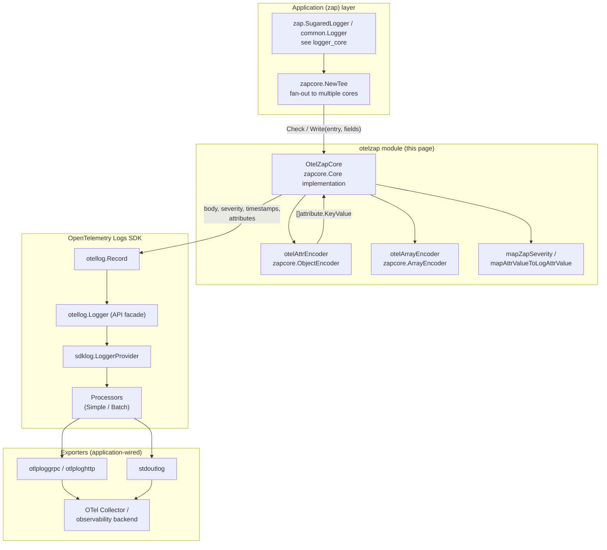
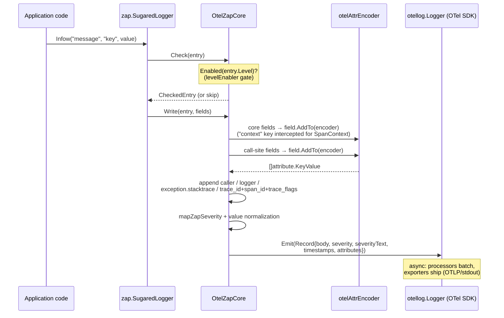
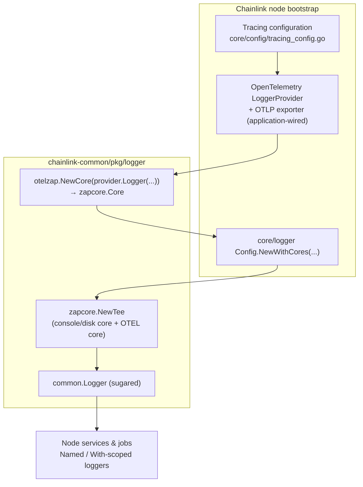

# logger/otelzap — OpenTelemetry `zapcore.Core` Bridge

> **Module:** `chainlink-common/pkg/logger/otelzap` · **Parent page:** [Shared Foundation Libraries / logger](../logger.md)

The `otelzap` package provides **`OtelZapCore`**, a drop-in implementation of the [`zapcore.Core`](https://pkg.go.dev/go.uber.org/zap/zapcore#Core) interface that forwards zap log entries to the **OpenTelemetry Logs SDK** (`go.opentelemetry.io/otel/log` + `go.opentelemetry.io/otel/sdk/log`). It lets every part of a Chainlink node keep writing logs through the standard zap-based [`common.Logger`](logger_core.md) API while the logs are simultaneously exported, as structured OpenTelemetry records, to any OTLP-capable observability backend (collector, vendor pipeline, or stdout for debugging).

In short, the module decouples *how the node logs* (zap) from *where the logs are shipped* (OpenTelemetry):

- **Emission side:** the node keeps its existing zap logging calls, field conventions, `Named`/`With` scoping, and level management.
- **Export side:** log entries are converted to OpenTelemetry `log.Record`s — with a proper severity mapping, caller metadata, stack traces, and trace/span correlation attributes — and handed to the OTel `LoggerProvider`, whose processors and exporters (OTLP gRPC/HTTP, stdout) manage batching, retries, and shutdown.

---

## At a Glance

| Aspect | Value |
|---|---|
| Package | `github.com/smartcontractkit/chainlink-common/pkg/logger/otelzap` |
| Public entrypoint | `NewCore(logger otellog.Logger, opts ...Option) zapcore.Core` |
| Core type | `OtelZapCore` (implements `zapcore.Core`) |
| Internal encoders | `otelAttrEncoder` (`zapcore.ObjectEncoder`), `otelArrayEncoder` (`zapcore.ArrayEncoder`) |
| Key dependencies | `go.uber.org/zap v1.28.0`, `go.opentelemetry.io/otel v1.46.0`, `go.opentelemetry.io/otel/log v0.22.0`, `go.opentelemetry.io/otel/sdk/log v0.22.0` (pinned in [`chainlink-common/go.mod`](https://github.com/smartcontractkit/chainlink-common/blob/main/go.mod)) |
| Exporters used by consumers | `otlploggrpc`, `otlploghttp`, `stdoutlog` (all `v0.22.0`, see `chainlink-common/go.mod`) |
| Source files | `otelzap.go` (core + mappings), `encoder.go` (encoders), `otelzap_test.go` (test suite) |

---

## Architecture

The module sits between the zap logging stack and the OpenTelemetry Logs SDK. It consists of one public adapter (`OtelZapCore`) and two internal encoding helpers that translate zap's streaming-encoder model into OpenTelemetry's attribute model.



### Component reference

#### `OtelZapCore` — the zap → OTel adapter (`otelzap.go`)

The only exported type consumers interact with (besides the constructor and options). Methods use **value receivers** except `With`, which returns a new pointer — matching zap's expectation that `With` never mutates the parent core.

| `zapcore.Core` method | Behaviour |
|---|---|
| `Enabled(level)` | Delegates to the configured `zapcore.LevelEnabler`. Defaults to `zapcore.InfoLevel`; overridable via options. |
| `With(fields)` | Returns a **new** `*OtelZapCore` with the given fields appended to the core-attached field list (immutable copy-on-write). |
| `Check(entry, checked)` | Adds itself to the `CheckedEntry` only if `Enabled(entry.Level)` — standard zap gating. |
| `Write(entry, fields)` | The conversion pipeline (see [Data Flow](#data-flow)). Always returns `nil` — export failures are handled inside the OTel SDK, never propagated back into zap's hot path. |
| `Sync()` | No-op. OpenTelemetry has no synchronous flush; flushing is the `LoggerProvider`'s responsibility (`ForceFlush`/`Shutdown`). |

Structural fields: `logger` (the `otellog.Logger` facade), `fields` (core-attached `zapcore.Field`s), `levelEnabler` (minimum exported level).

#### Constructor & options

```go
core := otelzap.NewCore(
    otelLoggerProvider.Logger("chainlink.node"),
    otelzap.WithLevel(zapcore.DebugLevel),          // fixed minimum level, or...
    otelzap.WithLevelEnabler(cfg.Level.Enabled),    // ...a dynamic LevelEnabler
)
```

- `NewCore(logger otellog.Logger, opts ...Option) zapcore.Core` — wraps the given OTel logger facade; returns the plain `zapcore.Core` interface so it composes with `zapcore.NewTee`.
- `WithLevel(level zapcore.Level)` — sets a static minimum export level (default `Info`).
- `WithLevelEnabler(enabler zapcore.LevelEnabler)` — injects a dynamic enabler, e.g. one driven by [`logger.Config.Level`](logger_core.md) for runtime level changes.

#### `otelAttrEncoder` — field → attribute conversion (`encoder.go`)

Implements `zapcore.ObjectEncoder`. Every zap field type has a dedicated `Add*` method that appends an `attribute.KeyValue` to the encoder's `attributes` slice. Nested objects (`AddObject`) are **flattened** into dotted keys (`user.name`, `user.age`), and arrays (`AddArray`) are collected through the `otelArrayEncoder` into a single string-slice attribute. `OpenNamespace` maintains a `namespace` prefix applied by `prefixKey` to scalar keys.

#### `otelArrayEncoder` — array element stringification (`encoder.go`)

Implements `zapcore.ArrayEncoder`. All element types are converted to strings (`strconv` for integers/bools, `fmt.Sprintf("%g")` for floats, RFC 3339 for times). Nested arrays and objects inside arrays degrade to the placeholders `"[nested array]"` and `"[object]"`.

---

## Field-to-attribute mapping

Mapping of `zapcore.Field` types (as exercised by `Test_otelAttrEncoder`):

| zap field type | OTel attribute | Notes |
|---|---|---|
| `StringType` | `String(key, v)` | |
| `Int64Type` | `Int64` | |
| `Uint64Type` | `Int64` | cast to signed |
| `BoolType` | `Bool` | |
| `Float64Type` | `Float64` | |
| `ErrorType` | `String` | `err.Error()` |
| `StringerType` | `String` | `Stringer.String()` |
| `TimeType` | `String` | RFC 3339 formatted |
| `DurationType` | `Int64` | nanoseconds |
| `BinaryType`, `ByteStringType` | `String` | raw bytes cast to string |
| `Complex128Type`, `Complex64Type` | `String` | `fmt.Sprintf("%v", …)` |
| `ReflectType` | `String` | `fmt.Sprintf("%+v", …)` (structs, maps, etc.) |
| `ObjectMarshalerType` | flattened dotted keys | e.g. `config.host`, `config.timeout` |
| Array marshalers | `StringSlice` | elements stringified; mixed arrays supported |

### Reserved / enrichment attributes

Beyond user fields, `OtelZapCore.Write` enriches each record with structured metadata:

| Attribute | Source | Condition |
|---|---|---|
| `caller` | `entry.Caller.String()` (`file.go:42`) | `entry.Caller.Defined` |
| `logger` | `entry.LoggerName` (e.g. `svc.sub` from `Named`) | non-empty logger name |
| `exception.stacktrace` | `entry.Stack` (semantic-convention key) | level **greater than Info** and stack non-empty |
| `trace_id`, `span_id`, `trace_flags` | a core-attached field with key `context` whose value is an `oteltrace.SpanContext` | field present; IDs must be valid for `trace_id`/`span_id` |

> The `context` key is **reserved** by the core: it is intercepted in `Write` and never emitted as a regular attribute — it becomes the trace-correlation trio instead. This mirrors the correlation helpers exported by the parent [`logger`](../logger.md) package (e.g. `logger.CtxKeyVals`).

### Severity mapping (`mapZapSeverity`)

| zap level | OpenTelemetry severity |
|---|---|
| `Debug` | `SeverityDebug` |
| `Info` | `SeverityInfo` |
| `Warn` | `SeverityWarn` |
| `Error` | `SeverityError` |
| `DPanic` | `SeverityFatal1` |
| `Panic` | `SeverityFatal2` |
| `Fatal` | `SeverityFatal3` |
| other | `SeverityUndefined` |

The record also carries `SetSeverityText(entry.Level.String())`, `SetTimestamp(entry.Time)`, `SetObservedTimestamp(time.Now())`, and `SetBody(entry.Message)`.

### Value normalization (`mapAttrValueToLogAttrValue`)

Before emission, every attribute value is normalized: `STRING`, `BOOL`, `INT64`, and `FLOAT64` pass through unchanged; `INVALID` becomes the string `"invalid"`; slice-typed values and anything else are stringified with `fmt.Sprintf("%v", …)`.

---

## Data flow

The path of a single log call through the module:



Two properties of this pipeline are worth emphasizing:

1. **Non-blocking contract with zap.** `Write` returns `nil` unconditionally; transport failures belong to the OTel SDK layer (processors/exporters), keeping the logging hot path free of network concerns.
2. **Explicit (rather than ambient) trace correlation.** `Emit` is called with `context.Background()`, so records are *not* automatically correlated with an in-flight span. Correlation is opt-in via the reserved `context` field carrying an `oteltrace.SpanContext`, which surfaces as `trace_id` / `span_id` / `trace_flags` attributes.

---

## Integration with the node

`NewCore` returns a plain `zapcore.Core`, so it composes with any zap setup using `zapcore.NewTee`. In the Chainlink codebase there are two natural composition points:

- **Shared library:** [`logger.NewWithCores(cores ...zapcore.Core)`](logger_core.md) in `chainlink-common/pkg/logger/logger.go` builds a `common.Logger` around `zapcore.NewTee(cores...)`.
- **Node bootstrap:** `Config.NewWithCores(cores ...zapcore.Core)` in `chainlink/core/logger/logger.go` tees extra cores into the node's disk/console logger (the node's primary core comes from `newDefaultLoggingCore`, and additional cores are appended via `zapcore.NewTee`).

The OTEL side (logger provider, exporter, resource attributes such as node/service identity) is provisioned by the application from the node's tracing configuration — see the [`Tracing` config interface](../../Node_Application_Core___Interfaces/core_config/core_config_observability.md) (`Enabled`, `CollectorTarget`, `NodeID`, `SamplingRatio`, `Mode`, `TLSCertPath`, `Attributes` in `chainlink/core/config/tracing_config.go`). This keeps the otelzap module itself config-free: it only wraps whatever `otellog.Logger` the application hands it.



For the wider observability stack this module feeds (collectors, dashboards, Beholder-based telemetry), see the [Telemetry & Observability Platform](../../Telemetry___Observability_Platform.md) and [beholder-telemetry](../../Telemetry___Observability_Platform/beholder-telemetry.md) documentation.

---

## Testing (`otelzap_test.go`)

The test suite validates both encoding fidelity and end-to-end emission. It uses a real `sdklog.LoggerProvider` with a `stdoutlog` exporter writing into a buffer, then asserts on the emitted OTel JSON — so the tests exercise the same processor/exporter path production uses.

| Test | What it guarantees |
|---|---|
| `Test_otelAttrEncoder` | Exact `attribute.KeyValue` produced for each zap field type (strings, ints, bools, floats, errors, stringers, times, durations, binary, complex, reflected). |
| `Test_otelAttrEncoder_nilSafety` | Nil interface values (`(*stringerMock)(nil)`, `(*panicError)(nil)`) **do not panic** when encoded — zap's `Field.AddTo` shields the encoder, and the tests lock that contract in. |
| `TestOtelZapCore_Write` | End-to-end: body/severity propagation, caller (`file.go:42`), `exception.stacktrace` for error levels, span-context attributes from the reserved `context` field, and presence/absence of the `logger` attribute. |
| `Test_otelAttrEncoder_AddObject` | Nested objects flatten to dotted keys (`user.name`, `config.timeout`); empty objects produce no attributes. |
| `Test_otelAttrEncoder_AddArray` | Arrays of strings/ints/floats/bools/mixed values become a single `StringSlice` attribute; empty arrays emit an empty slice. |
| `TestCallerInfo` | Caller attribute emission across levels, including the no-caller case; flushes via `provider.ForceFlush` to assert on batch-processed output. |

The `panicError` test helper is deliberately hostile: its `Error()` method dereferences the receiver and panics when called on a nil pointer. It exists purely to prove that malformed user-provided error values flowing through zap fields can never crash log emission.

---

## Configuration & dependencies

- **Dependency pins** live in `chainlink-common/go.mod`: `go.opentelemetry.io/otel v1.46.0`, `go.opentelemetry.io/otel/log v0.22.0`, `go.opentelemetry.io/otel/sdk/log v0.22.0`, exporters `otlploggrpc`/`otlploghttp`/`stdoutlog v0.22.0`, and `go.uber.org/zap v1.28.0`.
- **Level control** is two-layered: the zap logger's own atomic level (see [`logger.Config`](logger_core.md) and the node's `logging` configuration) plus this core's `WithLevel`/`WithLevelEnabler`, which gate what reaches OTEL independent of what reaches the console/disk core.
- **Backend addressing** (collector endpoint, TLS, resource attributes) is owned by the application's [tracing/observability configuration](../../Node_Application_Core___Interfaces/core_config/core_config_observability.md), not by this package.

## Design notes & limitations

- **No error propagation:** `Write` always returns `nil`; `Sync` is a no-op. Shutdown/flush must go through the OTel `LoggerProvider` (`ForceFlush`/`Shutdown`) at application stop.
- **Lossy flattening:** complex values (reflected types, nested arrays inside arrays, complex numbers) are stringified rather than structured — the encoder favors "never fail, never panic" over preserving full structure. Slices become `StringSlice`s of stringified elements.
- **Reserved key:** never attach a field literally named `context` expecting it to appear as an attribute; the core consumes it for span correlation.
- **`context.Background()` emission:** log records are not sampled or filtered by the caller's span; controlling volume is done via the level enabler and SDK-side processors.
- **Immutability:** `With` copies the field slice, so derived cores (e.g. from `Named`/`With` loggers) never observe later mutations of the parent's fields.

## Related documentation

- [logger (overview)](../logger.md) — logging package umbrella and role within the shared foundation libraries.
- [logger_core](logger_core.md) — the `Logger`/`SugaredLogger` interfaces, `Config`, and `NewWithCores` composition.
- [core_config_observability](../../Node_Application_Core___Interfaces/core_config/core_config_observability.md) — tracing/telemetry configuration surfaces of the node.
- [Telemetry & Observability Platform](../../Telemetry___Observability_Platform.md) · [beholder-telemetry](../../Telemetry___Observability_Platform/beholder-telemetry.md) — downstream telemetry pipelines these logs travel alongside.
