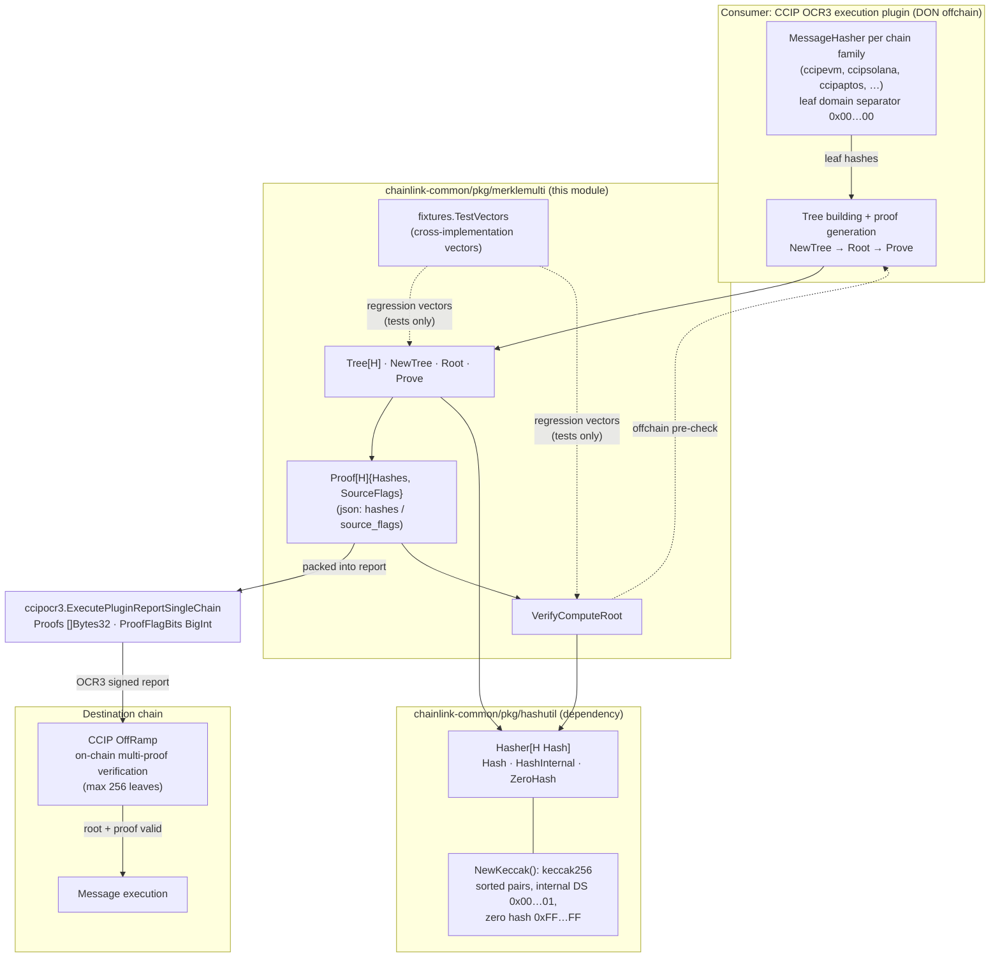
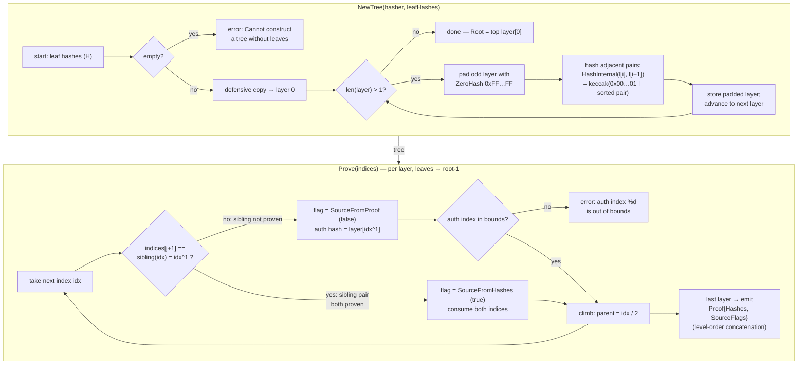
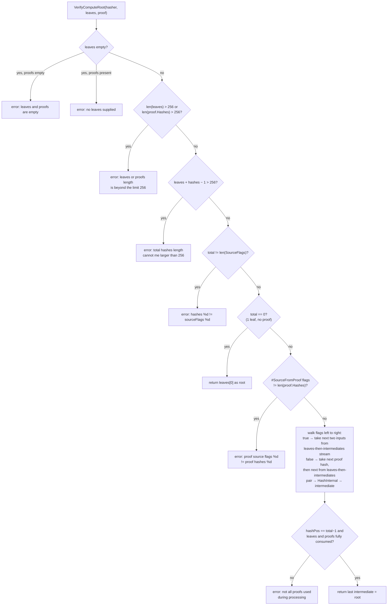
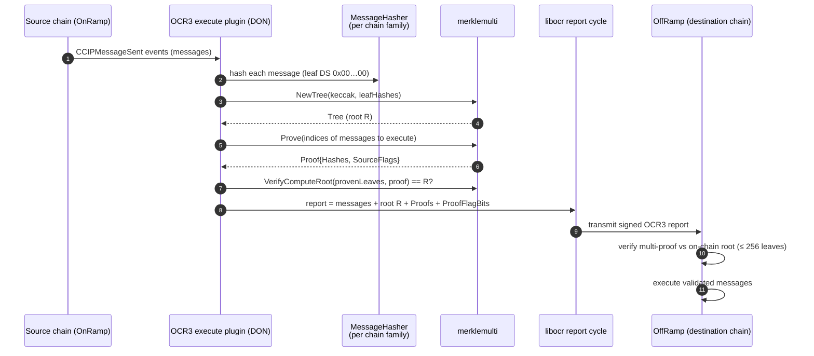

# Merkle Multi-Proof (`merklemulti`)

> **Package locations:** `chainlink-common/pkg/merklemulti` (tree construction, multi-proof generation and verification), `chainlink-common/pkg/merklemulti/fixtures` (cross-implementation test vectors).
>
> Part of the [Shared Foundation Libraries & Domain Types](../Shared_Foundation_Libraries___Domain_Types.md) documentation set.

## 1. Purpose and Scope

`merklemulti` is a small, dependency-light, Go-generics library that implements **Merkle trees with multi-proofs**: given a set of `bytes32` hashes, it builds a binary Merkle tree, can prove **many leaves at once with a single compact proof**, and can recompute the tree root from a subset of leaves plus that proof.

Its defining characteristic is **cross-implementation compatibility**: the algorithm, hash scheme, padding rule and size limits are chosen to be byte-for-byte compatible with the on-chain Merkle multi-proof verification used by Chainlink smart contracts — most prominently the **CCIP OffRamp** (maximum 256 leaves, Keccak-256 with domain separation, `0xFF…FF` zero padding). The zero-hash constant in the hashing layer even carries the comment *"We use bytes32 0xFF..FF for zeroHash in the CCIP research spec, this needs to match"* (`chainlink-common/pkg/hashutil/keccak.go`).

The module provides:

- **Tree construction** — `NewTree` builds all tree layers at once, padding odd-sized layers with the zero hash.
- **Root commitment** — `Root()` returns the single top-layer hash.
- **Multi-proof generation** — `Prove(indices)` produces one `Proof` (sibling/auth hashes + source flags) covering any subset of leaf indices.
- **Multi-proof verification** — `VerifyComputeRoot` recomputes the root from the proven leaves plus the proof, with strict input validation (size caps, flag/hash-count agreement, full consumption of all hashes).
- **Cross-implementation fixtures** — `fixtures.TestVectors` pins the Go implementation to externally generated reference vectors.

The module is part of the `github.com/smartcontractkit/chainlink-common` Go module (it has no `go.mod` of its own — unlike sibling packages such as `pkg/values` or `pkg/chipingress`; see `chainlink-common/go.mod`). Its only runtime dependency is the sibling package `chainlink-common/pkg/hashutil`.

## 2. Package Layout

| Package / file | Content |
|---|---|
| `pkg/merklemulti/merkle_multi.go` | `Tree[H]`, `NewTree`, `Root`, `Prove`, `Proof[H]`, `VerifyComputeRoot`, `proveSingleLayer`/`computeNextLayer` internals, constants |
| `pkg/merklemulti/merkle_multi_test.go` | Unit + exhaustive combinatorial tests, fixture-driven tests, error-contract tests |
| `pkg/merklemulti/fixtures/merkle_multi_proof_test_vector.go` | `TestVector` struct and `TestVectors` slice — externally generated reference vectors |
| `pkg/hashutil` *(dependency)* | `Hash` / `Hasher[H]` abstractions and the CCIP-aligned Keccak-256 implementation (`NewKeccak`) |

## 3. Architecture Overview



### Key concepts

| Concept | Role | Defined in |
|---|---|---|
| `Hasher[H Hash]` | Injected hash scheme: `Hash([]byte) H` (leaf hashing), `HashInternal(a, b H) H` (pair hashing), `ZeroHash() H` (padding) | `chainlink-common/pkg/hashutil/hasher.go` |
| `Hash` | Type constraint for tree nodes — any type whose underlying type is `[32]byte` | `chainlink-common/pkg/hashutil/hasher.go` |
| `Tree[H]` | Immutable, fully materialized tree; `layers [][]H` from leaves (layer 0, zero-padded) up to the root | `merkle_multi.go` |
| `Proof[H]` | Multi-proof payload: `Hashes []H` (auth/sibling hashes) + `SourceFlags []bool`; JSON tags `hashes` / `source_flags` for serialization | `merkle_multi.go` |
| `SourceFromHashes` / `SourceFromProof` | Flag constants (`true` / `false`): how each step of verification obtains its inputs | `merkle_multi.go` |
| `MaxNumberTreeLeaves = 256` | Hard size cap mirroring the on-chain contract limitation, enforced by `VerifyComputeRoot` | `merkle_multi.go` |
| `TestVector` / `TestVectors` | Frozen cross-implementation vectors: proof leaves, proof hashes, flags, full node list, expected root | `fixtures/merkle_multi_proof_test_vector.go` |

### The hash scheme (`hashutil.NewKeccak`)

The default hasher (and the one all CCIP machinery uses) is Keccak-256 with three deliberate choices (`chainlink-common/pkg/hashutil/keccak.go`):

1. **Sorted pair hashing** — `HashInternal(a, b)` orders the two operands with `bytes.Compare` before concatenation, making the node function commutative (`H(a,b) == H(b,a)`).
2. **Internal domain separation** — internal nodes are hashed as `keccak256(0x00…01 ‖ a ‖ b)`. The `0x00…01` separator distinguishes internal nodes from leaf preimages, preventing second-preimage attacks (an attacker cannot substitute an internal node as a leaf). This is tested by `TestMerkleMultiProofSecondPreimage`.
3. **Zero hash `0xFF…FF`** — used to pad odd-sized layers. It is chosen to be effectively un-collidable with any hash output and to match the CCIP research spec / on-chain constants.

Leaf hashes (layer 0) are produced by the caller — for CCIP, by the per-chain-family `MessageHasher` implementations, which apply their own leaf domain separator `0x00…00` (e.g. `ccipevm/msghasher.go`).

## 4. Core API Reference

All public API lives in `chainlink-common/pkg/merklemulti/merkle_multi.go`.

```go
func NewTree[H hashutil.Hash](hasher hashutil.Hasher[H], leafHashes []H) (*Tree[H], error)
func (t *Tree[H]) Root() H
func (t *Tree[H]) Prove(indices []int) (Proof[H], error)
func (t *Tree[H]) String() string
func VerifyComputeRoot[H hashutil.Hash](hasher hashutil.Hasher[H], leafHashes []H, proof Proof[H]) (H, error)
type Proof[H hashutil.Hash] struct {
    Hashes      []H    `json:"hashes"`
    SourceFlags []bool `json:"source_flags"`
}
const (
    SourceFromHashes = true
    SourceFromProof  = false
    MaxNumberTreeLeaves = 256
)
```

| Function | Semantics |
|---|---|
| `NewTree` | Copies the leaf hashes (defensive copy), then repeatedly pads the current layer to an even length with `hasher.ZeroHash()` and hashes adjacent pairs until a single root remains. Errors if the leaf list is empty (`"Cannot construct a tree without leaves"`). Layer 0 stored in the tree is the **padded** leaf layer. |
| `Root` | Returns `layers[last][0]`. For a single-leaf tree the root is the leaf itself (the build loop does not run). |
| `Prove` | Walks every layer except the root layer. For each layer it groups the requested indices: adjacent **sibling pairs** are collapsed (no auth hash needed, flag `SourceFromHashes`); isolated indices pull their sibling from the layer as an auth hash (flag `SourceFromProof`). Out-of-range indices return an error — `Prove` never panics. |
| `VerifyComputeRoot` | Recomputes the root from a subset of leaves plus a `Proof` (see §6). Performs strict validation and returns the recomputed root or a descriptive error. |

**Caller requirements for `Prove`:** indices must be **ascending and duplicate-free** (sibling collapsing relies on it). Out-of-range indices are rejected with an error, but *unsorted* input is not validated and yields a meaningless proof rather than an error — the exhaustive test harness always feeds sorted combinations.

## 5. Algorithms & Data Flows

### 5.1 Tree construction and proof generation



A proof is *minimal-ish*: whenever two proven leaves are siblings, the proof contains **no** hash for their parent — the verifier recomputes it from the two leaves. Flags record, per verification step, whether the inputs come from the proven-leaf stream (`SourceFromHashes`) or from the proof's hash list (`SourceFromProof`). `ProofFlags` therefore has length `len(ProofLeaves) + len(ProofHashes) − 1` — an invariant asserted by the fixtures (§7).

### 5.2 Verification (`VerifyComputeRoot`)



Verification is a single left-to-right sweep over `SourceFlags` (this mirrors the reference Solidity/JS multi-proof algorithms, where a bit `true` means "hash the next two items from the provided leaves", `false` means "take the next node from the proof"). The final consistency check guarantees every supplied hash was consumed exactly once — a malformed or truncated proof cannot silently verify against a different tree.

**Error strings are part of the observable contract**: the unit tests assert them verbatim (`merkle_multi_test.go`), including the historical typo in `"total hashes length cannot me larger than 256"`. Treat error messages as API when changing this package.

## 6. Test Fixtures (Cross-Implementation Vectors)

`fixtures/merkle_multi_proof_test_vector.go` defines:

```go
type TestVector struct {
    ProofLeaves  []string // hex hashes of the proven leaves, in tree order
    ProofHashes  []string // hex auth hashes of the multi-proof
    ProofFlags   []bool   // per verification step: SourceFromHashes (true) / SourceFromProof (false)
    AllLeafs     []string // ordered node list (leaves + intermediate hashes) of the original tree
    ExpectedRoot string   // hex root both paths must reproduce
}
```

Two vectors are embedded:

| Vector | `ProofLeaves` | `ProofHashes` | `ProofFlags` | `AllLeafs` | `ExpectedRoot` |
|---|---|---|---|---|---|
| 1 | 5 | 3 | 7 | 10 | `cd92df41…d8820e` |
| 2 | 10 | 33 | 42 | 100 | `d4f0f3c4…3928e` |

Both satisfy the invariant `len(ProofFlags) == len(ProofLeaves) + len(ProofHashes) − 1` (7 and 42 respectively). Each vector is exercised in two directions by the test suite (`merkle_multi_test.go`):

- `TestSpecFixtureVerifyProof` — `VerifyComputeRoot` over `ProofLeaves` + `{ProofHashes, ProofFlags}` must reproduce `ExpectedRoot`. This pins the *verification* algorithm and flag semantics against the external reference.
- `TestSpecFixtureNewTree` — `NewTree` built over the full `AllLeafs` node list must produce `ExpectedRoot` as its root. This pins *tree construction and padding* against the same reference.

These vectors act as regression guards for the cross-implementation contract with the CCIP on-chain libraries and tooling: any change to hashing order, padding, or flag semantics that breaks compatibility fails these tests before it can fail in production.

## 7. Testing Strategy

| Test | What it proves |
|---|---|
| `TestMerkleMultiProof` | **Exhaustive correctness**: for every tree size 1–6 leaves and **every subset** of leaves (generated with `gonum.org/v1/gonum/stat/combin` — a direct dependency of `chainlink-common`, see `chainlink-common/go.mod`), `Prove` + `VerifyComputeRoot` reproduces `Root()`. Also asserts that out-of-range proof indices return an error instead of panicking. |
| `TestPadding` | Odd layers are zero-padded at **every** level (3 leaves → layer 0 of length 4; 5 leaves → layers of length 6 and 4), the root matches the hand-computed padded formula, and a single-leaf proof of a padded tree still verifies. |
| `TestMerkleMultiProofSecondPreimage` | Domain separation prevents second-preimage attacks: `NewTree([a, b]).Root() != NewTree([H(a‖b)]).Root()`. |
| `TestReturnErrorForTooLargeInput` | The 256-leaf/proof size caps and empty-input errors, with exact messages. |
| `TestErrorWhenNotAllProofsCanBeUsed` | Flag/hash-count mismatch detection (`"proof source flags 1 != proof hashes 2"`). |
| `TestSpecFixtureVerifyProof` / `TestSpecFixtureNewTree` | Cross-implementation fixture vectors (§6). |

Run with `go test ./pkg/merklemulti/...` from the `chainlink-common` module root.

## 8. Role in the System

`merklemulti` is the offchain half of Chainlink's **authenticated-set-membership** scheme:

- **CCIP message execution (primary consumer).** The OCR3 CCIP execution plugin hashes every pending cross-chain message into a leaf (via the per-chain-family `MessageHasher` implementations documented in [ccip chain codecs](../CCIP_Cross-Chain_Protocol/ccip/ccip_chain_codecs.md) and [ccip common interfaces](../CCIP_Cross-Chain_Protocol/ccip/ccip_common_interfaces.md)), builds a `merklemulti.Tree`, and multiproofs the messages selected for execution. The proof travels in the OCR3 report as `ExecutePluginReportSingleChain{Proofs []Bytes32, ProofFlagBits BigInt}` (`chainlink-common/pkg/types/ccipocr3/plugin_execute_types.go`) — `ProofFlagBits` is exactly the `Proof.SourceFlags` bit-slice packed into a big integer, and `Proofs` is `Proof.Hashes`. The destination-chain OffRamp re-verifies the multi-proof against the on-chain root before executing messages. See [CCIP Cross-Chain Protocol](../CCIP_Cross-Chain_Protocol.md), [types-ccip: OCR3 plugin types](../CCIP_Cross-Chain_Protocol/types-ccip/types-ccip_ocr3_plugin_types.md).
- **On-chain parity.** `MaxNumberTreeLeaves = 256` exists because "this is a limitation of the contract" — the Go side rejects inputs the on-chain verifier could not process, so offchain proof generation can never produce an unverifiable oversized proof.
- **Plugin boundary.** The tree building/proofing happens inside the CCIP plugin process; plugin/loop interplay is documented in [loop-plugin-core](../Plugin_Process_Framework_(Loop)/loop-plugin-core.md). The types crossing that boundary (`Proofs`, `ProofFlagBits`, message hashes) are plain data, so the scheme survives the process boundary unchanged.
- **Generic reuse.** Because the tree is generic over `H hashutil.Hash` (anything with underlying type `[32]byte`) and takes the hash function as a parameter, any service needing compact inclusion proofs over ≤ 256 items can reuse it; the CCIP-aligned `hashutil.NewKeccak` is the only hasher shipped.

### End-to-end flow (CCIP execute path)



## 9. Usage Example

```go
import (
    "github.com/smartcontractkit/chainlink-common/pkg/hashutil"
    "github.com/smartcontractkit/chainlink-common/pkg/merklemulti"
)

hasher := hashutil.NewKeccak()

// 1. Hash the items to get leaf hashes (leaf preimages are domain-separated
//    by the caller, e.g. the CCIP MessageHasher's 0x00…00 leaf separator).
var leafHashes [][32]byte
for _, item := range items {
    leafHashes = append(leafHashes, hasher.Hash(item))
}

// 2. Build the tree and commit to the root.
tree, err := merklemulti.NewTree(hasher, leafHashes) // err if len == 0
if err != nil { /* ... */ }
root := tree.Root()

// 3. Prove a subset of leaves (ascending, distinct indices; errors on
//    out-of-range indices instead of panicking).
proof, err := tree.Prove([]int{0, 3, 7})
if err != nil { /* ... */ }

// 4. Serialize the proof (JSON keys: "hashes", "source_flags"); in CCIP the
//    flags are packed into a big.Int as ProofFlagBits on-chain.

// 5. Verifier side: recompute the root from the proven leaves + proof.
provenLeaves := [][32]byte{leafHashes[0], leafHashes[3], leafHashes[7]}
recomputed, err := merklemulti.VerifyComputeRoot(hasher, provenLeaves, proof)
if err != nil { /* invalid proof */ }
valid := recomputed == root
```

## 10. Implementation Notes & Caveats

- **Root commits to the padded shape.** Because odd layers are zero-padded, trees with 5 and 6 real leaves have different roots. Prover and verifier must agree on the exact leaf list (count and order) — for CCIP this is pinned by the report contents and the on-chain message count.
- **`Prove` does not validate index ordering.** Ascending, duplicate-free indices are a caller obligation (the combinatorial test harness guarantees it). Out-of-range indices are bounds-checked and return `"auth index %d is out of bounds"`.
- **`VerifyComputeRoot` is strict.** Beyond size caps it requires `len(SourceFlags) == len(leaves) + len(Hashes) − 1`, that every `SourceFromProof` flag consumes exactly one proof hash, and that all leaves, intermediates and proof hashes are consumed exactly once — the last intermediate is the root only when the walk is fully consistent.
- **Fixtures are frozen.** `fixtures.TestVectors` are externally generated reference vectors; regenerate them only together with the reference (on-chain/JS) implementation, never by copying Go output.
- **No goroutine-safety concerns.** `Tree` is immutable after construction; `Proof` is plain data. Sharing both across goroutines is safe as long as the hasher implementation is stateless per call (the provided `keccak` is).
