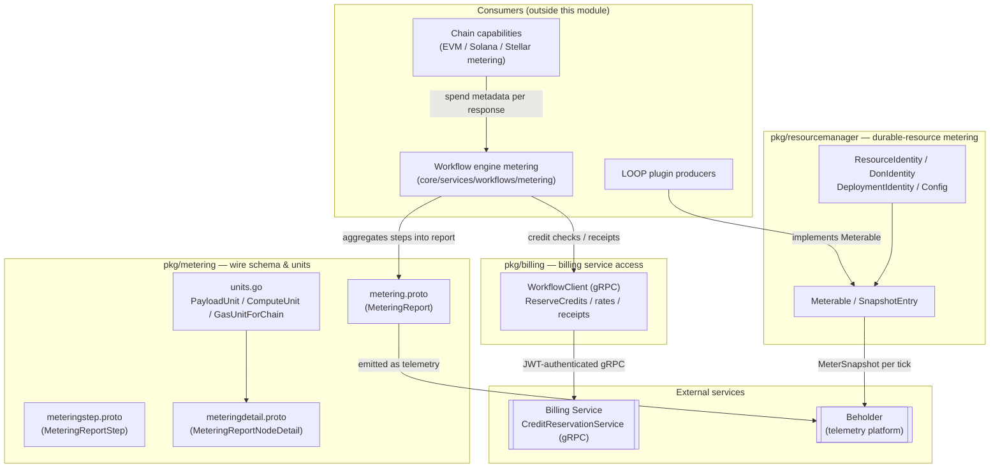
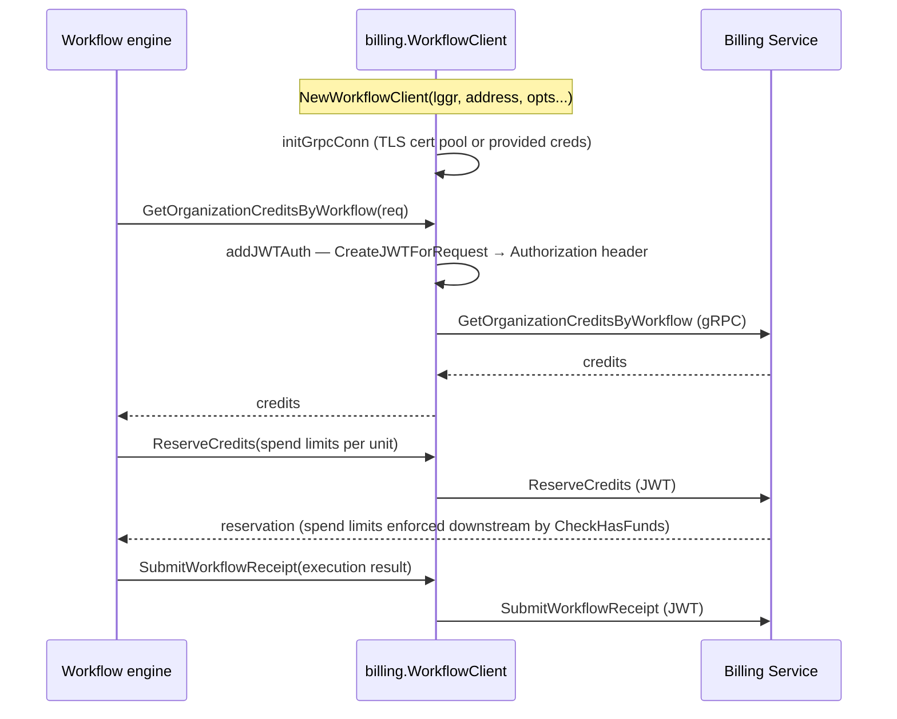
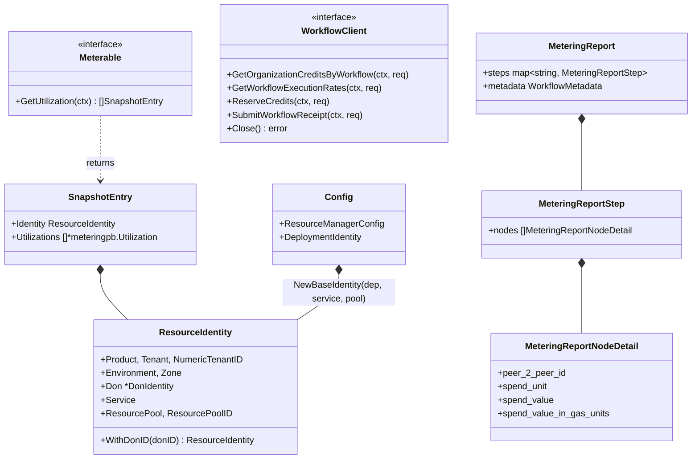

# Metering & Billing

> **Module scope:** `chainlink-common/pkg/metering`, `chainlink-common/pkg/billing`, `chainlink-common/pkg/resourcemanager`

## 1. Purpose

The **Metering & Billing** module is the shared foundation that lets every Chainlink node and LOOP plugin answer two questions for the CRE platform:

1. **"How much did this work cost?"** — a *metering* layer that defines the wire schema for spend reports, the canonical measurement units, and the contracts that services implement so billable usage can be attributed to workflows, DONs, tenants, and individual nodes.
2. **"Who pays for it?"** — a *billing* layer that provides the gRPC client the node uses to talk to the external **Billing Service** (`CreditReservationService`) to check credits, reserve spend *before* execution, and submit execution receipts afterwards.

It sits at the bottom of the [Shared Foundation Libraries & Domain Types](../Shared_Foundation_Libraries___Domain_Types.md) stack and is consumed by:

- The **CRE workflow engine**, which aggregates per-step node spend into a final [`MeteringReport`](#2-architecture) and enforces credit limits before executing actions (see [workflows metering](../Workflow___Capability_Runtime_(CRE_Engine)/workflows/workflows_metering.md)).
- **Chain capabilities** (EVM, Solana, Stellar, …), which attach `MeteringNodeDetail` spend metadata to every capability response and pre-flight `CheckHasFunds` against reserved credits.
- **LOOP plugin hosts and producers** (cron trigger, HTTP trigger, log triggers, workflow syncer, …), which report durable billable resources (trigger registrations, log filters, workflow storage) through the `resourcemanager` contracts.

The module intentionally contains **no business logic** beyond unit formatting and gRPC plumbing — it is the *contract layer* that keeps metering/billing semantics identical across the node core, plugin processes, and the remote billing platform.

## 2. Architecture

The module is organised into three Go packages with strictly one-directional dependencies:



Two complementary metering flows exist, both ultimately reaching the billing platform:

```mermaid
flowchart LR
    subgraph inline["Inline workflow metering"]
        A[Capability action/trigger] -->|"MeteringNodeDetail<br/>in ResponseMetadata"| B[Workflow engine]
        B -->|"MeteringReport<br/>(steps + WorkflowMetadata)"| C[Beholder]
    end
    subgraph snapshot["Durable resource metering"]
        D[Meterable producer<br/>(registrations, filters)] -->|"GetUtilization snapshot"| E[ResourceManager]
        E -->|"MeterSnapshot per resource"| F[Beholder]
    end
    C --> G[Billing platform]
    F --> G
    G -.->|"ReserveCredits / rates"| H[WorkflowClient]
    H -.-> A
```

### 2.1 Inline workflow metering (per-execution spend)

> Message schemas and spend-unit conventions: [metering report schema & units](metering-and-billing/metering-and-billing_metering-report-schema.md) · Engine-side aggregation: [workflows metering](../Workflow___Capability_Runtime_(CRE_Engine)/workflows/workflows_metering.md)

1. A **chain capability** executes an action or trigger and computes its own spend (e.g. gas fees for a write report). It attaches one `capabilities.MeteringNodeDetail` per node to the `ResponseMetadata` of the capability response — for example, Solana's `GetResponseMetadataWriteReport` converts lamports to SOL and stamps the spend in gas units, and the EVM capability's `CheckHasFunds` rejects an action up-front when the spend exceeds the credit limit returned by `ReserveCredits`.
2. The **workflow engine** collects these per-node details keyed by step ID, enriches them with `WorkflowMetadata` (workflow owner, ID, execution ID), and assembles the final `metering.MeteringReport` proto.
3. The report is emitted through **Beholder**, the platform telemetry pipeline, where the billing platform consumes it. Note the proto comments: `MeteringReport`, `MeteringReportStep`, and `MeteringReportNodeDetail` live in three separate files solely because of a Beholder proto-registration restriction — the schema is logically one message tree (see [metering report schema & units](metering-and-billing/metering-and-billing_metering-report-schema.md)).
4. Before execution, the engine uses the **`billing.WorkflowClient`** to reserve credits (`ReserveCredits`) and after execution submits a `SubmitWorkflowReceipt`; `GetOrganizationCreditsByWorkflow` and `GetWorkflowExecutionRates` support quota and pricing lookups (see [billing workflow client](metering-and-billing/metering-and-billing_billing-client.md)).

### 2.2 Durable resource metering (steady-state usage)

Unlike per-execution spend, some billable resources persist over time (trigger registrations, log filters, workflow storage). The `resourcemanager` package defines the **`Meterable`** contract: a producer exposes `GetUtilization(ctx) []SnapshotEntry`, a cheap non-blocking read of in-memory state, which a `ResourceManager` polls once per snapshot tick and converts into `MeterSnapshot` events. Each snapshot carries a structured **`ResourceIdentity`** (product, tenant, environment, zone, DON/node, service, resource pool) so billing can attribute and *zero out* resources by their absence from later snapshots — no explicit de-registration event is needed.

> Producer contracts, identity structures and LOOP wiring are detailed in [resource metering contracts](metering-and-billing/metering-and-billing_resource-metering.md).

### 2.3 Billing client interaction



Authentication details:

- **JWT:** if a `WithJWTGenerator` option supplies a [JWTGenerator](node-auth-jwt.md), every request is signed and placed in the `Authorization: Bearer …` outgoing gRPC metadata (see [node-auth-jwt](node-auth-jwt.md) for the token format). Without a generator, requests are sent unauthenticated.
- **TLS:** `WithWorkflowTLSCert` + `WithServerName` build TLS credentials from a PEM cert pool; otherwise the transport credentials passed via `WithWorkflowTransportCredentials` are used, defaulting to insecure.
- Logging goes through the shared [logger](logger.md) (`logger.Named(lggr, "WorkflowClient")`).

## 3. Sub-modules

Detailed documentation for each package is maintained separately:

| Sub-module | Package | Responsibility |
|---|---|---|
| [Metering report schema & units](metering-and-billing/metering-and-billing_metering-report-schema.md) | `pkg/metering` | `MeteringReport` / `MeteringReportStep` / `MeteringReportNodeDetail` protos emitted via Beholder; canonical spend units (`PayloadUnit`, `ComputeUnit`, `GasUnitForChain`) |
| [Billing workflow client](metering-and-billing/metering-and-billing_billing-client.md) | `pkg/billing` | gRPC `WorkflowClient` for credit lookup, reservation, rates and workflow receipts, with JWT auth and TLS options |
| [Resource metering contracts](metering-and-billing/metering-and-billing_resource-metering.md) | `pkg/resourcemanager` | `Meterable`, `SnapshotEntry`, `ResourceIdentity`/`DonIdentity`/`DeploymentIdentity`, and `Config` for metering durable billable resources from LOOP plugins |

## 4. Relationships to other modules

- **[Workflow & Capability Runtime (CRE Engine)](../Workflow___Capability_Runtime_(CRE_Engine).md)** — the primary consumer. The [workflows metering](../Workflow___Capability_Runtime_(CRE_Engine)/workflows/workflows_metering.md) sub-module owns the engine-side aggregation that turns capability spend metadata into `MeteringReport`s; EVM/Solana/Stellar chain capabilities produce the per-node spend details and enforce `CheckHasFunds` limits.
- **[Telemetry & Observability Platform](../Telemetry___Observability_Platform.md)** — `MeteringReport`s and `MeterSnapshot`s are emitted as Beholder messages, per the registration notes embedded in the proto files (see [beholder-telemetry](../Telemetry___Observability_Platform/beholder-telemetry.md)).
- **[types-core](types-core.md)** — the capability `ResponseMetadata` that carries `MeteringNodeDetail` is defined in the shared `capabilities` package documented under [capabilities core](../Workflow___Capability_Runtime_(CRE_Engine)/capabilities/capabilities_core.md).
- **[node-auth-jwt](node-auth-jwt.md)** — supplies the `JWTGenerator` the billing client uses to sign requests.
- **[settings](settings.md)** — resource-pool governance (`ResourceIdentity.ResourcePool`) complements the tenant/limit machinery in [settings limits](settings.md).
- **[Plugin Process Framework (Loop)](../Plugin_Process_Framework_(Loop).md)** — LOOP hosts resolve `DeploymentIdentity` from the node environment and deliver it to plugins as `loop.EnvConfig.MeteringConfig`, which builds this module's `resourcemanager.Config`.

## 5. Build & dependency notes

The module's wire contracts and external integration points are pinned by the `chainlink-common` Go module (`chainlink-common/go.mod`):

- `github.com/smartcontractkit/chainlink-protos/billing/go` — the remote `CreditReservationService` API (`ResourceType`, `MeasurementUnit` enums used by `units.go`, request/response types used by `WorkflowClient`).
- `github.com/smartcontractkit/chainlink-protos/metering/go` — the `metering.v1` types (`Utilization`, `ResourceIdentity`, `MeterSnapshot`) that `SnapshotEntry`/`ResourceIdentity` map 1:1 onto.
- `github.com/smartcontractkit/chainlink-protos/workflows/go` — the `events.WorkflowMetadata` message embedded in `MeteringReport`.
- `github.com/smartcontractkit/chain-selectors` — resolves chain IDs to selectors for `GasUnitForChain` (`GAS.<selector>` spend units).

Generated code lifecycle: the `.proto` files under `pkg/metering/pb` are (re)generated with the module-wide `make generate` target in `chainlink-common/Makefile`, which installs `protoc` + plugins (`install-protoc`) and builds the workspace proto tooling (`cre-protoc`). When editing the metering protos, keep the three-file split intact — the comments in the proto sources explain that Beholder's proto registration requires `MeteringReportNodeDetail` and `MeteringReportStep` to be registered in their own files.

## 6. Key contracts at a glance



Spend values are always transported as **strings of fixed-point integers** in native units (`spend_value_in_gas_units`, e.g. wei/lamports) with a decimal `spend_value` companion; `spend_value_in_gas_units` being empty signals legacy behaviour (fall back to `spend_value` shifted 18 decimals). Consumers implement their own conversions, e.g. the Solana capability divides lamports by 1e9 for the human-readable SOL value.
