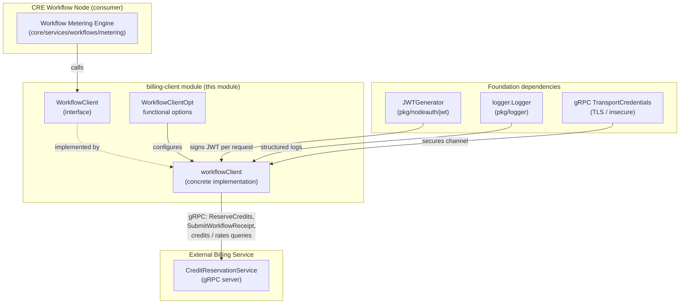
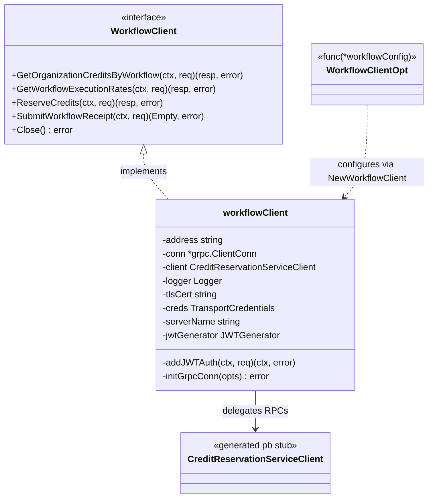
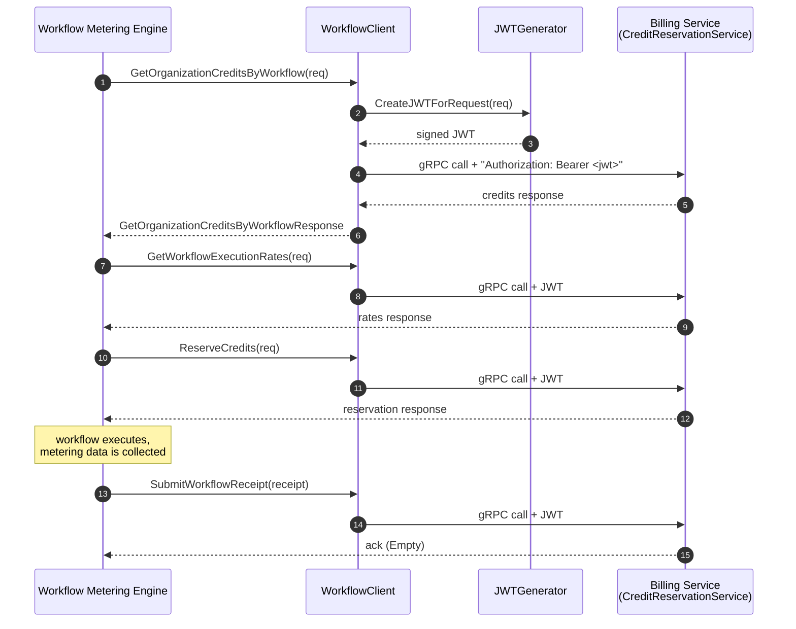
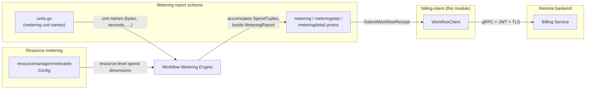
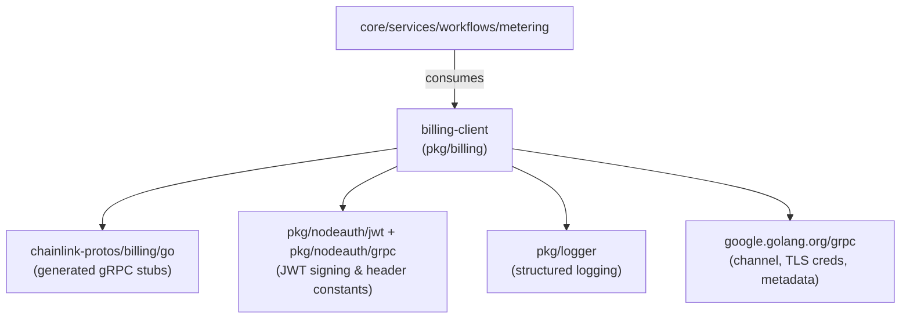

# Billing Client (Workflow)

> Part of the [Metering and Billing](../metering-and-billing.md) subsystem within the [Shared Foundation Libraries & Domain Types](../../Shared_Foundation_Libraries___Domain_Types.md) layer.

## 1. Introduction

The **billing-client** module provides `WorkflowClient` — a specialized, high-level gRPC client for the Chainlink **Billing Service**, tailored to the Workflow (CRE) node use-case. It wraps the `CreditReservationService` gRPC surface (generated bindings from the external `github.com/smartcontractkit/chainlink-protos/billing/go` module) and adds the cross-cutting concerns the raw generated stub lacks:

- **Per-request JWT authentication** — tokens are created by a pluggable [`JWTGenerator`](../node-auth-jwt.md) and injected into the gRPC `Authorization` metadata header.
- **TLS setup** — from an inline PEM CA certificate with a configurable server name, or fully custom `TransportCredentials`.
- **Structured logging** — every RPC outcome is recorded through the common [`logger.Logger`](../logger.md).
- **Lifecycle management** — explicit `Close()` for the underlying gRPC connection.

The module is deliberately thin: it contains **no metering computation logic**. It is the *transport and security boundary* between the node's workflow metering engine and the remote billing backend.

**Source:** `chainlink-common/pkg/billing/workflow_client.go` (single-file module, part of the `chainlink-common` Go module — dependency pins in `chainlink-common/go.mod`).

## 2. Core Functionality

### 2.1 RPC surface

`WorkflowClient` is a Go interface; the concrete type `workflowClient` implements it by delegating to a generated `pb.CreditReservationServiceClient`:

| Method | Purpose | Request → Response |
|---|---|---|
| `GetOrganizationCreditsByWorkflow` | Query the organization's remaining credits for a specific workflow | `GetOrganizationCreditsByWorkflowRequest` → `GetOrganizationCreditsByWorkflowResponse` |
| `GetWorkflowExecutionRates` | Fetch the execution rates used to convert metered units into spend | `GetWorkflowExecutionRatesRequest` → `GetWorkflowExecutionRatesResponse` |
| `ReserveCredits` | Reserve credits *before* a workflow execution (pre-execution preamble) | `ReserveCreditsRequest` → `ReserveCreditsResponse` |
| `SubmitWorkflowReceipt` | Submit the final receipt of a completed, metered workflow execution | `SubmitWorkflowReceiptRequest` → `google.protobuf.Empty` |
| `Close` | Release the underlying gRPC connection | — |

### 2.2 Construction & functional options

`NewWorkflowClient(lggr, address, opts...)` builds the client from a functional-options list:

| Option | Effect | Default (when omitted) |
|---|---|---|
| *(none)* | — | Insecure credentials, `serverName = "localhost"`, JWT auth disabled |
| `WithWorkflowTransportCredentials(creds)` | Overrides the gRPC `TransportCredentials` entirely | `insecure.NewCredentials()` |
| `WithJWTGenerator(gen)` | Enables per-request JWT signing and auth headers | `nil` (authentication skipped) |
| `WithWorkflowTLSCert(cert)` | Inline PEM CA certificate → `x509` cert pool; forces TLS client creds | `""` |
| `WithServerName(name)` | Expected server name in the TLS certificate | `"localhost"` |

> ⚠️ **Precedence note:** if `WithWorkflowTLSCert` is supplied, `initGrpcConn` **overwrites** whatever credentials were set via `WithWorkflowTransportCredentials`, constructing them from the cert pool + server name instead. Supplying both options silently discards the custom credentials.

### 2.3 Authentication flow (`addJWTAuth`)

Every RPC first passes through `addJWTAuth`:

1. If no `JWTGenerator` is configured, the context is returned unchanged (no auth header).
2. Otherwise, `jwtGenerator.CreateJWTForRequest(req)` signs a JWT scoped to the request.
3. The token is appended to outgoing gRPC metadata under the node-auth `AuthorizationHeader` key, prefixed with `Bearer` (via `pkg/nodeauth/grpc` constants).

A JWT-creation failure aborts the RPC *before any network call* and is logged with a method-specific message.

### 2.4 Connection setup (`initGrpcConn`)

- With a TLS cert: parses the PEM into an `x509.CertPool` (parse failure → constructor error `credentials: failed to append certificates`) and builds `credentials.NewClientTLSFromCert(pool, serverName)`.
- Uses `grpc.NewClient(...)` — the modern **lazy-dial** API, so the returned "Connected" log line means the client was created; the actual TCP/TLS handshake happens on first RPC.
- Instantiates `pb.NewCreditReservationServiceClient(conn)` as the delegation target.
- `Close()` closes the connection and logs the result (errors are returned, not swallowed).

## 3. Architecture

### 3.1 Component diagram



### 3.2 Class diagram



## 4. Request Lifecycle & Data Flow

The typical lifecycle of a metered workflow execution, as seen by the client:



Key behaviors at each hop:

- **Steps 2–3 (auth):** repeated for every RPC; if the generator is nil, the calls proceed unauthenticated.
- **Failure handling:** JWT failure short-circuits locally (no network); gRPC errors are logged per-method (e.g. `"ReserveCredits failed"`) and returned to the caller.
- **Receipt submission:** the receipt payload aligns with the metering report schema maintained by the [metering report schema](metering-and-billing_metering-report-schema.md) module (`MeteringReport` → `MeteringReportStep` → `MeteringReportNodeDetail`), which the engine populates from accumulated [`SpendTuple`](../../Workflow___Capability_Runtime_(CRE_Engine)/workflows/workflows_metering.md) spend entries.

### End-to-end metering data flow



For the schemas themselves (message fields, spend-unit conventions, Beholder registration constraints), see [metering report schema](metering-and-billing_metering-report-schema.md); for resource-level metering configuration, see [resource metering](metering-and-billing_resource-metering.md).

## 5. Dependencies



- **Proto bindings:** `github.com/smartcontractkit/chainlink-protos/billing/go` is pinned in `chainlink-common/go.mod` (alongside the `chainlink-protos/metering/go` module used by the report schema).
- **Auth:** the pluggable `JWTGenerator` interface comes from the [node-auth-jwt](../node-auth-jwt.md) module; the header key and `Bearer` prefix come from `pkg/nodeauth/grpc`.
- **Logging:** uses the shared [logger](../logger.md) module; the client is wrapped with `logger.Named(lggr, "WorkflowClient")` so all its log lines are prefixed and traceable.

## 6. How It Fits into the Overall System

| Aspect | Role of this module |
|---|---|
| **Layer** | Shared foundation library — no dependency on node-internal packages; only on `chainlink-common` peers and external protos. |
| **Primary consumer** | The CRE [workflow metering engine](../../Workflow___Capability_Runtime_(CRE_Engine)/workflows/workflows_metering.md) in `core/services/workflows/metering`, which reserves credits before execution and submits receipts afterward. |
| **Environment wiring** | System-test environments configure the billing endpoint via `BillingConfig` in the [system-tests](../../Dev,_Test___Simulation_Environments/system-tests.md) library. |
| **Sister concerns** | Metering *schema* lives in [metering report schema](metering-and-billing_metering-report-schema.md); resource-level *metering config* lives in [resource metering](metering-and-billing_resource-metering.md); this module owns only the *billing RPC transport*. |

The module exists so that workflow executions can be economically accounted for: rates are fetched once, credits are reserved as a pre-execution gate, spend is metered during execution, and a final receipt reconciles actual usage with the reserved credits.

## 7. Error Handling & Observability

| Scenario | Behavior |
|---|---|
| JWT creation fails | RPC aborted locally; error returned; logged as `"Failed to add ... auth header to <Method> request"` |
| gRPC call fails | Error returned to caller; logged with method-specific message (e.g. `"ReserveCredits failed"`) |
| TLS cert unparseable | Constructor fails with `credentials: failed to append certificates` |
| gRPC channel creation fails | Constructor fails with `failed to dial billing service at <address>` wrapping the cause |
| `Close()` failure | Error logged (`"Failed to close WorkflowClient connection"`) **and** returned |
| Successful connect / close | Info-level log lines with the billing address |

All logs flow through the caller-provided `logger.Logger` (named `WorkflowClient`), integrating with the node's standard logging pipeline.

## 8. Configuration Reference

Defaults (when no options are passed):

- Transport: **insecure** (no TLS) — production deployments **must** supply `WithWorkflowTLSCert` (or custom credentials) and a `WithJWTGenerator`.
- `serverName`: `"localhost"` (only meaningful with a TLS cert).
- JWT auth: **disabled** (requests carry no `Authorization` metadata).

Minimal production-style construction:

```go
wc, err := billing.NewWorkflowClient(lggr, "billing.internal:9000",
    billing.WithWorkflowTLSCert(caPEM),      // forces TLS via x509 pool
    billing.WithServerName("billing.internal"),
    billing.WithJWTGenerator(jwtGen),        // per-request signed tokens
)
```

## 9. Related Documentation

- [Metering and Billing](../metering-and-billing.md) — parent subsystem overview.
- [Metering Report Schema](metering-and-billing_metering-report-schema.md) — proto messages (`MeteringReport`, `MeteringReportStep`, `MeteringReportNodeDetail`) and metering units carried by `SubmitWorkflowReceipt`.
- [Resource Metering](metering-and-billing_resource-metering.md) — resource-manager-level metering configuration.
- [Node Auth JWT](../node-auth-jwt.md) — the `JWTGenerator` interface used for request signing.
- [Logger](../logger.md) — logging foundation used by this client.
- [Workflows Metering](../../Workflow___Capability_Runtime_(CRE_Engine)/workflows/workflows_metering.md) — the primary consumer that produces spend data and drives this client.
- [Shared Foundation Libraries & Domain Types](../../Shared_Foundation_Libraries___Domain_Types.md) — enclosing documentation layer.
