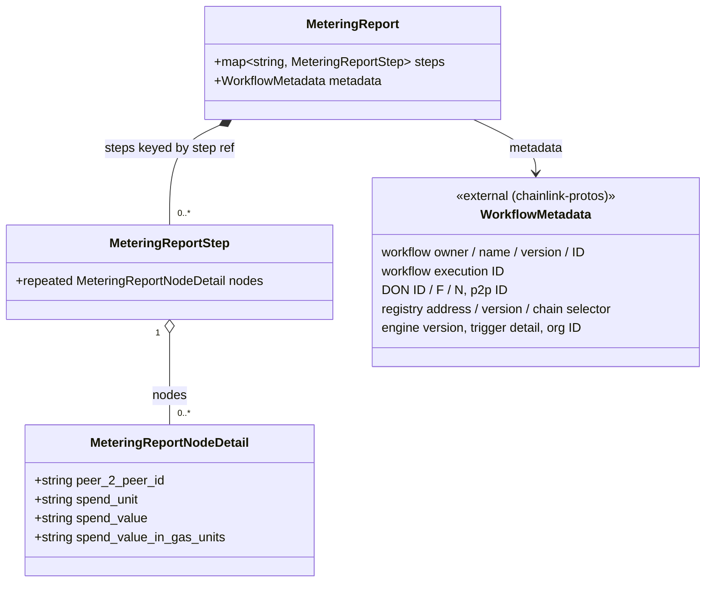
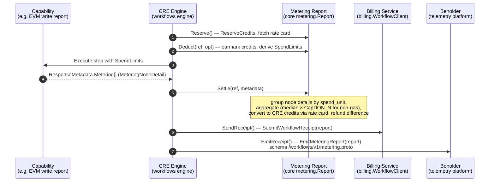
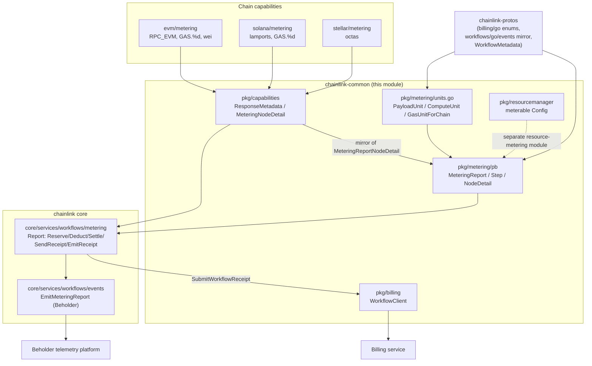

# Metering & Billing — Metering Report Schema

## Introduction

The `metering-and-billing_metering-report-schema` module defines the **wire contract (protobuf schema) and spend-unit vocabulary** used to meter Chainlink CRE (Capability Runtime Engine) workflow executions. Every workflow step that consumes platform resources — on-chain gas for report transmissions, RPC calls, network payload, or compute time — produces a machine-readable spend record. These records are aggregated by the node engine into a final **Metering Report** and delivered to two destinations:

1. The **billing service** (via `SubmitWorkflowReceipt`) for credit accounting, and
2. The **Beholder telemetry platform** (schema `/workflows/v1/metering.proto`) for analytics and observability.

This module is the *schema authority* within `chainlink-common/pkg/metering`: it owns the three protobuf definitions (`metering.proto`, `meteringstep.proto`, `meteringdetail.proto`) plus the Go helper vocabulary (`units.go`) that capability developers use to label their spend consistently.

It is a leaf module of the [Metering & Billing](../metering-and-billing.md) family, alongside the [billing client](metering-and-billing_billing-client.md) and [resource metering](metering-and-billing_resource-metering.md) modules.

---

## Module at a Glance

| Component | File | Role |
|---|---|---|
| `MeteringReport` | `chainlink-common/pkg/metering/pb/metering.proto` | Top-level report envelope: a map of step reports plus workflow identity metadata. "Consumed by the engine in core to emit the final Metering Report." |
| `MeteringReportStep` | `chainlink-common/pkg/metering/pb/meteringstep.proto` | Per-step container holding the node-level spend details for one workflow step reference. |
| `MeteringReportNodeDetail` | `chainlink-common/pkg/metering/pb/meteringdetail.proto` | A single node's spend for a step in a single spend unit. "Consumed by capability responses and by Metering Report." |
| `unit`, `PayloadUnit`, `ComputeUnit`, `GasUnitForChain` | `chainlink-common/pkg/metering/units.go` | Go vocabulary of spend units and helpers for building unit strings. |

All protos share `go_package = "github.com/smartcontractkit/chainlink-common/pkg/metering/pb"` and package name `metering`. The generated Go bindings (`*.pb.go`) are produced by the repo's protoc tooling (`make generate` → `cre-protoc` in [`chainlink-common/Makefile`](../../../repo/chainlink-common/Makefile)).

---

## Report Schema Anatomy

### Structure

### Field Semantics

**`MeteringReportNodeDetail`** — the atomic metering record:

| Field | Meaning |
|---|---|
| `peer_2_peer_id` | Identity of the node that performed the work. Capabilities leave this empty; the engine assigns it. |
| `spend_unit` | Spend-type key, e.g. `GAS.<chainSelector>`, `RPC_EVM`, `NETWORK`, `COMPUTE` (see [Spend-Unit Vocabulary](#spend-unit-vocabulary)). |
| `spend_value` | Spend as a decimal string in the unit's *display* unit (e.g. ETH, SOL). For gas units this is the **legacy** representation. |
| `spend_value_in_gas_units` | **Native fixed-point integer** in the chain's smallest unit (wei, lamports, octas, …). Empty = legacy path: consumers fall back to `spend_value` with a decimal `Shift(18)`. |

> **Note on file splitting:** `meteringstep.proto` and `meteringdetail.proto` each live in their own file *solely* because of a restriction in proto registration for Beholder — each message must be independently registrable as an event schema.

**`MeteringReportStep`** — groups all node details for one workflow step (keyed by the step reference, e.g. `report.steps["fetch-price"]`).

**`MeteringReport`** — the full-execution envelope:
- `steps`: map of step reference → `MeteringReportStep`.
- `metadata`: a `WorkflowMetadata` imported from the external `workflows/events/pb/metadata.proto` (generated in the `chainlink-protos` repo). It carries the billing/observability identity dimensions: workflow owner, name, version, workflow ID, execution ID, DON ID/F/N, node p2p ID, workflow-registry address/chain selector, engine version, trigger detail, and org ID. The engine stamps this at emission time (`EmitMeteringReport` overwrites `rpt.Metadata`).

### Runtime Mirroring Caveat

The protobuf types used by the *runtime emission path* in core (`chainlink/core/services/workflows/metering`) are the mirrored generated types from `github.com/smartcontractkit/chainlink-protos/workflows/go/events`. They mirror this schema and add **billing-only extensions** (e.g. `spend_value_cre`, aggregated spend fields, `capdon_n`, `metering_mode`, `message`). The `chainlink-common/pkg/metering/pb` schema documented here remains the **capability-facing contract**: `MeteringReportNodeDetail` is what capabilities (indirectly) populate and what the report embeds. When changing the schema, both locations must stay field-compatible.

---

## Spend-Unit Vocabulary

`chainlink-common/pkg/metering/units.go` centralizes the spend-unit strings so capability developers don't hand-roll inconsistent labels.

| Unit (Name / Unit) | Definition | Typical producer |
|---|---|---|
| `PayloadUnit` → `NETWORK` / `BYTES` | Payload/network resource consumption | Workflow payloads, data feeds |
| `ComputeUnit` → `COMPUTE` / `MILLISECONDS` | Compute/wall-clock consumption | Workflow execution engine |
| `GAS.<chainSelector>` | On-chain gas for a transmission, in the chain's native smallest unit | Write-report transmissions (EVM/Solana/Stellar capabilities) |
| `RPC_EVM` | Credit cost of EVM RPC actions (e.g. `BalanceAt` = 1, `CallContract` = 2.5) | EVM chain capability |

Key helpers:

- **`unit` struct** — pairs a resource `Name` with a measurement `Unit`. It is deliberately **unexported** ("Do not export"); only the predefined constants above are public.
- **`GasUnitForChain(chainID uint64)`** — resolves an EVM chain ID to its chain selector (via the `chain-selectors` dependency) and returns the canonical `GAS.<selector>` unit string. This keeps gas units aligned with the chain-selector identifiers used throughout billing and CCIP.

The billing enums `ResourceType` and `MeasurementUnit` come from `github.com/smartcontractkit/chainlink-protos/billing/go`, keeping this vocabulary consistent with the billing service's own resource taxonomy.

Capability-side usage mirrors this vocabulary (see the [capabilities module docs](../../Workflow___Capability_Runtime_(CRE_Engine)/capabilities/capabilities_core.md)):
- EVM: `ActionSpendUnit = "RPC_EVM"`, `WriteReportSpendUnitFormat = "GAS.%d"` — write reports populate both `spend_value` (legacy ETH decimal) and `spend_value_in_gas_units` (wei).
- Solana: fee in lamports reported in `spend_value_in_gas_units` with `GAS.<selector>` unit.
- Stellar: fee in octas, same pattern.

---

## Data Flow: From Capability Spend to Billing & Telemetry

Step by step:

1. **Capability populates the schema.** A capability returns `capabilities.ResponseMetadata` containing `Metering []MeteringNodeDetail` (the Go mirror of `MeteringReportNodeDetail`, defined in `chainlink-common/pkg/capabilities/capabilities.go`). It sets `spend_unit` and `spend_value` (and `spend_value_in_gas_units` for gas) but leaves `peer_2_peer_id` empty — the engine assigns it.
2. **Engine settles the step.** `Report.Settle` (`chainlink/core/services/workflows/metering/metering.go`) groups node details by spend unit. For gas units, a valid native-integer `spend_value_in_gas_units` is used directly; otherwise the legacy `spend_value` is parsed and `Shift(18)`-ed. Invalid values are dropped from settlement but **remain in the emitted report**. Non-gas spends are aggregated with a *median* across nodes and multiplied by `CapDON_N`.
3. **Report is formatted.** `Report.FormatReport` builds the proto report: one `MeteringReportStep` per step reference, ordered deterministically, with node details carrying the (possibly collapsed) spend values.
4. **Two delivery paths:**
   - `SendReceipt` submits the report to the billing service through the [billing client](metering-and-billing_billing-client.md) (`SubmitWorkflowReceipt`, with credit totals and retry logic on retryable gRPC codes).
   - `EmitReceipt` emits the report as a Beholder event via `EmitMeteringReport`, which stamps `WorkflowMetadata` and publishes with schema `/workflows/v1/metering.proto`, domain `platform`, entity `workflows.v1.MeteringReport` (constants in `chainlink/core/services/workflows/events/types.go`). See [beholder-telemetry](../../Telemetry___Observability_Platform/beholder-telemetry.md).

**Fail-open "metering mode":** if the billing client is missing/unavailable, the rate card is empty, or billing RPCs fail, the engine switches to metering-only mode — resource collection continues, credit accounting is skipped (negative balances allowed), and the condition is flagged on the emitted report (`metering_mode` / `message` in the chainlink-protos variant). A short 5-second deadline bounds blocking billing RPCs so consensus is not stalled (see CRE-5160).

---

## Architecture & Component Relationships

Dependency highlights:

- `units.go` depends on `github.com/smartcontractkit/chain-selectors` (chain ID → selector) and the billing protos for `ResourceType`/`MeasurementUnit` enums.
- `metering.proto` depends on the external `workflows/events/pb/metadata.proto` for `WorkflowMetadata`; both are part of the same Beholder-registered schema surface.
- The [workflows engine's metering component](../../Workflow___Capability_Runtime_(CRE_Engine)/workflows/workflows_metering.md) (`ProtoDetail`, `SpendTuple`, and the `Report` lifecycle) is the primary **consumer** of this schema.
- `MeteringReport` itself is intentionally minimal on the common side: richer, billing-facing fields live in the `chainlink-protos` mirror, keeping the capability-facing contract stable.

---

## Design Notes & Constraints

- **Beholder registration restriction** is the reason the three messages are split across three files; do not merge them.
- **String decimals everywhere.** Spend values are decimal strings (default precision 10 — one thousandth of a dollar — matching the billing service's fixed precision; gas limits use precision 0). This avoids float drift across languages and chain families.
- **Gas-unit collapse.** When a valid `spend_value_in_gas_units` is present for a `GAS.*` unit, it supersedes `spend_value` for billing consumers; the legacy path (`spend_value` + `Shift(18)`) only applies when the native field is empty. Invalid native values are dropped from settlement, not silently converted.
- **Node identity is engine-assigned.** Capabilities never set `peer_2_peer_id`; the engine stamps it during `Settle`.
- **Schema changes are cross-repo.** Because the runtime types are mirrored in `chainlink-protos`, any field change must be coordinated with the chainlink-protos release and the billing service consumers.

---

## Related Documentation

- [Metering & Billing overview](../metering-and-billing.md) — module family home.
- [Billing client](metering-and-billing_billing-client.md) — `WorkflowClient` interface that transports `SubmitWorkflowReceipt` (with the metering report) to the billing service.
- [Resource metering](metering-and-billing_resource-metering.md) — LOOP resource-manager metering config (deployment/node identity dimensions).
- [Workflows metering engine](../../Workflow___Capability_Runtime_(CRE_Engine)/workflows/workflows_metering.md) — the core-side `Report` lifecycle that builds and emits these reports.
- [Capabilities core](../../Workflow___Capability_Runtime_(CRE_Engine)/capabilities/capabilities_core.md) — `ResponseMetadata`/`MeteringNodeDetail` carried by capability responses.
- [Beholder telemetry](../../Telemetry___Observability_Platform/beholder-telemetry.md) — event emission platform consuming the `/workflows/v1/metering.proto` schema.
