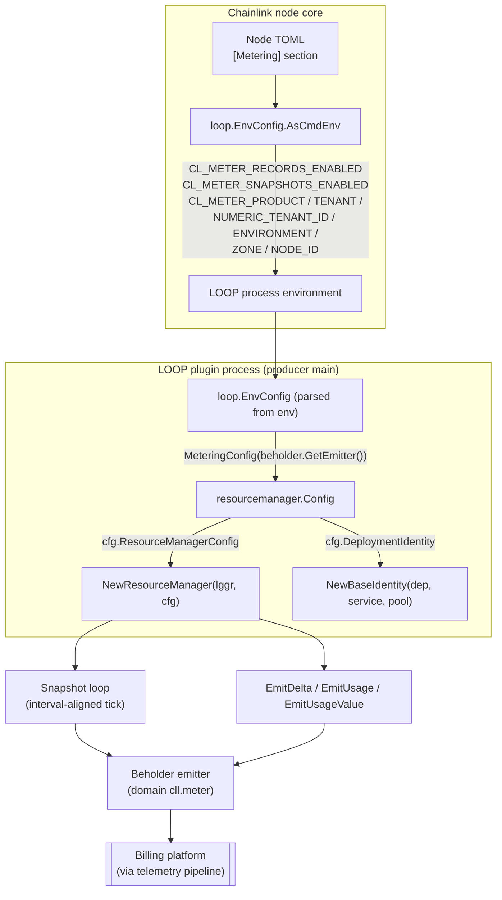
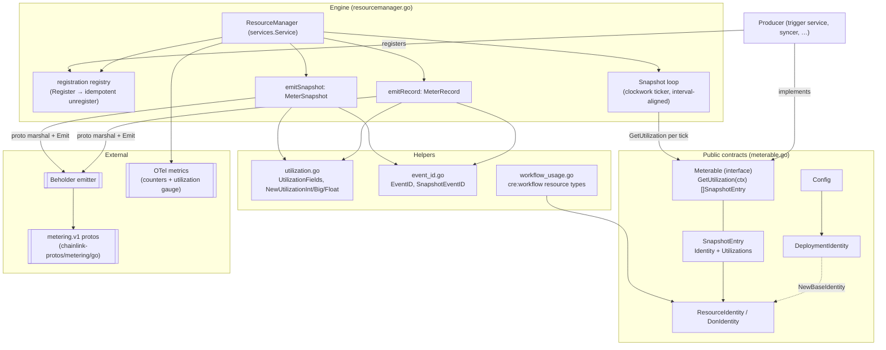
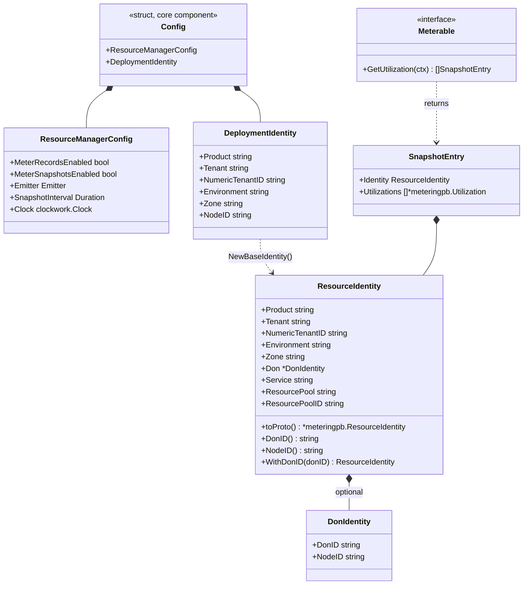
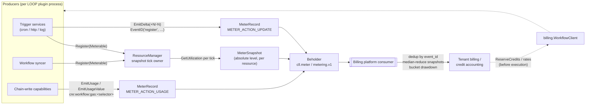

# Resource Metering (`pkg/resourcemanager`)

> **Module scope:** `chainlink-common/pkg/resourcemanager`
> **Core component:** [`resourcemanager.Config`](#2-the-config-component) (`chainlink-common/pkg/resourcemanager/meterable.go`)

## 1. Purpose

The **resource metering** module is the emission engine for *durable billable resources* — resources whose billing is driven by steady-state existence rather than by a single execution. Canonical examples are **trigger registrations** (cron schedules, HTTP/webhook registrations, EVM/Solana log filters), **workflow specs** held in storage, and other long-lived per-organization state. The package emits the first-class billing streams `metering.v1.MeterRecord` and `metering.v1.MeterSnapshot` over [Beholder](../../Telemetry___Observability_Platform/beholder-telemetry.md), so the billing platform can charge tenants for resources that *persist*, independently of the per-execution spend pipeline documented in the [metering report schema](metering-and-billing_metering-report-schema.md).

It answers three questions for every billable resource:

1. **What is it?** — a structured [`ResourceIdentity`](#4-identity-model) that carries product, tenant, environment, zone, DON/node, service, and resource-pool dimensions as discrete columns.
2. **How much is in use right now?** — periodic **MeterSnapshots** of the absolute level of each active resource, reduced by median across DON nodes.
3. **What changed, and when?** — request-time **MeterRecords** (`METER_ACTION_UPDATE` deltas and `METER_ACTION_USAGE` occurrences) that give the consumer precise audit edges and cross-node dedup semantics.

The package is part of the [Metering & Billing](../metering-and-billing.md) foundation. It contains no billing business logic of its own; credit checking and receipts are the responsibility of the [billing workflow client](metering-and-billing_billing-client.md).

## 2. The `Config` component

`Config` is the single wiring point a LOOP producer needs to turn its resolved process environment into a working metering stack. It is deliberately tiny — everything else is derived from it:

```go
// meterable.go
type Config struct {
    ResourceManagerConfig          // embeds: gates, emitter, snapshot interval, clock
    DeploymentIdentity             // static deployment + node identity dimensions
}
```

| Field group | Field | Meaning |
|---|---|---|
| `ResourceManagerConfig` | `MeterRecordsEnabled` | Rollout gate for `EmitDelta` / `EmitUsage`; `false` (default) makes them no-ops |
| | `MeterSnapshotsEnabled` | Gates snapshot emission; only effective when `MeterRecordsEnabled` is also true |
| | `Emitter` | Delivery sink, typically `beholder.GetEmitter()`; `nil` makes emission a no-op |
| | `SnapshotInterval` | Snapshot period. Zero (default) **disables** the snapshot loop — zero is never replaced by a default. Use `DefaultSnapshotInterval` (60 s) to opt in |
| | `Clock` | Drives tick timing and record timestamps; `nil` selects the real clock (`clockwork` injection for tests) |
| `DeploymentIdentity` | `Product`, `Tenant`, `NumericTenantID`, `Environment`, `Zone`, `NodeID` | Static rollup dimensions resolved once by the host. `NodeID` is the node's *logical name* (e.g. `clp-cre-wf-zone-a-1`), **not** the CSA public key — the CSA key rides emitted events separately as the `node_csa_key` attribute |

### 2.1 How `Config` is built

In production, producers never hand-assemble a `Config`. The [LOOP host](../../Plugin_Process_Framework_(Loop)/loop-plugin-core.md) resolves the node's `[Metering]` TOML section once, ships it to every plugin process as `CL_METER_*` environment variables via `loop.EnvConfig.AsCmdEnv`, and each plugin maps that environment back into a `Config` with the pure function `loop.EnvConfig.MeteringConfig(emitter)` (`chainlink-common/pkg/loop/metering_config.go`):

- `nil` `EnvConfig` → zero `Config` (metering disabled, fail-open)
- `Emitter` is injected by the caller (e.g. `beholder.GetEmitter()`), keeping the mapping a pure function
- `SnapshotInterval` is set to `resourcemanager.DefaultSnapshotInterval`



This mapping "lives in one place instead of being copy-pasted into every producer main", as the `Config` doc comment in `chainlink-common/pkg/resourcemanager/meterable.go` puts it.

## 3. Architecture

The package is organized around one interface, one engine, and one identity model:



Key structural properties:

- **The `ResourceManager` is the single owner of the snapshot tick.** Producers start the manager as a sub-service (it embeds `services.Service` — see [services](../services.md)) and only `Register` themselves; they never run their own snapshot loop (`resourcemanager.go`).
- **The emitter is stateless with respect to metering**: a delta is derived only from the request being fielded plus the producer's own store. Producers emit only when fielding a request that changes desired state.
- **Fail-open by design**: `EmitDelta`, `EmitUsage`, and the snapshot loop return no error. A metering failure must never gate, delay, or retry the resource operation being metered. Failures surface via error-level logs and the `resource_manager_*_failure_total` counters.
- **Billing streams**: `MeterRecord` is the durable, first-class event stream (signed deltas and usage occurrences); `MeterSnapshot` carries the periodic absolute level and the liveness signal. Snapshots are what let billing *zero out* a released resource — by its absence from subsequent snapshots — without an explicit de-registration event.

## 4. Identity model

`ResourceIdentity` maps 1:1 onto `metering.v1.ResourceIdentity`, so every emitted record carries each dimension as a discrete column rather than a parsed dotted string or out-of-band telemetry attribute.



Construction rules enforced by `NewBaseIdentity` (`meterable.go`):

- An empty `Product` falls back to the non-silent sentinel `UnsetProduct = "unset"` so misconfigured producers are visible in billing data instead of silently unattributed.
- The `Don` sub-identity is set only when `DeploymentIdentity.NodeID` is non-empty; `WithDonID(donID)` later stamps the DON ID (a no-op on an empty argument) once the producer knows it — for LOOP plugins, typically after `Initialise` delivers the DON context.
- `DonID()` / `NodeID()` accessors safely return `""` when the `Don` group is absent, so consumers can branch on one struct instead of handling don/node permutations.

`Service` and `ResourcePool` are stable constants supplied by each producer (e.g. service `"cron-trigger"`, pools `"trigger_registrations"`, `"log_filters"`, `"workflow_storage"`). For workflow capability usage, `workflow_usage.go` fixes the vocabulary: pool `cre:workflow:gas` / `cre:workflow:compute` with `ResourcePoolID` set to the fully qualified resource type (`WithWorkflowUsagePool`), and `WorkflowGasResourceType(chainSelector)` producing e.g. `cre:workflow:gas:421614`. Those usage records are emitted by the workflow engine and chain-write capabilities (see [workflows metering](../../Workflow___Capability_Runtime_(CRE_Engine)/workflows/workflows_metering.md)).

## 5. Emission semantics

### 5.1 Request-time records (`EmitDelta` / `EmitUsage` / `EmitUsageValue`)

| API | Action | Semantics |
|---|---|---|
| `EmitDelta(ctx, identity, eventID, delta, fields)` | `METER_ACTION_UPDATE` | Signed level change of a durable resource: register `+N`, unregister `-N`, resize `±delta`. Timestamped with the raw clock (request-time edge, not bucket-aligned) |
| `EmitUsage(ctx, identity, eventID, quantity, fields)` | `METER_ACTION_USAGE` | One-off instantaneous consumption billed per occurrence; no level, never snapshotted |
| `EmitUsageValue(ctx, identity, eventID, value, fields)` | `METER_ACTION_USAGE` | Same as `EmitUsage` for quantities that overflow `int64` (e.g. tx fees in wei); `nil` emits `"0"` |

**The `eventID` contract is load-bearing.** Records have counter semantics, so the consumer's cross-node dedup/aggregation key is `event_id`. Every DON node fielding the same logical delta must pass the *identical* value, which is why producers derive it with the canonical helper:

```
EventID(namespace, parts...) = "<namespace>:<hex(sha256(namespace‖0‖part‖0…))>"
```

- The namespace (e.g. `"register"`, `"unregister"`, `"evm-activate"`) scopes paired `+N`/`-N` deltas so they cannot collide.
- Parts must be **DON-consistent** — fields of the DON-aggregated request (the remote capability layer runs mode consensus over workflow-DON senders, so the delivered request is byte-identical on every node) or a reconciliation signature. Locally generated values (per-node UUIDs, `os.Hostname`, `time.Now`) silently break cross-node dedup.
- An **empty** `eventID` is an error: the emit is skipped and `resource_manager_emit_failure_total` is incremented with `reason="missing_event_id"`. The manager never substitutes a random id.

### 5.2 Periodic snapshots

The snapshot tick converts the *absolute state* reported by `Meterable.GetUtilization` into one `MeterSnapshot` per active resource:

```mermaid
sequenceDiagram
    participant Loop as Snapshot goroutine (ResourceManager.start)
    participant Reg as Registration registry
    participant M as Meterable producer
    participant Emit as Beholder emitter
    participant Met as OTel metrics

    Note over Loop: start() aligns first tick to the next<br/>wall-clock multiple of SnapshotInterval
    loop every SnapshotInterval
        Loop->>Reg: read registrations (RLock)
        Loop->>Loop: timeout = max(interval/4, 5s floor)
        Loop->>M: GetUtilization(ctx with deadline)
        M-->>Loop: []SnapshotEntry (cheap in-memory read)
        loop per entry with non-empty Utilizations
            Loop->>Loop: stamp SnapshotEventID(node, service, pool, type, id, bucketUnix)
            Loop->>Met: resource_manager_utilization gauge
            Loop->>Emit: Emit(MeterSnapshot proto, domain=cll.meter)
            Emit-->>Loop: ok / err (fail-open: log + counter)
        end
        Note over Loop: bucket = tickTime.Truncate(interval)<br/>→ cross-node buckets agree structurally
    end
```

Snapshot specifics worth knowing when implementing a `Meterable`:

- **`GetUtilization` must be cheap**: no network, no disk, no lock held across I/O. It must tolerate context cancellation and concurrent registration; returning nil/empty is valid and means nothing is currently active (no snapshots emitted, billing zeroes the resource by absence).
- **Per-registrant deadline** of `SnapshotInterval/4` floored at 5 s: one slow or stuck producer is logged and skipped for that tick rather than stalling the others.
- **Manager-derived snapshot `event_id`** (`SnapshotEventID`): `snapshot:{node_id}:{service}:{resource_pool}:{resource_type}:{resource_id}:{bucket_unix}`. Unlike record event ids, `node_id` is *intentionally* part of the key — snapshots are reduced by median across nodes, so the dedup scope is a single node's retries of one tick.
- **Tick alignment**: the first tick is aligned to the next wall-clock multiple of the interval, and each snapshot's timestamp is the tick time truncated to the interval. For DonTime-synced clocks this makes cross-node snapshot buckets agree structurally. The loop is hand-rolled on `clockwork` (not `services.TickerConfig`) to keep exact-interval-boundary agreement and testable clock injection.

### 5.3 Bucket semantics (consumer contract)

An org draws down credits in a time bucket if the bucket contains any positive-delta `UPDATE` record, any `USAGE` record, or any nonzero snapshot for a resource attributed to that org. A `+N` and `-N` cancelling within one bucket still triggers drawdown via the positive delta. This is why deltas and snapshots are two complementary streams: records give precise request-time edges and the audit trail; snapshots bound residual level drift from at-least-once delivery.

## 6. Observability

Two metric families are registered through Beholder's OTel meter (`resourcemanager.go`; counter names are a dashboard contract — do not rename):

| Metric | Kind | Labels | Notes |
|---|---|---|---|
| `resource_manager_emit_success_total` / `resource_manager_emit_failure_total` | counters | `service`, `resource_pool`, `action`, (`reason` on failure) | Deliberately low cardinality — `node_id`/`resource_id` excluded to keep series bounded. Success means accepted for async OTel export, not Kafka delivery |
| `resource_manager_snapshot_emit_success_total` / `resource_manager_snapshot_emit_failure_total` | counters | `service`, `resource_pool`, (`reason` = `marshal` \| `emit`) | Same fail-open accounting for the snapshot loop |
| `resource_manager_utilization` | gauge | **all** `ResourceIdentity` dimensions + `resource_type`, `resource_id`, `org_id` | High cardinality *by construction* — the intended behaviour, letting dashboards break utilization down by any dimension. Non-`int64` values are skipped at debug level |

Beholder routing attributes are fixed constants shared with the CHiP schema registration and consumer topic names: `domain=cll.meter`, `entity=metering.v1.MeterRecord` / `metering.v1.MeterSnapshot`, `dataSchema=metering.v1.meter_record` / `metering.v1.meter_snapshot`.

## 7. End-to-end data flow



The dashed path back into execution (credit reservation and receipt submission through the [billing workflow client](metering-and-billing_billing-client.md)) is a separate, synchronous gRPC flow; resource metering itself is always asynchronous and fail-open.

## 8. Relationships to other modules

- **[Metering & Billing (parent)](../metering-and-billing.md)** — this module is the durable-resource half of the foundation; the per-execution spend pipeline lives in the [metering report schema & units](metering-and-billing_metering-report-schema.md) and the credit API in the [billing client](metering-and-billing_billing-client.md).
- **[Plugin Process Framework (Loop)](../../Plugin_Process_Framework_(Loop).md)** — the host side of the `Config` contract: `loop.EnvConfig` (`CL_METER_*` variables) and `EnvConfig.MeteringConfig` are defined in the LOOP plugin core ([loop-plugin-core](../../Plugin_Process_Framework_(Loop)/loop-plugin-core.md)). `Meterable` producers are standard capabilities delivered over that boundary.
- **[Workflow & Capability Runtime (CRE Engine)](../../Workflow___Capability_Runtime_(CRE_Engine).md)** — the workflow engine emits compute/gas `METER_ACTION_USAGE` records using the `workflow_usage.go` resource-type vocabulary (see [workflows metering](../../Workflow___Capability_Runtime_(CRE_Engine)/workflows/workflows_metering.md)); chain capabilities contribute gas usage from their write paths.
- **[Telemetry & Observability Platform](../../Telemetry___Observability_Platform.md)** — the `Emitter` is satisfied by [Beholder](../../Telemetry___Observability_Platform/beholder-telemetry.md) (`beholder.GetEmitter()`), which batch-exports records to the platform pipeline.
- **[services](../services.md)** — `ResourceManager` embeds `services.Service`; producers typically start it as a sub-service alongside their own lifecycle.
- **[durable-emitter](../durable-emitter.md)** — an alternative production emitter: `MeteringConfig` accepts the process-global durable emitter for buffered delivery when the host configures it.
- **[logger](../logger.md)** — all manager logging goes through the shared sugared logger; metric-creation failures are logged and skipped, never fatal.

## 9. Build & dependency notes

Dependencies are pinned by the `chainlink-common` module (`chainlink-common/go.mod`):

- `github.com/smartcontractkit/chainlink-protos/metering/go` — the `metering.v1` wire types (`Utilization`, `ResourceIdentity`, `MeterRecord`, `MeterSnapshot`, `MeterAction`). The local proto sources mirrored for reference live under `chainlink-common/pkg/metering/pb/` (`metering.proto`, `meteringstep.proto`, `meteringdetail.proto`) and are regenerated with `make generate` in `chainlink-common/Makefile` (which installs protoc via `install-protoc` and runs the workspace `cre-protoc` tooling).
- `github.com/jonboulle/clockwork` — injected clock for tick alignment and testable time.
- OpenTelemetry `go.opentelemetry.io/otel/{metric,attribute}` — counters and the utilization gauge, created via `beholder.GetMeter()`.
- `github.com/smartcontractkit/chainlink-common/pkg/{beholder,logger,services}` — emitter, logging, and lifecycle plumbing.

Testing notes from the package itself: the snapshot loop's hand-rolled timer (instead of `services.TickerConfig`) exists specifically so `clockwork.FakeClock` can drive interval alignment deterministically, and `Emitter` is a one-method interface so tests substitute a fake for `beholder.Emitter`.
