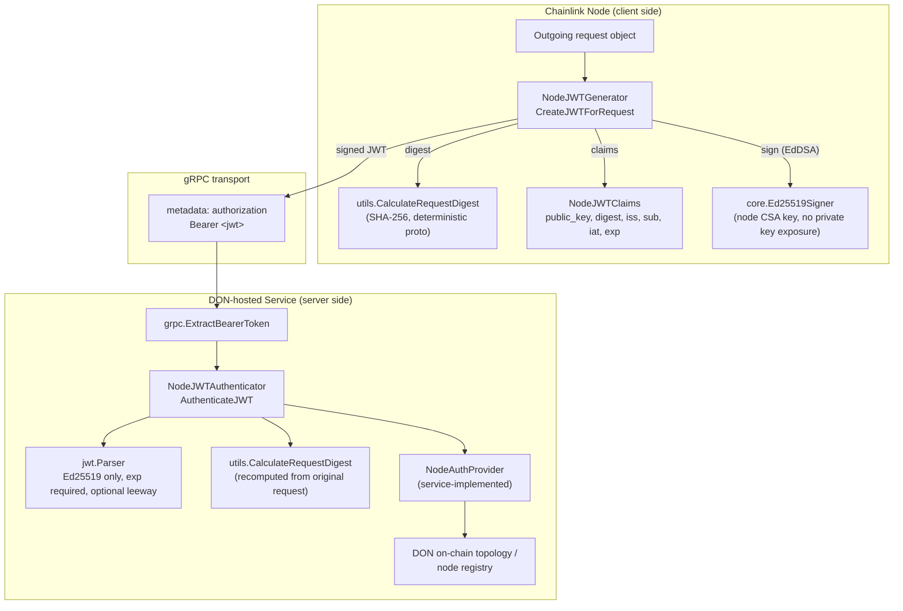
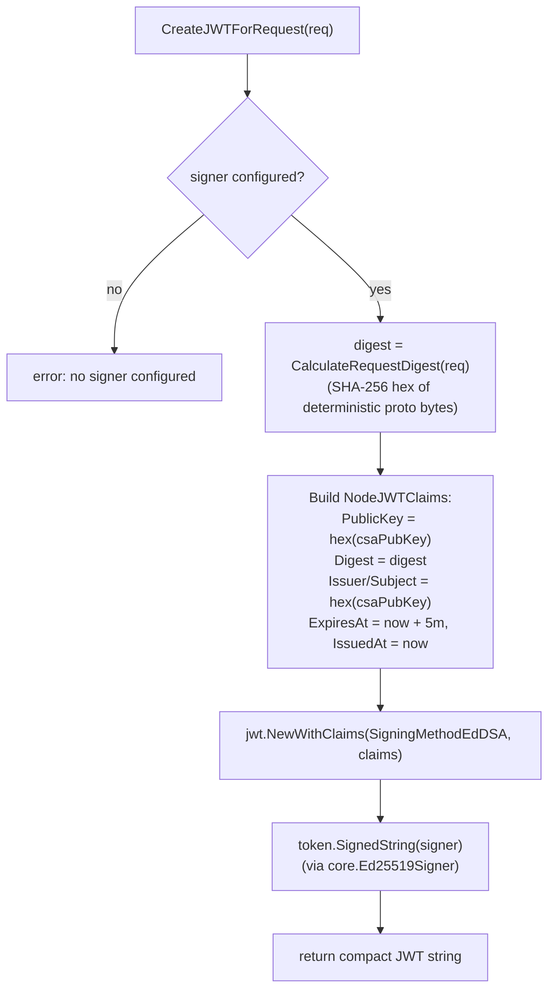
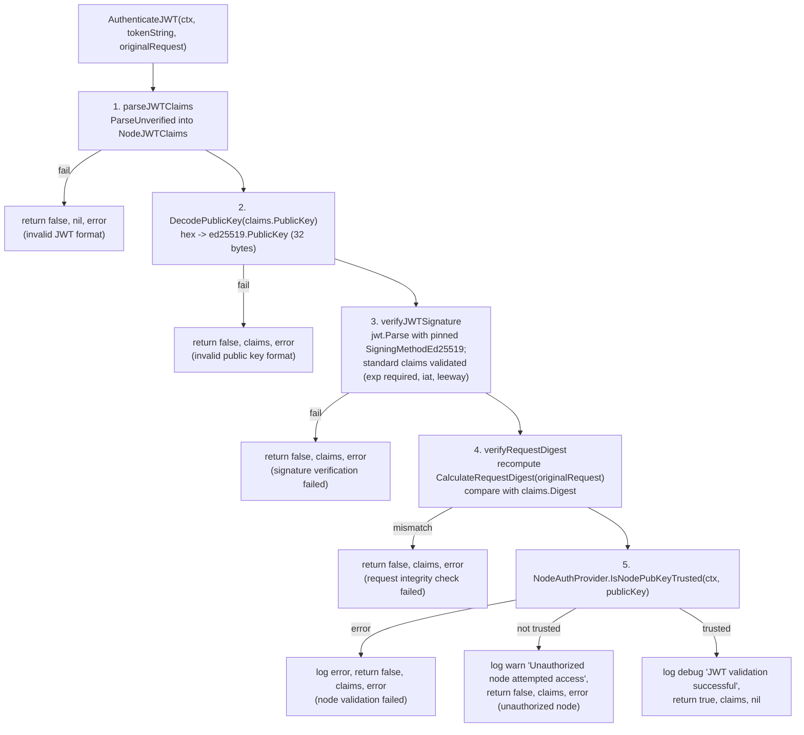

# node-auth-jwt

## Overview

**node-auth-jwt** (`chainlink-common/pkg/nodeauth/jwt` and its sibling packages under `chainlink-common/pkg/nodeauth/`) is the shared library for **mutual, key-based authentication between a Chainlink node and DON-hosted services** (e.g., services running inside a Workflow DON). It defines a small, dependency-light contract for:

- **Generating** short-lived, Ed25519-signed JWTs on the node side (`JWTGenerator` / `NodeJWTGenerator`).
- **Authenticating** those JWTs on the service side (`JWTAuthenticator` / `NodeJWTAuthenticator`), including signature verification, request-integrity (digest) checks, and node trust checks delegated to a service-provided `NodeAuthProvider`.
- **Extracting** bearer tokens from gRPC metadata (`pkg/nodeauth/grpc`).
- **Shared helpers** for request digests and key decoding (`pkg/nodeauth/utils`) and the shared claims type (`pkg/nodeauth/types`).

The design goal is that a node proves *who it is* (via its CSA/Ed25519 identity key) and *what it is sending* (via a SHA-256 digest of the request payload embedded in the JWT), while the receiving service verifies both and independently decides whether that node identity is trusted for its DON topology.

This module is part of the [Shared Foundation Libraries & Domain Types](../Shared_Foundation_Libraries___Domain_Types.md) family. It is compiled into the `github.com/smartcontractkit/chainlink-common` Go module (see `chainlink-common/go.mod`, which pins the JWT dependency `github.com/golang-jwt/jwt/v5 v5.3.0`).

> **Note:** This module is intentionally *not* an OAuth/OpenID or external-IdP JWT library. For example, the Vault capability's Auth0/JWKS-based JWT authorizer (`chainlink/core/capabilities/vault/jwt_based_auth.go`) is a separate mechanism for user-initiated requests and does not use this package. node-auth-jwt is specifically for **node-issued (machine-to-machine) credentials**.

---

## Package layout

| Package | Purpose |
|---|---|
| `pkg/nodeauth/jwt` | Core interfaces (`JWTGenerator`, `JWTAuthenticator`, `NodeAuthProvider` in `types.go`) and their concrete implementations (`NodeJWTGenerator`, `NodeJWTAuthenticator`), logger adapters, and constants. |
| `pkg/nodeauth/types` | Shared claims payload type `NodeJWTClaims` (`claims.go`). |
| `pkg/nodeauth/grpc` | gRPC helpers to extract the bearer token from incoming context metadata (`token_extractor.go`). |
| `pkg/nodeauth/utils` | `CalculateRequestDigest` (client+server shared hashing), `DecodePublicKey`, `DecodeP2PId`. |
| `pkg/nodeauth/jwt/mocks` | mockery-generated mocks for all three interfaces. |

---

## Architecture

The module follows a symmetric **client/server** split. The node is always the *client* (token producer); the DON-hosted service is the *server* (token verifier and trust arbiter).



Key architectural properties:

1. **Interface-first design** (`jwt/types.go`): consumers depend on `JWTGenerator`, `JWTAuthenticator`, and `NodeAuthProvider` abstractions; the concrete types are implementation details.
2. **The trust decision is pluggable**: `NodeAuthProvider.IsNodePubKeyTrusted` must be implemented by every service that uses `NodeJWTAuthenticator` — the library itself never hard-codes trust. Implementations typically consult DON on-chain topology (contracts or a cache), at the discretion of the service.
3. **Shared hashing on both ends**: `utils.CalculateRequestDigest` is deliberately shared between generator and authenticator so the digest always matches. It uses *deterministic protobuf serialization* (`proto.MarshalOptions{Deterministic: true}`) for `proto.Message` requests, falling back to `fmt.Stringer` / `%v`.
4. **No private key handling**: `NodeJWTGenerator` wraps a `*core.Ed25519Signer` from [`types-core`](types-core/types-core_keystore.md) (`chainlink-common/pkg/types/core/keystore.go::Ed25519Signer`), so the JWT package never touches key material directly; signing is delegated through the keystore's sign function.

---

## Core interfaces (contract reference)

Defined in `chainlink-common/pkg/nodeauth/jwt/types.go`:

### `JWTGenerator` — token creation (node side)

```go
type JWTGenerator interface {
    // CreateJWTForRequest creates a JWT token for the given request
    CreateJWTForRequest(req any) (string, error)
}
```

### `JWTAuthenticator` — token verification (service side)

```go
type JWTAuthenticator interface {
    // AuthenticateJWT authenticates the JWT token for the given request and
    // returns the JWT claims. If the JWT token is invalid, the function will
    // still return claims along with an error.
    AuthenticateJWT(ctx context.Context, tokenString string, originalRequest any) (valid bool, claims *nodeauthtypes.NodeJWTClaims, err error)
}
```

Note the deliberate contract: on most validation failures the parsed `claims` are still returned alongside the error (audit/debuggability); only a hard parse failure yields `nil` claims.

### `NodeAuthProvider` — node trust policy (service-implemented)

```go
type NodeAuthProvider interface {
    // IsNodePubKeyTrusted checks if a node's public key is trusted.
    // Usually done by checking the node against DON's on-chain topology
    // (contracts or cache, depending on the service).
    IsNodePubKeyTrusted(ctx context.Context, publicKey ed25519.PublicKey) (bool, error)
}
```

Every service that wires up `NodeJWTAuthenticator` **must** supply an implementation — this is the integration point where DON-specific membership rules live.

---

## Token structure & claims

The shared payload type lives in `pkg/nodeauth/types/claims.go`:

```go
type NodeJWTClaims struct {
    PublicKey string `json:"public_key" validate:"required"`
    Digest    string `json:"digest" validate:"required"`
    jwt.RegisteredClaims
}
```

| Claim | Produced as (node side) | Consumed as (service side) |
|---|---|---|
| `public_key` | hex-encoded node CSA Ed25519 public key | decoded via `utils.DecodePublicKey` (must be exactly `ed25519.PublicKeySize` = 32 bytes) |
| `digest` | `utils.CalculateRequestDigest(req)` — hex SHA-256 of the serialized request | recomputed from the original request and compared to the claim |
| `iss` / `sub` | hex-encoded CSA public key (issuer/subject identity; a code TODO notes a future switch to DON ID) | validated as part of standard claim checks |
| `exp` / `iat` | `now` / `now + workflowJWTExpiration` (5 minutes, see `jwt/const.go`) | `exp` is **required** (`jwt.WithExpirationRequired()`); `iat` validated (`jwt.WithIssuedAt()`); optional `Leeway` absorbs clock skew |
| signature | EdDSA (`jwt.SigningMethodEd25519`) signed through `core.Ed25519Signer` | verified against the `public_key` claim; the algorithm is pinned — any other `alg` is rejected |

---

## Token generation flow (node side)

Implemented by `NodeJWTGenerator` in `jwt/node_jwt_generator.go`, constructed via `NewNodeJWTGenerator(signer *core.Ed25519Signer, csaPubKey ed25519.PublicKey)`.



Because the digest is computed over the same object the caller will transmit, the JWT is bound to a specific request payload — the token cannot be replayed with different arguments.

---

## Authentication pipeline (service side)

Implemented by `NodeJWTAuthenticator` in `jwt/node_jwt_authenticator.go`. Construct with `NodeJWTAuthenticatorConfig{SLogger | Logger, Leeway}.New(nodeAuthProvider)`. (The older `NewNodeJWTAuthenticator(nodeAuthProvider, slogger, cfg...)` constructor is deprecated but delegates to the same config-based constructor.)



Behaviour notes:

- **Step order matters**: cheap structural/format checks run first, signature and integrity second, and the (potentially expensive or remote) trust lookup runs last.
- **Clock skew**: set `Leeway` in `NodeJWTAuthenticatorConfig` when node and service clocks may drift; it is applied to the parser via `jwt.WithLeeway`.
- **Algorithm pinning**: the keyfunc rejects any signing method that is not `*jwt.SigningMethodEd25519`, preventing `alg`-confusion attacks.
- **Logging** is abstracted behind the internal `nodeJWTLogger` interface (`Debugw/Warnw/Errorw`) with adapters for both `*slog.Logger` and the chainlink [`logger`](logger.md) interface (`jwt/logger_adapters.go`); if neither is configured a no-op logger is used. Node public keys are always logged hex-encoded.

---

## gRPC transport integration

`pkg/nodeauth/grpc/token_extractor.go` provides the transport seam between the wire and `JWTAuthenticator`:

```go
func ExtractBearerToken(ctx context.Context) (string, error)
```

- Reads the lowercase `authorization` metadata key from the incoming gRPC context.
- Expects the `Bearer ` prefix and returns the trimmed token.
- Typed sentinel errors for server handlers to map onto gRPC status codes:
  - `ErrMissingMetadata` — context carries no metadata.
  - `ErrMissingAuthHeader` — no `authorization` key.
  - `ErrInvalidAuthFormat` — value lacks the `Bearer ` prefix.

On the node side, the counterpart is to attach the token to outgoing metadata as `authorization: Bearer <token>`; the library intentionally does not prescribe the client-side transport helper, keeping `JWTGenerator` transport-agnostic.

---

## Supporting utilities (`pkg/nodeauth/utils`)

| Function | Used by | Description |
|---|---|---|
| `CalculateRequestDigest(req any) string` | Generator **and** Authenticator | SHA-256 hex digest of the request. Prefers deterministic protobuf marshalling for `proto.Message`, then `fmt.Stringer`, then `%v`. |
| `DecodePublicKey(string) (ed25519.PublicKey, error)` | Authenticator | Hex-decodes and size-validates (32 bytes) the public key claim. |
| `DecodeP2PId(string) (p2ptypes.PeerID, error)` | Integrations | Base58-decodes a libocr ragep2p `PeerID`; useful when trust checks correlate CSA keys with peer identities. |

---

## Testing support

All three interfaces have generated mocks in `pkg/nodeauth/jwt/mocks` (`JWTGenerator`, `JWTAuthenticator`, `NodeAuthProvider`). They are wired into the repository's mock toolchain via `chainlink-common/.mockery.yaml`:

```yaml
github.com/smartcontractkit/chainlink-common/pkg/nodeauth/jwt:
  interfaces:
    JWTGenerator:
    JWTAuthenticator:
    NodeAuthProvider:
```

Regenerate with the standard `chainlink-common` mock targets (`make mockery` in `chainlink-common/Makefile`). Package-level tests live alongside the implementations (`node_jwt_generator_test.go`, `node_jwt_authenticator_test.go`).

---

## Relationships to other modules

- **[types-core](types-core.md)** — `NodeJWTGenerator` signs with `core.Ed25519Signer` from `chainlink-common/pkg/types/core/keystore.go` (see [types-core keystore](types-core/types-core_keystore.md)); the signer is backed by the node's keystore/CSA key, described in the [Node Platform Services keystore module](../Node_Platform_Services/keystore.md).
- **[logger](logger.md)** — the authenticator's optional structured logging accepts the common `logger.Logger` interface via `chainlinkLoggerAdapter`.
- **[jsonrpc2](jsonrpc2.md)** — request/response payloads authenticated with this module commonly travel as JSON-RPC messages between nodes and DON services.
- **[Node Platform Services → gateway](../Node_Platform_Services/gateway.md)** — DON-hosted service infrastructure (gateway connectors, WebSocket/HTTP surfaces) is a typical deployment shape for a server that pairs `grpc.ExtractBearerToken` + `NodeJWTAuthenticator` with a `NodeAuthProvider`.
- **[Workflow & Capability Runtime (CRE Engine)](../Workflow___Capability_Runtime_(CRE_Engine).md)** — the token profile (5-minute expiry, `workflowDONType = "workflowDON"` constant in `jwt/const.go`) is oriented toward Workflow DON traffic; DON-side services that accept node-initiated requests implement `NodeAuthProvider` against their on-chain topology (e.g., capabilities/node registries).
- **[P2P](../Node_Platform_Services/p2p.md)** — `utils.DecodeP2PId` bridges CSA public keys and libocr peer identities used in DON topologies.

---

## Security considerations

- **Identity binding**: the JWT is self-describing (the signer's public key travels in the `public_key` claim) and signed with EdDSA; verification pins the Ed25519 algorithm, so a token cannot be downgraded to `none` or a weaker algorithm.
- **Freshness**: tokens expire after 5 minutes and `exp` is mandatory; `iat` is validated. Enable `Leeway` to tolerate clock skew without widening the effective validity window unnecessarily.
- **Replay/integrity**: the embedded request digest binds each token to exactly one request payload. Replay protection *within* the TTL window against a changed payload fails the digest check; services needing strict single-use semantics should add their own nonce/replay tracking on top.
- **Trust is externalized**: signature validity never implies authorization. The `NodeAuthProvider` trust check is the security boundary — implement it against authoritative DON membership data and treat `IsNodePubKeyTrusted` failures as deny-by-default (the authenticator already denies on both error and `false`).
- **Key hygiene**: private keys never enter this package; signing is delegated to `core.Ed25519Signer`, keeping key material inside the keystore layer.
- **Least information in logs**: log adapters emit hex-encoded public keys and validation outcomes only — no token material.

---

## Quick usage guide

**Node side (producer):**

```go
gen := jwt.NewNodeJWTGenerator(signer /* *core.Ed25519Signer from keystore */, csaPubKey)
token, err := gen.CreateJWTForRequest(myProtoRequest)
// attach: md.Append("authorization", "Bearer "+token)
```

**Service side (verifier):**

```go
authCfg := jwt.NodeJWTAuthenticatorConfig{
    SLogger: slogLogger,   // or Logger: logger.Logger
    Leeway:  time.Minute,  // optional clock-skew tolerance
}
auth := authCfg.New(myNodeAuthProvider /* implements NodeAuthProvider */)

tokenString, err := grpcnodeauth.ExtractBearerToken(ctx)
valid, claims, err := auth.AuthenticateJWT(ctx, tokenString, originalRequest)
// act on valid / err; claims are populated even on most failures for audit trails
```

For module context and sibling libraries, see the [Shared Foundation Libraries & Domain Types overview](../Shared_Foundation_Libraries___Domain_Types.md).
