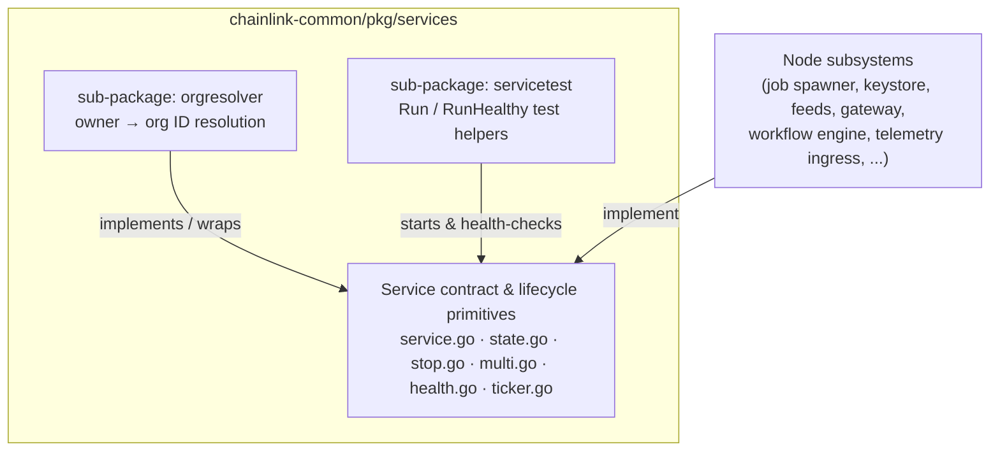
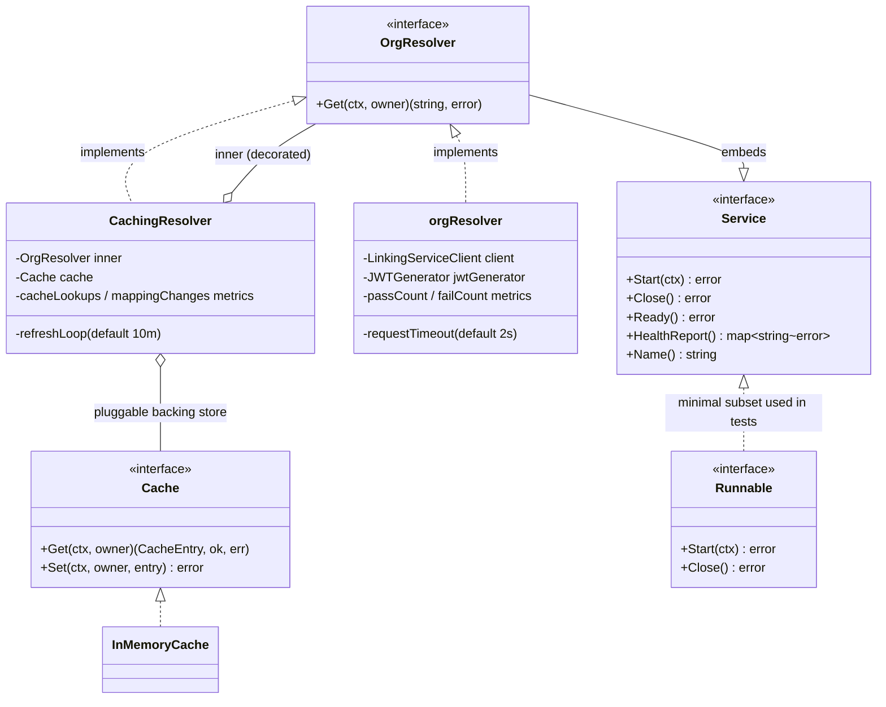
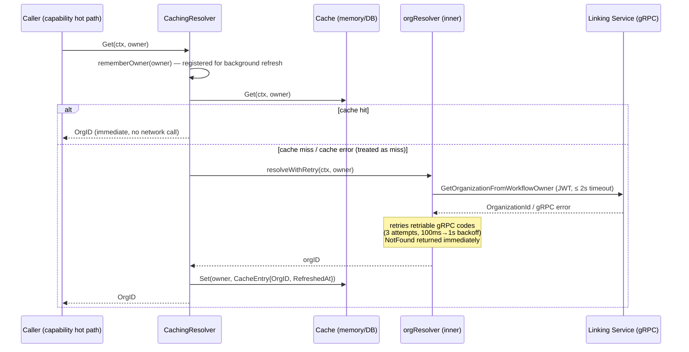
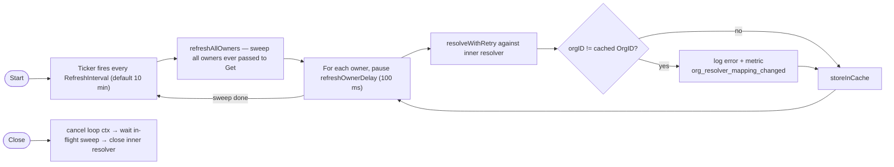

# Services (`chainlink-common/pkg/services`)

> Parent module: [Shared Foundation Libraries & Domain Types](../Shared_Foundation_Libraries___Domain_Types.md)

## 1. Purpose and Scope

The `services` module is the **shared foundation for long-running services** in Chainlink nodes. Nearly every subsystem of the node — the job spawner, keystore, feeds service, gateway, telemetry ingress, workflow engine, and more — is implemented as a `services.Service` and is started, stopped, health-checked, and tested using this package.

The module is defined in the `github.com/smartcontractkit/chainlink-common` Go module (Go 1.27.1, see `chainlink-common/go.mod`) at package path `chainlink-common/pkg/services`. It provides three layers of functionality:

1. **The `Service` contract and lifecycle primitives** (base package): the `Service` interface (`Start` / `Close` / `HealthReporter`), the `Engine` helper for goroutine tracking and health conditions, `StateMachine`, `StopChan`, and multi-service starters/closers.
2. **`orgresolver`** — a concrete, production-ready service that resolves the Chainlink **organization ID owning a workflow** (owner address → org ID) by calling the Linking Service over gRPC, with cache-aside behaviour, retry with backoff, JWT authentication and OpenTelemetry metrics.
3. **`servicetest`** — generic Go test helpers (`Run`, `RunHealthy`) that start a service in a test and automatically verify it starts, closes, becomes ready, and stays healthy.



> **Disambiguation:** do not confuse this `pkg/services.Service` (`Start`/`Close`/`Ready`/`HealthReport`) with the libocr-style `Service` in `chainlink-common/pkg/types/types.go`, which is documented in [types-core](types-core.md).

## 2. Package Layout

```text
chainlink-common/pkg/services/
├── service.go            # Service interface, Engine, Config.NewServiceEngine
├── state.go              # StateMachine (start/stop state transitions)
├── stop.go, stop_*.go    # StopChan signalling helpers
├── multi.go              # MultiStart, MultiCloser
├── health.go             # HealthReporter contract helpers, CopyHealth
├── ticker.go, waitgroup.go
├── orgresolver/          # ← sub-module: services_orgresolver
│   ├── linking.go        #   OrgResolver interface + gRPC orgResolver implementation
│   ├── caching.go        #   CachingResolver (cache-aside + background refresh)
│   └── fallback.go       #   Deprecated OrgResolverFallback
└── servicetest/          # ← sub-module: services_servicetest
    ├── run.go            #   Runnable, Run[R], RunHealthy[S]
    ├── run_test.go       #   fakeTest (tests the helpers themselves)
    ├── health.go         #   AssertHealthReportNames
    └── mock.go           #   Mock interface, SetupNoOpMock
```

Adjacent packages in the same tree (`otelhealth`, `beholderhealth`, `promhealth`) export service health reports to observability backends; they are consumer-side adapters and are not covered here (see [Telemetry & Observability Platform](../Telemetry___Observability_Platform.md)).

## 3. Architecture

### 3.1 The Service contract

`Service` (defined in `chainlink-common/pkg/services/service.go`) is the node's universal lifecycle contract:

```go
type Service interface {
    Start(context.Context) error   // must return promptly on ctx cancel
    Close() error                  // after Close, the Service is usually not restartable
    HealthReporter                 // Ready() error + HealthReport() map[string]error
}
```

The base package makes this contract easy to honour correctly:

- **`Config.NewServiceEngine` / `Config.NewService`** — builds a ready-made `Service` with named logging, sub-service fan-out, health-condition tracking, goroutine tracking (`Engine.Go`, `Engine.GoTick`) and an OpenTelemetry tracer per service name.
- **`StateMachine`** — safe `StartOnce`/`StopOnce`/`IfStarted`/`IfNotStopped` transitions (see `state.go`).
- **`MultiStart` / `MultiCloser`** — ordered start/close of service groups; **`CopyHealth`** merges health reports.

Everything in this module — including the concrete resolvers below and the test helpers — builds on this contract.

### 3.2 Component relationships



Key design points:

- **`CachingResolver` is a decorator** around any `OrgResolver`: cached entries are trusted immediately (never blocking the caller), while a single background loop revalidates all known owners so a bad mapping cannot become permanent.
- **The `Cache` is pluggable**: an in-memory map by default (`NewInMemoryCache`), or a durable DB-backed store chosen by the embedding application.
- **`servicetest` is generic**: `Run[R Runnable]` works for any start/close type; `RunHealthy[S services.Service]` additionally polls readiness and health until the test ends.

### 3.3 Data flow: `CachingResolver.Get`



### 3.4 Background revalidation loop



The loop deliberately runs on its own `context.Background()`-derived context (cancelled by `Close`), because it must outlive the caller-supplied `Start` context.

## 4. Sub-module Documentation

Detailed documentation for each sub-package was generated under the `services/` folder (confirmed file names):

| Sub-module | Generated file | Contents |
|---|---|---|
| **`services_orgresolver`** | [services/services_orgresolver.md](services/services_orgresolver.md) | `OrgResolver` interface and gRPC `orgResolver` implementation (`linking.go`); `CachingResolver`, `Cache`/`InMemoryCache`, gRPC error classification helpers (`grpcStatus`, `wrapper`/`errorAs`) in `caching.go` |
| **`services_servicetest`** | [services/services_servicetest.md](services/services_servicetest.md) | `Runnable`, `Run`, `RunHealthy` (`run.go`); `fakeTest` self-test double (`run_test.go`) |

Related in this repository: the concrete services built on this contract are covered by [Node Platform Services](../Node_Platform_Services.md) and the [Workflow & Capability Runtime (CRE Engine)](../Workflow___Capability_Runtime_(CRE_Engine).md).

## 5. Dependencies and Integration Points

| Dependency | Role in this module | Documented at |
|---|---|---|
| `pkg/services` (this package) | `Service` / `HealthReporter` contract implemented and tested here | this page |
| `pkg/logger` (`SugaredLogger`) | Named, sugared logging for resolvers | [logger](logger.md) |
| `pkg/utils/retry` (`Strategy[R]`) | Bounded retry with backoff for gRPC calls (`MaxRetries=3`) | — |
| `pkg/nodeauth/grpc` (`AuthorizationHeader`, `BearerPrefix`) | JWT auth metadata for Linking Service calls | [node-auth-jwt](node-auth-jwt.md) |
| `chainlink-protos/linking-service/go/v1` (`LinkingServiceClient`) | External proto client for org resolution (pinned in `chainlink-common/go.mod`) | — |
| `go.opentelemetry.io/otel/metric` | `Int64Counter` metrics: `org_resolver_cache_lookups`, `org_resolver_mapping_changed`, `org_resolver_success`, `org_resolver_fail` | [Telemetry & Observability](../Telemetry___Observability_Platform.md) |
| `github.com/jpillora/backoff` | Retry backoff curve (100 ms → 1 s, factor 2) | — |
| `stretchr/testify` | Assertions in `servicetest` helpers | — |

**System integration:** the concrete long-running services that build on this contract are documented in [Node Platform Services](../Node_Platform_Services.md) (job, keystore, feeds, gateway, registry syncer, …), [Oracle Engines & Data Pipelines](../Oracle_Engines___Data_Pipelines.md) (pipeline runner, streams, OCR components) and the [Workflow & Capability Runtime (CRE Engine)](../Workflow___Capability_Runtime_(CRE_Engine).md). The `orgresolver` resolver is consumed from capability hot paths (workflow engine billing/metering flows), which is why `Get` is bounded by a short request timeout and a non-blocking cache.

## 6. Usage Patterns

**Implementing a service** (preferred approach):

```go
type myService struct {
    services.Service
    eng *services.Engine
}
m := myService{}
m.Service, m.eng = services.Config{
    Name:   "MyService",
    Start:  m.start,   // optional hook, runs after sub-services
    Close:  m.close,   // optional hook, runs before sub-services
    NewSubServices: func(l log.Logger) []services.Service { return nil },
}.NewServiceEngine(lggr)
```

**Wiring an org resolver with caching:**

```go
inner, err := orgresolver.Config{
    URL:                           cfg.LinkingServiceURL,
    TLSEnabled:                    true,
    WorkflowRegistryAddress:       registryAddr,
    WorkflowRegistryChainSelector: chainSelector,
    JWTGenerator:                  jwtGen,
    Meter:                         meter,
}.New(logger)

cr, err := orgresolver.NewCachingResolver(inner,
    orgresolver.CachingResolverConfig{Cache: orgresolver.NewInMemoryCache()}, logger)
```

**Testing any service:**

```go
svc := NewMyService(...)
res := servicetest.RunHealthy(t, svc)   // starts it, asserts readiness + continuous health, closes on cleanup
```

For a deeper walkthrough of the resolvers and their operational semantics, see [services_orgresolver](services/services_orgresolver.md); for the test-helper contracts and edge cases, see [services_servicetest](services/services_servicetest.md).
