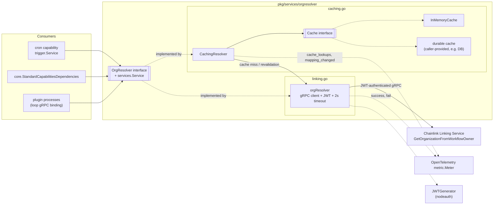
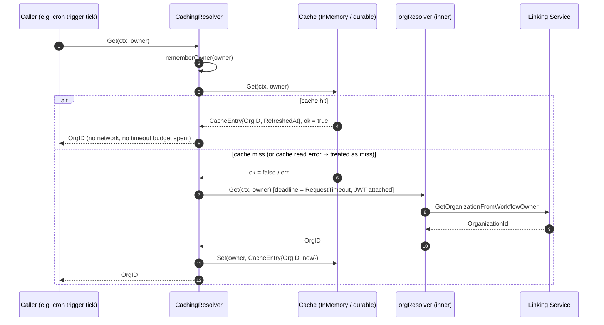
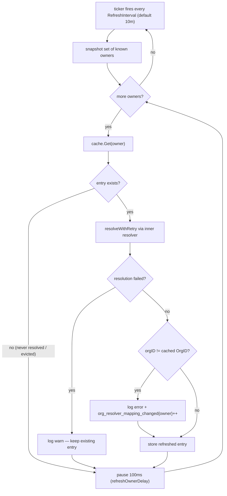
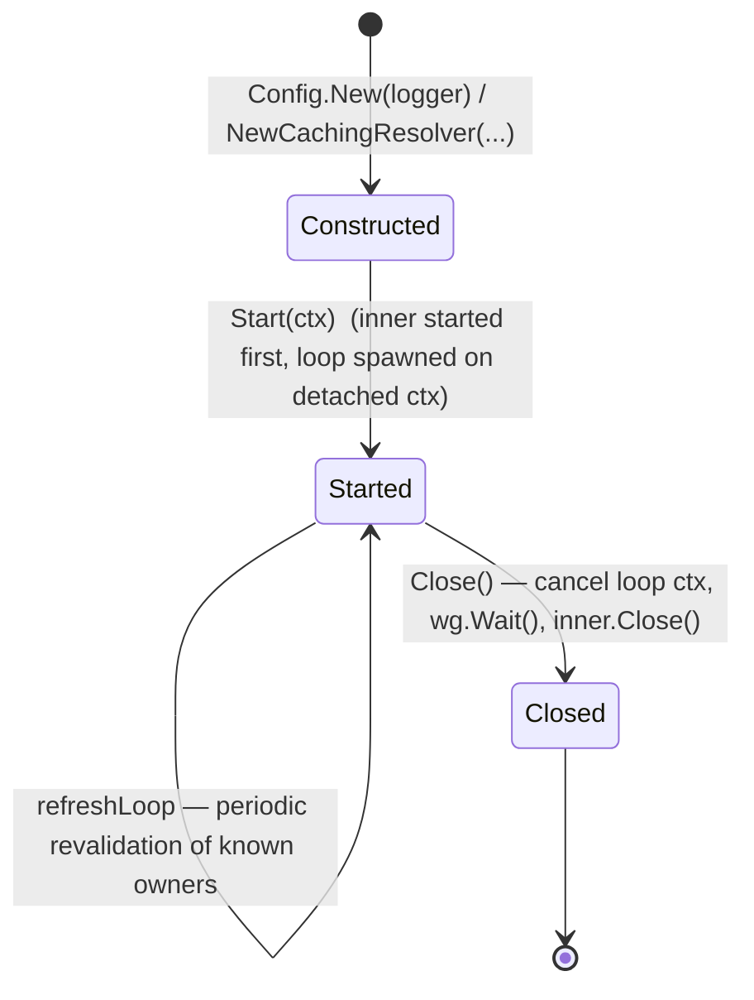

# Org Resolver (`chainlink-common/pkg/services/orgresolver`)

> **Parent:** [services](../services.md) · **Collection:** [Shared Foundation Libraries & Domain Types](../../Shared_Foundation_Libraries___Domain_Types.md)

## 1. Introduction

The `orgresolver` package provides a small, focused infrastructure service used across the Chainlink node and capability runtimes: it **resolves a workflow owner (an on-chain address) to the organization ID that owns that workflow**. Organization IDs are used for attribution — most notably attaching `organizationID` to trigger telemetry events and billing/metering records (see [metering-and-billing](../metering-and-billing.md)).

The package ships two layers:

| Layer | File | Purpose |
|---|---|---|
| `OrgResolver` interface + `orgResolver` implementation | `linking.go` | A thin gRPC client for the **Chainlink Linking Service** (`GetOrganizationFromWorkflowOwner`), authenticated via node JWT, with a hard per-call timeout. |
| `CachingResolver` + `Cache`/`InMemoryCache` | `caching.go` | A decorating resolver that adds a cache-aside layer with background revalidation, so hot capability code paths never block on the network after the first lookup of a given owner. |

Both layers implement the shared [services](../services.md) lifecycle contract (`services.Service`: `Start` / `Close` / `HealthReport` / `Ready` / `Name`), and both are instrumented with OpenTelemetry counters when a `metric.Meter` is supplied.

The module has deliberately **no Go-module dependencies beyond `chainlink-common`**; heavier wiring (which concrete owner registry, which org database) lives in the Linking Service, accessed over gRPC.

---

## 2. Where it fits in the system

```
Capability code (e.g. cron trigger)  ──►  OrgResolver (interface)
                                            │
                     ┌──────────────────────┴──────────────────────┐
                     ▼                                             ▼
             CachingResolver (caching.go)                orgResolver (linking.go)
             owner → orgID cache + refresh loop          gRPC client, JWT, 2s timeout
                     │                                             │
                     ▼                                             ▼
              Cache (InMemory / DB)                Linking Service (chainlink-protos)
```

Key consumers:

- **Cron capability** (`capabilities/cron/trigger/trigger.go`) — receives the resolver via `core.StandardCapabilitiesDependencies.OrgResolver` in `Initialise` and calls `Get` on every trigger tick to label `TriggerExecutionStarted` events with `KeyOrganizationID`. See [cron_capability](../../Workflow___Capability_Runtime_(CRE_Engine)/cron_capability.md).
- **Standard capabilities runtime** — the resolver is injected as part of the standard capabilities dependency bundle (`core.StandardCapabilitiesDependencies`), see [types-core](../types-core.md).
- **Plugin (Loop) processes** — an `OrgResolver` gRPC surface (`UnsafeOrgResolverServer` in `chainlink-common/pkg/loop/internal/pb/orgresolver_grpc.pb.go`) exposes the resolver to plugin subprocesses; see [loop-grpc-bindings](../../Plugin_Process_Framework_(Loop)/loop-grpc-bindings/loop-grpc-bindings_contract-io.md).

---

## 3. Core components

### 3.1 `OrgResolver` interface (`linking.go`)

```go
type OrgResolver interface {
    services.Service
    Get(ctx context.Context, owner string) (string, error)
}
```

- Embeds [`services.Service`](../services.md) — `Start`, `Close`, `HealthReport`, `Ready`, `Name`.
- `Get` maps a workflow owner address to an organization ID.

### 3.2 `orgResolver` implementation (`linking.go`)

A direct client for the Linking Service:

- **Transport** — `grpc.NewClient(cfg.URL)` with TLS (`TLSEnabled`) or insecure credentials. A pre-built `linkingclient.LinkingServiceClient` can be injected instead (used by tests and by callers that already own a connection); the URL is only required when no client is injected. The connection is created lazily-owned by the resolver and closed in `Close` **only when it was created internally**.
- **Request** — `GetOrganizationFromWorkflowOwner{WorkflowOwner, WorkflowRegistryAddress, ChainSelector}`, where the registry address/chain selector identify *which* workflow registry the owner is anchored to.
- **Auth** — when a `JWTGenerator` is configured (see [node-auth-jwt](../node-auth-jwt.md)), each request gets a signed JWT attached to the outgoing gRPC context as `Authorization: Bearer <token>` (`nodeauthgrpc.AuthorizationHeader` / `nodeauthgrpc.BearerPrefix`). JWT failure aborts the call before any network I/O.
- **Timeout** — every `Get` is bounded by `RequestTimeout` (default **2 s**, `defaultRequestTimeout`). The comment in the source is explicit: callers sit in capability hot paths, so a hung connection must not propagate.
- **Metrics** — `org_resolver_success` / `org_resolver_fail` `Int64Counter`s when a `Meter` is provided.
- **Lifecycle** — `Start`/`Ready` are no-ops (client creation happens at construction); `HealthReport` reports a healthy self-entry; `Close` closes the owned gRPC connection.

> ⚠️ `NewOrgResolver` and `NewOrgResolverWithClient` are **deprecated** (annotated `//go:fix inline`); use `Config.New(logger)` instead — the deprecated functions simply forward to it.

### 3.3 `CachingResolver` (`caching.go`)

Wraps *any* `OrgResolver` with a cache of `owner → CacheEntry{OrgID, RefreshedAt}`:

- **Trust model** — an owner's org mapping is assumed *immutable*. Once an entry is cached it is **trusted indefinitely** and returned immediately; `Get` never blocks on the underlying resolver for a cached owner.
- **Revalidation** — a single background goroutine (`refreshLoop`) started by `Start` wakes every `RefreshInterval` (default **10 min**, `defaultRefreshInterval`) and revalidates every owner *ever passed to `Get`* against the inner resolver. Failed revalidations are logged (warn) and the existing entry is kept; a detected **mapping change** is logged at error level and counted.
- **Hot-path protection** — the sweep processes owners one at a time with a `refreshOwnerDelay` (**100 ms**) pause between calls and honours context cancellation between owners, so revalidation never delays a `Get` or hammers the Linking Service.
- **Retry** — the first resolution of an owner (cache miss) retries retriable gRPC errors up to `maxGetRetries` (**3**) with exponential backoff (100 ms → 1 s, factor 2, `jpillora/backoff` + `pkg/utils/retry`). Retries use the caller's context, so caller cancellation wins.
- **Metrics** — `org_resolver_cache_lookups` (label `result=hit|miss|error`) and `org_resolver_mapping_changed` (label `owner`).
- **Lifecycle delegation** — `Ready`, `HealthReport`, `Name` forward to the inner resolver; `Start` starts the inner resolver first; `Close` cancels the loop context, waits for any in-flight sweep (`sync.WaitGroup`), then closes the inner resolver.

Implementation notes worth knowing when extending it:

- `rememberOwner` records every owner seen in a mutex-guarded set — this set drives the refresh sweep.
- `grpcStatusCode` extracts the `codes.Code` from arbitrarily wrapped errors (`fmt.Errorf("%w", …)`) using the generic `errorAs`/`unwrapErr` helpers, so retryability survives error wrapping.
- The refresh loop is given its **own detached context** (`context.WithCancel(context.Background())`) rather than the `Start` context, because the [services contract](../services.md) forbids retaining the start-up context after `Start` returns; it is cancelled explicitly in `Close`.

### 3.4 `Cache` abstraction

```go
type Cache interface {
    Get(ctx context.Context, owner string) (entry CacheEntry, ok bool, err error)
    Set(ctx context.Context, owner string, entry CacheEntry) error
}
```

- `InMemoryCache` — a mutex-guarded `map[string]CacheEntry`; context is ignored; `Set` never fails.
- Callers may supply any durable implementation (e.g. a DB-backed table) for deployments where a node restart should not repopulate the cache owner-by-owner. A cache read failure is treated as a **miss** (and tagged `result=error`), never as a fatal error.

### 3.5 Package constants

| Constant | Value | Meaning |
|---|---|---|
| `maxGetRetries` | 3 | Retry attempts per cache-miss resolution |
| `initialRetryBackoff` / `maxRetryBackoff` | 100 ms / 1 s | Exponential backoff bounds (factor 2) |
| `defaultRefreshInterval` | 10 min | Background revalidation period |
| `refreshOwnerDelay` | 100 ms | Pause between owners inside one sweep |
| `defaultRequestTimeout` | 2 s | Per-`Get` deadline in the inner resolver |

---

## 4. Architecture



---

## 5. Request flows

### 5.1 `Get` — cache hit vs. cache miss



On a cache miss the inner call is retried up to **3** times for retriable gRPC codes only; non-retriable errors (e.g. `NotFound`) and caller cancellation are surfaced immediately.

### 5.2 Background revalidation sweep



Every path above runs **outside** the caller's `Get`; a failed sweep leaves the cache untouched and serving.

### 5.3 Lifecycle



`Ready()` and `HealthReport()` always reflect the **inner** resolver, so a CachingResolver adds no failure modes of its own to health reporting.

---

## 6. Retry and error handling

| Condition | Behaviour |
|---|---|
| Retriable gRPC code (`Unavailable`, `DeadlineExceeded`, `ResourceExhausted`, `Aborted`, `Unknown`) | Retried up to 3 attempts with backoff 100 ms → 1 s (factor 2); retries stop early if the caller's context is cancelled |
| `NotFound` and other non-retriable codes | Returned immediately without retry |
| Retry budget exhausted | Returns `context.Cause(ctx)` if the context was cancelled, otherwise the unwrapped underlying error |
| JWT signing failure | `Get` fails fast (error log, no network call) |
| Cache read failure | Treated as a miss (`result=error` metric) — resolution proceeds |
| Cache write failure | Logged (warn) and ignored — the resolved value is still returned to the caller |
| Revalidation failure during a sweep | Logged (warn); existing entry kept and kept serving |
| Org mapping changed | Error-level log + `org_resolver_mapping_changed` counter; new value replaces the entry |

The retriable-code check uses `grpcStatusCode`, which walks wrapped error chains via a small generic `errors.As` replacement, so retry classification works through `fmt.Errorf("%w", …)` layers added by the caller or the gRPC stack.

---

## 7. Configuration reference

### 7.1 `orgresolver.Config` (inner resolver, `linking.go`)

| Field | Type | Required | Description |
|---|---|---|---|
| `URL` | `string` | When `Client` is nil | gRPC endpoint of the Linking Service |
| `TLSEnabled` | `bool` | No | Selects TLS vs. insecure transport credentials |
| `WorkflowRegistryAddress` | `string` | Yes (semantically) | Workflow registry contract address sent with every lookup |
| `WorkflowRegistryChainSelector` | `uint64` | Yes (semantically) | Chain selector of the registry |
| `JWTGenerator` | `JWTGenerator` | Optional | Signs requests; nil ⇒ unauthenticated calls |
| `RequestTimeout` | `time.Duration` | Optional | Per-`Get` deadline; `0` ⇒ 2 s |
| `Client` | `linkingclient.LinkingServiceClient` | Optional | Injected client (tests / shared connections) |
| `Meter` | `metric.Meter` | Optional | Enables `org_resolver_success` / `org_resolver_fail` |

### 7.2 `CachingResolverConfig` (`caching.go`)

| Field | Type | Required | Description |
|---|---|---|---|
| `Cache` | `Cache` | **Yes** (constructor errors if nil) | Backing store; pick `NewInMemoryCache()` or a durable implementation |
| `RefreshInterval` | `time.Duration` | Optional | Revalidation period; `<= 0` ⇒ 10 min |
| `Meter` | `metric.Meter` | Optional | Enables `org_resolver_cache_lookups` / `org_resolver_mapping_changed` |

### 7.3 Minimal wiring

```go
inner, err := orgresolver.Config{
    URL:                           lsURL,
    TLSEnabled:                    true,
    WorkflowRegistryAddress:       registryAddr,
    WorkflowRegistryChainSelector: chainSelector,
    JWTGenerator:                  jwtGen,
    Meter:                         meter,
}.New(logger)

resolver, err := orgresolver.NewCachingResolver(
    inner,
    orgresolver.CachingResolverConfig{
        Cache:           orgresolver.NewInMemoryCache(),
        RefreshInterval: 10 * time.Minute,
        Meter:           meter,
    },
    logger,
)

_ = resolver.Start(ctx)
defer resolver.Close()

orgID, err := resolver.Get(ctx, workflowOwner)
```

---

## 8. Observability

| Metric | Type | Source | Labels | Meaning |
|---|---|---|---|---|
| `org_resolver_success` | Int64Counter | inner resolver | — | Successful `GetOrganizationFromWorkflowOwner` calls |
| `org_resolver_fail` | Int64Counter | inner resolver | — | Failed inner calls |
| `org_resolver_cache_lookups` | Int64Counter | CachingResolver | `result=hit\|miss\|error` | Cache behaviour of the hot path |
| `org_resolver_mapping_changed` | Int64Counter | CachingResolver | `owner` | Detected owner→org mapping change (also logged at error level) |

Logging is standardised on [`pkg/logger`](../logger.md); both implementations name themselves (`CachingResolver`, `OrgResolver`) so `HealthReport` keys and log lines are stable. Runtime telemetry transport itself is out of scope here — see [beholder-telemetry](../../Telemetry___Observability_Platform/beholder-telemetry.md) / [monitoring](../../Telemetry___Observability_Platform/monitoring.md).

---

## 9. Integration with the capability runtime (worked example: cron)

The cron trigger capability shows the intended usage pattern (`capabilities/cron/trigger/trigger.go`):

1. **Injection** — `Initialise(ctx, dependencies core.StandardCapabilitiesDependencies)` stores `dependencies.OrgResolver`. The dependency is *optional*: a nil resolver logs a warning and the capability keeps firing triggers without org attribution. Tests inject `MockOrgResolver` (mockery).
2. **Deferred resolution** — on each trigger tick, org resolution happens **after** trigger-event emission bookkeeping. The source comments this explicitly: org lookup and event emission "can involve slow network calls … that must not delay the actual trigger or the next scheduled run."
3. **Defensive call** — the `Get` call is wrapped in a panic-recovering closure; failures are logged at warn level and never block the trigger.
4. **Attribution** — the resolved value is attached to the `TriggerExecutionStarted` event via `events.KeyOrganizationID`, feeding downstream billing/attribution (see [metering-and-billing](../metering-and-billing.md)).

This pattern (optional dependency + non-blocking best-effort resolution + event attribution) is the recommended template for other capabilities.

---

## 10. Plugin boundary (Loop)

For plugin subprocesses, the resolver crosses the process boundary via the Loop gRPC surface `chainlink-common/pkg/loop/internal/pb/orgresolver_grpc.pb.go` (`UnsafeOrgResolverServer`), listed with the other contract-I/O bindings in [loop-grpc-bindings](../../Plugin_Process_Framework_(Loop)/loop-grpc-bindings/loop-grpc-bindings_contract-io.md). The generated protobufs are rebuilt with `make generate` / `cre-protoc` in `chainlink-common/Makefile` (see [build-and-repo-tooling](../../Build,_CI___Release_Infrastructure/build-and-repo-tooling.md)).

---

## 11. Testing

- **Inner resolver** — inject `Client: <fake LinkingServiceClient>` via `Config` to avoid gRPC dialling; `NewOrgResolverWithClient` (deprecated) does the same.
- **CachingResolver** — pass a stub `Cache` and/or a stub inner `OrgResolver` (it only needs `Get` + `services.Service`). The in-repo gRPC-status error types (`grpcStatus`) are mirrored in the package's own tests.
- **Lifecycle** — both implementations satisfy `services.Service`, so [`servicetest.Run`](services_servicetest.md) can drive Start/Close in tests.
- **Consumers** — `capabilities/cron/trigger/trigger_test.go` defines `MockOrgResolver` (mockery) used to verify attribution behaviour.

---

## 12. Design decisions & gotchas

1. **Immutable-mapping assumption.** Cached entries are served forever without blocking. If an org mapping *does* change, correctness depends on the 10-minute sweep detecting it — the change is loudly logged and counted, but the stale value keeps serving until the sweep succeeds.
2. **`Get` is latency-bounded, not failure-free.** A cold owner pays up to 2 s (inner timeout) × 3 retries only when the inner call keeps failing with retriable codes; callers in hot paths should treat `Get` errors as best-effort (as the cron capability does).
3. **Detached refresh-loop context.** The loop does not inherit the `Start` context (per the services contract) and is cancelled in `Close`; `Close` also waits for an in-flight sweep before closing the inner resolver, so it is safe to stop the process mid-sweep.
4. **Client ownership.** The gRPC connection is closed on `Close` only when the resolver created it; an injected `Client` is not owned.
5. **Durable cache option.** `Cache` is an interface precisely so multi-tenant or frequently-restarting deployments can avoid repopulating owner-by-owner at startup cost — but note the revalidation sweep always hits the Linking Service once per known owner per interval regardless of cache durability.

---

## 13. Related documentation

- [services](../services.md) — parent module: shared service framework and lifecycle conventions.
- [services_servicetest](services_servicetest.md) — `servicetest.Run` helper for lifecycle tests.
- [types-core](../types-core.md) — `core.StandardCapabilitiesDependencies` and other core interfaces the resolver is wired through.
- [node-auth-jwt](../node-auth-jwt.md) — JWT generation used to authenticate Linking Service calls.
- [logger](../logger.md) — logging configuration shared by both implementations.
- [cron_capability](../../Workflow___Capability_Runtime_(CRE_Engine)/cron_capability.md) and [capabilities_core](../../Workflow___Capability_Runtime_(CRE_Engine)/capabilities/capabilities_core.md) — primary capability-runtime consumers.
- [metering-and-billing](../metering-and-billing.md) — downstream consumer of the org attribution data.
- [loop-grpc-bindings](../../Plugin_Process_Framework_(Loop)/loop-grpc-bindings/loop-grpc-bindings_contract-io.md) — gRPC surface exposing the resolver to plugin processes.
