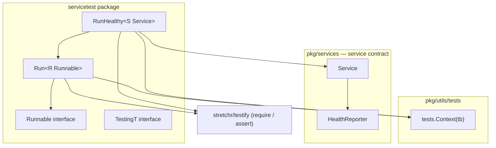
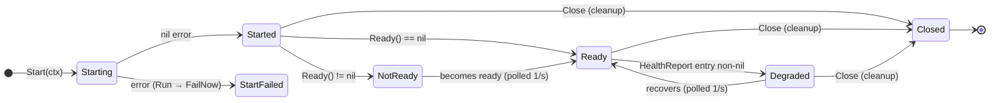
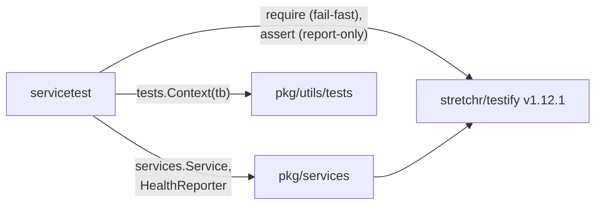
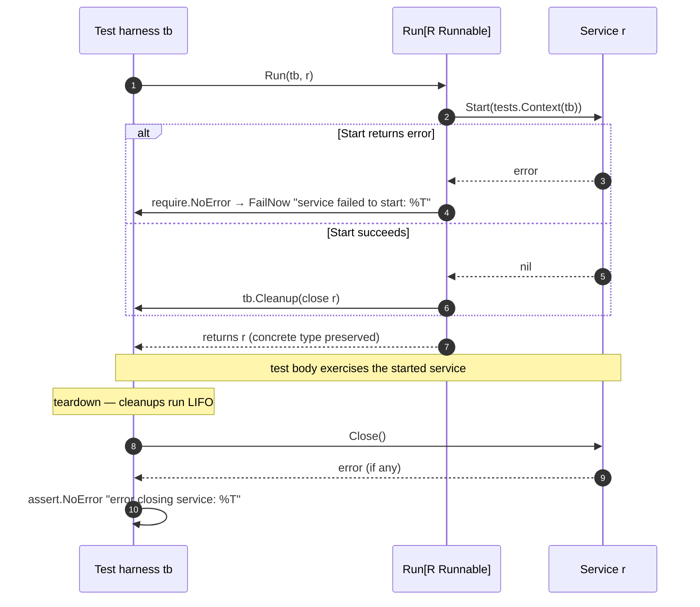
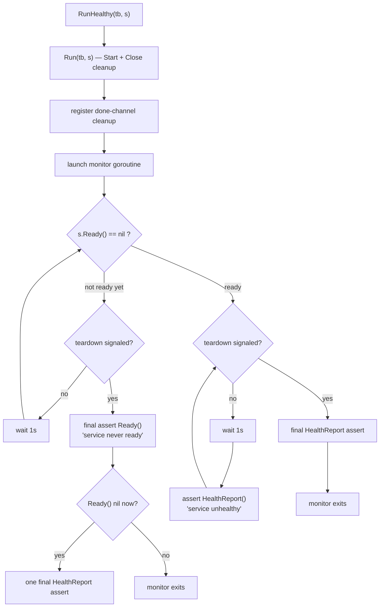
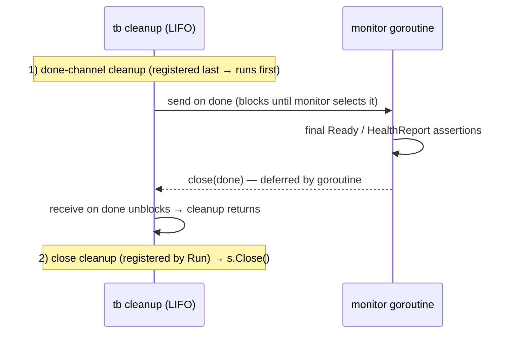
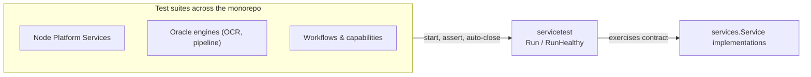

# Services Test Helpers (`servicetest`)

> **Package:** `github.com/smartcontractkit/chainlink-common/pkg/services/servicetest`
> **Parent module group:** [Services (`pkg/services`)](../services.md)

## Introduction

`servicetest` is a small test-support library that standardizes how chainlink tests **start, observe, and stop** service implementations. Instead of every test package hand-rolling `Start`/`Close`/cleanup boilerplate (and forgetting to close services on failure paths), tests call two generic helpers:

- **`Run`** — starts a service, registers a `tb.Cleanup` that closes it, and fails the test if either operation errors.
- **`RunHealthy`** — does everything `Run` does, and additionally **continuously asserts** that the service becomes ready and stays healthy (via `Ready()` and `HealthReport()` polling) for the duration of the test.

Because nearly every long-lived component in the node implements the `services.Service` contract, this module is one of the most widely shared test dependencies in the monorepo — from [Node Platform Services](../../Node_Platform_Services.md) (job spawner, keystore, feeds, gateway) to [Oracle Engines](../../Oracle_Engines___Data_Pipelines.md) and the [Workflow/Capability Runtime (CRE)](<../../Workflow___Capability_Runtime_(CRE_Engine).md>).

### At a glance

| Aspect | Detail |
|---|---|
| Module | `github.com/smartcontractkit/chainlink-common` (`chainlink-common/go.mod`) |
| Type | Go test helper library (no runtime footprint — test-only) |
| Core files | `run.go` (helpers + contracts), `run_test.go` (self-tests) |
| Companion files | `health.go` (health-report assertions), `mock.go` (mocked-service setup) |
| Key dependencies | `pkg/services` (service contract), `pkg/utils/tests` (test context), `stretchr/testify` v1.12.1 |

---

## Architecture



### Core API (run.go)

| Export | Kind | Purpose |
|---|---|---|
| `Runnable` | interface | Minimal lifecycle contract: `Start(context.Context) error` and `Close() error`. Lets `Run` work with anything startable/stoppable, even types that do not implement the full `services.Service`. |
| `TestingT` | interface | Test-harness abstraction: embeds testify's `require.TestingT` (`Errorf`, `FailNow`) and adds `Helper()` and `Cleanup(func())`. Satisfied by `*testing.T` and by the package's own `fakeTest`. |
| `Run[R Runnable]` | generic function | Starts `r` with a test-scoped context, registers cleanup to close it, fails `tb` on start or close errors. Returns `R` unchanged so callers keep the concrete type. |
| `RunHealthy[S services.Service]` | generic function | `Run` + a background monitor goroutine that polls `Ready()` and `HealthReport()` every second and fails `tb` if the service is never ready or is ever unhealthy. |

### Package companions

The package also ships two small conveniences used alongside `Run`/`RunHealthy` (defined outside the module tree's core components, so they are only summarized here):

- **`health.go::AssertHealthReportNames`** — asserts that a `HealthReport()` map contains *exactly* an expected set of keys (sorted comparison). Useful for pinning which sub-services report into the aggregated health map.
- **`mock.go`** — `Mock` (a `services.Service` plus testify's `On`/`String`) and `SetupNoOpMock`, which registers `.Maybe()` no-op expectations for `Start`, `Close`, `Name`, `Ready`, and `HealthReport` so generated service mocks can be passed straight into `Run`/`RunHealthy`.

---

## The service contract it exercises

`RunHealthy` operates on `services.Service`, which composes lifecycle methods with the `HealthReporter` interface (`Ready`, `HealthReport`, `Name`). For the parallel, structurally-equivalent domain interface `types.Service` (which plugin providers implement), see [types-core: Providers](../types-core/types-core_providers.md) — the two are Go-structurally compatible, so the same helpers work for both.



Contract invariants enforced or relied upon by the helpers (from `pkg/services/service.go`):

- `Start` must return promptly when the context is cancelled and must not block on external resources — this is why `Run` passes a **test-scoped context** rather than `context.Background()`.
- `Close` is terminal; a service is generally not restartable afterwards, which is why `Run` closes it exactly once, during cleanup.
- `HealthReport` must be cheap — that is what makes the 1-second health polling in `RunHealthy` safe.

---

## Dependency model



- **`pkg/services`** — defines `Service` and `HealthReporter` (see [Services module](../services.md) and the sibling [OrgResolver](services_orgresolver.md) implementation in the same group).
- **`pkg/utils/tests`** — `Context(tb TestingT)` yields a context that is cancelled when the test finishes. It is implemented via build tags: `ctx.go` (`!go1.24`) always builds the context, while `ctx_go124.go` (`go1.24`) prefers `tb.Context()` when the harness implements `interface{ Context() context.Context }` (as `*testing.T` does since Go 1.24). With the current toolchain (`go 1.27.1` in `chainlink-common/go.mod`), the go1.24+ variant is active; it is marked deprecated in favor of `*testing.T.Context`.
- **`stretchr/testify`** — `require` for fail-fast start assertions, `assert` for report-only close/health assertions (see [assertion semantics](#assertion-semantics)). Declared as a direct dependency of `chainlink-common` in `chainlink-common/go.mod`.

---

## Process flows

### `Run` — start / test / close lifecycle



Design points:

1. **Generics preserve typing.** `Run` returns the same `R` it was given, so tests can call concrete methods without type assertions.
2. **Fail fast on start, report on close.** Start failure aborts the test immediately (`require`); a close error is recorded (`assert`) but does not break the rest of teardown, so cascading failures remain visible without masking the original test failure.
3. **Cleanup-based closure.** The service is closed exactly once, after the test body — including when assertions in the test body fail.

### `RunHealthy` — readiness & health monitoring

After delegating to `Run`, `RunHealthy` spawns a monitor goroutine that runs in two phases:



Semantics (as documented in `run.go`):

- Readiness is checked **at least once** before closing — if teardown begins before the service is ever ready, the monitor performs one final `Ready()` assertion (`"service never ready"`), and only checks health if the service became ready just in time.
- Once ready, the `HealthReport()` is checked **every second** and **at least once** before closing (`"service unhealthy"`). Individual report errors are keyed and joined: `fmt.Errorf("%s: %w", k, v)` collected via `errors.Join`, so a degraded dependency is named in the failure output.
- Both polls use a fixed **1-second interval**.

### Teardown choreography (why health checks run before `Close`)

`RunHealthy` registers a synchronization cleanup *after* `Run` registered the close cleanup. Since `tb.Cleanup` runs **LIFO**, the health monitor finishes before the service is closed — the final assertions always observe a still-running service:



The unbuffered `done` channel therefore provides a rendezvous: the harness cannot finish teardown until the monitor goroutine has completed its final assertions, eliminating a race between health polling and test exit.

### Assertion semantics

| Step | Style | On failure | Message |
|---|---|---|---|
| `Start` | `require.NoError` | **FailNow** — aborts the test immediately | `service failed to start: %T` |
| `Close` | `assert.NoError` | records failure, teardown continues | `error closing service: %T` |
| `Ready` (final check) | `assert.NoError` | records failure | `service never ready` |
| `HealthReport` (periodic + final) | `assert.NoError` | records failure | `service unhealthy` |

---

## Self-testing: `run_test.go` and `fakeTest`

The helpers themselves are tested **without** the standard `testing` package, using the module's own `TestingT` abstraction:

- **`fakeTest`** (core component of `run_test.go`) implements `TestingT` — it collects `Errorf` messages, sets a `failed` flag, implements `FailNow()` as a one-shot panic with the sentinel `failNow{}`, records `Cleanup` functions, and provides `Helper()` (no-op) and `Context()` (returns `context.Background()`, which also satisfies the optional `Context()` probe used by `tests.Context` under the go1.24+ build tag).
- **`runFake`** executes a test function against a `fakeTest`, then drains cleanups in reverse (LIFO) order and recovers the `failNow` panic — faithfully reproducing the `*testing.T` semantics the helpers depend on.
- **`fakeService`** implements the full `services.Service` with injectable faults, letting a single table-driven test (`TestRunHealthy`) cover every failure mode:

| Case | Injected fault | Expected outcome |
|---|---|---|
| healthy | none | passes |
| start | `Start` returns error | test fails (`"service failed to start"`) |
| close | `Close` returns error | test fails (`"error closing service"`) |
| unready | `Ready` returns error | test fails (`"service never ready"`) |
| unhealthy | `HealthReport` returns `{"foo.bar": err}` | test fails (`"service unhealthy"`) |

This is also a reference implementation for anyone who needs to run these helpers inside a custom test harness.

---

## Usage

Typical patterns (illustrative):

```go
import (
    "testing"

    "github.com/smartcontractkit/chainlink-common/pkg/services/servicetest"
)

func TestMyService(t *testing.T) {
    svc := NewMyService(cfg)

    // Simple: start + guaranteed Close; fails the test if either errors.
    _ = servicetest.Run(t, svc)

    // Or: start + guarantee Close + assert readiness and continuous health.
    healthy := servicetest.RunHealthy(t, svc)

    // Optionally pin exactly which sub-services appear in the aggregated report.
    servicetest.AssertHealthReportNames(t, healthy.HealthReport(),
        "myService", "myService.db")
}

func TestWithMockedService(t *testing.T) {
    mock := NewMyServiceMock(t)
    servicetest.SetupNoOpMock(mock) // Start/Close/Name/Ready/HealthReport → no-ops
    _ = servicetest.RunHealthy(t, mock)
}
```

Guidance:

- Prefer `RunHealthy` for production services: it catches services that never become ready (deadlocks in `Start`) and *silent* degradation (a service that keeps running with a broken dependency) — failure modes a plain `Run` cannot see.
- Reach for `Run` when the type only implements start/stop (satisfies `Runnable` but not `HealthReporter`), or when health polling is irrelevant to the test.
- Avoid calling `Close` manually in tests that use these helpers; double-close on a non-restartable service would surface as a close error during cleanup.

---

## Role in the system

`servicetest` is the shared lifecycle-testing idiom for every subsystem that produces `services.Service` implementations:

- **Node Platform Services** — job spawner, keystore master, feeds service, gateway connector, registry syncer, etc. (see [Node Platform Services](../../Node_Platform_Services.md)).
- **Oracle Engines & Data Pipelines** — OCR/OCR2 delegates, pipeline runner, streams (see [Oracle Engines](../../Oracle_Engines___Data_Pipelines.md)).
- **Workflow / Capability Runtime** — workflow syncers, engines, and capability services (see [Workflow & Capability Runtime (CRE Engine)](<../../Workflow___Capability_Runtime_(CRE_Engine).md>)).

It belongs to the `pkg/services` group alongside the production [OrgResolver](services_orgresolver.md) service, and complements the domain interfaces in [types-core](../types-core/types-core_providers.md): the `RunHealthy` monitor effectively unit-tests conformance to the `Service`/`HealthReporter` contract at the boundary of every subsystem.



---

## Build & test context

- The package lives in the `github.com/smartcontractkit/chainlink-common` Go module (`chainlink-common/go.mod`); `stretchr/testify v1.12.1` is a direct dependency there.
- The Go toolchain directive is `go 1.27.1`, so the `go1.24` build-tag variant of `tests.Context` is the active one (see [Dependency model](#dependency-model)).
- Build automation for the module (lint, generate, mockery targets used by sibling packages such as `mock.go`-generated mocks) is described in [Build & Repo Tooling](../../Build,_CI___Release_Infrastructure/build-and-repo-tooling.md).

## References

| Topic | Where |
|---|---|
| Services package group (parent) | [Services (`pkg/services`)](../services.md) |
| Sibling production service: OrgResolver | [OrgResolver](services_orgresolver.md) |
| `types.Service` / provider contracts | [types-core: Providers](../types-core/types-core_providers.md) |
| Plugin-service interfaces (`ErrorLog`, `PipelineRunner`, …) | [types-core: Plugin Services](../types-core/types-core_plugin-services.md) |
| Node Platform Services consumers | [Node Platform Services](../../Node_Platform_Services.md) |
| Oracle engine consumers | [Oracle Engines & Data Pipelines](../../Oracle_Engines___Data_Pipelines.md) |
| CRE consumers | [Workflow & Capability Runtime (CRE Engine)](<../../Workflow___Capability_Runtime_(CRE_Engine).md>) |
| Module build tooling | [Build & Repo Tooling](../../Build,_CI___Release_Infrastructure/build-and-repo-tooling.md) |
