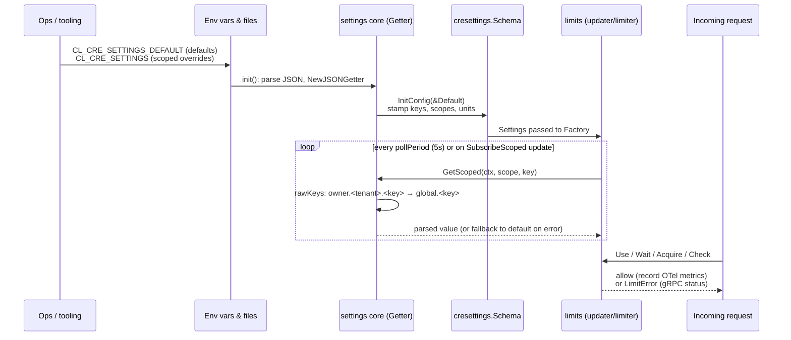

# Settings

> **Module path:** `github.com/smartcontractkit/chainlink-common/pkg/settings` (plus `cresettings/` and `limits/` sub-packages)
>
> **Module tree:** [Shared Foundation Libraries & Domain Types](../Shared_Foundation_Libraries___Domain_Types.md)

## Purpose

The **settings** module provides the Chainlink Runtime Environment (CRE) with a *multi-tenant, dynamically-updatable configuration and enforcement framework*. It answers two questions for every node subsystem:

1. **"What is the configured value?"** — a typed, scope-aware settings framework (`Setting[T]`) that resolves values from compiled-in defaults, environment variables, and scoped (org / owner / workflow) override documents.
2. **"Is this request allowed?"** — a limiter toolkit (`limits`) that turns those settings into runtime *rate limits, resource pools, timeouts, bounds, ranges, queues, and gates*, with consistent errors and OpenTelemetry metrics.

The module is deliberately dependency-light and sits at the bottom of the library stack: oracle engines, the workflow runtime, gateways, and capabilities all read their operational limits from here. This is what makes limits **hot-adjustable in production without redeploying nodes** — a flipped setting or a new scoped override propagates into live limiters within a polling interval.

## Architecture Overview

The module is composed of three cooperating sub-packages:

| Sub-package | Responsibility | Documentation |
|---|---|---|
| `settings` (core framework) | Typed `Setting[T]` definitions, scope resolution, key initialization, JSON/TOML getters | [settings_core_framework](settings/settings_core_framework.md) |
| `settings/cresettings` | The concrete CRE node settings schema (`Schema`), its defaults, and env-var bootstrap | [settings_cre_schema](settings/settings_cre_schema.md) |
| `settings/limits` | Runtime limit enforcement (rate, resource, time, bound, range, queue, gate) with metrics and dynamic updates | [settings_limits](settings/settings_limits.md) |

```mermaid
flowchart TB
    subgraph ENV["Deployment / Environment"]
        EV["Env vars<br/>CL_CRE_SETTINGS_DEFAULT<br/>CL_CRE_SETTINGS"]
        OVR["Scoped override files<br/>(global.json, org/*.json, owner/*.json, workflow/*.json)"]
    end

    subgraph CORE["settings (core framework)"]
        INIT["InitConfig<br/>(reflection-based key wiring)"]
        SET["Setting&#91;T&#93;<br/>Key · Default · Scope · Parse · Unit"]
        SC["Scope<br/>Global / Org / Owner / Workflow"]
        GT["Getter / Registry<br/>(JSON · TOML)"]
    end

    subgraph SCHEMA["cresettings (CRE schema)"]
        SCH["Schema<br/>gateway · dispatcher · trigger ·<br/>WASM · vault · confidential-compute ·<br/>PerOrg / PerOwner / PerWorkflow"]
    end

    subgraph LIMITS["limits (enforcement)"]
        LIM["Limiter&#91;N&#93; family<br/>Rate · ResourcePool · Time ·<br/>Bound · Range · Queue · Gate"]
        UPD["updater<br/>(poll/subscribe loop)"]
        MET["OTel gauges &amp; histograms<br/>(scoped attributes)"]
        ERR["LimitError hierarchy<br/>(gRPC status mapping)"]
    end

    subgraph CONSUMERS["Consumers (elsewhere in the codebase)"]
        GW["Gateway / dispatcher<br/>(Node_Platform_Services)"]
        CRE["Workflow &amp; capability runtime<br/>(Workflow/CRE Engine)"]
        CAP["Capabilities (cron, http, chain)"]
    end

    EV -->|"bootstrap defaults"| CORE
    OVR -->|"NewJSONGetter / TOML getter"| GT
    CORE <-->|"initSetting keys"| SCHEMA
    SCH -->|"Setting fields"| LIMITS
    GT -->|"GetScoped / SubscribeScoped"| LIM
    UPD -->|"dynamic limit refresh"| LIM
    MET --> LIM
    LIM --> ERR
    LIM -->|"enforce limits"| CONSUMERS
```

### Design principles

- **Typed settings, string transport.** A `Setting[T]` pairs a fully-qualified key with a default value and a `Parse func(string) (T, error)`. Values travel as strings (env, JSON, TOML) and are parsed at the edge, so any backend can serve any setting. See [settings_core_framework](settings/settings_core_framework.md).
- **Hierarchical scoping.** Every setting declares a `Scope` (`global` → `org` → `owner` → `workflow`). Lookups build priority-ordered keys such as `owner.0xabcd.PerWorkflow.WASMConfigSizeLimit` and fall back to `global.<key>`, reading the tenant identifiers from the CRE request context.
- **Defaults are safe by construction.** Schemas ship compiled-in defaults; if the settings service is degraded, limiters **fail open to the default** so work is never dropped for advisory read errors — except when a required tenant is missing entirely (`ErrMissingTenant`), which signals a programming error.
- **Enforcement is uniform.** All limiters share one `Limiter[N]` contract, one error hierarchy mapped onto gRPC codes (`ResourceExhausted`, `DeadlineExceeded`, `PermissionDenied`), and one metrics convention (gauges for `limit`/`usage`, histograms for `block_time`/`amount`/`denied`).

## Sub-modules

Generated sub-module pages (detailed documentation):

- [`settings/settings_core_framework.md`](settings/settings_core_framework.md) — typed `Setting[T]` framework, scopes, keys, getters
- [`settings/settings_cre_schema.md`](settings/settings_cre_schema.md) — the CRE node settings schema and bootstrap
- [`settings/settings_limits.md`](settings/settings_limits.md) — runtime limit enforcement toolkit

### 1. Core settings framework — [`settings_core_framework`](settings/settings_core_framework.md)

The foundation package that everything else builds on. Core components:

- **`Setting[T]`** (`IsSetting` / `SettingSpec` interfaces) — a key + default + scope + parser + unit. Provides `GetOrDefault(ctx, Getter)` and `Subscribe(ctx, Registry)` (updates pushed over a channel and parsed per type).
- **`InitConfig`** with the internal **`keySetter`** contract — walks any settings struct via reflection and stamps every `Setting` field with its dot-separated, fully-qualified key, the enclosing `scope:` tag, and its `unit:` tag. This is how `cresettings.Schema` gets wired at package init.
- **Scope system** (`Scope`, `ParseScope`, `Scope.Value(ctx)`, `RoundCRE`, `IsTenantRequired`) — resolves tenants from `pkg/contexts` CRE values.
- **Key resolution** (`rawKeys`) — builds the decreasing-priority key list per scope and reports `tenantMissingError`.
- **Getters** — `NewJSONGetter` / `NewTOMLGetter` (static, file/env-backed) plus `CombineJSONFiles` for the `global.json` + `org|owner|workflow/*.json` layout.

### 2. CRE settings schema — [`settings_cre_schema`](settings/settings_cre_schema.md)

The concrete, node-wide settings schema for CRE nodes (`cresettings.Schema`), covering:

- **Global node settings** — workflow limits, gateway payload size limits, dispatcher and gateway rate limits, central trigger queue capacity, base-trigger retry policies, WASM poll-oneoff subscription bound.
- **Scoped groups** — `PerOrg`, `PerOwner`, and `PerWorkflow` sections (trigger queues, execution concurrency/timeouts, WASM memory & size limits, log limits, user metrics, chain read/write limits per chain family, consensus/HTTP-action/confidential-HTTP limits, DON time).
- **Vault OCR plugin limits** — ciphertext/share/identifier size limits, batch and queue caps, report and blob size accounting (with documented capacity math and upgrade-safety warnings).
- **Confidential Compute (San Marino)** settings — enclave request timeouts, relay response caches, public-key caches, sticky sessions, per-owner rates.
- **Feature-flag time windows** — `Feature*ActivePeriod` timestamp ranges that stage rollouts per capability (e.g. new HTTP-trigger execution IDs, hash-based OCR, workflow-tag request hashing).
- **Env-var bootstrap** — `CL_CRE_SETTINGS_DEFAULT` (defaults) and `CL_CRE_SETTINGS` (scoped overrides JSON → `DefaultGetter`), applied in `init()`.

### 3. Limits enforcement toolkit — [`settings_limits`](settings/settings_limits.md)

The enforcement layer that binds `Setting` values onto live request handling:

- **`Limiter[N]` contract** — `Limit(ctx) (N, error)` plus `io.Closer`; limiters spawn background goroutines, so `TryCleanup` releases per-context state.
- **Limiter family** — `RateLimiter`, `ResourceLimiter` / `ResourcePoolLimiter` (FIFO waiter queue, `Use`/`Free`/`Wait` semantics), `TimeLimiter`, `BoundLimiter`, `RangeLimiter`, `QueueLimiter`, and feature **Gates**; scoped variants (`OrgResourcePoolLimiter`, `OwnerResourcePoolLimiter`, `WorkflowResourcePoolLimiter`) keep per-tenant state, plus `MultiResourcePoolLimiter` composition and unlimited no-op implementations.
- **Dynamic updates** — the internal `updater` polls the `Getter` (default period 5s) or subscribes via a `Registry`, and a `Factory` wires logger, OTel meter, and settings service.
- **Metrics** — `gauge`/`histogram` recorders with scope-derived OTel attributes.
- **Error taxonomy** — the `LimitError` interface with `ErrorRateLimited`, `ErrorResourceLimited`, `ErrorTimeLimited`, `ErrorBoundLimited`, `ErrorRangeLimited`, `ErrorQueueFull`, `ErrorNotAllowed`, each mapped to a gRPC status; `IsErrRecoverable` distinguishes advisory failures (fall back to default) from `ErrMissingTenant`.

## How settings flow through the system

**Fail-open vs fail-closed.** If a settings read fails, `IsErrRecoverable` treats it as advisory: limiters enforce the last-known/compiled default so a degraded settings backend never halts traffic. Only `ErrMissingTenant` — a required CRE context tenant absent — is fatal, because no meaningful limit could be selected.

## Relationship to other modules

- **[types-core](types-core.md)** defines the service-level settings surface used by plugin processes: `SettingsBroadcasterLocal` and `SettingsUpdate` in `chainlink-common/pkg/types/core/settings.go`. Plugins receive settings broadcast over the [Plugin (Loop) process framework](../Plugin_Process_Framework_(Loop).md), backed by this module's Getter/Registry machinery.
- **[config-validation](config-validation.md)** and the **[x-config-framework](x-config-framework.md)** provide node *bootstrap* configuration (TOML docs, CLI binding, validation). This module complements them: bootstrap config starts the node, *settings* adjust runtime behavior continuously.
- **[logger](logger.md)** and **[services](services.md)** supply the logger and lifecycle primitives (StopChans, wait groups) that limiters and getters depend on.
- **[Telemetry & Observability Platform](../Telemetry___Observability_Platform.md)** consumes the OTel gauges/histograms that limiters emit (scoped by org/owner/workflow attributes).
- Enforcement consumers live across the platform: the gateway and dispatcher ([Node Platform Services](../Node_Platform_Services.md)), the workflow engine and central trigger queue ([Workflow & Capability Runtime (CRE Engine)](../Workflow___Capability_Runtime_(CRE_Engine).md)), and capability implementations (cron, HTTP, chain writers) all read their limits from `cresettings` and enforce them with this module's limiters.

## Key takeaways for maintainers

1. **Adding a new setting**: declare a `Setting[T]` field in the appropriate schema struct (global, `PerOrg`, `PerOwner`, or `PerWorkflow`), give it a default, and — if needed — a `unit:` tag. `InitConfig` handles key wiring; enforcement code reads it via `GetOrDefault` or subscribes via `Setting.Subscribe`.
2. **Changing vault-related defaults is dangerous** — they act as defaults for the Vault OCR plugin, and nodes applying old/new values inconsistently across an image upgrade can misbehave. Override on-chain configuration first (see the `DANGER` notes in the schema).
3. **Scopes require context.** Enforcement only works when request contexts carry CRE tenant values (`contexts.WithCRE`); the limits package fails closed with `ErrMissingTenant` for required scopes and fails open (unlimited) only when a scope marks tenants as optional (org).
4. **Feature rollouts use time windows.** `Feature*ActivePeriod` settings are `Range[Timestamp]` values: a window covering "now" enables a feature for consensus-hash-sensitive behavior changes; far-future windows keep them off, enabling synchronized, operator-controlled rollouts across a DON.
