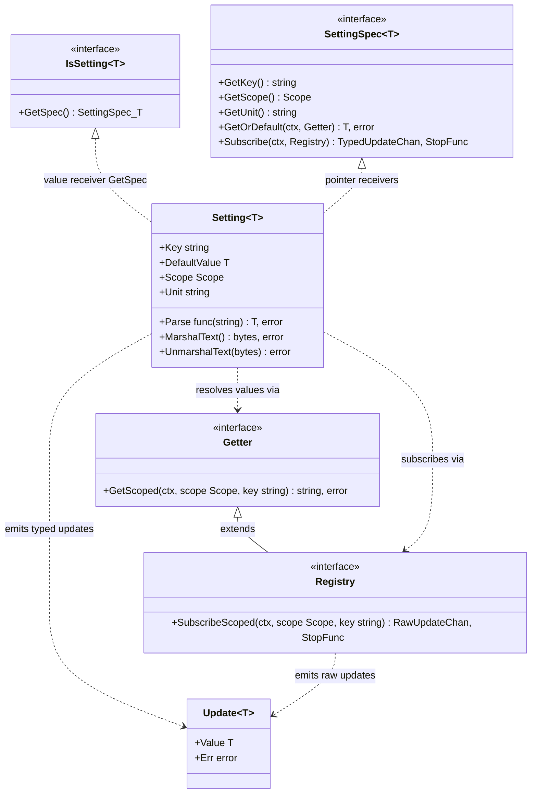
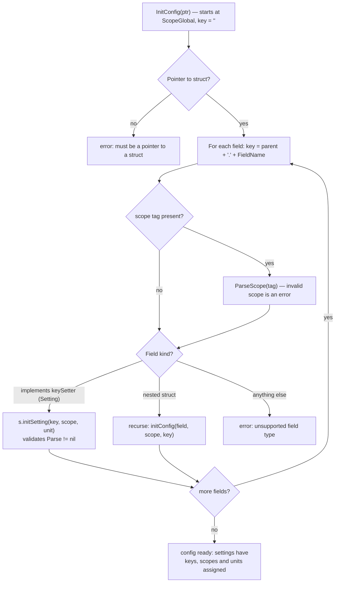
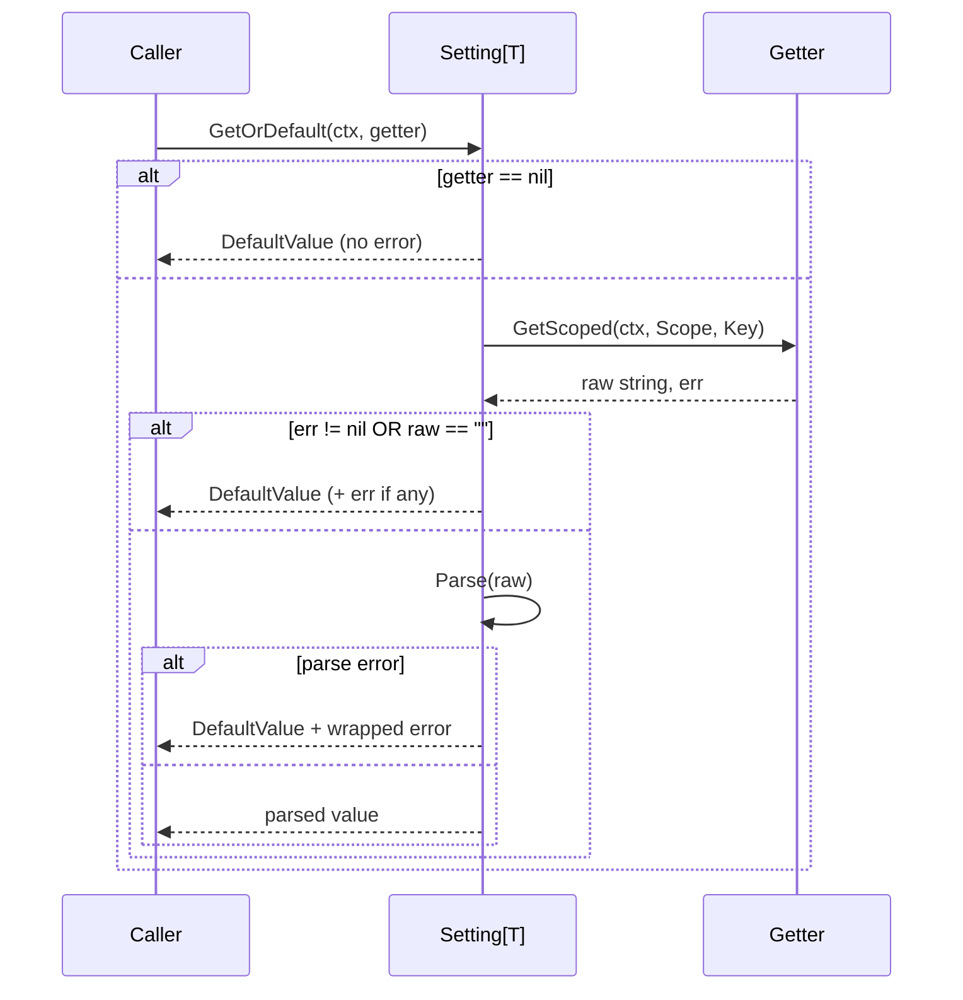
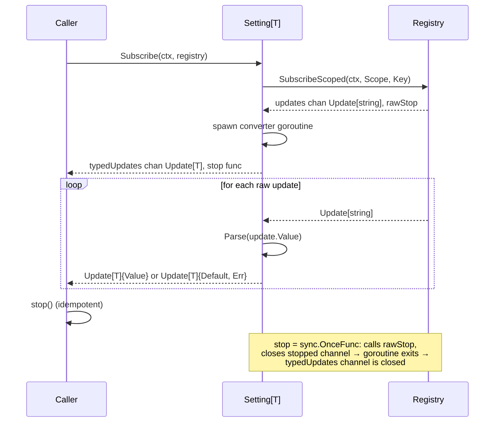
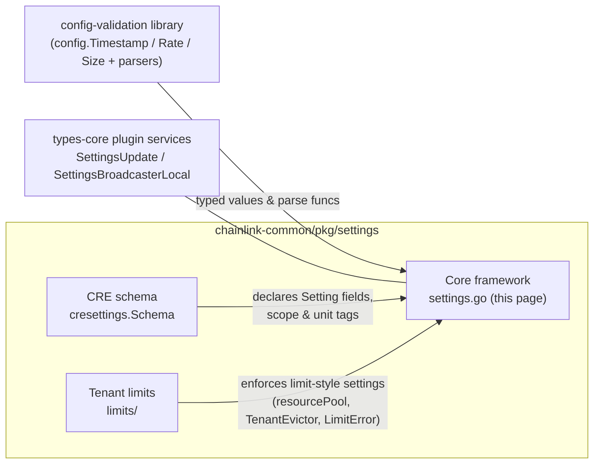

# Settings Core Framework

> **Module**: `github.com/smartcontractkit/chainlink-common/pkg/settings` (package `settings`, module `chainlink-common`, see [`chainlink-common/go.mod`](../../../repo/chainlink-common/go.mod))
> **Core components**: [`IsSetting`](#isettingt), [`keySetter`](#keysetter) — `chainlink-common/pkg/settings/settings.go`
> **Group**: [Shared Foundation Libraries & Domain Types](../../Shared_Foundation_Libraries___Domain_Types.md) → [settings](../settings.md)

## 1. Overview

The **settings core framework** is the small, generic engine that powers dynamic, typed, *tenant-scoped* configuration across the Chainlink node and CRE (Chainlink Runtime Environment) platform. Instead of passing raw `map[string]string` config around, components declare **typed settings** as Go struct fields (`Setting[bool]`, `Setting[int]`, `Setting[config.Rate]`, …). Each setting carries:

- a **key** (auto-derived from its struct path by `InitConfig`),
- a **default value** used when nothing is configured,
- a **scope** (global / org / owner / workflow …) controlling where overrides may come from,
- a **unit annotation** (e.g. `{request}`, `rps`, `By`) for documentation and alerting,
- a **parse function** converting raw string values into the typed value.

The framework intentionally separates *what a setting is* (`Setting[T]`, a pure value type) from *where values come from* (`Getter`) and *how updates are pushed* (`Registry`). Backing implementations (environment variables, databases, remote config services) only need to implement `Getter`/`Registry`; all parsing, defaulting, and typed subscription fan-out is handled once, here.

The package has three cooperating sub-modules, all documented under [settings](../settings.md):

| Sub-module | Page | Role |
|---|---|---|
| **Core framework** (this page) | — | `Setting[T]`, specs, `Getter`/`Registry`, `InitConfig` |
| CRE settings schema | [settings_cre_schema](settings_cre_schema.md) | The concrete CRE-wide schema built on this framework |
| Tenant limits | [settings_limits](settings_limits.md) | Enforcement machinery (resource pools, eviction, metrics) for settings that act as limits |

## 2. Core concepts

| Concept | Kind | Summary |
|---|---|---|
| `Setting[T]` | struct | A single setting: key + default + scope + parse func + unit. The only type callers normally instantiate. |
| `SettingSpec[T]` | interface | Read-only spec surface over a setting: `GetKey`, `GetScope`, `GetUnit`, `GetOrDefault`, `Subscribe`. |
| `IsSetting[T]` | interface | Marker/adapter interface implemented by `Setting[T]`; returns the `SettingSpec[T]`. Lets generic code and `InitConfig` treat any declared setting uniformly. |
| `Getter` | interface | Value source: `GetScoped(ctx, scope, key) (string, error)`. Resolves scope-based overrides *up to* the requested scope; tenant identity per scope is taken from `contexts.CRE` in `ctx`. |
| `Registry` | interface | A `Getter` that can also push updates: `SubscribeScoped(ctx, scope, key) (<-chan Update[string], stop func())`. |
| `Update[T]` | struct | `{Value T, Err error}` — the payload of a typed subscription. On any error (source or parse), `Value` is the setting's default and `Err` explains why. |
| `keySetter` | interface (unexported) | `initSetting(key, scope, unit *string) error` — the compile-time contract that lets `InitConfig` inject keys into `Setting` fields via reflection. |
| `Scope` | type (defined elsewhere in package) | Identifies a scope level; `ScopeGlobal` is the root default, `ParseScope` parses `scope:"…"` struct tags. |

## 3. Architecture



Key architectural points:

- **`Setting[T]` is a plain value type** — no locks, no I/O. `GetSpec()` (value receiver) returns a pointer to a copy; the metadata methods (`GetKey`, `GetScope`, `GetUnit`, `GetOrDefault`, `Subscribe`) use pointer receivers, which is why `Setting` fields must be addressed through their containing struct when used.
- **Two unidirectional seams**: `Getter` (pull) and `Registry` (push). Production code depends only on these interfaces, never on a concrete store.
- **`Update[T]` never drops errors silently**: a failed fetch or failed parse surfaces as `Update[T]{Value: default, Err: err}` so consumers can distinguish "value" from "fallback".

## 4. Component reference

### 4.1 `Getter` and `Registry`

```go
type Getter interface {
    GetScoped(ctx context.Context, scope Scope, key string) (value string, err error)
}

type Registry interface {
    Getter
    SubscribeScoped(ctx context.Context, scope Scope, key string) (updates <-chan Update[string], stop func())
}
```

- `GetScoped` walks any scope-based overrides *up to* the requested `Scope` (e.g. an org-level override beats a global one). The tenant for each scope level comes from the `contexts.CRE` value embedded in `ctx` — i.e. multi-tenancy is carried by the context, not by the setting.
- `SubscribeScoped` returns a channel of **raw string** updates; the returned `stop` func must be called (exactly once is fine — see [§7.2](#72-subscription-lifecycle)) to terminate the subscription.

### 4.2 `IsSetting[T]` and `SettingSpec[T]`

```go
type IsSetting[T any] interface { GetSpec() SettingSpec[T] }

type SettingSpec[T any] interface {
    GetKey() string
    GetScope() Scope
    GetUnit() string
    GetOrDefault(context.Context, Getter) (T, error)
    Subscribe(context.Context, Registry) (<-chan Update[T], func())
}
```

These interfaces exist so that **generic machinery** (init reflection, schema generation, telemetry) can inspect and use settings without knowing the concrete value type. `var _ IsSetting[int] = Setting[int]{}` is a compile-time assertion that `Setting[T]` satisfies `IsSetting[T]` for arbitrary `T`.

### 4.3 `Setting[T]`

Fields:

| Field | Purpose |
|---|---|
| `Key` | Fully-qualified, dot-separated path (e.g. `PerOrg.GatewayHTTPGlobalRate`); assigned by [`InitConfig`](#6-initialization-initconfig). |
| `DefaultValue` | Returned when the source has no value (empty string) or when `Getter` is nil. Also rewritten by `UnmarshalText`. |
| `Scope` | Scope level at which this setting may be overridden. |
| `Parse` | `func(string) (T, error)`; **must be non-nil** (enforced by `initSetting` and `UnmarshalText`). Hidden from JSON/TOML (`json:"-" toml:"-"`). |
| `Unit` | Optional unit annotation, set directly by helpers (e.g. `"s"`, `"rps"`, `"By"`) or via the `unit:"…"` struct tag. |

Serialization: `MarshalText` renders the *default value* (so settings embedded in TOML/JSON config documents round-trip as their defaults), and `UnmarshalText` parses the incoming text back into `DefaultValue` through `Parse` (stripping optional surrounding double quotes, wrapping failures with the setting key).

### 4.4 `Update[T]`

```go
type Update[T any] struct {
    Value T
    Err   error
}
```

The common envelope for both raw (`Registry`) and typed (`SettingSpec`) subscriptions. Convention: on error, `Value` holds the default and `Err` holds the cause.

### 4.5 `keySetter`

```go
type keySetter interface {
    initSetting(key string, scope Scope, unit *string) error
}
```

Unexported on purpose: it is the hook used by `InitConfig`'s reflection walk. `Setting[T]` implements it by storing the computed key/scope/unit and validating that `Parse != nil`. `var _ keySetter = &Setting[struct{}]{}` asserts the contract. Any field type that implements `keySetter` is treated as a leaf setting by `InitConfig`; anything else must be a nested struct.

## 5. Typed setting constructors

`settings.go` ships constructors covering the common value types so that callers never hand-write parse functions:

| Constructor | Type `T` | Parser | Default `Unit` |
|---|---|---|---|
| `NewSetting(v, parse)` | any `T` | caller-supplied | — |
| `MarshaledText[T encoding.TextUnmarshaler](v)` | any `TextUnmarshaler` | `t.UnmarshalText` | — |
| `Bool(v)` | `bool` | `strconv.ParseBool` | — |
| `String(v)` | `string` | identity | — |
| `Int(v)`, `Int64/32/16/8`, `Uint64/32/16/8` | ints | `strconv.ParseInt`/`ParseUint` | — |
| `Float64(v)`, `Float32(v)` | floats | `strconv.ParseFloat` | — |
| `Duration(v)` | `time.Duration` | `time.ParseDuration` | `s` |
| `Time(v)` | `config.Timestamp` | `config.ParseTimestamp` | `s` |
| `TimeRange(lower, upper)` | `Range[config.Timestamp]` | `ParseRangeFn(config.ParseTimestamp)` | `s` |
| `URL(v)` | `*url.URL` | `url.Parse` | — |
| `Rate(limit, burst)` | `config.Rate` | `config.ParseRate` | `rps` |
| `Size(v)` | `config.Size` | `config.ParseByte` | `By` |

The `config.*` value types and parsers come from the shared [config-validation](../config-validation.md) library (`chainlink-common/pkg/config`); `Rate` additionally relies on `golang.org/x/time/rate` (declared in [`chainlink-common/go.mod`](../../../repo/chainlink-common/go.mod)). `Range[N cmp.Ordered]` is a simple `{Lower, Upper N}` pair also defined in the package.

## 6. Initialization: `InitConfig`

`InitConfig(a any) error` takes a pointer to a config struct and recursively walks every field, wiring up keys, scopes and units. **Every field must be either a `Setting` (i.e. implement `keySetter`) or a nested struct** — plain fields are an error.



### Struct tags

| Tag | Applies to | Meaning |
|---|---|---|
| `scope:"org"`, `scope:"owner"`, `scope:"workflow"`, … | Usually a nested struct | All settings in that subtree (and deeper, until another tag) resolve at that scope level. Parsed with `ParseScope`. |
| `unit:"{request}"`, `unit:"{workflow}"`, … | A `Setting` field | Attach a unit annotation (dimension such as `request`, `attempt`, `observation`, `subscription`). |

### Key naming rules

- Keys are the **dot-joined chain of Go field names** from the root struct: `PerOrg.GatewayHTTPGlobalRate`, `BaseTriggerMaxRetries`, etc.
- A scope tag changes *where* a setting is overridden, **not** its key.
- Keys are assigned once at startup by `InitConfig`; settings read before initialization have empty keys, so modules must call `InitConfig` on their schema struct before first use (the [CRE schema](settings_cre_schema.md) does exactly this).

## 7. Runtime behavior

### 7.1 Value resolution — `GetOrDefault`

```go
func (s *Setting[T]) GetOrDefault(ctx context.Context, g Getter) (T, error)
```



Semantics worth noting:

- **Empty string means "unset"** → default value with a `nil` error. This makes blank env/config entries harmless.
- A `nil` `Getter` short-circuits to the default — handy for tests and for settings that are purely compile-time.
- Parse failures are returned as errors (defaults are still returned, but with a non-nil error).

### 7.2 Subscription lifecycle — `Subscribe`

```go
func (s *Setting[T]) Subscribe(ctx context.Context, r Registry) (<-chan Update[T], func())
```



Details:

- A **goroutine per subscription** converts raw string updates into typed `Update[T]`, applying the same parse + default-on-error rule as `GetOrDefault`. The channel is unbuffered, so consumers apply natural back-pressure.
- The returned `stop` function is wrapped in `sync.OnceFunc`, making repeated calls safe; after stopping, the typed channel is closed so consumers can `range` over it cleanly.
- `Registry.SubscribeScoped`'s contract states the consumer **must** eventually call `stop` to release the subscription.

## 8. Serialization & generated config docs

Because `Setting[T]` implements `encoding.TextMarshaler`/`TextUnmarshaler`:

- **Marshalling** emits the current `DefaultValue` (usually the compiled-in default), which lets schema structs double as self-documenting default config (TOML/JSON).
- **Unmarshalling** replaces `DefaultValue` with the parsed text, so defaults can be seeded from config files, while `Key`/`Scope`/`Unit` stay untouched.
- The `Parse` field is excluded from JSON/TOML (`json:"-" toml:"-"`) since functions are not serializable.

## 9. Usage example

```go
package mysvc

import (
    "context"
    "time"

    "github.com/smartcontractkit/chainlink-common/pkg/config"
    "github.com/smartcontractkit/chainlink-common/pkg/settings"
)

type nested struct {
    Timeout settings.Setting[time.Duration] // unit "s" via Duration()
}

type Config struct {
    Enabled settings.Setting[bool]
    MaxRate settings.Setting[config.Rate]
    nested                                  // nested struct => key prefix
    PerTenant nested                        `scope:"owner"` // subtree resolved at owner scope
}

var cfg Config

func init() {
    // Assign keys/scope/units; panics-free error handling expected in real code.
    _ = settings.InitConfig(&cfg)
}

func use(ctx context.Context, g settings.Getter) error {
    enabled, err := cfg.Enabled.GetOrDefault(ctx, g) // key "Enabled"
    _ = cfg.nested.Timeout.GetOrDefault(ctx, g)      // key "nested.Timeout", unit "s"
    _ = cfg.PerTenant.Timeout.GetOrDefault(ctx, g)   // key "PerTenant.Timeout", scope "owner"

    // Watch for live updates (typed):
    updates, stop := cfg.MaxRate.Subscribe(ctx, registry)
    defer stop()
    for u := range updates {
        if u.Err != nil { /* log, default in u.Value */ }
        _ = u.Value // config.Rate
    }
    return err
}
```

> `Enabled` and `MaxRate` must be built with the constructors from [§5](#5-typed-setting-constructors), e.g. `settings.Bool(true)` / `settings.Rate(10, 20)`, so that `Parse` is non-nil before `InitConfig` runs.

## 10. Consumers & integration



- **[CRE settings schema](settings_cre_schema.md)** — `cresettings.Schema` is the flagship consumer: dozens of `Setting[bool|int|config.Size|config.Rate|time.Duration|uint64]` fields with `unit:"{request}"`, `unit:"{workflow}"`, … annotations, plus `scope:"org"`, `scope:"owner"` and `scope:"workflow"` subtrees for tenant-scoped overrides. It is initialized once via `InitConfig` and read via `GetOrDefault`/`Subscribe` throughout the workflow engine.
- **[Tenant limits](settings_limits.md)** — limit-style settings (rate, concurrency, queue sizes) are enforced through `resourcePool`, `TenantEvictor`, `LimitError` and the `gauge`/`histogram` metrics; the framework supplies the typed, scoped values those pools are sized from.
- **[types-core plugin services](../types-core/types-core_plugin-services.md)** — the plugin-facing surface `SettingsUpdate` (TOML payload + sha256 hash) and `SettingsBroadcasterLocal` (unsubscribe handle) is how settings changes are broadcast to Loop-hosted plugin processes (see [Plugin Process Framework](../../Plugin_Process_Framework_(Loop)/loop-plugin-core.md)). The core framework's `Registry`/`Subscribe` is the in-process typed counterpart; a broadcaster implementation typically acts as the `Registry` feeding plugin-relevant settings.
- **Node-level configuration** in the application layer (see [node application config](../../Node_Application_Core___Interfaces/node_application/node_application_config.md)) follows the broader static-config path (`GeneralConfig`), while this framework handles the dynamic, per-tenant settings layered on top.

## 11. Design notes & gotchas

1. **`Parse` must be non-nil.** `initSetting` (run by `InitConfig`) and `UnmarshalText` both reject nil parsers; always build settings with the constructors in [§5](#5-typed-setting-constructors).
2. **`InitConfig` is strict.** Non-pointer input, non-struct fields, unsupported field types, and invalid scope tags all fail with a field-qualified error message. Every field must be a `Setting` or a nested struct — no plain values allowed.
3. **Scopes are inherited down the struct tree** until a nested tag overrides them; a tag error aborts initialization for the whole struct.
4. **Empty string = unset.** `GetOrDefault` treats an empty raw value as "not configured" and returns the default with no error.
5. **One goroutine per subscription.** `Subscribe` is cheap but not free; stop subscriptions you no longer need. `stop` is idempotent and closes the typed channel.
6. **`GetSpec()` copies.** `Setting.GetSpec` uses a value receiver and returns `&s` (a copy of the setting). Read metadata and resolve values through it freely, but key injection must have happened (via `InitConfig`) on the original struct beforehand.
7. **Multi-tenancy is context-driven.** Scope resolution and tenant identity derive from `contexts.CRE` in the `context.Context` passed to `GetScoped`/`SubscribeScoped`, not from the setting itself — pass the right context.
8. **Units are documentation-grade metadata** (`s`, `rps`, `By`, `{request}`, …) — surfaced by spec inspection for dashboards and alerting; the framework itself does not convert units.

## 12. Related documentation

- [settings](../settings.md) — parent group: core framework, CRE schema, tenant limits.
- [settings_cre_schema](settings_cre_schema.md) — the CRE-wide settings schema built on this framework.
- [settings_limits](settings_limits.md) — resource pools, eviction and metrics for limit-style settings.
- [config-validation](../config-validation.md) — `config.Timestamp`, `config.Rate`, `config.Size` and their parsers used by the typed constructors.
- [types-core plugin services](../types-core/types-core_plugin-services.md) — `SettingsUpdate` / `SettingsBroadcasterLocal`, the plugin-facing settings broadcast surface.
- [Shared Foundation Libraries & Domain Types](../../Shared_Foundation_Libraries___Domain_Types.md) — the wider foundation layer this framework belongs to.
