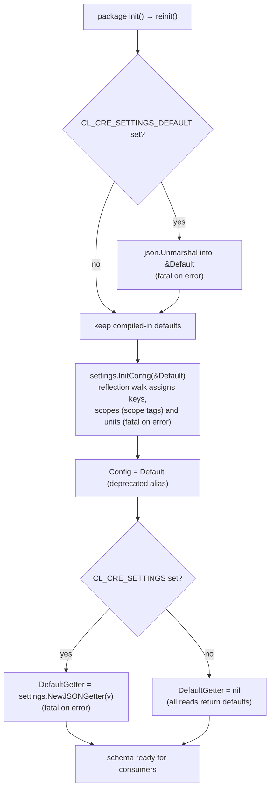
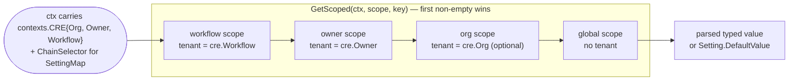
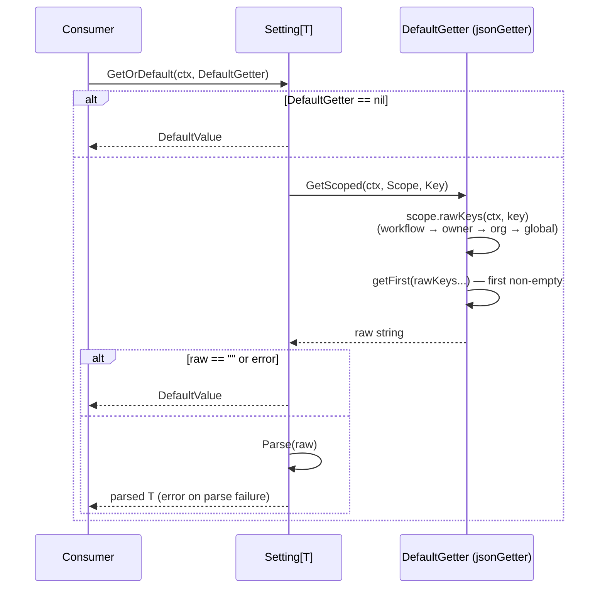
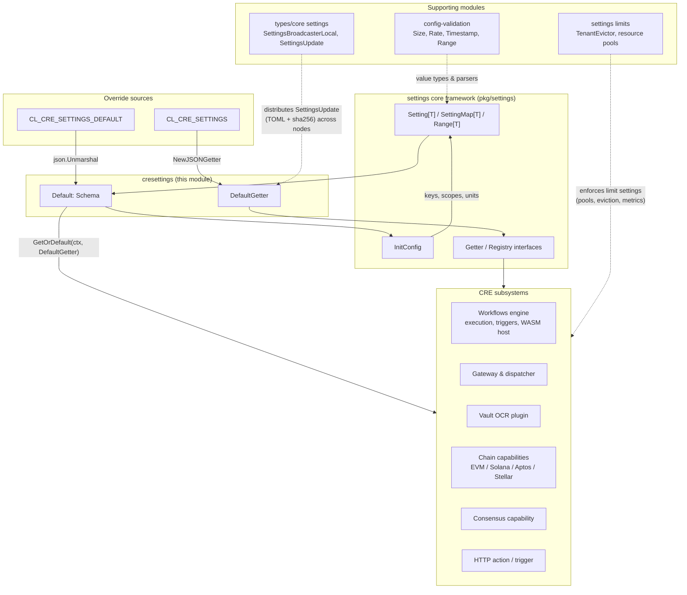

# CRE Settings Schema

> **Module**: `github.com/smartcontractkit/chainlink-common/pkg/settings/cresettings` (module `chainlink-common`, see [`chainlink-common/go.mod`](../../../repo/chainlink-common/go.mod))
> **Core component**: [`Schema`](#2-the-schema-struct) — `chainlink-common/pkg/settings/cresettings/settings.go`
> **Group**: [Shared Foundation Libraries & Domain Types](../../Shared_Foundation_Libraries___Domain_Types.md) → [settings](../settings.md)

## 1. Overview

The **CRE settings schema** (`cresettings`) is the single, canonical catalogue of every *tunable knob* used by nodes in the Chainlink Runtime Environment (CRE). Where the [settings core framework](settings_core_framework.md) provides the generic machinery (`Setting[T]`, `Getter`, `InitConfig`), this module instantiates it with the concrete, product-wide schema:

- **`Schema`** — a typed struct tree declaring every setting with its compiled-in default, scope, unit and parse function: workflow/execution limits, gateway and dispatcher rate limits, trigger queues, Vault OCR constraints, Confidential Compute (San Marino) settings, per-chain write/read limits, and time-windowed feature flags.
- **`Default`** — the package-level `Schema` instance holding the shipped defaults (mirrored in [`cresettings/defaults.json`](../../../repo/chainlink-common/pkg/settings/cresettings/defaults.json) and [`defaults.toml`](../../../repo/chainlink-common/pkg/settings/cresettings/defaults.toml)).
- **`DefaultGetter`** — a runtime override source built from the `CL_CRE_SETTINGS` environment variable.
- **`reinit()`** — package `init()` hook that seeds `Default` from `CL_CRE_SETTINGS_DEFAULT`, assigns keys/scopes/units via `InitConfig`, and builds `DefaultGetter`.

Because every field is a `Setting[T]` (or `SettingMap[T]`), consumers get typed reads (`GetOrDefault`) and typed subscriptions (`Subscribe`) with **tenant-scoped resolution**: a value can be overridden globally, per org, per workflow owner, per workflow, and — for chain-selector maps — per chain, all resolved from the `contexts.CRE` embedded in `context.Context`.

Related pages: [settings core framework](settings_core_framework.md) (machinery), [settings limits](settings_limits.md) (enforcement/eviction machinery), [types-core plugin services](../types-core/types-core_plugin-services.md) (`SettingsBroadcasterLocal` / `SettingsUpdate` used to push schema updates to nodes).

## 2. The `Schema` struct

`Schema` is the root of the settings tree. It contains three kinds of fields:

1. **Global settings** (no scope tag) — node-wide values.
2. **Scoped sub-structs** — `PerOrg Orgs` (`scope:"org"`), `PerOwner Owners` (`scope:"owner"`), `PerWorkflow Workflows` (`scope:"workflow"`).
3. **Nested domain structs** — `ConfidentialCompute` (global) and the per-workflow capability structs (`cronTrigger`, `httpTrigger`, `logTrigger`, `chainWrite`, `chainRead`, `consensus`, `httpAction`, `confidentialHTTP`, `secrets`, `donTime`, …).

```mermaid
flowchart TD
    SCHEMA["Schema (global scope)"] --> G1["Workflow & execution limits<br/>WorkflowLimit, WorkflowExecutionConcurrencyLimit"]
    SCHEMA --> G2["Gateway settings<br/>payload limits, vault mgmt, HTTP/confidential-relay<br/>rates & concurrency bounds"]
    SCHEMA --> G3["Dispatcher rate limits<br/>DispatcherGlobalRate, DispatcherPerSenderRate"]
    SCHEMA --> G4["Node-level trigger settings<br/>CentralTriggerEventQueueLimit,<br/>BaseTrigger* retry/prune"]
    SCHEMA --> G5["Vault limits & feature gates<br/>size limits, batch limits, boolean gates"]
    SCHEMA --> G6["WASMPollOneoffSubscriptionLimit,<br/>MissingRequestRecoveryEnabled, TenantID"]
    SCHEMA --> CC["ConfidentialCompute<br/>(San Marino framework)"]

    SCHEMA -->|"scope:&quot;org&quot;"| ORGS["PerOrg (Orgs)"]
    ORGS --> O1["BaseTriggerRetransmitEnabled<br/>WorkflowExecutionConcurrencyLimit<br/>ZeroBalancePruningTimeout"]
    ORGS --> O2["HTTPAction.MtlsRateLimit"]

    SCHEMA -->|"scope:&quot;owner&quot;"| OWNERS["PerOwner (Owners)"]
    OWNERS --> W1["WorkflowLimit<br/>WorkflowExecutionConcurrencyLimit"]
    OWNERS --> W2["VaultCiphertextSizeLimit<br/>VaultSecretsLimit"]
    OWNERS --> W3["VaultZoneBGetSecretsAllowed<br/>ConfidentialCompute.Rate"]

    SCHEMA -->|"scope:&quot;workflow&quot;"| WF["PerWorkflow (Workflows)"]
    WF --> F1["Trigger limits & timeouts"]
    WF --> F2["Execution limits<br/>concurrency, timeout, response size"]
    WF --> F3["WASM limits<br/>memory / binary / config / secrets"]
    WF --> F4["Logging & user metrics"]
    WF --> F5["ChainAllowed (SettingMap)"]
    WF --> F6["CRONTrigger / HTTPTrigger / LogTrigger"]
    WF --> F7["ChainWrite (EVM, Solana, Aptos, Stellar)"]
    WF --> F8["ChainRead (incl. Solana)"]
    WF --> F9["Consensus / HTTPAction /<br/>ConfidentialHTTP / Secrets / DONTime"]
    WF --> F10["Feature*ActivePeriod<br/>time-windowed feature flags"]

    CC --> C1["GlobalRate, MaxRetries, RetryBackoff,<br/>Enclave & public-key timeouts"]
    CC --> C2["RelayResponseCache, PublicKeyCache, Session"]
```



### 2.1 Package variables

| Symbol | Type | Purpose |
|---|---|---|
| `Default` | `Schema` | Compiled-in defaults for every setting. Can be re-seeded wholesale via `CL_CRE_SETTINGS_DEFAULT`. |
| `Config` | `Schema` | **Deprecated** alias assigned from `Default` at init; retained for backwards compatibility. |
| `DefaultGetter` | `Getter` | Static override source built from `CL_CRE_SETTINGS`; `nil` when the variable is unset (all lookups then fall back to defaults). |
| `EnvNameSettingsDefault` | `const` = `CL_CRE_SETTINGS_DEFAULT` | JSON document of defaults (same shape as [`defaults.json`](../../../repo/chainlink-common/pkg/settings/cresettings/defaults.json)). |
| `EnvNameSettings` | `const` = `CL_CRE_SETTINGS` | JSON document of scoped overrides (shape: `{global|org|owner|workflow}.{tenant}.{SettingKey}`). |

## 3. Initialization flow (`reinit`)

The package performs all wiring in `init()` → `reinit()`. Failure of any step is fatal (`log.Fatalf`), guaranteeing no consumer ever sees a partially keyed schema.



Notes:

- `InitConfig` walks `Schema` recursively; every field must be a `Setting`/`SettingMap` (implements the unexported `keySetter` contract) or a nested struct. Keys are the dot-joined Go field names (e.g. `PerWorkflow.ChainWrite.EVM.GasLimit`); a `scope` tag changes the resolution scope without changing the key (see [settings core framework §6](settings_core_framework.md#6-initialization-initconfig)).
- The JSON override document consumed by `NewJSONGetter` is organised by scope level and tenant, e.g. `{"org": {"123": {"Foo": "42"}}, "owner": {"0xabc…": {"Foo": "75"}}}` (see the reference example in [`settings/testdata/config.json`](../../../repo/chainlink-common/pkg/settings/testdata/config.json)). The companion helper `settings.CombineJSONFiles` builds such a document from `global.json`, `org/*.json`, `owner/*.json` and `workflow/*.json` files.

## 4. Scope model and value resolution

`Schema` uses four scope levels. Overrides are resolved **most-specific-first**, with each level's tenant identity taken from `contexts.CRE` in the caller's `context.Context`:



The raw lookup keys are built by `Scope.rawKeys` in **decreasing priority** — for a workflow-scoped setting: `workflow.<wf>.<Key>`, `owner.<owner>.<Key>`, `org.<org>.<Key>`, `global.<Key>` — and the getter returns the first non-empty value. Missing tenant IDs at a level simply drop that level's candidate key (a missing **org** tenant is only logged, per `Scope.IsTenantRequired`, since org may not always be available).

- **Global** — node-wide defaults declared at the top level of `Schema` (and in nested structs such as `ConfidentialCompute`).
- **Org** (`PerOrg`, `scope:"org"`) — organisation/tenant-wide overrides. Per `Scope.IsTenantRequired`, the org tenant is optional (lookups degrade gracefully when it is missing).
- **Owner** (`PerOwner`, `scope:"owner"`) — per workflow-owner overrides (owner address).
- **Workflow** (`PerWorkflow`, `scope:"workflow"`) — per-workflow overrides (workflow ID/hash).

At runtime a consumer resolves a setting with:

```go
limit, err := cresettings.Default.WorkflowLimit.GetOrDefault(ctx, cresettings.DefaultGetter)
```



Push-based consumers use `Setting.Subscribe(ctx, registry)` instead, which converts raw registry updates into typed `Update[T]` values (see [settings core framework §7](settings_core_framework.md#7-runtime-behavior)). Settings updates distributed across nodes travel as `SettingsUpdate{Settings, Hash}` payloads via `SettingsBroadcasterLocal` — see [types-core plugin services](../types-core/types-core_plugin-services.md).

## 5. Setting groups reference

### 5.1 Global (node-level) settings

| Group | Settings (defaults) | Consumed by |
|---|---|---|
| Workflow mgmt | `WorkflowLimit` (1000), `WorkflowExecutionConcurrencyLimit` (1000) | [workflows engine](../../Workflow___Capability_Runtime_(CRE_Engine)/workflows/workflows_engine.md) |
| Engine selection | `CoordinatedEngineEnabled`, `CentralizedWorkflowOwnerVerificationEnabled`, `RemoteExecutableWorkflowDONBindingEnabled`, `TenantID` | [workflows syncer](../../Workflow___Capability_Runtime_(CRE_Engine)/workflows/workflows_syncer.md), remote executable capability server ([core capabilities runtime](../../Workflow___Capability_Runtime_(CRE_Engine)/core_capabilities_runtime.md)) |
| Gateway | `GatewayIncomingPayloadSizeLimit` (1 MB), `GatewayVaultManagementEnabled`, `GatewayHTTPGlobalRate` (500 rps, burst 500), `GatewayHTTPPerNodeRate` (100/100), `GatewayConfidentialRelayGlobalRate` (50/10), `GatewayConfidentialRelayPerNodeRate` (10/10), `GatewayHTTPActionMtlsRequestRate` (every 30 s), `GatewayHTTPActionMtlsConcurrencyLimit` (50), `GatewayHTTPActionOutboundConcurrencyLimit` (875 ≈ 500 rps × 1.75 s p99.9), `GatewayHTTPActionOutboundPerNodeConcurrencyLimit` (175) | Gateway request handling ([Node Platform gateway](../../Node_Platform_Services/gateway.md), [http action capability](../../Workflow___Capability_Runtime_(CRE_Engine)/http_action_capability.md)) |
| Dispatcher | `DispatcherGlobalRate` (5000/5000), `DispatcherPerSenderRate` (500/1000) — inbound P2P message rate limits | P2P dispatcher ([p2p](../../Node_Platform_Services/p2p.md)) |
| Base triggers | `CentralTriggerEventQueueLimit` (1000), `TriggerRegistrationStatusUpdateTimeout` (0 s), `BaseTriggerRetryInterval` (30 s), `BaseTriggerMaxRetries` (20), `BaseTriggerPruneAge` (24 h), `BaseTriggerMaxSendsPerTick` (20) | [cron capability](../../Workflow___Capability_Runtime_(CRE_Engine)/cron_capability.md), log trigger ([chain capability EVM](../../Workflow___Capability_Runtime_(CRE_Engine)/chain_capability_evm.md)), [trigger event store](../../Workflow___Capability_Runtime_(CRE_Engine)/core_capabilities_runtime/core_capabilities_runtime_trigger_event_store.md) |
| WASM runtime | `WASMPollOneoffSubscriptionLimit` (128) | WASM host ([workflows engine](../../Workflow___Capability_Runtime_(CRE_Engine)/workflows/workflows_engine.md)) |
| Recovery | `MissingRequestRecoveryEnabled` (false) | Vault request recovery ([capabilities vault](../../Workflow___Capability_Runtime_(CRE_Engine)/capabilities/capabilities_vault.md)) |
| Vault limits | Size limits (`VaultShareSizeLimit` 600 B, `VaultIdentifier*SizeLimit` 64 B, `VaultMaxQuerySizeLimit` 102.4 KB, `VaultMaxObservationSizeLimit` 512 KB, `VaultMaxReportsPlusPrecursorSizeLimit`/`VaultMaxReportSizeLimit` 2 MB, `VaultMaxKeyValueModifiedKeysPlusValuesSizeLimit` ≈1.4 MB, `VaultMaxBlobPayloadSizeLimit` 25.6 KB, `VaultMaxPerOracleUnexpiredBlob*`), batch limits (`VaultPluginBatchSizeLimit`/`VaultRequestBatchSizeLimit` 10, `VaultPendingQueueWriteSizeLimit` 1000, `VaultMaxReportCount` 10, `VaultMaxKeyValueModifiedKeys` 300) and boolean gates (`VaultZoneBWorkflowGetSecretsRestrictEnabled`, `VaultGetSecretsIncludePublicKeyEnabled`, `VaultPublicKeyEncryptOnlyEnabled`, …) | Vault OCR plugin ([capabilities vault](../../Workflow___Capability_Runtime_(CRE_Engine)/capabilities/capabilities_vault.md)) |
| Confidential Compute | `ConfidentialCompute.{GlobalRate, MaxRetries(3), RetryBackoff(2 s), SecretsCacheEnabled, EnclaveRequestTimeout(30 s), PublicKeyRequestTimeout(5 s), ConfidentialRelayHandlerTimeout(60 s), RelayResponseCache{…}, InsecureSkipTLSVerify, EnclaveRefreshInterval(10 s), PublicKeyRetries{Max, Backoff}, PublicKeyCache{…}, Session{…}}` (San Marino framework) | Confidential workflow execution ([workflows engine](../../Workflow___Capability_Runtime_(CRE_Engine)/workflows/workflows_engine.md), [confidential HTTP](../../Workflow___Capability_Runtime_(CRE_Engine)/http_action_capability.md)) |

### 5.2 `PerOrg` (scope: `org`)

| Setting (default) | Purpose |
|---|---|
| `BaseTriggerRetransmitEnabled` (false) | Allow retransmission of base trigger events for this org. |
| `WorkflowExecutionConcurrencyLimit` (100) | Org-wide cap on concurrent workflow executions. |
| `ZeroBalancePruningTimeout` (24 h) | How long zero-balance org data is retained before pruning. |
| `HTTPAction.MtlsRateLimit` (every 30 s, burst 3) | Rate limit for mTLS HTTP action requests from this org. |

### 5.3 `PerOwner` (scope: `owner`)

| Setting (default) | Purpose |
|---|---|
| `WorkflowLimit` (1000) | Max workflows per owner. |
| `WorkflowExecutionConcurrencyLimit` (5) | Concurrent executions per owner. |
| `VaultCiphertextSizeLimit` (2 KB) | Max ciphertext size for secrets owned by this owner (replaces deprecated global). |
| `VaultSecretsLimit` (100) | Max secrets per owner. |
| `VaultZoneBGetSecretsAllowed` (false) | **Default deny** allowlist: owner may read vault secrets from a zone-b workflow DON only when the global `VaultZoneBWorkflowGetSecretsRestrictEnabled` gate is open. |
| `ConfidentialCompute.Rate` (1000 rps, burst 1000) | Per-owner Confidential Compute request rate. |

### 5.4 `PerWorkflow` (scope: `workflow`)

Grouped sub-structs:

- **Triggers** — `TriggerRegistrationsTimeout` (10 s), `TriggerSubscriptionTimeout` (15 s), `TriggerSubscriptionLimit` (10), `TriggerEventQueueLimit` (50), `TriggerEventQueueTimeout` (10 m); `CRONTrigger.FastestScheduleInterval` (30 s, enforced by [`enforceFastestSchedule`](../../Workflow___Capability_Runtime_(CRE_Engine)/cron_capability/cron_capability_trigger_service.md)); `HTTPTrigger.RateLimit` (every 30 s, burst 3); `LogTrigger.{EventRateLimit (every 6 s, burst 10), EventSizeLimit (5 KB), FilterAddressLimit (5), FilterTopicsPerSlotLimit (10)}`.
- **Execution** — `ExecutionConcurrencyLimit` (5), `ExecutionTimeout` (5 m), `ExecutionResponseLimit` (100 KB), `ExecutionTimestampsEnabled`; capability calls `CapabilityConcurrencyLimit` (30) / `CapabilityCallTimeout` (3 m); secrets `SecretsConcurrencyLimit` (5) / `Secrets.CallLimit` (5).
- **WASM** — `WASMMemoryLimit` (100 MB), `WASMBinarySizeLimit` (100 MB), `WASMCompressedBinarySizeLimit` (20 MB), `WASMConfigSizeLimit` (50 KB), `WASMSecretsSizeLimit` (27 KB).
- **Logging & metrics** — `LogLineLimit` (1 KB), `LogEventLimit` (1000); user metrics `UserMetricEnabled` (false), `UserMetricPayloadLimit` (4 KB), `UserMetricNameLengthLimit` (128), `UserMetricLabelsPerMetric` (20), `UserMetricLabelValueLength` (256) — exported through the observability stack (see [beholder telemetry](../../Telemetry___Observability_Platform/beholder-telemetry.md)).
- **Chain access** — `ChainAllowed` (`SettingMap[bool]`, default deny with built-in allowlist for the `geth-devnet2`, `geth-testnet` and `solana-testnet` selectors); `ChainRead.{CallLimit (15), LogQueryBlockLimit (100), PayloadSizeLimit (5 KB), Solana.{BatchItemLimit (100), PayloadSizeLimit (5 KB)}}`; `ChainWrite.{TargetsLimit (10), EVM{GasLimit map, ReportSizeLimit}, Solana{GasLimit map (300 k), ReportSizeLimit (265 B)}, Aptos{GasLimit map (2 M), ReportSizeLimit (5 KB)}, Stellar{MaxResourceFee map (1 M stroop), ReportSizeLimit (5 KB)}}` — consumed by the [chain capabilities](../../Workflow___Capability_Runtime_(CRE_Engine)/chain_capability_evm.md).
- **Actions** — `HTTPAction.{CallLimit (5), CacheAgeLimit (10 m), ConnectionTimeout (10 s), RequestSizeLimit (10 KB), ResponseSizeLimit (100 KB), GatewayProxyDonID}` and `ConfidentialHTTP.{CallLimit, ConnectionTimeout, RequestSizeLimit, ResponseSizeLimit}` for the [HTTP action capability](../../Workflow___Capability_Runtime_(CRE_Engine)/http_action_capability.md); `DONTime.RequestTimeout` (30 s) for DON time requests ([workflows common types](../../Workflow___Capability_Runtime_(CRE_Engine)/workflows/workflows_common_types.md)).
- **Consensus** — `Consensus.{ObservationSizeLimit (100 KB), CallLimit (20)}` for the [consensus capability](../../Workflow___Capability_Runtime_(CRE_Engine)/consensus_capability.md).
- **Confidential workflows** — `ConfidentialWorkflows.Enabled` (false), a scoped kill-switch that can be toggled per org/owner/workflow without redeploy.

#### Feature flags as time windows

Eight `Feature*ActivePeriod` settings are `Setting[Range[config.Timestamp]]` values. A feature is active only while the current time falls inside `[Lower, Upper]`, which allows **staged, DON-coordinated rollouts and rollbacks** without code changes:

| Setting | Default window | Semantics |
|---|---|---|
| `FeatureHTTPTriggerNewExecutionIDsActivePeriod` | 2100 → 2101 (OFF) | New execution ID scheme for HTTP triggers ([http trigger capability](../../Workflow___Capability_Runtime_(CRE_Engine)/http_trigger_capability.md)). |
| `FeatureChainCapabilityHashBasedOCRActivePeriod` | 2100 → 2101 (OFF) | Hash-based OCR for chain capabilities. |
| `FeatureEVMWriteReportL1FeeActivePeriod` | 2100 → 2101 (OFF) | L1 fee accounting in EVM write reports. |
| `FeatureAptosWriteReportBlockTimestampActivePeriod` | 2100 → 2101 (OFF) | Block timestamps in Aptos write reports. |
| `FeatureRequestHashIncludeWorkflowTagActivePeriod` | year 1 → 2100 (**ON**) | Includes `WorkflowTag` in request hashes (current prod behaviour); window narrowed after rollout. |
| `FeatureWorkflowTagBackfillActivePeriod` | 2100 → 2101 (OFF) | `workflow_specs_v2.workflow_tag` DB backfill; ops narrows the window to "now" only after the tag feature is muted on every DON member, to avoid hash divergence during backfill. |
| `FeatureConsensusStricterMedianQuorumActivePeriod` | 2100 → 2101 (OFF) | Stricter median quorum rules ([consensus capability](../../Workflow___Capability_Runtime_(CRE_Engine)/consensus_capability.md)). |
| `FeatureConsensusIncludeAllTimestampsActivePeriod` | 2100 → 2101 (OFF) | Include all timestamps in consensus observations. |

### 5.5 `SettingMap` — per-chain overrides

`ChainAllowed`, `ChainWrite.*.GasLimit`, `Solana.GasLimit`, `Stellar.MaxResourceFee` etc. are `SettingMap[T]` values created with `PerChainSelector(default, map[string]T)`. Resolution reads the chain selector from `ctx` (`contexts.ChainSelectorValue`), then checks `<Key>.Values.<selector>` then `<Key>.Default` in the override source, then the built-in map, then the default — enabling per-chain gas/fee limits on multi-chain DONs. Details in [settings core framework](settings_core_framework.md) (`map.go`).

## 6. Safety and compatibility notes

- **Vault limit defaults are consensus-sensitive.** The `Vault*` size/batch limits act as defaults consumed by the Vault OCR plugin; nodes apply old and new values inconsistently during image upgrades, so any change requires a **safe upgrade path that overrides the defaults in the on-chain configuration** for the contract (see the `DANGER` comments in [`cresettings/settings.go`](../../../repo/chainlink-common/pkg/settings/cresettings/settings.go)).
- **Deprecated fields** (kept for backwards compatibility, do not use in new code): `Config` (use `Default`), `VaultJWTAuthEnabled`, `VaultOrgIdAsSecretOwnerEnabled`, `VaultOptimizationsEnabled`, `VaultGetSecretsShareAggregationIncludesPublicKeys`, `VaultJSONOmitUnpopulatedEnabled`, `VaultGetSecretsRelaxedConsensusEnabled`, `VaultIncludeInvalidPendingItemsEnabled`, `VaultSignedResponseRequestIDEnabled` (all retired — behaviour now always enabled), `VaultCiphertextSizeLimit` (use `PerOwner.VaultCiphertextSizeLimit`), `ChainWrite.ReportSizeLimit`, `ChainWrite.EVM.TransactionGasLimit`.
- Schema changes must keep `defaults.json` / `defaults.toml` in sync; both are the human-readable projection of `Default` and the reference format for `CL_CRE_SETTINGS_DEFAULT`.

## 7. How this module fits into the system



Key relationships:

- **Depends on** the [settings core framework](settings_core_framework.md) for the `Setting[T]`/`SettingMap[T]` value types, `Getter`/`Registry` seams and the `InitConfig` reflection walk; on [config-validation](../config-validation.md) for `config.Size`, `config.Rate`, `config.Timestamp` and their parsers.
- **Feeds** the CRE engine and its capabilities: the [workflows engine](../../Workflow___Capability_Runtime_(CRE_Engine)/workflows/workflows_engine.md), [syncer](../../Workflow___Capability_Runtime_(CRE_Engine)/workflows/workflows_syncer.md), [artifacts store](../../Workflow___Capability_Runtime_(CRE_Engine)/workflows/workflows_artifacts.md), [metering](../../Workflow___Capability_Runtime_(CRE_Engine)/workflows/workflows_metering.md), [cron](../../Workflow___Capability_Runtime_(CRE_Engine)/cron_capability.md), [HTTP action](../../Workflow___Capability_Runtime_(CRE_Engine)/http_action_capability.md), [chain capabilities](../../Workflow___Capability_Runtime_(CRE_Engine)/chain_capability_evm.md) and the [consensus capability](../../Workflow___Capability_Runtime_(CRE_Engine)/consensus_capability.md) all read limits, timeouts and feature windows from `Default`/`DefaultGetter` at runtime.
- **Complements** [settings limits](settings_limits.md): the schema *declares* limit values; the limits package *enforces* them (tenant-scoped resource pools, queues, rate gates, eviction via `TenantEvictor`, `LimitError`, and limit metrics).
- **Integrates with** [types-core plugin services](../types-core/types-core_plugin-services.md): `SettingsUpdate{Settings, Hash}` (TOML + sha256) is the wire format used to propagate schema values across nodes, with `SettingsBroadcasterLocal` for local subscriptions.

## 8. Usage example

```go
package main

import (
    "context"

    . "github.com/smartcontractkit/chainlink-common/pkg/settings/cresettings"
)

func check(ctx context.Context) {
    // Typed read: resolves workflow-scope override → owner → org → global → default.
    timeout, err := Default.PerWorkflow.ExecutionTimeout.GetOrDefault(ctx, DefaultGetter)
    if err != nil {
        // fall back to timeout (default) and log err
    }
    _ = timeout

    // Subscription: react to live changes of a setting.
    updates, stop := Default.PerWorkflow.WASMMemoryLimit.Subscribe(ctx, registry) // registry: settings.Registry
    defer stop()
    for u := range updates {
        if u.Err != nil { continue }
        _ = u.Value // new config.Size
    }
}
```

Deployment-time configuration is supplied through the two environment variables documented in [§2.1](#21-package-variables); the JSON shape for `CL_CRE_SETTINGS` is `{global|org|owner|workflow: {tenant: {SettingKey: value}}}`, values written as parseable strings (e.g. `"500rps:500"`, `"1mb"`, `"30s"`).
