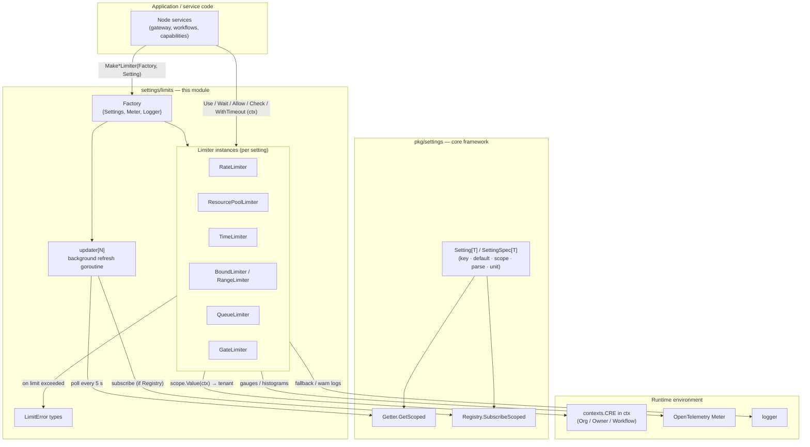
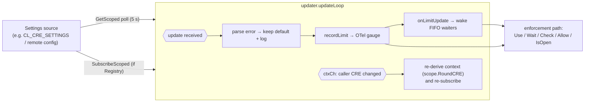
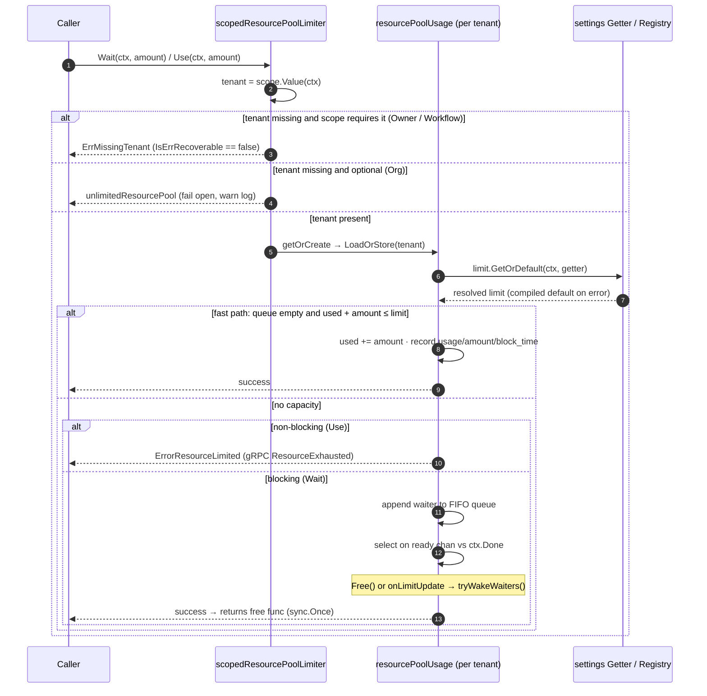
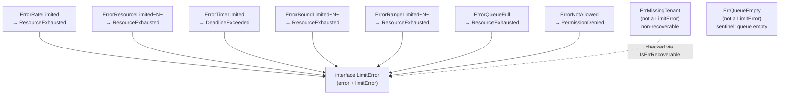
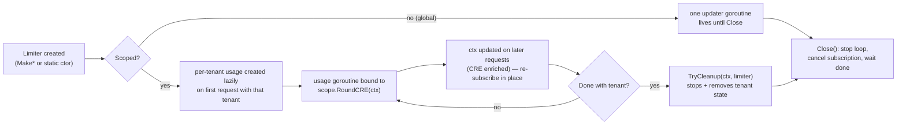

# Settings Limits (`chainlink-common/pkg/settings/limits`)

## Introduction

The `limits` package is the enforcement layer of the Chainlink [settings framework](../settings.md). While the [settings core framework](settings_core_framework.md) defines *how* values are resolved (keys, scopes, getters, registries) and the [CRE settings schema](settings_cre_schema.md) declares *which* limits exist, this module provides the *runtime primitives that enforce those values*: rate limits, resource pools, timeouts, bounds, ranges, queues, and on/off gates.

Every limiter is:

- **Request-scoped & multi-tenant** — enforcement is driven by the `contexts.CRE` (org / owner / workflow) carried in each request's `context.Context`, so different tenants get independently enforced limits from a single limiter instance.
- **Dynamically updatable** — limits are backed by a `settings.Setting[T]` spec with a compiled default; the limiter refreshes its value either by polling a `settings.Getter` (every 5 s) or by subscribing to a `settings.Registry` push channel.
- **Observable** — limit, usage, and denial signals are emitted as OpenTelemetry gauges/histograms, tagged with scope-derived attributes.
- **Failure-tolerant** — a degraded settings service never blocks work: limiters fall back to the compiled default and treat the read error as *advisory*. Only a genuinely mis-scoped request (missing required tenant) is non-recoverable.

```
Go package:  github.com/smartcontractkit/chainlink-common/pkg/settings/limits
Go module:   chainlink-common  (see chainlink-common/go.mod, go 1.27.1)
Key deps:    go.opentelemetry.io/otel/metric v1.46.0 · golang.org/x/time (rate)
             google.golang.org/grpc (status/codes for error mapping)
```

---

## Architecture

The package sits between application services (gateway, workflows, capabilities — see the [CRE Engine module](<../../Workflow___Capability_Runtime_(CRE_Engine).md>)) and the settings infrastructure. A single `Factory` wires the optional dependencies (dynamic settings, telemetry meter, logger) into limiter instances.



### Interface model

All limiters share the minimal `Limiter[N]` contract (`Limit` + `Close`, since they spawn background goroutines) and specialize from there:

```mermaid
classDiagram
    class Limiter~N~ {
        <<interface>>
        +Limit(ctx) (N, error)
        +Close() error
    }
    class ResourceLimiter~N~ {
        <<interface>>
        +Use(ctx, amount) error
        +Free(ctx, amount) error
        +Available(ctx) (N, error)
    }
    class ResourcePoolLimiter~N~ {
        <<interface>>
        +Wait(ctx, amount) (free func(), error)
    }
    class RateLimiter {
        <<interface>>
        +Allow(ctx) bool
        +AllowN(ctx, t, n) bool
        +Reserve(ctx) (Reservation, error)
        +Wait(ctx) error
    }
    class TimeLimiter {
        <<interface>>
        +WithTimeout(ctx) (ctx, done func(), err)
    }
    class BoundLimiter~N~ {
        <<interface>>
        +Check(ctx, n) error
    }
    class RangeLimiter~N~ {
        <<interface>>
        +Check(ctx, n) error
    }
    class QueueLimiter~T~ {
        <<interface>>
        +Put(ctx, v) error
        +Get(ctx) (T, error)
        +Wait(ctx) (T, error)
    }
    class GateLimiter {
        <<interface>>
        +IsOpen(ctx) (bool, error)
    }
    class TenantEvictor {
        <<interface deprecated>>
        +EvictTenant(tenant) error
    }

    ResourceLimiter~N~ --|> Limiter~N~
    ResourcePoolLimiter~N~ --|> ResourceLimiter~N~
    RateLimiter --|> Limiter~N~
    TimeLimiter --|> Limiter~N~
    BoundLimiter~N~ --|> Limiter~N~
    RangeLimiter~N~ --|> Limiter~N~
    QueueLimiter~T~ --|> Limiter~N~
    GateLimiter --|> Limiter~N~
    TenantEvictor ..> Limiter~N~ : "optionally implemented (deprecated; use TryCleanup)"
```

### Package layout

| File | Responsibility |
|---|---|
| `limits.go` | Package contract: `Limiter[N]`, `Number` (all int/float kinds), `TryCleanup`, deprecated `TenantEvictor`/`TryEvictTenant`, `maxVal[N]` (type max via reflection for "unlimited"), `pollPeriod` (5 s) |
| `factory.go` | `Factory` (optional `Settings` getter, OTel `Meter`, `Logger`) and the `Make*Limiter` constructors |
| `updater.go` | `updater[N]`: background loop that polls or subscribes for limit changes and reacts to CRE context changes |
| `errors.go` | `LimitError` marker interface, concrete limit-exceeded error types, `ErrMissingTenant`, `IsErrRecoverable` |
| `metrics.go` | `gauge`/`histogram` OTel adapters, `metricConstructors[N]`, `withScope` scope attributes |
| `resource.go` | `ResourceLimiter`, `ResourcePoolLimiter`; global / scoped / multi / unlimited pool implementations (`resourcePoolLimiter`, `resourcePoolUsage`, `scopedResourcePoolLimiter`) |
| `rate.go` | `RateLimiter` (context-scoped wrapper over `golang.org/x/time/rate`) |
| `time.go` | `TimeLimiter` (`WithTimeout` returning a cancellable ctx + done func) |
| `bound.go` | `BoundLimiter` upper/lower bound checks |
| `range.go` | `RangeLimiter` (`settings.Range[N]` containment checks) |
| `queue.go` | `QueueLimiter[T]` bounded FIFO queue with `Get`/`Wait` |
| `gate.go` | `GateLimiter` boolean allow/deny feature gate |

---

## Core Concepts

### Scoping and tenancy

Enforcement is per-tenant, where *tenant* is defined by the limiter's `settings.Scope` (see the [settings core framework](settings_core_framework.md)):

| Scope | Tenant source (`scope.Value(ctx)`) | Tenant required? |
|---|---|---|
| `ScopeGlobal` | — (one shared limit) | n/a |
| `ScopeOrg` | `contexts.CRE.Org` | No — org may be absent; **fails open** |
| `ScopeOwner` | `contexts.CRE.Owner` | Yes |
| `ScopeWorkflow` | `contexts.CRE.Workflow` | Yes |

The `CRE` struct is injected into `context.Context` by the [CRE runtime](<../../Workflow___Capability_Runtime_(CRE_Engine).md>); a missing tenant for a *required* scope is a programming error and surfaces as [`ErrMissingTenant`](#error-model), while a missing *optional* tenant (org) fails open with an unlimited no-op pool so that work is never dropped because of a missing header.

### The `Factory`

```go
type Factory struct {
    Settings settings.Getter // optional: dynamic limit source (poll), or settings.Registry (push)
    Meter    metric.Meter    // optional: OpenTelemetry metrics
    Logger   logger.Logger   // optional: used when a limit falls back to its default
}
```

Each `Make*Limiter` method selects the correct implementation from the setting's `Scope` — e.g. `MakeResourcePoolLimiter[N]` builds an unscoped pool for `ScopeGlobal` and a tenant-keyed pool otherwise. Providing `Settings` is what enables dynamic updates; with `Settings == nil` the compiled `Setting.DefaultValue` is enforced statically. Metrics additionally require a non-empty `Setting.Key`.

### Dynamic limit updates (`updater[N]`)

Every dynamic limiter embeds an `updater[N]` goroutine:



Key behaviors:

- **Push preferred over poll.** If `Factory.Settings` implements `settings.Registry`, the updater subscribes via `SubscribeScoped`; otherwise it polls `GetScoped` every `pollPeriod` (5 s, reduced for tests).
- **CRE re-binding.** Per-tenant updaters run against a *rounded* CRE (`scope.RoundCRE`) so they only observe their own scope level; if a later request for the same tenant carries additional CRE fields, the new context is pushed over `ctxCh` and the subscription is refreshed — no goroutine restart.
- **Waiter wake-up.** When the limit changes, `onLimitUpdate` re-evaluates the FIFO queue so blocked `Wait` callers can proceed without waiting for a `Free`.

---

## Limiter Families

### Resource & ResourcePool limiters (`resource.go`)

`ResourceLimiter[N]` covers single-action accounting (`Use`/`Free`/`Available`, non-blocking). `ResourcePoolLimiter[N]` adds `Wait(ctx, amount) (free func(), error)` — blocking acquisition with FIFO fairness and a mandatory release function.

Constructors:

- `GlobalResourcePoolLimiter(limit)` — static, unscoped.
- `MakeResourcePoolLimiter[N](f, setting)` — dynamic; global or scoped per `setting.Scope`.
- `OrgResourcePoolLimiter` / `OwnerResourcePoolLimiter` / `WorkflowResourcePoolLimiter` — static per-tenant pools.
- `MultiResourcePoolLimiter[N]` — composes several pools; `Wait`/`Use` acquire from each in order and roll back all on failure (releases run in reverse order via `freeFns.freeAll`).
- `UnlimitedResourceLimiter` / `UnlimitedResourcePoolLimiter` — no-ops reporting `maxVal[N]()`.

Internally, a `scopedResourcePoolLimiter[N]` keeps one `resourcePoolUsage[N]` per tenant in a `sync.Map`. Each usage owns its own `updater` goroutine, its `used` counter, and a FIFO `queue` of `waiter[N]{amount, ready chan}`:



Notes on correctness:

- `tryWakeWaiters` (called under lock from `free` and `onLimitUpdate`) grants the queue head only when `used + head.amount ≤ limit`, preserving FIFO ordering.
- On context cancellation, a dequeued-or-not race is handled: if the waiter was granted resources just as it cancelled, they are returned (`used -= amount`) and the waiters behind it are re-evaluated.
- `Wait`'s returned `free` is idempotent (`sync.Once`).
- `Close()` first waits on a `services.WaitGroup` for in-flight operations, then closes every tenant's usage (stopping its updater goroutine).

### Rate, Time, Bound, Range, Queue, Gate limiters

| Limiter | Semantics | Static constructor | Denial error |
|---|---|---|---|
| `RateLimiter` | Token-bucket throttle (`Allow*`, `Reserve*`, `Wait*`) over `golang.org/x/time/rate`, scoped per tenant; settings type `config.Rate` | `GlobalRateLimiter` / `OrgRateLimiter` / `OwnerRateLimiter` / `WorkflowRateLimiter`, or `Factory.MakeRateLimiter` | `ErrorRateLimited` |
| `TimeLimiter` | `WithTimeout(ctx)` → derived ctx + `done func()`; emits runtime/success/timeout counters | `NewTimeLimiter(timeout)`, `Factory.MakeTimeLimiter` | `ErrorTimeLimited` |
| `BoundLimiter` | Upper- or lower-bound check | `NewUpperBoundLimiter` / `NewLowerBoundLimiter`, `Factory.MakeUpperBoundLimiter` / `MakeLowerBoundLimiter` | `ErrorBoundLimited[N]` |
| `RangeLimiter` | Value must be inside a `settings.Range[N]` | `NewRangeLimiter`, `Factory.MakeRangeLimiter` | `ErrorRangeLimited[N]` |
| `QueueLimiter[T]` | Bounded FIFO queue (`Put`/`Get`/`Wait`/`Len`), cond-var based | `NewQueueLimiter`, `Factory.MakeQueueLimiter` | `ErrorQueueFull` / `ErrQueueEmpty` (not a limit error) |
| `GateLimiter` | Boolean allow/deny; `IsOpen` distinguishes *closed* (`false, nil`) from *unevaluable* (`false, err`) for fail-closed callers | `NewGateLimiter(open)`, `Factory.MakeGateLimiter` | `ErrorNotAllowed` |

Simple (static) variants are cheap wrappers with no goroutines; `Factory`-made variants get metrics, dynamic updates, and per-tenant scoping.

---

## Error Model

All "limit exceeded" errors implement the `LimitError` marker interface (identify them with `errors.As`) and share `Key`, `Scope`, and `Tenant` context. Each carries a `GRPCStatus()` so the error maps cleanly onto gRPC interceptors and cross-process plugin boundaries (see the [Loop plugin framework](../../Plugin_Process_Framework_(Loop).md) for how plugin calls cross process edges).



| Error | Raised by | gRPC status | Message shape |
|---|---|---|---|
| `ErrorRateLimited` | `RateLimiter` denials | `ResourceExhausted` | `<key> rate limited for <scope>[<tenant>]` |
| `ErrorResourceLimited[N]` | pool `Use`/`Wait` exhaustion | `ResourceExhausted` | `cannot use <amount>, already using <used>/<limit>` |
| `ErrorTimeLimited` | enforced timeout | `DeadlineExceeded` | `time limited to <timeout>` |
| `ErrorBoundLimited[N]` | bound check | `ResourceExhausted` | `cannot use <amount>, limit is <limit>` |
| `ErrorRangeLimited[N]` | range check | `ResourceExhausted` | `limited to range <lower..upper>` |
| `ErrorQueueFull` | `QueueLimiter.Put` | `ResourceExhausted` | `queue of <limit> is full` |
| `ErrorNotAllowed` | closed `GateLimiter` | `PermissionDenied` | `not allowed` |

Two sentinels sit outside the interface:

- **`ErrMissingTenant{Scope}`** — a scoped limiter was used without the tenant its scope requires in `ctx`. No limit value is resolved and no enforcement is attempted; this indicates the CRE context was never populated (a programming error), not a degraded system.
- **`ErrQueueEmpty`** — returned by `QueueLimiter.Get` when nothing is queued.

### Recoverability contract

```go
func IsErrRecoverable(err error) bool // false only for ErrMissingTenant
```

The contract callers should rely on:

1. **Settings read failure → recoverable.** The limiter logs the error and enforces the compiled default. `Limiter.Limit` still returns a usable fallback value alongside the error, so callers must *not* drop work. Unknown error types are treated as recoverable so future degraded-mode cases are picked up automatically.
2. **Missing required tenant → not recoverable.** There is no value to enforce; the zero value would be wrong. Match with `errors.Is(err, ErrMissingTenant{})` or via `IsErrRecoverable`.

Scope nuance: `ScopeOrg` does *not* require a tenant (`Scope.IsTenantRequired()` is false) — a missing org **fails open** (unlimited pool / no enforcement) with an error log, because org identity may legitimately be absent, whereas owner/workflow identity missing is a bug.

---

## Metrics Integration (`metrics.go`)

`gauge[N]` and `histogram[N]` are minimal `Record(ctx, value, options...)` interfaces. Two adapters bridge the generic `Number` types to OpenTelemetry instruments:

- `intRecorder[N]` / `floatRecorder[N]` — convert `N` to `int64` / `float64` at record time.
- `metricConstructors[N](meter, unit)` — selects the instrument family via `reflect.Kind` (float kinds → `Float64Gauge`/`Float64Histogram`, everything else → int64).

Metric names follow `<family>.<key>.<signal>` (documented per `Make*Limiter` in `factory.go`):

| Family | Instruments |
|---|---|
| `resource.<key>.*` | `limit` (gauge) · `usage` (gauge) · `block_time` (histogram, seconds) · `amount` (histogram) · `denied` (histogram) |
| `rate.<key>.*` | `limit` (float gauge) · `burst` (int gauge) · `usage` (counter) · `denied` (histogram) |
| `time.<key>.*` | `limit` (float gauge, seconds) · `runtime` (float gauge) · `success` / `timeout` (counters) |
| `bound.<key>.*` | `limit` (gauge) · `usage` / `denied` (histograms) |
| `range.<key>.*` | `lower.limit` / `upper.limit` (gauges) · `usage` / `denied` (histograms) |
| `queue.<key>.*` | `limit` / `usage` (int gauges) · `denied` (int histogram) |
| `gate.<key>.*` | `limit` (int gauge) · `usage` / `denied` (int counters) |

**Scope attributes.** `withScope(ctx, scope)` derives `attribute.KeyValue`s from the request's CRE context (`kvsFromScope` walks the scope levels from the limiter's scope down to global, reading the tenant value from `ctx` for each level), so dashboards in the [telemetry platform](../../Telemetry___Observability_Platform.md) can slice limit/usage/denial signals by org, owner, and workflow. Per-tenant pools additionally bake a static scope attribute into each usage's recorders.

Metrics are strictly optional: with `Factory.Meter == nil` all recorder fields are no-ops. If a meter is provided but `Setting.Key` is empty, construction fails with `metrics require Key to be set`.

---

## Lifecycle, Cleanup & Concurrency



- **Goroutine hygiene.** Every dynamic limiter spawns background work; `Limiter` embeds `io.Closer` for this reason. Scoped limiters track their goroutines with `services.WaitGroup` so `Close()` waits for in-flight requests before tearing down tenant state.
- **`TryCleanup[N](ctx, limiter)`** — the preferred way to release per-tenant state as soon as a tenant's work is done (e.g. a workflow is deleted). Per the doc comment, pass *only* the context values you want cleaned up, e.g. rebuild ctx with just the workflow: `contexts.WithCRE(ctx, contexts.CRE{Workflow: contexts.CREValue(ctx).Workflow})`. Implemented via an unexported `cleanup(ctx)` capability check.
- **`TenantEvictor` / `TryEvictTenant`** — deprecated predecessors of `TryCleanup` that evict by tenant string; still honored by scoped resource and range limiters.
- **Closed limiters.** Static limiters expose a `closed` atomic flag; operations after `Close` return a plain `"closed"` error.

---

## Usage Example

```go
import (
    "github.com/smartcontractkit/chainlink-common/pkg/settings"
    "github.com/smartcontractkit/chainlink-common/pkg/settings/cresettings"
    "github.com/smartcontractkit/chainlink-common/pkg/settings/limits"
)

// 1. Declare the limit setting: compiled default + parser + scope.
var MaxConcurrentExecs = settings.Int(1000)
// MaxConcurrentExecs.Key   = "workflow.execution.concurrency"
// MaxConcurrentExecs.Scope = settings.ScopeWorkflow

// 2. Build a dynamic, workflow-scoped resource pool.
f := limits.Factory{
    Settings: cresettings.DefaultGetter, // nil → static defaults only
    Meter:    otelMeter,                 // nil → no metrics
    Logger:   lggr,
}
pool, err := limits.MakeResourcePoolLimiter[int](f, MaxConcurrentExecs)
if err != nil { /* ... */ }
defer pool.Close()

// 3. Enforce per workflow (tenant comes from contexts.CRE in ctx).
free, err := pool.Wait(ctx, 1) // blocks (FIFO) until capacity
if err != nil {
    var le limits.LimitError
    switch {
    case errors.As(err, &le):
        // limit hit; err maps to a gRPC status (ResourceExhausted)
    case !limits.IsErrRecoverable(err):
        // ErrMissingTenant: CRE context not populated — programming error
    default:
        // advisory: a degraded settings service fell back to the default
    }
    return err
}
defer free() // mandatory; releases the resources

// 4. Release per-tenant state when the tenant is gone.
limits.TryCleanup(ctx, pool)
```

Concrete limit settings consumed through this pattern are declared in the [CRE settings schema](settings_cre_schema.md) (e.g. `WorkflowLimit`, `WorkflowExecutionConcurrencyLimit`, `GatewayHTTPGlobalRate`, `GatewayIncomingPayloadSizeLimit`), initialized from the `CL_CRE_SETTINGS` / `CL_CRE_SETTINGS_DEFAULT` environment variables.

---

## Related Modules

| Module | Relationship |
|---|---|
| [Settings](../settings.md) | Parent module grouping the settings framework, the CRE schema, and this enforcement layer. |
| [Settings core framework](settings_core_framework.md) | Provides `Setting[T]`, `SettingSpec[T]`, `Getter`, `Registry`, `Scope`, and `Range[N]` consumed directly by limiters. |
| [CRE settings schema](settings_cre_schema.md) | Declares the actual limit settings (defaults + env overrides) that the Factory wires into limiters. |
| [Types core](../types-core.md) | Plugin-facing settings surface (`SettingsBroadcasterLocal`, `SettingsUpdate` in `types/core/settings.go`); `limits` is the in-process core-side enforcement counterpart. |
| [Logger](../logger.md) | `Factory.Logger` (via `logger.Sugared`) annotates fallback/fail-open events with key/scope/tenant. |
| [Telemetry & Observability](../../Telemetry___Observability_Platform.md) | OTel meter backend receives the gauges/histograms emitted by limiters. |
| [CRE Engine](<../../Workflow___Capability_Runtime_(CRE_Engine).md>) | Source of the `contexts.CRE` tenant identity that drives scoped enforcement. |
| [Shared foundation libraries](../../Shared_Foundation_Libraries___Domain_Types.md) | Home domain of this package. |

## Testing

Behavior is pinned by focused unit tests in-package: `missing_tenant_test.go` (fail-open vs `ErrMissingTenant` per scope), `default_on_error_test.go` (fallback to compiled defaults on settings failures), `updater_test.go` (poll/subscribe/CRE re-binding), and per-family suites (`resource_test.go`, `rate_test.go`, `time_test.go`, `bound_test.go`, `range_test.go`, `queue_test.go`, `gate_test.go`, `metrics_test.go`). The `resourcePoolUsage.onEnqueue` hook exists specifically so tests can synchronize with the FIFO queue without sleeps.
