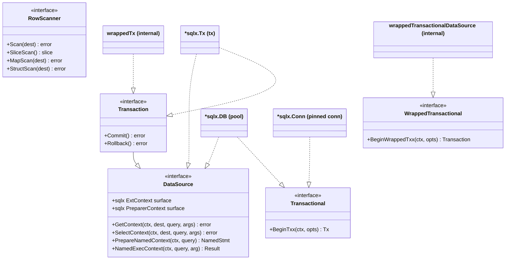
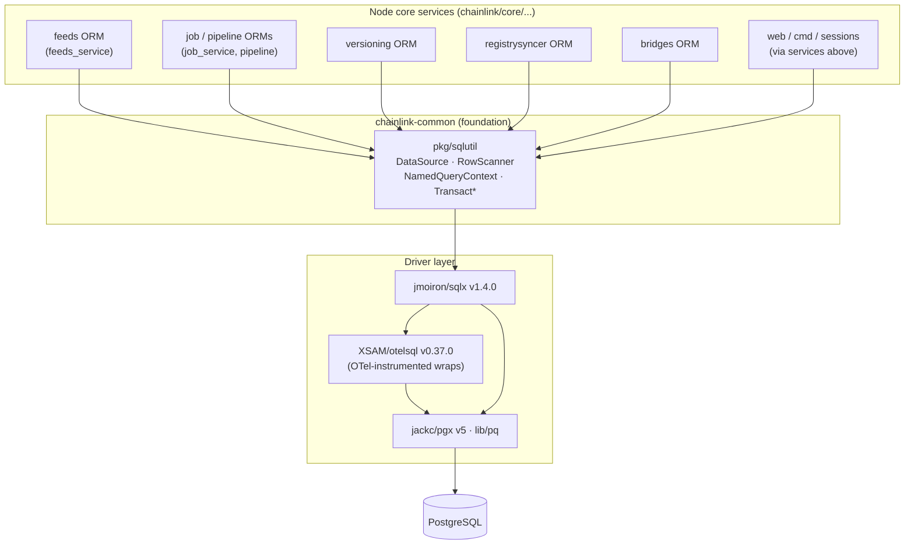
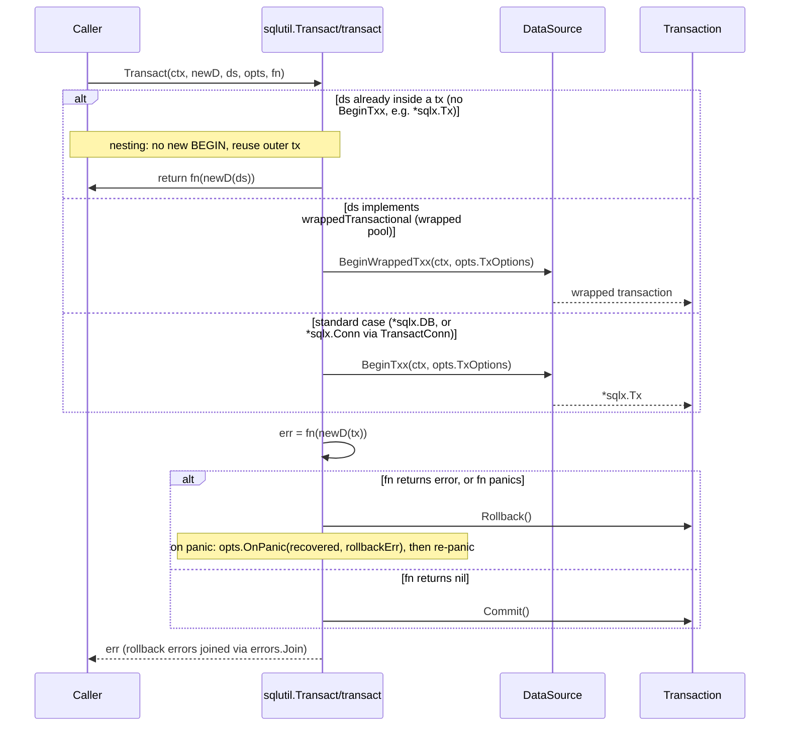
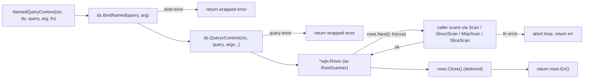

# sqlutil

`chainlink-common/pkg/sqlutil` is the shared database-access foundation for the Chainlink node. It defines a single, transaction-aware `DataSource` abstraction (implemented identically by a connection pool `*sqlx.DB` and a transaction `*sqlx.Tx`) and a small family of generic transaction helpers. Every persistence layer in the node — job storage, pipeline runs, feeds managers, registry sync, versioning — is written against this abstraction so that the same repository code works identically inside or outside a transaction.

It is one of the small, dependency-free utility packages in the [Shared Foundation Libraries & Domain Types](../Shared_Foundation_Libraries___Domain_Types.md) group, alongside the [services](services.md) lifecycle framework and the [logger](logger.md) facade.

---

## 1. Purpose and design goals

The package solves four recurring problems of Go data-access code in a long-running node:

1. **Transaction-agnostic repositories.** `*sqlx.DB` and `*sqlx.Tx` expose nearly identical query APIs but are separate types. `DataSource` unifies them behind one interface, so an ORM written once can be handed a pool for reads and a transaction for writes.
2. **Unit-of-work over domain types.** `Transact[D]` is generic over a domain wrapper type `D` (e.g., a typed ORM), so business code transacts over *its* type, not over raw `sqlx.Tx` values.
3. **Nesting without savepoints.** If the supplied `DataSource` is already a transaction, `Transact` simply reuses it — nested "transactions" become no-ops that share the fate of the outermost transaction instead of failing.
4. **Panic-safe commit/rollback with an observability hook.** A deferred handler commits on success, rolls back on error or panic, optionally reports the panic through `TxOptions.OnPanic`, and re-panics.

A secondary goal is interop with instrumented or wrapped connections: DataSources that are wrapped (e.g., by telemetry drivers such as `XSAM/otelsql`) can implement the internal `wrappedTransactional` interface so that `Transact` can still begin a real transaction through the wrapper.

## 2. Public API reference

Source: `chainlink-common/pkg/sqlutil/sqlutil.go`.

| Export | Kind | Purpose |
|---|---|---|
| `DataSource` | interface | Unified query/execute surface combining `sqlx.ExtContext`, `sqlx.PreparerContext`, `GetContext`, `SelectContext`, `PrepareNamedContext`, `NamedExecContext`. Satisfied by `*sqlx.DB` and `*sqlx.Tx` (enforced at compile time). |
| `Queryer` | type alias | `type Queryer = DataSource`. Legacy alias kept for call-site compatibility; new code should use `DataSource`. |
| `RowScanner` | interface | Row-iteration surface (`Scan`, `SliceScan`, `MapScan`, `StructScan`) satisfied by `*sqlx.Rows`; the callback type used by `NamedQueryContext`. |
| `NamedQueryContext` | function | Named-parameter query that works with *any* `DataSource`: binds the query, executes it, and invokes `fn(RowScanner)` once per row. |
| `TxOptions` | struct | Embeds `sql.TxOptions` plus `OnPanic func(recovered any, rollbackErr error)` — invoked after a panic-driven rollback, before re-panicking. |
| `TransactDataSource` | function | Transaction over the raw `DataSource`. Best for raw SQL or when multiple unrelated domain types must share one transaction. |
| `Transact[D]` | generic function | Transaction with a domain-specific type: `newD func(DataSource) D` rebinds the repository onto the transaction. |
| `TransactConn[D]` | generic function | Special case for `*sqlx.Conn` (pinned connections), which implement `BeginTxx` but not the full `DataSource` interface. |

Internal (unexported) machinery:

- `transactional` — `BeginTxx(ctx, *sql.TxOptions) (*sqlx.Tx, error)`; implemented by `*sqlx.DB` and `*sqlx.Conn`, *not* by `*sqlx.Tx`. Its absence is the nesting signal.
- `wrappedTransactional` — `BeginWrappedTxx(ctx, *sql.TxOptions) (transaction, error)`; implemented by wrapped DataSources (e.g., `wrappedTransactionalDataSource` produced by the package's `WrapDataSource` helper).
- `transaction` — `DataSource` + `Commit` + `Rollback`; implemented by `*sqlx.Tx` and the internal `wrappedTx`.
- `transact[D]` — the shared begin/defer/commit-rollback engine used by all three public entry points.

Compile-time assertions in the file guarantee the sqlx types keep satisfying the abstraction:

```go
var _ DataSource = (*sqlx.DB)(nil)
var _ DataSource = (*sqlx.Tx)(nil)
var _ transactional = (*sqlx.DB)(nil)
var _ wrappedTransactional = (*wrappedTransactionalDataSource)(nil)
var _ transaction = (*wrappedTx)(nil)
```

## 3. Architecture and component relationships

### 3.1 Type model

The interfaces deliberately carve `database/sql`/`sqlx` capabilities into the smallest units needed by callers, with `transaction` composing `DataSource` plus finalization:



Key relations:

- `*sqlx.Tx` realizes both `DataSource` and `transaction`, which is why it can be passed anywhere a `DataSource` is expected — including as the `ds` argument of a nested `Transact`.
- `*sqlx.Conn` realizes `transactional` only; it cannot act as a general `DataSource`, hence the dedicated `TransactConn` entry point.
- `wrappedTransactional` is the extension point that lets instrumented/wrapped pools participate in transactions.

### 3.2 Layering in the overall system

sqlutil sits at the bottom of the persistence stack, directly above the driver layer and below every node service ORM:



The physical connection lifecycle (URIs, pool sizing, version checks, wrapped tx drivers for tests) belongs to the [Database Persistence](../Node_Platform_Services/database_persistence.md) module (`chainlink/core/services/pg`); sqlutil itself knows nothing about it and only consumes whatever `*sqlx.DB` that layer hands out.

## 4. Transaction lifecycle and semantics

All three public entry points funnel into the internal `transact` engine, which owns begin / commit / rollback and panic handling:



Resulting semantics, summarized:

| `ds` argument | Behavior of `Transact` |
|---|---|
| `*sqlx.DB` (pool) | Begins a real transaction; commits on `nil` error; rolls back on error or panic. |
| `*sqlx.Conn` | Same, via `TransactConn` (the connection is pinned; the tx runs on it). |
| `*sqlx.Tx` | `transactional` is not implemented → `fn` runs directly on the existing transaction; **no** commit/rollback at this level. The outermost transaction owner decides the outcome. |
| Wrapped DataSource | `BeginWrappedTxx` is used so wrappers (instrumentation, test drivers) still yield a real transaction. |

Error-handling details:

- A failed `Rollback` is **not** swallowed: it is combined with the original error via `errors.Join`, except when the cause is `sql.ErrTxDone` (the transaction was already finalized — e.g., after a panic-driven rollback).
- On panic, the rollback is attempted first, then `opts.OnPanic` (if configured) receives both the recovered value and any rollback error, and the original panic is re-raised so upstream recovery (e.g., service supervisors) still works.
- Committing is the last deferred step: `err = fn(...)` runs inside the deferred function's scope, so `Commit` only happens when `fn` returned `nil` and did not panic.

## 5. Query helpers and data flow

`NamedQueryContext` is the streaming read primitive: it works on any `DataSource` (pool or transaction) rather than only on `*sqlx.DB`, which plain `sqlx.NamedQueryContext` requires.



Because the row callback receives a `RowScanner`, callers can stream large result sets without materializing them, and the same callback shape works whether the rows come from the pool or from inside a transaction.

## 6. Usage patterns

**Pattern A — typed repository with generic transactions** (the pattern from the package's own documentation, and the one used by e.g. the feeds ORM):

```go
func (d *MyD) Transact(ctx context.Context, fn func(tx *MyD) error) (err error) {
    return sqlutil.Transact(ctx, d.new, d.db, nil, fn)
}
```

The feeds service exposes exactly this shape at its interface boundary — note `WithDataSource(sqlutil.DataSource) ORM` re-binds the ORM onto a transaction or pool, and `Transact(ctx, func(ORM) error)` is the unit-of-work entry point (see [Feeds Service — persistence](../Node_Platform_Services/feeds_service.md)).

**Pattern B — raw SQL or multiple domain types in one transaction:**

```go
err := sqlutil.TransactDataSource(ctx, ds, &sqlutil.TxOptions{
    TxOptions: sql.TxOptions{Isolation: sql.LevelSerializable},
}, func(tx sqlutil.DataSource) error {
    // raw SQL and/or several ORM types over the same tx
    return nil
})
```

**Pattern C — pinned connections:** use `TransactConn` when the starting point is a `*sqlx.Conn` (e.g., for session-level locks or LISTEN/NOTIFY), since `*sqlx.Conn` cannot be handed to the generic `DataSource`-based helpers.

**Pattern D — crossing service boundaries with a transaction:** the pipeline runner accepts a transaction-scoped callback from its callers and passes it down as a `sqlutil.DataSource` — `Run(ctx, ..., fn func(tx sqlutil.DataSource) error)` and `InsertFinishedRun(ctx, ds sqlutil.DataSource, ...)` (see [Pipeline — persistence](../Oracle_Engines___Data_Pipelines/pipeline.md)). The same abstraction therefore flows between modules without either side importing the other's concrete types.

## 7. Consumers across the system

Because it is part of `chainlink-common`, sqlutil is the single place where PostgreSQL access is abstracted. Principal consumers, by module:

- **Node platform services** — the [pg layer](../Node_Platform_Services/database_persistence.md) owns connection creation and hands `*sqlx.DB` to everything else; the [job service](../Node_Platform_Services/job_service.md), [feeds service](../Node_Platform_Services/feeds_service.md), versioning, and registry syncer ORMs use `DataSource`/`Transact` for their persistence; the [p2p](../Node_Platform_Services/p2p.md) and [keystore](../Node_Platform_Services/keystore.md) modules persist through the same store stack.
- **Oracle engines & data pipelines** — the [pipeline ORM/Runner](../Oracle_Engines___Data_Pipelines/pipeline.md) and [streams](../Oracle_Engines___Data_Pipelines/streams.md) services persist runs and specs through `sqlutil.DataSource` transactions.
- **Application core** — higher-level modules ([web API](../Node_Application_Core___Interfaces/web_api.md), [bridges](../Node_Application_Core___Interfaces/bridges.md), [sessions/auth](../Node_Application_Core___Interfaces/sessions_auth.md)) reach the database only through service ORMs, never directly through sqlx.

In other words, sqlutil defines the *vocabulary* of the persistence layer; the concrete connections and lifecycle live in the pg layer, and the actual schema/migrations live in the [Database Persistence — migrations](../Node_Platform_Services/database_persistence.md) module.

## 8. Dependencies and build context

The package is intentionally minimal. Its third-party surface comes from the `chainlink-common` module manifest (`chainlink-common/go.mod`):

- `github.com/jmoiron/sqlx v1.4.0` — the only direct import (`sqlx.DB`, `sqlx.Tx`, `sqlx.Conn`, `sqlx.ExtContext`, `sqlx.PreparerContext`, `sqlx.NamedStmt`).
- `github.com/jackc/pgx/v5 v5.9.2` and `github.com/lib/pq v1.10.9` — PostgreSQL drivers available to the wrapping layers (sqlutil itself is driver-agnostic).
- `github.com/XSAM/otelsql v0.37.0` — used by wrapping code to produce OTel-instrumented DataSources; the `wrappedTransactional` hook is what lets such wrappers still begin transactions through `Transact`.
- Module: `github.com/smartcontractkit/chainlink-common` (Go 1.27), built with the shared [Build, CI & Release Infrastructure](../Build,_CI___Release_Infrastructure.md) tooling of the repository.

## 9. Design notes and gotchas

- **`Queryer` is an alias, not a second API.** `type Queryer = DataSource` exists for historical call sites; treat `DataSource` as canonical.
- **Nesting is cooperative, not isolated.** There are no savepoints: an inner `Transact` on a `*sqlx.Tx` neither commits nor rolls back. Any error must propagate to the outermost caller, or the work stays half-applied inside the outer transaction until *it* finishes.
- **Silent non-transactional fallback.** If `ds` neither implements `transactional` nor is a real pool (a custom type), `Transact` runs `fn` directly on it. Pass pools, connections, or transactions deliberately.
- **`OnPanic` is diagnostic only.** It cannot suppress the panic; rollback is attempted before the hook runs, and the hook receives the rollback error for logging/alerting.
- **Compile-time guards matter.** The `var _ ...` assertions pin the sqlx version behavior — a sqlx upgrade that changes `*sqlx.Tx`'s method set will fail the build here rather than at runtime.

## 10. Related documentation

- [Shared Foundation Libraries & Domain Types](../Shared_Foundation_Libraries___Domain_Types.md) — parent group: domain types, settings, settings limits, and other foundation packages.
- [Database Persistence](../Node_Platform_Services/database_persistence.md) — connection creation, locking (`LockedDB`), backups, migrations, versioning.
- [Job Service](../Node_Platform_Services/job_service.md) and [Feeds Service](../Node_Platform_Services/feeds_service.md) — representative ORM consumers with `WithDataSource`/`Transact` surfaces.
- [Pipeline](../Oracle_Engines___Data_Pipelines/pipeline.md) — cross-module transaction callback pattern (`func(tx sqlutil.DataSource) error`).
- [services](services.md) — the service lifecycle framework that starts/stops the long-running components holding these DataSources.
