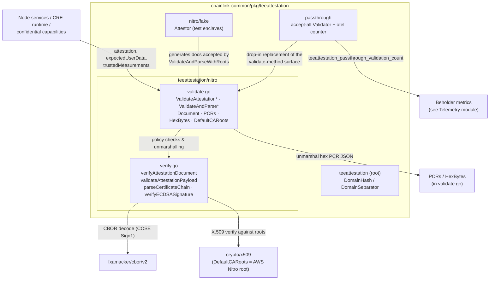

# TEE Attestation (`chainlink-common/pkg/teeattestation`)

## Purpose

The **tee-attestation** module provides platform-agnostic primitives for validating **Trusted Execution Environment (TEE)** attestations, with first-class support for **AWS Nitro Enclaves**. It lets any Chainlink component (node services, the CRE workflow runtime, confidential capabilities) verify that:

1. A peer really is running inside a genuine AWS Nitro Enclave (hardware-rooted certificate chain),
2. The enclave runs exactly the expected code and configuration (trusted PCR measurements), and
3. The attestation is bound to the specific exchange it protects (user data, nonce, public key).

It is a shared foundation library in the [Shared Foundation Libraries & Domain Types](../Shared_Foundation_Libraries___Domain_Types.md) group: it has no dependencies on node services and only depends on the Go standard library plus `github.com/fxamacker/cbor/v2` (see `chainlink-common/go.mod`) for CBOR decoding of the attestation wire format.

> **Key concepts**
> - **COSE Sign1** — the CBOR-signed envelope AWS Nitro produces (`18(tagged)` signature structure: protected header, payload, signature).
> - **PCRs (Platform Configuration Registers)** — SHA-384 digests inside the enclave describing the loaded image and configuration. PCR0/PCR1/PCR2 must match trusted measurements for an attestation to be accepted.
> - **`user_data`** — caller-supplied bytes embedded by the enclave in the attestation, used to bind the attestation to a specific request or session.
> - **Domain separation** — `teeattestation.DomainHash` derives collision-free, purpose-specific hashes from attestation payloads (tagged, length-prefixed SHA-256 under the `CONFIDENTIAL_COMPUTE_PAYLOAD` domain separator).

## Architecture

The module is organised as a small package tree under `chainlink-common/pkg/teeattestation`:

| Package | Responsibility | Layer |
|---|---|---|
| `teeattestation` (root, `hash.go`) | Platform-agnostic domain-separated hashing (`DomainHash`, `DomainSeparator`) | Primitives |
| `teeattestation/nitro` (`verify.go`) | Cryptographic verification engine: CBOR/COSE parsing, payload validation, X.509 chain verification, ECDSA P-384 signature check | Verification core |
| `teeattestation/nitro` (`validate.go`) | Policy API: trusted PCR matching, user-data binding, `Document` parsing, embedded AWS root CA | Validation policy (public API) |
| `teeattestation/nitro/fake` (`fake.go`) | `Attestor` generating structurally valid Nitro-like COSE Sign1 documents for tests without real enclave hardware | Test support |
| `teeattestation/passthrough` (`passthrough.go`) | INSECURE accept-everything validator, instrumented with an OpenTelemetry/Beholder counter so the insecure path is observable | Test / local environments |

### Package & dependency diagram



### Component relationships

- **validate.go (policy layer) → verify.go (crypto layer):** the exported `Validate*`/`ValidateAndParse*` functions build an `x509.CertPool` (from the embedded `DefaultCARoots` or a caller-provided PEM), delegate all cryptographic work to `verifyAttestationDocument`, then apply the *policy* checks: user-data equality and PCR0/1/2 equality against the trusted measurements. Only after every check passes is a `Document` returned to the caller.
- **verify.go is the single trust anchor:** it enforces the COSE structure, the ES384 (ECDSA P-384) algorithm, payload sanity limits, the ±5-minute freshness window, certificate-chain validity against the supplied roots, and the raw ECDSA signature. All security-relevant hardening ([CL112-10], [CL112-12]) lives here.
- **fake / passthrough are companions, not dependencies:** `nitro/fake` produces documents that pass `ValidateAndParseWithRoots` (custom roots), enabling full validation-path testing on non-Nitro hardware; `passthrough` mirrors the *validate-method surface* so it can be swapped in for local/test environments where fake enclaves are trusted.
- **hash.go is used by higher layers** to derive domain-separated hashes of attestation payloads before they are embedded as `user_data` (length-prefixed, `CONFIDENTIAL_COMPUTE_PAYLOAD` domain separator — [CL112-14]).

## Public API (validation policy layer)

The module's entry points (detailed in [tee-attestation_nitro-validation](tee-attestation/tee-attestation_nitro-validation.md)):

| Function | Use case |
|---|---|
| `ValidateAttestation(attestation, expectedUserData, trustedMeasurements) error` | Production validation against the embedded AWS Nitro root; discard parsed fields. |
| `ValidateAttestationWithRoots(..., caRootsPEM)` | Same policy, custom CA roots — used with `nitro/fake` attestors in tests. |
| `ValidateAndParse(...)` / `ValidateAndParseWithRoots(...)` | Validation **plus** a parsed [`Document`](tee-attestation/tee-attestation_nitro-validation.md) exposing `PCRs`, `LeafPublicKey`, `PublicKey`, `UserData`, `Nonce`, `ModuleID` for identity binding and freshness checks. |

```go
doc, err := nitro.ValidateAndParse(attestationDoc, expectedUserData, trustedMeasurements)
// err == nil ⇒ cert chain valid, signature valid, user data matched,
// PCR0/PCR1/PCR2 match trustedMeasurements, timestamp within ±5 min.
// doc.PublicKey / doc.Nonce may still need caller-side comparison.
```

## Validation flow

```mermaid
sequenceDiagram
    participant C as Caller (service / runtime)
    participant V as nitro.ValidateAndParse
    participant P as verifyAttestationDocument
    participant X as crypto/x509 + ecdsa

    C->>V: attestation, expectedUserData, trustedMeasurements (JSON PCRs)
    V->>V: build x509 CertPool (DefaultCARoots or custom PEM)
    V->>P: verify document, roots, time.Now()
    P->>P: parse COSE Sign1 (CBOR), check sections non-empty
    P->>P: validate protected header alg == ES384 (-35)
    P->>P: validateAttestationPayload (mandatory fields, digest=SHA384,<br/>PCR count/size, cabundle & field length limits)
    P->>P: parse leaf cert (ECDSA, ECDSAWithSHA384) + cabundle intermediates
    P->>P: freshness: |now − timestamp| ≤ 5 min  [CL112-10]
    P->>X: leafCert.Verify(intermediates, roots, now)
    P->>X: rebuild Sig1 structure, verifyECDSASignature (P-384/SHA-384)
    P-->>V: verifyResult{document, signatureOK, leafPublicKey}
    V->>V: bytes.Equal(expectedUserData, doc.UserData)
    V->>V: unmarshal trustedMeasurements → PCRs{PCR0,PCR1,PCR2}; compare PCR0/1/2
    V-->>C: *Document{PCRs, LeafPublicKey, PublicKey, UserData, Nonce, ModuleID}
```

Any step failing yields a typed, descriptive error (e.g. `errStaleAttestation`, `errBadPCRs`, `"PCR0 mismatch: expected …"`) — see the error catalogue in [tee-attestation_nitro-verification](tee-attestation/tee-attestation_nitro-verification.md).

## Trust model & hardening

- **Single root of trust:** production validation is pinned to the embedded AWS Nitro Enclaves root certificate (`DefaultCARoots`, from AWS's published root). Custom roots are only accepted through the `*WithRoots` variants, which are documented as test-only.
- **Freshness:** attestations older than **5 minutes** (or from the far future) are rejected (`maxAttestationAge`) so stolen attestations cannot be replayed indefinitely [CL112-10]. The `Nonce` field is *not* auto-checked; callers needing replay protection compare it against a fresh challenge themselves.
- **Algorithm pinning:** the COSE algorithm must be ES384, the leaf certificate must be ECDSA/`ECDSAWithSHA384` with a **P-384** key, and signature hashing is pinned to SHA-384. Curve/algorithm mismatches surface as distinct errors rather than misleading "bad signature" failures [CL112-12].
- **Input hardening:** payload sizes, PCR indices (0–31) and PCR value lengths (32/48/64 bytes), CA-bundle item sizes and optional-field lengths are all bounded before any cryptography runs.
- **Stable vs. ephemeral identity:** `LeafPublicKey` rotates roughly every few hours with the enclave's end-entity certificate and is **not** a stable identity anchor; `Document.PublicKey` is the enclave-published, long-lived identity key, and `nitro.DomainHash` provides the domain separation used when committing payload data on top of an attestation.
- **Observable insecure mode:** the `passthrough` validator emits a Beholder/OpenTelemetry counter (`teeattestation_passthrough_validation_count`) on every accept, so an accidentally enabled insecure path can be alerted on. See the Beholder telemetry module for the emission pipeline.

## Testing support

`chainlink-common/pkg/teeattestation/nitro/fake` provides an `Attestor` that mints a self-signed P-384 root CA, a leaf certificate, deterministic 48-byte fake PCRs, and full COSE Sign1 documents (`CreateAttestation` with `WithNonce`/`WithPublicKey` options). Combined with `Attestor.CARootsPEM()` and `Attestor.TrustedPCRsJSON()`, it exercises the **entire** validation chain (CBOR → certificate chain → signature → user data → PCRs) on any machine, without Nitro hardware.

## Where this fits in the system

- It is consumed by chainlink node and CRE runtime components that need to authenticate confidential-compute peers — for example the confidential workflow path in the [Workflow & Capability Runtime (CRE Engine)](../Workflow___Capability_Runtime_(CRE_Engine).md) and confidential networking capabilities that use the `CONFIDENTIAL_COMPUTE_PAYLOAD` domain separator.
- Metric emission from the `passthrough` validator rides on the Beholder stack documented in [Telemetry & Observability Platform](../Telemetry___Observability_Platform.md).
- As a foundation library, it follows the same Go module build conventions as the rest of `chainlink-common` (`chainlink-common/go.mod`, `chainlink-common/Makefile`).

## Sub-module documentation

Detailed documentation for the two layers of the `nitro` package (generated under `Shared_Foundation_Libraries___Domain_Types/tee-attestation/`):

| Page | Covers |
|---|---|
| [tee-attestation/tee-attestation_nitro-verification.md](tee-attestation/tee-attestation_nitro-verification.md) | **Nitro Verification Core** — COSE Sign1 parsing, protected-header algorithm enforcement, payload validation limits, certificate-chain verification, ECDSA P-384 signature verification, freshness window, and the full error catalogue (`errStaleAttestation`, `errBadPCRs`, …). |
| [tee-attestation/tee-attestation_nitro-validation.md](tee-attestation/tee-attestation_nitro-validation.md) | **Nitro Validation Policy API** — exported `ValidateAttestation` / `ValidateAndParse` (+ `*WithRoots` variants), trusted-PCR binding via `PCRs`/`HexBytes`, the caller-facing `Document` type, and the embedded AWS Nitro root (`DefaultCARoots`). |

The test-support companions (`nitro/fake.Attestor` and the instrumented `passthrough.Validator`) are intentionally *not* separate sub-modules — they are described above under "Testing support" and "Trust model & hardening", and their behaviour is defined relative to the validation API in [tee-attestation/tee-attestation_nitro-validation.md](tee-attestation/tee-attestation_nitro-validation.md).
