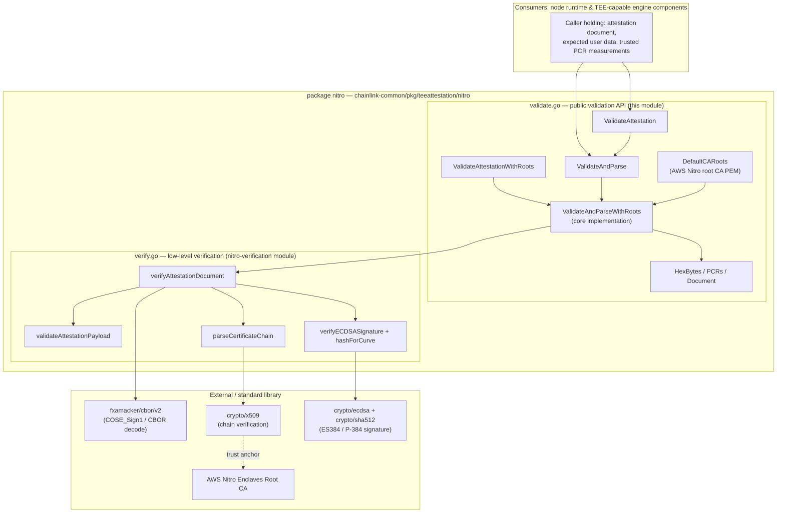
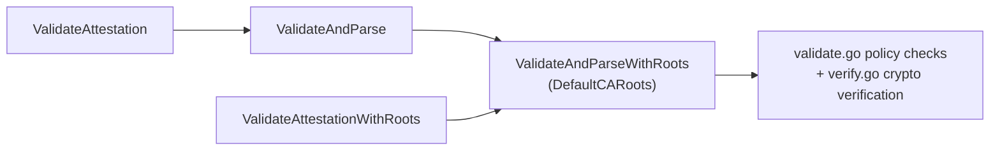
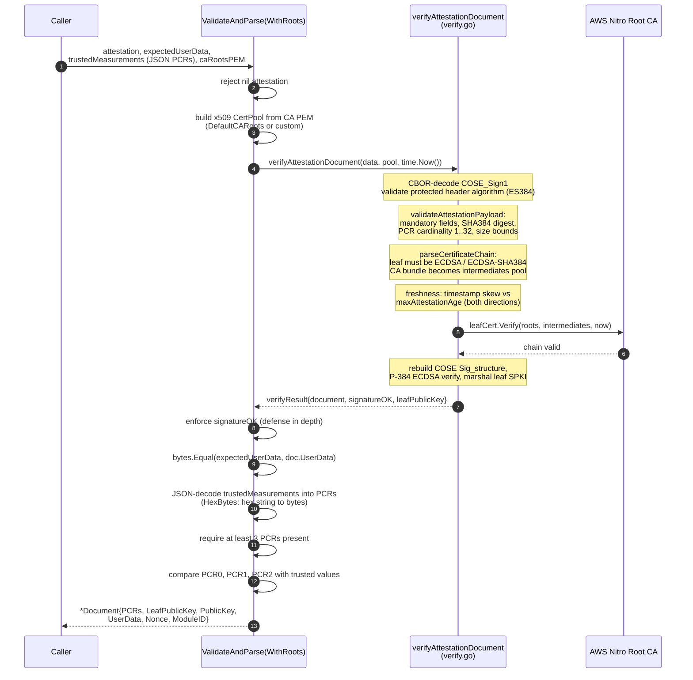
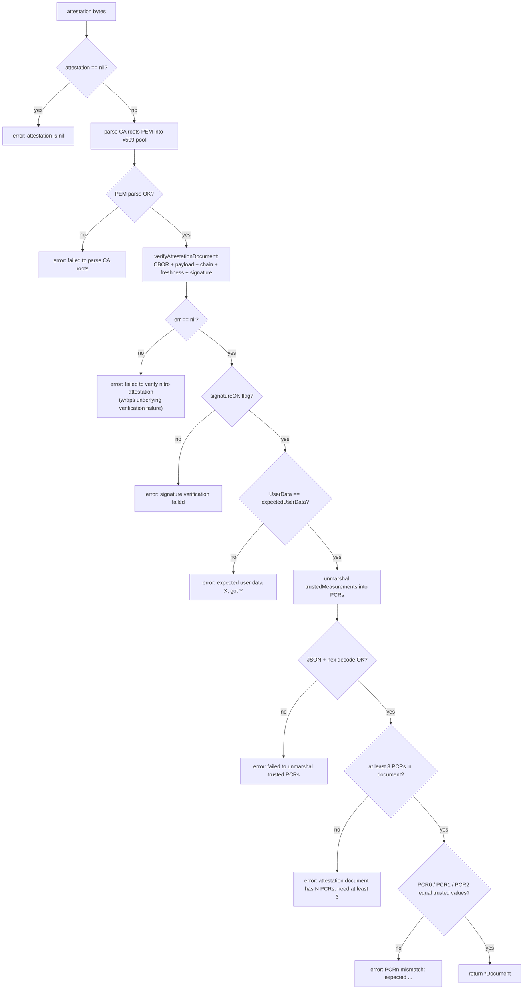
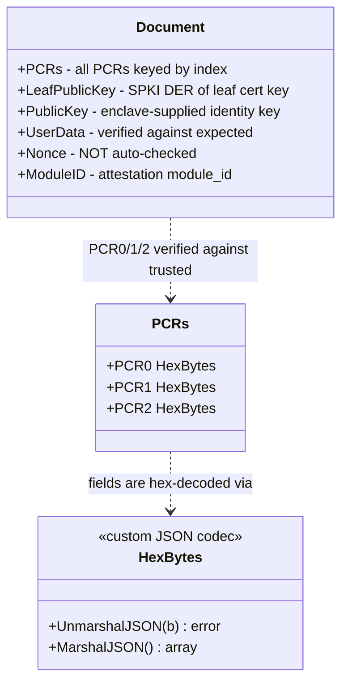
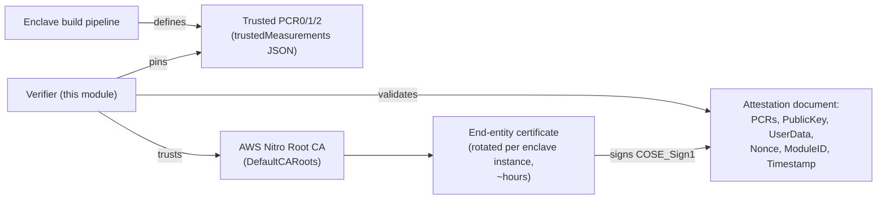

# TEE Attestation — Nitro Validation

> **Module**: `chainlink-common/pkg/teeattestation/nitro/validate.go`
> **Part of**: [Shared Foundation Libraries & Domain Types](../../Shared_Foundation_Libraries___Domain_Types.md) → [TEE Attestation](../tee-attestation.md)

## 1. Introduction

The **Nitro validation module** provides the public, policy-level API for validating **AWS Nitro Enclave attestation documents**. An attestation document is a COSE `Sign1`-signed structure produced by the Nitro hypervisor that proves *which enclave image is running* (via Platform Configuration Registers, PCRs) and *who signed it* (a certificate chain rooted in the AWS Nitro Enclaves CA).

This module answers the question a verifier cares about:

> *"Is this attestation genuine, fresh, produced by the enclave image I expect, and bound to the user data I sent?"*

It does so by layering **application-level validation policy** (this file — user-data binding, trusted PCR pinning, result parsing) on top of **low-level cryptographic verification** (the sibling [Nitro Verification](tee-attestation_nitro-verification.md) module — COSE/CBOR parsing, certificate chain validation, ES384/P-384 signature checks).

Within the broader system, this package is the trust anchor for workflows and components that operate inside (or talk to) Trusted Execution Environments — e.g. TEE-backed workflow execution in the [CRE engine](../../Workflow___Capability_Runtime_(CRE_Engine)/workflows/workflows_engine.md), where peers must prove their enclave identity and image integrity before being trusted.

---

## 2. Architecture

### 2.1 Layered design

```
┌─────────────────────────────────────────────────────────────────┐
│  validate.go (this module) — PUBLIC VALIDATION API               │
│  • nil/input guards          • user-data binding                │
│  • CA root selection         • trusted PCR0/1/2 pinning         │
│  • JSON decoding of PCRs     • parsed *Document result          │
└──────────────────────────────┬──────────────────────────────────┘
                               │ verifyAttestationDocument(...)
┌──────────────────────────────▼──────────────────────────────────┐
│  verify.go (nitro-verification module) — CRYPTO VERIFICATION     │
│  • COSE_Sign1 / CBOR decode  • payload shape validation         │
│  • certificate chain parse   • timestamp freshness              │
│  • x509 chain verify         • ES384 (P-384) signature verify   │
└─────────────────────────────────────────────────────────────────┘
```

All four exported entry points collapse into one core implementation, `ValidateAndParseWithRoots`, which distinguishes callers only by (a) whether they want the parsed result and (b) which CA root certificate is trusted.

### 2.2 Component relationship diagram



**External dependencies** (see `chainlink-common/go.mod`): `github.com/fxamacker/cbor/v2` for COSE/CBOR decoding; everything else is Go standard library (`crypto/x509`, `crypto/ecdsa`, `crypto/sha512`, `encoding/json`, `encoding/hex`).

---

## 3. Public API Reference

### 3.1 Validation functions

All functions are pure (stateless, no goroutines or shared state) and **fail closed** — any failure returns a non-nil error and (where applicable) a `nil` document.

| Function | Returns | Trusted root | Intended use |
|---|---|---|---|
| `ValidateAttestation(attestation, expectedUserData, trustedMeasurements []byte) error` | `error` only | `DefaultCARoots` (AWS) | Production validation when the parsed result is not needed |
| `ValidateAttestationWithRoots(attestation, expectedUserData, trustedMeasurements []byte, caRootsPEM string) error` | `error` only | Custom PEM | Testing with fake enclaves that use self-signed CA roots |
| `ValidateAndParse(attestation, expectedUserData, trustedMeasurements []byte) (*Document, error)` | `*Document` | `DefaultCARoots` (AWS) | Production validation + identity binding / freshness checks |
| `ValidateAndParseWithRoots(attestation, expectedUserData, trustedMeasurements []byte, caRootsPEM string) (*Document, error)` | `*Document` | Custom PEM | Core implementation; testing with fake enclaves |

The wrapper relationships are strict delegation:



> ⚠️ `ValidateAttestationWithRoots` / `ValidateAndParseWithRoots` exist **primarily for testing** with fake enclaves signed by self-signed roots. Production code should use the AWS-root variants unless it deliberately operates in a private enclave fleet with its own CA.

### 3.2 Types

| Type | Kind | Purpose |
|---|---|---|
| `HexBytes` | `[]byte` with custom JSON codec | Decodes AWS Nitro measurements, which are **hex strings in JSON**, into raw bytes (`UnmarshalJSON`), and re-encodes bytes to hex on marshal. Keeps `trustedMeasurements` parsing symmetrical with the wire format. |
| `PCRs` | struct (`PCR0`, `PCR1`, `PCR2 HexBytes`, JSON tags `pcr0/pcr1/pcr2`) | The **trusted measurement set** a verifier pins an enclave image to. Decoded from JSON via `HexBytes`. |
| `Document` | struct | The **validated, parsed attestation fields** returned only after the full validation chain has passed. See [Data model](#5-data-model). |
| `DefaultCARoots` | `const string` | PEM of the AWS Nitro Enclaves root certificate (sourced from `https://aws-nitro-enclaves.amazonaws.com/AWS_NitroEnclaves_Root-G1.zip`). |

**Trusted measurements JSON format** (decoded by `HexBytes`):

```json
{
  "pcr0": "e2af3e01...ff",
  "pcr1": "9c5b2aff...11",
  "pcr2": "11d4c93a...72"
}
```

---

## 4. Validation Pipeline

### 4.1 End-to-end sequence



Steps 1–12 (up to and including the signature result) are performed by the [nitro-verification module](tee-attestation_nitro-verification.md); steps 13–18 are the **policy layer owned by this module**.

### 4.2 Decision gates (this module)



**Gate semantics:**

1. **Input guard** — a nil attestation is rejected immediately.
2. **Root selection** — the caller-supplied PEM (or `DefaultCARoots`) is compiled into an `x509.CertPool`; a malformed PEM fails fast.
3. **Cryptographic verification** — delegated wholesale to `verifyAttestationDocument`; any error is wrapped with `"failed to verify nitro attestation: ..."`. The `signatureOK` result flag is additionally re-checked as defense in depth.
4. **User-data binding** — the attestation's `user_data` field must be byte-identical to `expectedUserData`. This is how the verifier binds the attestation to *this specific interaction* (e.g. an expected workload descriptor or request hash).
5. **Trusted PCR pinning** — `trustedMeasurements` JSON is decoded into a `PCRs` struct; the document must expose at least 3 PCRs and **PCR0, PCR1 and PCR2 must match exactly** (`bytes.Equal` on hex-decoded values). These are the canonical build-time measurements of the enclave (image / kernel-bootstrap / application; exact semantics are defined by the enclave build pipeline that produced the measurements).

---

## 5. Data model



### `Document` field semantics and caller guidance

| Field | Type | Semantics | Caller guidance |
|---|---|---|---|
| `PCRs` | `map[uint][]byte` | Every platform configuration register present in the attestation, keyed by index. PCR0/1/2 have already been checked against trusted measurements. | Higher PCRs (e.g. 3, 4, 8) are **exposed unchecked** — apply your own policy before trusting them. |
| `LeafPublicKey` | `[]byte` (SPKI DER) | Public key of the attestation's end-entity certificate. AWS rotates this certificate **per enclave instance (~every few hours)**. | Not a stable identity anchor on its own. Useful for correlating attestations within a short window. |
| `PublicKey` | `[]byte` | The enclave-supplied `public_key` field (nil if unset) — a **long-lived identity key generated inside the TEE**. | Preferred stable handle for binding an attestation to a specific enclave identity across restarts/certificate rotation. |
| `UserData` | `[]byte` | The attestation `user_data` field; already verified equal to `expectedUserData`. | Safe to treat as the verified request/context binding. |
| `Nonce` | `[]byte` | The attestation `nonce` field (nil if unset). **`ValidateAndParse` does NOT check it.** | For replay protection, compare it yourself against a freshly generated challenge you supplied to the enclave. |
| `ModuleID` | `string` | The attestation `module_id` field. | Informational; useful in logs/policy. |

### Trust chain overview



---

## 6. Usage

### 6.1 Validate only (production)

```go
import nitro "github.com/smartcontractkit/chainlink-common/pkg/teeattestation/nitro"

// trustedMeasurements is the JSON document pinning PCR0/1/2 for the
// expected enclave image.
if err := nitro.ValidateAttestation(attestation, expectedUserData, trustedMeasurements); err != nil {
    // reject: untrusted attestation
}
```

### 6.2 Validate and bind identity + freshness

```go
doc, err := nitro.ValidateAndParse(attestation, expectedUserData, trustedMeasurements)
if err != nil {
    // reject
}

// Replay protection: the validator does NOT check Nonce — the caller must
// compare it against the fresh challenge it sent to the enclave.
if !bytes.Equal(doc.Nonce, issuedChallenge) {
    // replay attempt
}

// Stable identity: prefer the enclave-generated key over the rotating
// per-instance certificate key.
identity := doc.PublicKey      // long-lived (enclave-generated)
// doc.LeafPublicKey           // short-lived (rotated certificate key)
```

### 6.3 Testing with fake enclaves

```go
// Fake enclave signs attestations with a self-signed root:
err := nitro.ValidateAttestationWithRoots(att, wantUserData, trustedPCRs, fakeCAPEM)

doc, err := nitro.ValidateAndParseWithRoots(att, wantUserData, trustedPCRs, fakeCAPEM)
```

---

## 7. Security Model

**Guarantees provided (fail-closed):**

- **Authenticity** — COSE signature verified with ES384 (P-384 / SHA-384) against a leaf certificate that chains to the trusted root (AWS by default).
- **Integrity & shape** — payload structure, mandatory fields, digest algorithm (`SHA384`), PCR cardinality (1–32) and value sizes (32/48/64 bytes), and field size caps (≤1024 bytes for key/user-data/nonce; ≤1024 per CA-bundle item) are enforced by the verification layer.
- **Freshness** — the attestation timestamp (epoch milliseconds) must fall within `maxAttestationAge` of `time.Now()` in both directions (stale and far-future attestations are rejected).
- **Workload pinning** — PCR0/PCR1/PCR2 must byte-match the trusted measurements, binding the attestation to a specific enclave image build.
- **Context binding** — `user_data` must byte-match the caller's expected value.

**Explicit non-guarantees (caller responsibilities):**

| Concern | Status | Mitigation |
|---|---|---|
| Replay protection | `Nonce` is **returned, not checked** | Caller generates a fresh challenge, delivers it to the enclave (e.g. via `user_data` or `nonce`), and compares `doc.Nonce` |
| Long-term identity | `LeafPublicKey` rotates (~hours) | Bind to `Document.PublicKey` (enclave-generated key) |
| PCRs beyond 0–2 | Exposed in `Document.PCRs` **unchecked** | Apply caller-side policy before trusting higher PCRs |
| Custom roots in production | `*WithRoots` variants accept any PEM | Restrict custom-root calls to test builds / private enclave fleets with their own CA |

**Note on time:** the verifier pins `time.Now()` at call time; there is no injectable clock in this module, so testability of freshness windows is achieved via the custom-roots + fake-attestation path.

---

## 8. Dependencies

| Dependency | Used for | Source |
|---|---|---|
| `github.com/fxamacker/cbor/v2` | CBOR decoding of COSE `Sign1` structures and attestation payload | `chainlink-common/go.mod` |
| `crypto/x509`, `crypto/ecdsa`, `crypto/sha512` | Certificate chain verification, P-384 ECDSA signature verification | Go standard library |
| `encoding/json`, `encoding/hex` | `HexBytes` codec for trusted measurements | Go standard library |

---

## 9. Related Documentation

- **[Nitro Verification](tee-attestation_nitro-verification.md)** — the low-level cryptographic verification layer (`verify.go`) this module delegates to: COSE parsing, payload validation, certificate chain handling, ES384 signatures, freshness enforcement.
- **[TEE Attestation](../tee-attestation.md)** — parent module overview.
- **[Shared Foundation Libraries & Domain Types](../../Shared_Foundation_Libraries___Domain_Types.md)** — the foundation layer this package belongs to.
- **[CRE Workflow Engine](../../Workflow___Capability_Runtime_(CRE_Engine)/workflows/workflows_engine.md)** — the workflow runtime whose TEE-backed execution this attestation mechanism helps secure (the CRE TypeScript SDK exposes a corresponding `TeeRuntime`).
