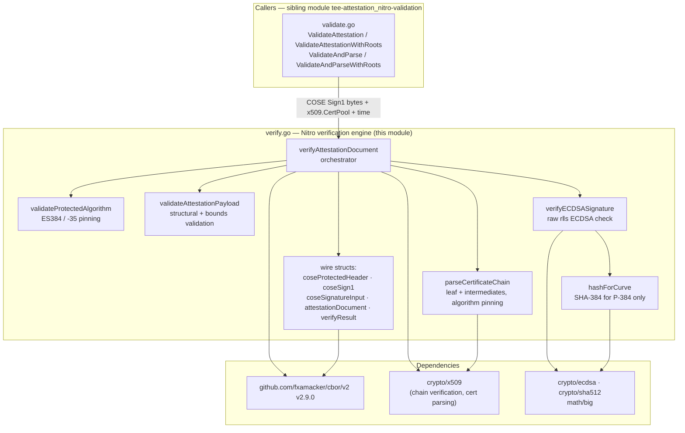
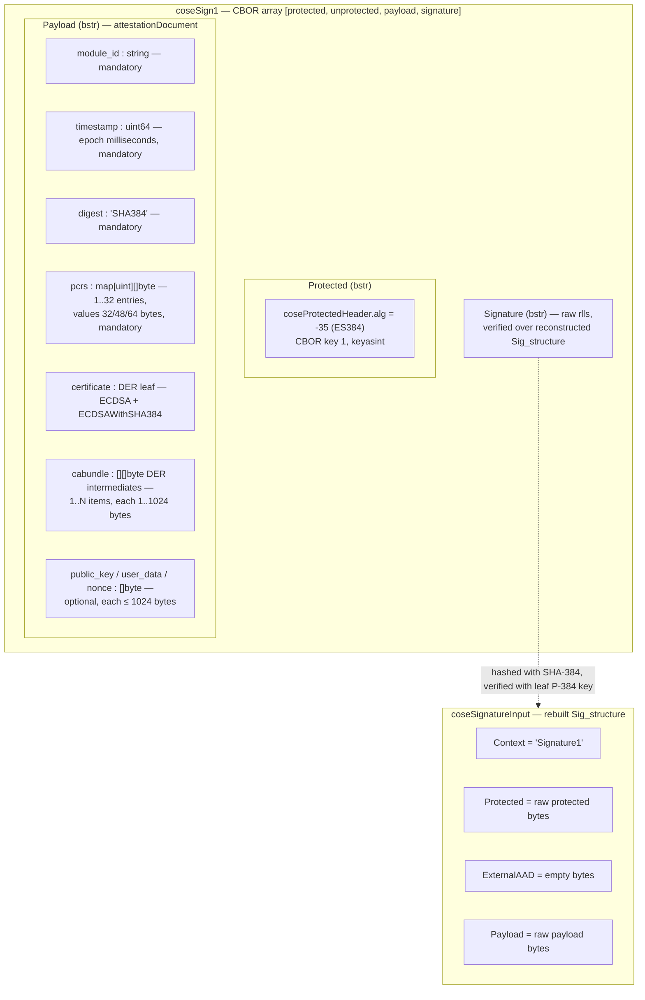
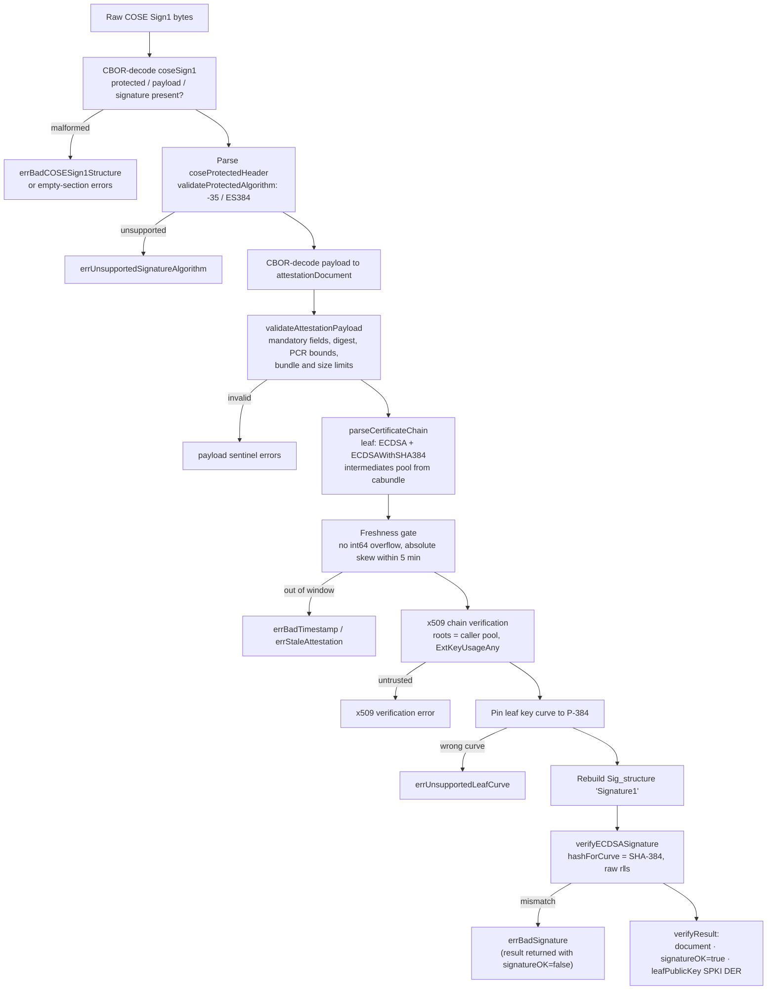
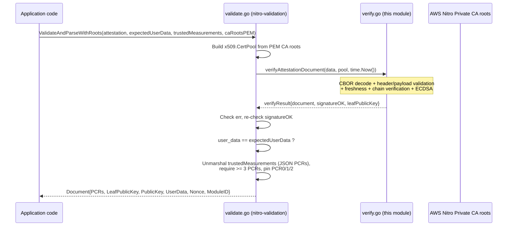

# TEE Attestation — Nitro Verification

This module is the **cryptographic verification engine for AWS Nitro Enclave attestation documents**, implemented in `chainlink-common/pkg/teeattestation/nitro/verify.go`. It parses a raw COSE Sign1 attestation blob, validates its structure and freshness, verifies the certificate chain against caller-provided AWS Private CA roots, and cryptographically verifies the ECDSA P-384 (ES384) signature over the attestation payload.

It is the lower half of the `teeattestation/nitro` package: the public-facing policy API (trusted-measurement pinning, user-data binding, root bundle loading) lives in the sibling module [tee-attestation_nitro-validation](tee-attestation_nitro-validation.md), which is the only documented caller of this engine. See the parent page [tee-attestation](../tee-attestation.md) for the TEE attestation domain overview.

---

## 1. Purpose and Scope

AWS Nitro Enclaves produce an **attestation document**: a CBOR-encoded `COSE_Sign1` object signed by an ephemeral, enclave-specific end-entity certificate whose chain roots in the AWS Nitro attestation Private CA. Relying parties (e.g., a Chainlink node that is about to hand secrets or accept reports from a TEE) must verify:

1. **Structure** — the blob is a well-formed COSE Sign1 with a valid ES384 protected header and a complete attestation payload.
2. **Freshness** — the attestation timestamp is recent, so replayed or pre-issued documents are rejected.
3. **Authenticity** — the signing certificate chains to the trusted AWS root pool.
4. **Integrity** — the ECDSA signature matches the exact `Sig_structure` bytes.

This module performs all four duties and returns a `verifyResult` containing the decoded `attestationDocument`, a `signatureOK` flag, and the **leaf public key in SPKI (DER) form** for downstream key-binding decisions. It deliberately does **not** enforce product policy (e.g., which PCR values are trusted); that is the validation layer's job.

### Key design decisions

| Decision | Rationale |
|---|---|
| Algorithm pinned to **ES384** (COSE alg `-35`) | AWS Nitro Private CA issues only P-384 leaf keys; any declared/actual mismatch is a tamper signal rather than something to silently re-hash. |
| Absolute freshness window of **±5 minutes** (`maxAttestationAge`, audit tag `[CL112-10]`) | Attestations must be consumed promptly after issuance; rejects both stale and far-future (clock-skew) timestamps. |
| Leaf curve explicitly pinned to **P-384** (audit tag `[CL112-12]`) | Surfaces an unsupported curve as a distinct error instead of a misleading "bad signature" from the hash-function fallback. |
| Signature checked as raw `r‖s` of length `2 × curveKeySize` | Per RFC 9053 §2.1, the component size is `ceil(bitSize/8)` (66 bytes for P-521), which differs from the hash length — the module handles both correctly even though only P-384 is accepted here. |
| Engine is **unexported** (`verifyAttestationDocument`) | The package's public API surface is the validation layer; this module is an internal implementation detail. |
| `currentTime` parameter with zero-value fallback to `time.Now()` | Enables deterministic testing while defaulting to wall-clock behaviour in production. |

---

## 2. Architecture

The module is a single-file engine (`verify.go`) composed of one orchestrating function and four focused helpers, plus the CBOR wire-format structs. Everything lives in package `nitro` alongside the validation layer.



**External dependencies** (from `chainlink-common/go.mod`, module `github.com/smartcontractkit/chainlink-common`, Go 1.27.1):

- `github.com/fxamacker/cbor/v2 v2.9.0` — deterministic CBOR decoding of the COSE structures (including `keyasint` maps and `toarray` structs).
- Go standard library only for all cryptography: `crypto/ecdsa`, `crypto/sha512`, `crypto/x509`, `math/big`.

---

## 3. Data Model — COSE Sign1 and Attestation Document

The engine decodes the wire format into three CBOR-tagged structs. Field tags follow the AWS Nitro attestation specification (`module_id`, `timestamp`, `digest`, `pcrs`, `certificate`, `cabundle`, plus optional `public_key`, `user_data`, `nonce`).



The resulting `verifyResult` is the engine's only output type:

| Field | Type | Meaning |
|---|---|---|
| `document` | `*attestationDocument` | Fully decoded payload (PCRs, certificate, optional fields). |
| `signatureOK` | `bool` | `true` only when the ECDSA signature verified. |
| `leafPublicKey` | `[]byte` | SPKI (DER) of the end-entity certificate key; populated only when `signatureOK` is true. Callers should treat this as **ephemeral** — AWS rotates the end-entity certificate per enclave instance (roughly every few hours), so it is not a stable identity anchor (see the `Document` docs in the [validation module](tee-attestation_nitro-validation.md)). |

---

## 4. Core Components

### 4.1 `verifyAttestationDocument` — orchestrator

```go
func verifyAttestationDocument(data []byte, roots *x509.CertPool, currentTime time.Time) (*verifyResult, error)
```

Single entry point of the engine (unexported). Pipeline, in order:

1. CBOR-decode `data` into `coseSign1`; reject malformed arrays and empty `Protected`/`Payload`/`Signature` sections.
2. Decode the protected header and enforce the algorithm via `validateProtectedAlgorithm` (ES384 / `-35` only).
3. Decode the payload into `attestationDocument` and run `validateAttestationPayload`.
4. Build the leaf certificate and intermediates pool via `parseCertificateChain`.
5. **Freshness gate**: reject `timestamp` values that overflow `int64`, convert epoch-millis to a `time.Time`, and reject if `|currentTime − issued| > maxAttestationAge` (5 minutes). A zero `currentTime` falls back to `time.Now()`.
6. **Chain-of-trust gate**: `leafCert.Verify` with the caller's `roots`, the parsed intermediates, `CurrentTime: currentTime`, and `ExtKeyUsageAny`.
7. Rebuild the COSE `Sig_structure` (`"Signature1"` context, raw protected bytes, empty AAD, raw payload).
8. Pin the leaf key curve to **P-384** (distinct error for a curve/algorithm disagreement, audit tag `[CL112-12]`).
9. Verify the signature via `verifyECDSASignature`.
10. On success, marshal the leaf public key to SPKI DER and return `&verifyResult{document, signatureOK: true, leafPublicKey}`.

**Important contract:** on signature failure the function returns *both* a result with `signatureOK: false` *and* `errBadSignature`. Callers must check the error first (the validation layer does exactly this: error check, then `signatureOK` re-check as defense in depth).

### 4.2 `validateAttestationPayload` — structural validation

Enforces every field bound before any crypto runs, so malformed input can never reach the parser stack:

- **Mandatory fields present**: `ModuleID`, `Digest`, `Timestamp`, `PCRs`, `Certificate`, `CABundle`.
- `Digest == "SHA384"` (matches the ES384 algorithm pin).
- `Timestamp ≥ 1` (zero/absent rejected; upper bound handled later by the overflow/freshness checks).
- **PCRs**: between 1 and 32 entries; every index < 32; every value length ∈ `{32, 48, 64}` bytes (accommodates SHA-256/384/512-class measurements).
- **CABundle**: at least one item; each item non-nil and 1–1024 bytes.
- **Optional fields** (`PublicKey`, `UserData`, `Nonce`): at most 1024 bytes each.

### 4.3 `parseCertificateChain` — leaf and intermediates

Parses the DER leaf certificate and requires:

- `PublicKeyAlgorithm == x509.ECDSA`
- `SignatureAlgorithm == x509.ECDSAWithSHA384`

Every `CABundle` item is parsed as a DER certificate and added to an `x509.CertPool` of intermediates. Actual chain verification (against the caller-supplied AWS roots) happens in `verifyAttestationDocument` via `x509.Verify`.

### 4.4 `verifyECDSASignature` and `hashForCurve` — signature path

```go
func verifyECDSASignature(publicKey *ecdsa.PublicKey, sigStructure, signature []byte) bool
func hashForCurve(publicKey *ecdsa.PublicKey, sigStructure []byte) ([]byte, bool)
func curveKeySize(publicKey *ecdsa.PublicKey) int
```

- `curveKeySize` returns `ceil(bitSize / 8)` — the correct per-component signature size per RFC 9053 §2.1 (66 bytes for P-521, versus its 64-byte hash).
- `verifyECDSASignature` rejects signatures whose length is not `2 × curveKeySize`, splits them into big-endian `r` and `s`, hashes the `Sig_structure` with `hashForCurve`, and calls `ecdsa.Verify`.
- `hashForCurve` returns the **SHA-384** digest only for **P-384** keys and `(_, false)` for anything else. Because ES384 is enforced in the header and AWS's Private CA issues only P-384 leaf keys, a different curve means the declared algorithm and the actual key disagree — the module rejects rather than silently re-hashing (audit tag `[CL112-12]`).

### 4.5 `coseProtectedHeader` and the wire structs

- `coseProtectedHeader{Alg any}` — decodes the CBOR map with integer key `1` (`keyasint`). `Alg` is typed `any` because encoders may emit either an int64 (`-35`) or a string (`"ES384"`); `validateProtectedAlgorithm` accepts exactly those two representations.
- `coseSign1` — CBOR array via the empty-struct `toarray` tag: `Protected`, `Unprotected` (kept raw), `Payload`, `Signature`.
- `coseSignatureInput` — CBOR array used to deterministically rebuild the signed bytes: context string `"Signature1"`, raw protected bytes, empty external AAD, raw payload.

---

## 5. Verification Pipeline

The end-to-end process flow of `verifyAttestationDocument`, including every rejection point:



---

## 6. Security Constraints and Error Taxonomy

All failures are expressed as package-level **sentinel errors**, enabling callers to match on intent without string parsing:

| Check | Sentinel error |
|---|---|
| CBOR array structure / empty sections | `errBadCOSESign1Structure`, `errEmptyProtectedSection`, `errEmptyPayloadSection`, `errEmptySignatureSection` |
| Protected-header algorithm ≠ ES384 | `errUnsupportedSignatureAlgorithm` |
| Payload undecodable | `errBadAttestationDocument` |
| Mandatory fields absent | `errMandatoryFieldsMissing` |
| Digest ≠ `SHA384` | `errBadDigest` |
| Timestamp zero / int64 overflow | `errBadTimestamp` |
| Timestamp outside ±5 min window | `errStaleAttestation` |
| PCR count ∉ [1,32], index ∉ [0,32), value length ∉ {32,48,64} | `errBadPCRs`, `errBadPCRIndex`, `errBadPCRValue` |
| Empty CABundle / item out of 1–1024 bytes | `errBadCABundle`, `errBadCABundleItem` |
| Optional field > 1024 bytes | `errBadPublicKey`, `errBadUserData`, `errBadNonce` |
| Leaf cert not ECDSA / signature algo ≠ ECDSAWithSHA384 | `errBadCertificatePublicKeyAlgo`, `errBadCertificateSigningAlgo` |
| Leaf curve ≠ P-384 | `errUnsupportedLeafCurve` |
| ECDSA signature mismatch | `errBadSignature` |

Audit-traceability tags embedded in the source (`[CL112-10]` for the freshness window, `[CL112-12]` for curve pinning) mark mitigations from security review and should be preserved when modifying the relevant checks.

---

## 7. Interaction with the Validation Layer

The engine has exactly one in-repo caller: the sibling [tee-attestation_nitro-validation](tee-attestation_nitro-validation.md) module. That layer adds the product policy on top of this engine's cryptographic verdict:



Division of responsibility (details on the validation page — do not re-implement either half elsewhere):

- **This module (verification):** wire-format correctness, algorithm/curve pinning, freshness, chain of trust to the supplied roots, signature integrity, and extraction of the decoded document and leaf public key.
- **Validation module (policy):** root-bundle loading (`DefaultCARoots` / PEM input), user-data binding, PCR0/1/2 pinning against trusted measurements, and construction of the public `Document` result.

---

## 8. Related Documentation

- [tee-attestation](../tee-attestation.md) — parent module: TEE attestation domain overview.
- [tee-attestation_nitro-validation](tee-attestation_nitro-validation.md) — public API layer that consumes this engine; trusted-measurement policy and `Document` result type.
- [Shared_Foundation_Libraries___Domain_Types](../../Shared_Foundation_Libraries___Domain_Types.md) — sibling foundation libraries (codec, values, logger, services) shared across the platform.
