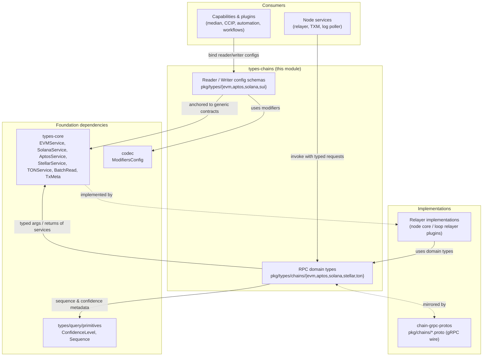
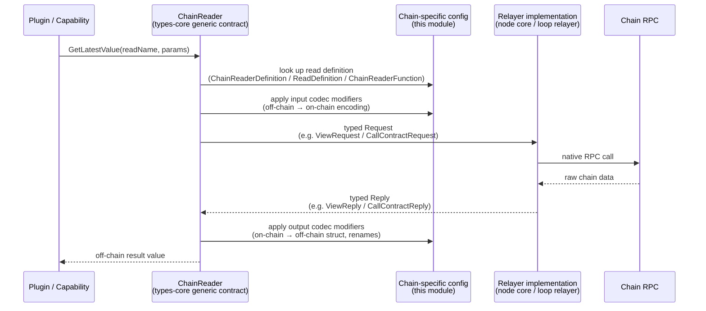

# types-chains — Chain-Specific Domain Types

> Part of [Shared_Foundation_Libraries___Domain_Types](../Shared_Foundation_Libraries___Domain_Types.md)

## 1. Purpose and Scope

`types-chains` collects the **chain-family-specific domain types** of the Chainlink ecosystem, all living under `chainlink-common/pkg/types`. It answers one question for every supported blockchain family: *"what do the messages look like when we talk to this chain, and how do we describe its contracts in configuration?"*

The module consists of two complementary layers:

1. **RPC domain types** (`pkg/types/chains/{evm,aptos,solana,stellar,ton}`) — strongly-typed request/reply pairs and minimal client interfaces (`Client`, `LiteClient`) that model each chain's native RPC surface: balances, blocks, headers, logs, transactions, view calls, simulations.
2. **Contract reader/writer configuration schemas** (`pkg/types/{evm,aptos,solana,sui}`) — declarative, TOML/JSON-serializable config structures (`ContractReaderConfig`, `ChainReaderConfig`, `ContractWriterConfig`, …) that drive the chain-agnostic **Contract Reader** and **Contract Writer** abstractions, including codec modifiers that translate between on-chain and off-chain representations.

These packages are deliberately **pure data + interface definitions**: no RPC client implementations, no I/O, no business logic. Implementations are supplied by relayers — either the node core or Loop plugin relayers (see [loop-relayer-services](<../Plugin_Process_Framework_(Loop)/loop-relayer-services.md>)) — and are consumed through the chain service interfaces of the [types-core](types-core.md) module (`EVMService`, `AptosService`, `SolanaService`, `StellarService`, `TONService`, `Relayer`).

Because these types cross process boundaries into plugins, they **mirror the protobuf definitions** of the [chain-grpc-protos](chain-grpc-protos.md) module (`chainlink-common/pkg/chains/*.proto`), which provide the gRPC wire format.

## 2. Package Map

| Package(s) | Contents | Sub-module |
|---|---|---|
| `pkg/types/chains/evm` | EVM domain types: `Log`, `Receipt`, `Header`, `Transaction`, `SubmitTransactionRequest`, `LPFilterQuery`, `LPBlock`, confidence-level read requests | [EVM](types-chains/types-chains_evm.md) |
| `pkg/types/evm` | Config-driven `ContractReaderConfig` / `ChainContractReader` schema (ABI, event definitions, polling filters) | [EVM](types-chains/types-chains_evm.md) |
| `pkg/types/chains/aptos` | Aptos `Client` interface, Move primitives (`AccountAddress`, `TypeTag` hierarchy, `ModuleID`), BCS-encoded view calls and transaction submission | [Aptos](types-chains/types-chains_aptos.md) |
| `pkg/types/aptos` | Declarative `ContractReaderConfig` / `ContractWriterConfig` for Move modules and events; `RenamedField` (reused by Sui) | [Aptos](types-chains/types-chains_aptos.md) |
| `pkg/types/chains/solana` | Solana `Client` (full RPC surface), account/transaction/fee types, log-poller types, TXM submit types | [Solana](types-chains/types-chains_solana.md) |
| `pkg/types/solana` | Anchor IDL model, `ContractReader` config (PDA reads, multi-reads, events), `ContractWriterConfig` (lookup tables, ATAs) | [Solana](types-chains/types-chains_solana.md) |
| `pkg/types/chains/stellar` | Soroban RPC surface: ledger entries, events, simulation, `ScVal` domain model, TXM-based submission | [Stellar & TON](types-chains/types-chains_stellar-ton.md) |
| `pkg/types/chains/ton` | TON lite-client types: `BlockIDExt`, `Block`, `Message`/BOC, log-poller filters, fees | [Stellar & TON](types-chains/types-chains_stellar-ton.md) |
| `pkg/types/sui` | Sui `ChainReaderConfig` (indexers, pointer tags) and `ChainWriterConfig` (PTB command construction) | [Sui](types-chains/types-chains_sui.md) |

## 3. Architecture Overview

### 3.1 Module Context

The module sits between the **consumers** (capabilities, plugins, node services) and the **relayer implementations**. Consumers program against chain-agnostic interfaces from [types-core](types-core.md); those interfaces are typed with the domain types defined here; relayers implement the interfaces using these types; and the gRPC wire format for cross-process relayers is defined by [chain-grpc-protos](chain-grpc-protos.md).

### 3.2 Package Dependency Structure

```mermaid
flowchart TD
    subgraph RPC["pkg/types/chains/* — RPC domain types"]
        EVMC["evm<br/>Log, Receipt, Header, Transaction,<br/>SubmitTransactionRequest, LPFilterQuery, LPBlock"]
        APTC["aptos<br/>Client, AccountAddress, TypeTag, ModuleID,<br/>ViewRequest/Reply, SubmitTransactionRequest/Reply"]
        SOLC["solana<br/>Client, Account, Transaction, Message,<br/>SubmitTransactionRequest/Reply, LPFilterQuery"]
        STEC["stellar<br/>Client, ScVal model, GetEvents*,<br/>SimulateTransaction*, SubmitTransaction*"]
        TONC["ton<br/>LiteClient, BlockIDExt, Message, LPFilterQuery"]
    end

    subgraph CFG["pkg/types/{chain} — reader/writer config schemas"]
        EVMD["evm.ChainContractReader<br/>(ABI, event definitions,<br/>polling filters, confidence map)"]
        APTD["aptos.ContractReader/WriterConfig<br/>(Move modules, functions, events)"]
        SOLD["solana.ContractReader/WriterConfig<br/>+ Anchor IDL model"]
        SUID["sui.ChainReader/WriterConfig<br/>(indexers, pointer tags, PTB)"]
    end

    CODEC["pkg/codec<br/>ModifiersConfig"]
    APTREUSE["aptos.RenamedField"]

    SUID -.->|"reuses"| APTREUSE
    APTD -.->|"defines"| APTREUSE
    EVMD --> CODEC
    APTD --> CODEC
    SOLD --> CODEC
    SUID --> CODEC
    EVMC --> PRIM["types/query/primitives<br/>ConfidenceLevel"]
```

Notable relationships:

- **Sui reuses Aptos types** — `sui.ChainReaderFunction` and `sui.ChainReaderEvent` embed `aptos.RenamedField` for result/field renames, making the rename vocabulary shared across Move-based chains.
- **All reader configs use codec modifiers** — `codec.ModifiersConfig` in read definitions and method configs translate on-chain encodings into off-chain structs (see [codec](codec.md)).
- **EVM reads are confidence-aware** — EVM read/log requests carry `primitives.ConfidenceLevel`, and `ChainReaderDefinition.ConfidenceConfirmations` maps confidence levels to confirmation counts.

## 4. Chain Family Capability Matrix

| Capability | EVM | Aptos | Solana | Stellar | TON | Sui |
|---|---|---|---|---|---|---|
| RPC client interface in this module | — (aggregate via `EVMService`) | `aptos.Client` | `solana.Client` | `stellar.Client` | `ton.LiteClient` | — |
| types-core service interface | `EVMService` | `AptosService` (embeds `aptos.Client`) | `SolanaService` (embeds `solana.Client`) | `StellarService` (embeds `stellar.Client`) | `TONService` (embeds `ton.LiteClient`) | — |
| Contract **reader** config schema | ✓ `evm.ChainContractReader` | ✓ `aptos.ContractReaderConfig` | ✓ `solana.ContractReader` | — | — | ✓ `sui.ChainReaderConfig` |
| Contract **writer** config schema | — (ABI-based payloads) | ✓ `aptos.ContractWriterConfig` | ✓ `solana.ContractWriterConfig` | — (TXM invocation) | — | ✓ `sui.ChainWriterConfig` |
| Log-poller types | `LPFilterQuery`, `LPBlock`, `Log` | transaction history (`AccountTransactions`) | `LPFilterQuery`, `LPBlock`, `Log` | `GetEvents` API | `LPFilterQuery`, `Log` | indexer configs |
| Native encoding modeled | ABI (`ABIPayload`) | BCS (`Args [][]byte`) | base58 / base64(+zstd) / jsonParsed | XDR (base64 `ScVal`) | BOC cells | BCS-ish (PTB args) |
| `IsExternal` request flag | ✓ | — | ✓ | — | — | — |

## 5. Sub-module Documentation

The module is organized by chain family. Each sub-module page documents the domain types, config schemas, and invariants of one family (or a group of minimal families). Detailed references live under `types-chains/`:

| Sub-module | Documentation file | Scope |
|---|---|---|
| **EVM** | [types-chains/types-chains_evm.md](types-chains/types-chains_evm.md) | EVM domain types (`Log`, `Receipt`, `Header`, transaction submission, log-poller cache types) and the TOML-configurable `ChainContractReader` schema with codec modifiers, generic topic/data-word mappings, per-event polling filters and confidence-confirmation maps. |
| **Aptos** | [types-chains/types-chains_aptos.md](types-chains/types-chains_aptos.md) | The Aptos `Client` interface with Move view functions and BCS encoding, the `TypeTag` type-system model, declarative reader/writer configs for Move modules and events, and the shared `RenamedField` vocabulary. |
| **Solana** | [types-chains/types-chains_solana.md](types-chains/types-chains_solana.md) | The largest family: the full Solana RPC surface (`solana.Client`), log-poller types with Anchor IDL parsing, TXM submit types, PDA-aware reads with `MultiReader` composition, and writer configs with lookup tables and ATAs. |
| **Stellar & TON** | [types-chains/types-chains_stellar-ton.md](types-chains/types-chains_stellar-ton.md) | The two families integrated directly through their client interfaces without config-driven reader/writer schemas: Soroban ledger/event/simulation APIs with the `ScVal` XDR model, and TON lite-client block/message types with log-poller filters. |
| **Sui** | [types-chains/types-chains_sui.md](types-chains/types-chains_sui.md) | The Sui `ChainReaderConfig` (events/transactions indexers, pointer-tag object derivation) and `ChainWriterConfig` (Programmable Transaction Block command construction, prerequisite owned objects). |

> Each sub-module page links back to this overview and to the sibling pages it interacts with (e.g. Sui's reuse of Aptos types, Solana's Anchor IDL model feeding its reader config).

## 6. Cross-Cutting Design Patterns

These patterns are consistent across all chain families in the module:

1. **Typed Request/Reply pairs.** Every RPC operation has a domain request and reply struct (e.g. `GetBalanceRequest`/`GetBalanceReply`, `ViewRequest`/`ViewReply`), so callers never handle raw RPC payloads.
2. **Uniform transaction lifecycle.** Every family defines a `TransactionStatus` enum with the same semantics — fatal pre-submission failure (`TxFatal`), on-chain failure (`TxReverted`/`TxAborted`/`TxFailed`), success (`TxSuccess`) — and submit replies carry an **idempotency key** for TXM tracking (`TxIdempotencyKey`, `IdempotencyKey`).
3. **`IsExternal` flag.** EVM and Solana read-style requests accept `IsExternal`; when true, implementations may apply external-caller limits such as response-size caps. This lets the same relayer safely serve both internal services and external plugins.
4. **Log-poller cache filters.** `LPFilterQuery` (+ `LPBlock`, `Log`) appears per family (EVM, Solana, TON) as the contract for persistent log tracking — `RegisterLogTracking`/`QueryTrackedLogs`/`GetLatestLPBlock` on the services — with retention, max-logs and rate-limit knobs.
5. **Confidence levels.** EVM read requests embed `primitives.ConfidenceLevel` (from [types-core](types-core.md) query primitives); the EVM reader config maps levels to confirmation counts.
6. **Codec-mediated translation.** Reader/writer configs reference `codec.ModifiersConfig` so chain-specific byte layouts are converted to off-chain structs declaratively; Sui additionally reuses Aptos' `RenamedField` for field renaming.
7. **Forward-compatible interfaces.** Client interfaces are designed to be embeddable in gRPC servers (`mustEmbedUnimplementedClient` on `solana.Client`) and mirrored by protobufs in [chain-grpc-protos](chain-grpc-protos.md).

## 7. Data Flow: Config-Driven Contract Read

The following sequence shows how a plugin read flows through the layers. The same pattern applies to writes (via `ContractWriterConfig`-derived builders and TXM submission).

Key points in the flow:

- The **generic** read names and params come from `types-core` (`BatchRead`, read bindings), keeping plugins chain-agnostic.
- The **chain-specific** interpretation — which Move function / Anchor account / EVM ABI method to call, how to derive PDA addresses or pointer objects, which polling filter to use — comes entirely from the config schemas in this module.
- The **wire** hop to a remote relayer (when the relayer is a Loop plugin) serializes the domain types through the protobufs of [chain-grpc-protos](chain-grpc-protos.md).

## 8. Relationship to Other Modules

| Module | Relationship |
|---|---|
| [types-core](types-core.md) | Defines the service interfaces (`EVMService`, `AptosService`, `SolanaService`, `StellarService`, `TONService`, `Relayer`) and generic reader/writer contracts (`BatchRead`, `TxMeta`, `ChainFeeComponents`) that are typed with and implemented over this module's types. |
| [chain-grpc-protos](chain-grpc-protos.md) | Protobuf/gRPC mirrors (`chainlink-common/pkg/chains/*.proto`) of these domain types for cross-process relayer communication. |
| [codec](codec.md) | `ModifiersConfig` / `ModifierConfig` used by all reader/writer configs to translate on-chain ↔ off-chain representations. |
| [config-validation](config-validation.md) | `config.Duration` (used by polling filters) and general config validation patterns for the TOML/JSON config schemas. |
| [loop-relayer-services](<../Plugin_Process_Framework_(Loop)/loop-relayer-services.md>) | Loop relayer/relayerset servers that adapt these domain types across the plugin process boundary per chain (evm, solana, aptos, stellar, ton). |
| Oracle engines & pipelines | OCR2/OCR3, VRF and CCIP plugins consume these types via their relayer providers to read state and submit reports. |

## 9. Adding a New Chain Family

Extending the ecosystem with a new chain family touches this module in a well-defined way:

1. Define the RPC domain types under `pkg/types/chains/<chain>`: a `Client` interface, request/reply structs, a `TransactionStatus` enum with the shared semantics, and (if applicable) log-poller types (`LPFilterQuery`, `LPBlock`, `Log`).
2. Add the aggregate service interface to `pkg/types/relayer.go` in [types-core](types-core.md), embedding the new `Client` and adding TXM methods with the shared submit semantics.
3. Mirror the types in a protobuf under `pkg/chains/<chain>` ([chain-grpc-protos](chain-grpc-protos.md)) and add a Loop relayerset server if the relayer runs out-of-process.
4. If the chain supports config-driven interoperability, add a `pkg/types/<chain>` reader/writer config schema following the EVM/Aptos/Solana/Sui patterns (reads as named definitions, codec modifiers for translation, polling filters for events).
